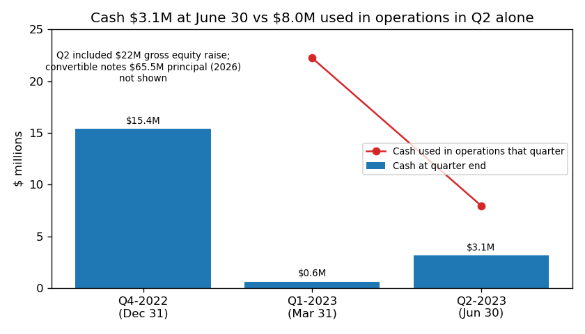
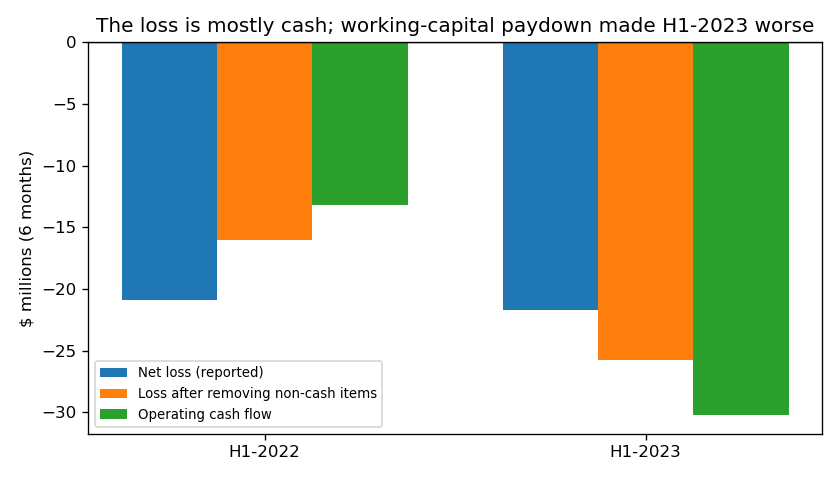
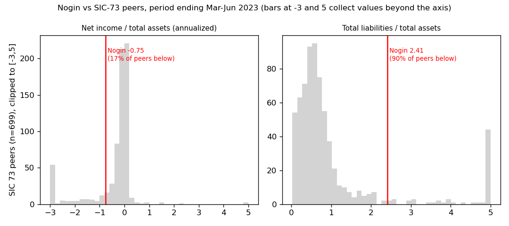
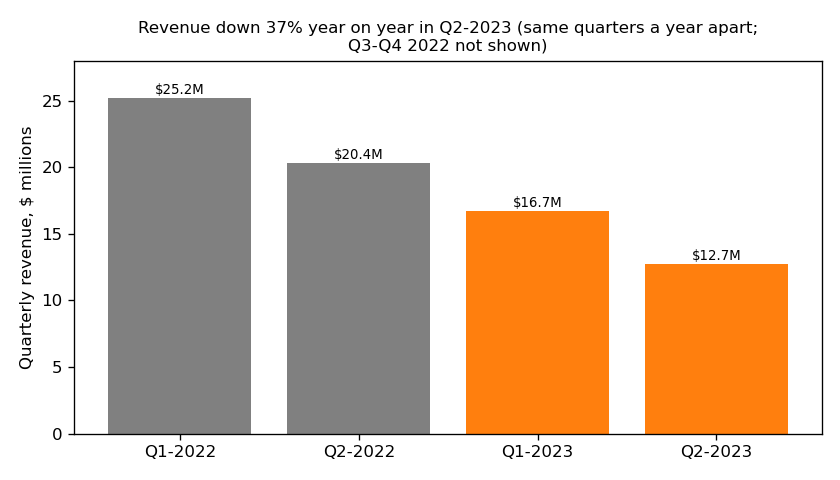

# Nogin, Inc. 10-Q for the period ending 2023-06-30 (filed 2023-08-14). Model score 0.701

**Answer.** The score comes from a large annualized loss (net income -$43.5M, which is -75% of assets) and operating cash outflow of -$60.4M (-104% of assets), set against liabilities 2.4 times assets and a current ratio of 0.48. The filings show these numbers are real and mostly cash: the company has $3.1M of cash, used $8.0M in operations in Q2 alone, and already defaulted on an interest payment in March 2023.

**Verdict: real risk.** My own risk is **high, about 45%**, against an 18% base rate for scores above 0.7. I agree with the model.

## The 8 model inputs
Flows are annualized (H1 × 2). Year-before flows are H1-2022 × 2 from this 10-Q. There is no June-2022 balance sheet in the data, so 2022-12-31 is used. Nothing is missing. "Peer rank" is the share of 699 SIC-73 peers (periods ending Mar–Jun 2023) that are lower than Nogin.

| Input | This report | Year before | What drives it | Peer rank |
|---|---|---|---|---|
| Total assets | $57.9M | $74.9M | Cash fell from $15.4M to $3.1M | 34% (smallish, not tiny) |
| Current assets | $20.2M | $35.2M | Less cash and inventory | 31% |
| Current liabilities | $42.4M | $53.7M | Due-to-clients paid down from $10.9M to $3.6M | 42% |
| Total liabilities | $139.3M | $148.0M | $59.1M convertible notes, $23.5M other long-term | 49%. Liabilities/assets 2.41 is above 90% of peers |
| Revenue | $58.8M | $91.1M | Down 35%. Product revenue $20.8M → $11.3M (H1) | 34% |
| Net income | -$43.5M | -$41.8M | G&A of $33.1M in H1 | 25%. NI/assets -0.75: only 17% of peers are lower |
| Operating income | -$44.8M | -$31.7M | Revenue fell faster than costs | 24% |
| Operating cash flow | -$60.4M | -$26.4M | Loss plus paying clients and vendors | 6% (only 6% of peers are lower) |

## Main reasons, in order
This order is my inference; I cannot see per-input effects.

1. **Cash loss and cash burn (model input).** The H1 net loss was $21.7M. Taking out every non-cash item on the cash-flow statement gives a loss of $25.8M, because fair-value gains flattered it. The same rule gives $16.0M for H1-2022. Stock compensation was $0.4M; no impairments. Operating cash flow over assets is lower than at 91% of peers. [10-Q 2023-08-14, cash-flow statement](https://www.sec.gov/Archives/edgar/data/1841800/000095017023042370/nogn-20230630.htm); [financials.csv](../../shared/financials.csv)
2. **About one month of cash (from the filings).** Cash was $3.1M against monthly burn of $5.1M (H1 average) or $2.9M (Q2 alone, including capex). That is 0.6–1.1 months, with no revolver. Note 2: *"These conditions provide substantial doubt about our ability to continue as a going concern for at least twelve months from the date that these consolidated financial statements are issued."* (10-Q, 2023-08-14, Note 2). [10-Q](https://www.sec.gov/Archives/edgar/data/1841800/000095017023042370/nogn-20230630.htm)
3. **A payment default has already happened (from the filings).** *"In March 2023, the Company did not timely make the payment of the accrued interest on the Convertible Notes due on March 1, 2023 of $2.3 million, resulting in a default."* (10-Q, 2023-08-14, Note 2). It was waived; the supplemental indenture tightened the cross-default. [8-K 2023-03-27](https://www.sec.gov/Archives/edgar/data/1841800/000119312523079897/d467224d8k.htm)
4. **Expensive stop-gap funding (from the filings).** *"In February 2023, the Company obtained a loan for $3 million with a third-party with an annual interest rate of 39%"*. Also: *"In June 2023, the Company entered into a payment plan agreement with an existing vendor with an outstanding accounts payable amount of $2 million."* (10-Q, 2023-08-14, Note 7). [10-Q](https://www.sec.gov/Archives/edgar/data/1841800/000095017023042370/nogn-20230630.htm)
5. **Leverage (model input).** Equity is -$81.4M. The $65.5M principal of the notes is 21 times cash. $5.0M of merger cash consideration due February 21, 2023 still *"is included in accrued expenses and other current liabilities as of June 30, 2023"* (10-Q, Note 8). [10-Q](https://www.sec.gov/Archives/edgar/data/1841800/000095017023042370/nogn-20230630.htm)
6. **Shrinking business and listing risk (from the filings).** Q2 revenue fell 37% year on year. Nasdaq has sent two deficiency notices. [8-K 2022-12-05](https://www.sec.gov/Archives/edgar/data/1841800/000119312522298440/d428389d8k.htm); [8-K 2023-07-14](https://www.sec.gov/Archives/edgar/data/1841800/000119312523187341/d864945d8k.htm)

## Evidence against
- **Equity market still open:** *"On April 6, 2023, the Company consummated the April 2023 Offering and received gross proceeds of approximately $22 million"* (10-Q, Note 2). [8-K 2023-04-04](https://www.sec.gov/Archives/edgar/data/1841800/000119312523090983/d485640d8k.htm)
- **Cooperative lenders:** all holders waived the default and the September 2023 interest. No maturity soon: *"The Convertible Notes will mature on September 1, 2026"* (10-Q, Note 7). [8-K 2023-03-27](https://www.sec.gov/Archives/edgar/data/1841800/000119312523079897/d467224d8k.htm)
- **Slower burn:** Q2 outflow $8.0M vs $22.2M in Q1; Part II Item 3 (Defaults) says "None"; management cites *"ongoing comprehensive cost reduction and performance improvement programs, reduced headcount"* (10-Q, Note 2). [10-Q](https://www.sec.gov/Archives/edgar/data/1841800/000095017023042370/nogn-20230630.htm)
- **Peers:** losses are common in SIC 73; 17% of peers have worse NI/assets.

## How it developed
- **2022-08-26:** the SPAC merger closed with $58.8M from the trust and $65.5M of 7% secured convertible notes. [8-K 2022-09-01](https://www.sec.gov/Archives/edgar/data/1841800/000119312522236634/d292151d8k.htm)
- **2022-12-02:** Nasdaq bid-price notice. [8-K](https://www.sec.gov/Archives/edgar/data/1841800/000119312522298440/d428389d8k.htm)
- **2023-01-27:** the co-CEO and Chairman resigned. [8-K](https://www.sec.gov/Archives/edgar/data/1841800/000119312523017792/d359873d8k.htm)
- **2023-03-01:** interest payment missed. **2023-03-23:** the FY2022 10-K came with an auditor's going-concern paragraph: *"raise substantial doubt about the Company’s ability to continue as a going concern."* [10-K](https://www.sec.gov/Archives/edgar/data/1841800/000095017023009502/nogn-20221231.htm)
- **2023-03-31:** *"had a cash balance of $0.6 million as of March 31, 2023."* (10-Q, 2023-05-15, Note 2). [10-Q Q1](https://www.sec.gov/Archives/edgar/data/1841800/000095017023021940/nogn-20230331.htm)
- **2023-04-06:** $22M raise. **2023-07-10:** Nasdaq market-value notice. **2023-08-14:** this 10-Q, with cash of $3.1M.

*Cash covers one quarter's burn at best. Source: [10-Q](https://www.sec.gov/Archives/edgar/data/1841800/000095017023042370/nogn-20230630.htm), [10-Q Q1](https://www.sec.gov/Archives/edgar/data/1841800/000095017023021940/nogn-20230331.htm)*

*The loss is cash. Source: cash-flow statement in the [10-Q](https://www.sec.gov/Archives/edgar/data/1841800/000095017023042370/nogn-20230630.htm)*

*Leverage is an outlier among peers. Source: [financials.csv](../../shared/financials.csv)*

*Revenue is shrinking. Source: [10-Q](https://www.sec.gov/Archives/edgar/data/1841800/000095017023042370/nogn-20230630.htm), [10-Q Q1](https://www.sec.gov/Archives/edgar/data/1841800/000095017023021940/nogn-20230331.htm)*

## Dates to watch
- **2023-08-27 and 2023-09-26:** conversion-rate reset on the notes, and the fundamental-change put moves to accreted principal. [10-Q Note 7](https://www.sec.gov/Archives/edgar/data/1841800/000095017023042370/nogn-20230630.htm)
- **Quarter-ends in 2023 and Q1-2024:** the minimum-liquidity covenant, which was *"lowered the minimum amounts of liquidity the Company must maintain on a consolidated basis for each quarter in 2023 and the first quarter of 2024"* (8-K 2023-03-27). [8-K](https://www.sec.gov/Archives/edgar/data/1841800/000119312523079897/d467224d8k.htm)
- **About 2023-11-14:** the Q3 10-Q, which will show cash and any new money. A late filing (NT 10-Q) would be a bad sign.
- **2024-01-08:** Nasdaq compliance deadline. [8-K 2023-07-14](https://www.sec.gov/Archives/edgar/data/1841800/000119312523187341/d864945d8k.htm)
- **2024-03-01:** about $2.3M of cash interest due (7% × $65.5M ÷ 2). [10-Q Note 7](https://www.sec.gov/Archives/edgar/data/1841800/000095017023042370/nogn-20230630.htm)

**What would change my mind:** a new raise of $15M or more, note conversion to equity, or positive operating cash flow would lower my risk to medium. A covenant miss, a second missed payment or restructuring advisers would raise it to very high.

## How sure I am
Fairly sure the distress is real; less sure of timing within 365 days, since noteholders bent once before. Not checked:
- the covenant dollar amounts (they are in the 8-K exhibit, which I did not download)
- cash after June 30
- the share price
- whether the conditions on the $5M deferred payment were met

All sources are dated on or before 2023-08-14. **Hindsight note:** I know from outside this data that Nogin filed for Chapter 11 in December 2023. I did not use it.

## Filings used
10-Q 2023-08-14; 10-Q 2023-05-15; 10-K 2023-03-23; 8-Ks 2023-08-03, 2023-07-28, 2023-07-14, 2023-06-20, 2023-05-17, 2023-04-04, 2023-03-27, 2023-02-14, 2023-02-03, 2023-01-27, 2022-12-05, 2022-09-01, 2022-04-25, 2022-02-14 (two) and 8-K/A 2022-02-14.
