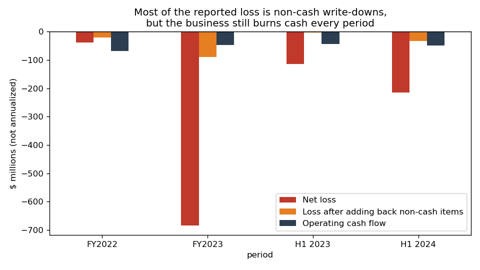
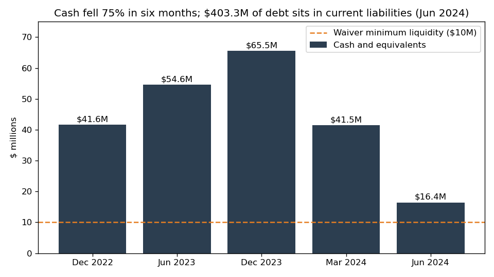
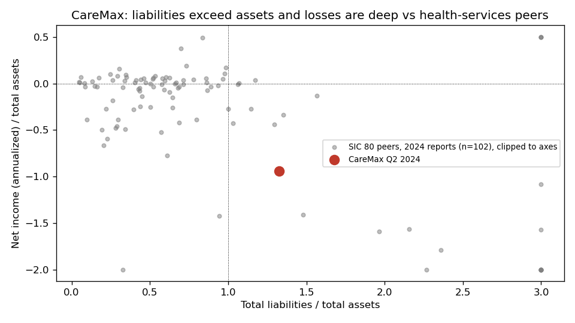
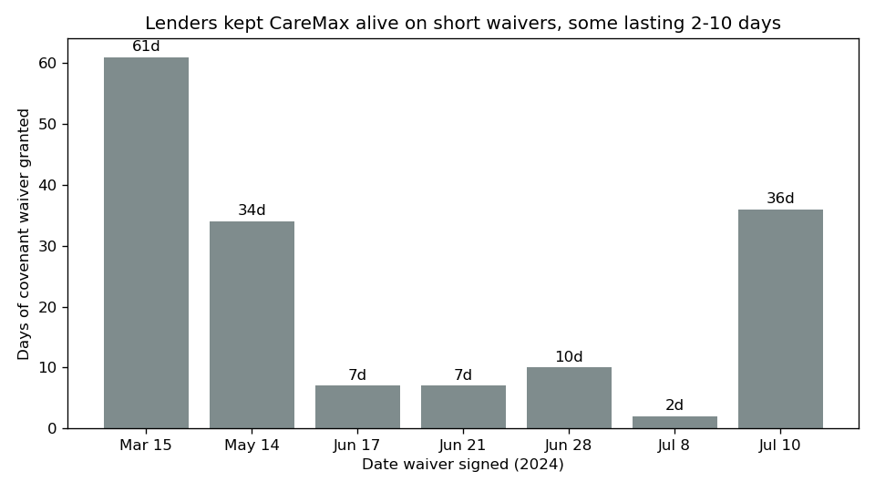

# CareMax, Inc. — 10-Q for Q2 2024 (filed 2024-08-09), model score 0.893

**Answer.** The score is high because of an annualized net loss of -$427.9M on $454.0M of assets. Liabilities are 1.33x assets and current liabilities are 4.3x current assets. Most of the loss is a non-cash write-down, but the filings show a company nearly out of cash, living on short lender waivers, and naming Chapter 11 as likely without relief.

**Verdict: real risk.** My risk: **very high, about 75%** within 12 months (the band's base rate is 18%). I **agree** with the model.

## The 8 inputs (annualized $M; Q2 2024 vs Q2 2023 10-Q; peers = 102 SIC-80 filers with 2024 period ends, excluding CareMax)

| Input | Q2 2024 | Q2 2023 | Peer median | % of peers below CareMax | What drives it |
|---|---|---|---|---|---|
| Total assets | 454.0 | 1,151.0 | 444.3 | 50% | Goodwill write-offs; $133.0M Q2 impairments |
| Current assets | 123.5 | 218.7 | 167.0 | 46% | Cash down to $16.4M |
| Current liabilities | 529.7 | 98.1 | 62.4 | 79% | $403.3M of debt reclassified as current after covenant breach |
| Total liabilities | 601.8 | 526.5 | 123.7 | 68% | Interest paid in kind (PIK) added to principal, lease defaults |
| Revenue | 861.7 | 794.8 | 422.5 | 57% | Steward deal added Medicare revenue |
| Net income | -427.9 | -228.9 | -1.5 | 3% | Impairments, interest |
| Operating income | -348.9 | -224.7 | -1.2 | 3% | Impairments |
| Operating cash flow | -96.2 | -86.5 | -0.4 | 7% | Losses on medical cost and centers |

None missing. Size doesn't explain the score: assets sit at the peer median. Sources: [financials.csv](../../shared/financials.csv), [10-Q Q2 2024](https://www.sec.gov/Archives/edgar/data/1813914/000095017024094897/cmax-20240630.htm).

## Main reasons, in order

The order is my inference; I can't see each input's weight.

1. **Deep losses (model input).** The annualized net loss of -$427.9M is lower than 97% of peers, and net loss/assets is -0.94 against a peer median of -0.04. Impairments of $133.0M are 62% of the H1 2024 loss of $214.0M. "Steward Health Care System moved to reject certain of such executory contracts" (10-Q, 2024-08-09, Note 1). [10-Q](https://www.sec.gov/Archives/edgar/data/1813914/000095017024094897/cmax-20240630.htm)
2. **Insolvent balance sheet (model input).** Liabilities/assets is 1.33 (peer median 0.61) and equity is -$147.8M. The current ratio is 0.23 (peer median 1.38, bottom 13%). [10-Q balance sheet](https://www.sec.gov/Archives/edgar/data/1813914/000095017024094897/cmax-20240630.htm)
3. **Cash runway of about 2 months (from the filings).** Cash is $16.4M. Operating burn is $8.0M a month over H1 and $8.1M a month in Q2 ($24.3M). That covers 2.0 months, or 0.8 months before cash hits the $10M waiver minimum. Cash is 4% of the $403.3M of current debt. [10-Q](https://www.sec.gov/Archives/edgar/data/1813914/000095017024094897/cmax-20240630.htm), [Q1 10-Q](https://www.sec.gov/Archives/edgar/data/1813914/000095017024057258/cmax-20240331.htm)
4. **Covenant default managed by short waivers (from the filings).** Seven waivers ran 61, 34, 7, 7, 10, 2 and 36 days. One extended the waiver "through June 24, 2024" (10-Q, Note 7). The July new money is priced so that the "minimum total cash return to the Lenders on amounts funded will equal 130%" (8-K, 2024-07-11, Item 1.01). [8-K](https://www.sec.gov/Archives/edgar/data/1813914/000095017024082848/cmax-20240710.htm)
5. **Restructuring is already under way (from the filings).** "The Company has appointed a Chief Restructuring Officer and engaged external consultants" (10-Q, Note 1). The CRO is an Alvarez & Marsal managing director ([8-K, 2024-06-14](https://www.sec.gov/Archives/edgar/data/1813914/000095017024073734/cmax-20240610.htm)). "If the Company is unable to successfully implement its plans or receive adequate relief from its creditors and lessors, the Company would likely to restructure under Chapter 11 of the US Bankruptcy Code." (10-Q, Note 1, going concern, which states substantial doubt). [10-Q](https://www.sec.gov/Archives/edgar/data/1813914/000095017024094897/cmax-20240630.htm)
6. **Missed rent (from the filings).** "The Company ceased rent payments for these properties, which in most cases constituted events of default under the related lease agreements." Landlords "have filed lawsuits against the Company for default on the lease payments" (10-Q, Note 12 and Note 14). [10-Q](https://www.sec.gov/Archives/edgar/data/1813914/000095017024094897/cmax-20240630.htm)

**Where the sources disagree.** Part II Item 3 ("Defaults Upon Senior Securities") says "None." because defaults are waived, not declared, so this line understates the risk. [10-Q](https://www.sec.gov/Archives/edgar/data/1813914/000095017024094897/cmax-20240630.htm)

## Evidence against

- **Most of the loss is non-cash.** Adding back the same non-cash items each period (cash-flow statement), the loss was -$20.1M in FY2022, -$90.3M in FY2023, -$2.7M in H1 2023 and -$33.5M in H1 2024. Far smaller, still negative ([10-Q](https://www.sec.gov/Archives/edgar/data/1813914/000095017024094897/cmax-20240630.htm), [10-K](https://www.sec.gov/Archives/edgar/data/1813914/000095017024032506/cmax-20231231.htm)).
- **Lenders are still funding.** They provided a $4.0M term loan plus a $16.0M facility "funded at the discretion of the Lenders" ([8-K, 2024-07-11](https://www.sec.gov/Archives/edgar/data/1813914/000095017024082848/cmax-20240710.htm)).
- **Assets and a late maturity.** The company holds $97.5M of receivables. MSSP savings "typically take place during the fourth quarter". "All amounts owed under the Credit Agreement are due in May 2027." ([10-Q](https://www.sec.gov/Archives/edgar/data/1813914/000095017024094897/cmax-20240630.htm)). The catch: the MSSP proceeds must go to prepaying the loans.

None covers $403.3M of current debt.

## How it developed

- **2022-05-10:** Credit Agreement with Jefferies-led lenders ([8-K](https://www.sec.gov/Archives/edgar/data/1813914/000095017024060022/cmax-20240514.htm)).
- **2022-11:** Steward acquisition adds $304.2M of goodwill ([10-K FY2023](https://www.sec.gov/Archives/edgar/data/1813914/000095017024032506/cmax-20231231.htm)).
- **2023-03-17:** Prior statements "should no longer be relied upon" because of a misclassified prepaid asset. An NT 10-K was filed ([8-K](https://www.sec.gov/Archives/edgar/data/1813914/000095017023008561/cmax-20230315.htm)).
- **2023 (FY):** $547.2M goodwill impairment and a $683.3M net loss. The auditor's report states substantial doubt ([10-K](https://www.sec.gov/Archives/edgar/data/1813914/000095017024032506/cmax-20231231.htm)).
- **2024-01-11:** Nasdaq notice that the stock "no longer complies with the minimum bid price requirement". A 1-for-30 reverse split followed ([8-K](https://www.sec.gov/Archives/edgar/data/1813914/000095017024003948/cmax-20240105.htm)).
- **2024-03-18:** The 10-K was filed late. The company "determined that it was not in compliance with a financial covenant in its credit agreement for the test period ended December 31, 2023." ([NT 10-K](https://www.sec.gov/Archives/edgar/data/1813914/000095017024032508/12b-25_for_2023_10-k.htm)).
- **2024-05-06 to 2024-06:** Steward files for Chapter 11 and rejects contracts, leading to $133.0M of impairments ([10-Q](https://www.sec.gov/Archives/edgar/data/1813914/000095017024094897/cmax-20240630.htm)).
- **2024-06-10:** CRO appointed ([8-K](https://www.sec.gov/Archives/edgar/data/1813914/000095017024073734/cmax-20240610.htm)).
- **2024-08-09:** This 10-Q reports equity of -$147.8M and cash of $16.4M ([10-Q](https://www.sec.gov/Archives/edgar/data/1813914/000095017024094897/cmax-20240630.htm)).

## Dates to watch and what would change my mind

- **2024-08-15:** The waiver expires. A further extension buys weeks; a lapse lets lenders accelerate ([8-K](https://www.sec.gov/Archives/edgar/data/1813914/000095017024082848/cmax-20240710.htm)).
- **Q4 2024:** The MSSP settlement payment arrives and must prepay the loans ([10-Q](https://www.sec.gov/Archives/edgar/data/1813914/000095017024094897/cmax-20240630.htm)).
- **~2024-11:** Q3 10-Q due; watch for an NT 10-Q.
- **2025-04-10:** The Eighth Amendment loans mature ([8-K](https://www.sec.gov/Archives/edgar/data/1813914/000095017024082848/cmax-20240710.htm)).

**Lower my risk:** an asset sale that pays down the term loan, a long covenant reset, or new equity. **Raise it:** waiver lapse, forbearance, or a restructuring support agreement.

## Charts

Losses are mostly write-downs; cash burn persists. Source: [10-Q](https://www.sec.gov/Archives/edgar/data/1813914/000095017024094897/cmax-20240630.htm) and [10-K](https://www.sec.gov/Archives/edgar/data/1813914/000095017024032506/cmax-20231231.htm).

Cash near the $10M floor. Sources: [10-Q](https://www.sec.gov/Archives/edgar/data/1813914/000095017024094897/cmax-20240630.htm), [Q1 10-Q](https://www.sec.gov/Archives/edgar/data/1813914/000095017024057258/cmax-20240331.htm), [10-K](https://www.sec.gov/Archives/edgar/data/1813914/000095017024032506/cmax-20231231.htm).

An outlier vs peers (extremes clipped). Source: [financials.csv](../../shared/financials.csv).

Waivers shrank to days. Source: [10-Q Note 7/16](https://www.sec.gov/Archives/edgar/data/1813914/000095017024094897/cmax-20240630.htm).

## How sure I am

- **Confidence: high.** The company's own note names Chapter 11 as likely.
- **What I couldn't check:**
  - the lenders' private intentions;
  - whether the $16M facility was ever drawn;
  - asset-sale talks;
  - whether bid-price compliance was regained;
  - the exact principal of the term loan (the $403.3M includes finance leases in default).
- **Hindsight:** I know CareMax later filed Chapter 11 (Nov 2024). I did not use this; all sources are dated on or before 2024-08-09.

## Filings used

10-Q 2024-08-09; 10-Q 2024-05-09; 10-Q/A 2024-05-13; 10-K 2024-03-18; NT 10-K 2024-03-18; 10-K/A 2024-04-29; 10-K 2023-03-30; NT 10-K 2023-03-17; 8-Ks 2023-03-09, 2023-03-17, 2023-10-06, 2023-10-20, 2024-01-11, 2024-05-15, 2024-06-14, 2024-06-18, 2024-06-24, 2024-06-28, 2024-07-09, 2024-07-11.
