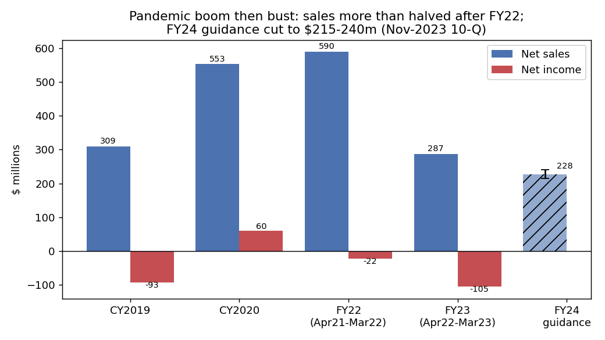
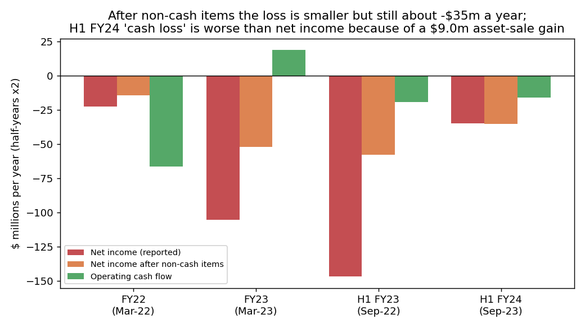
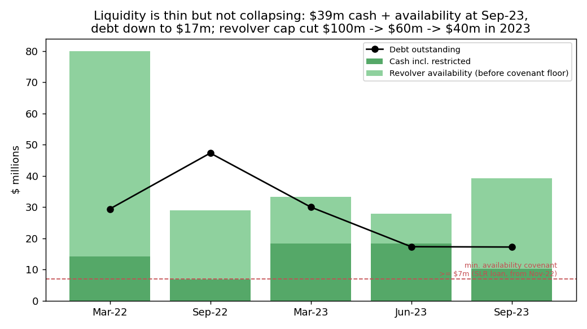
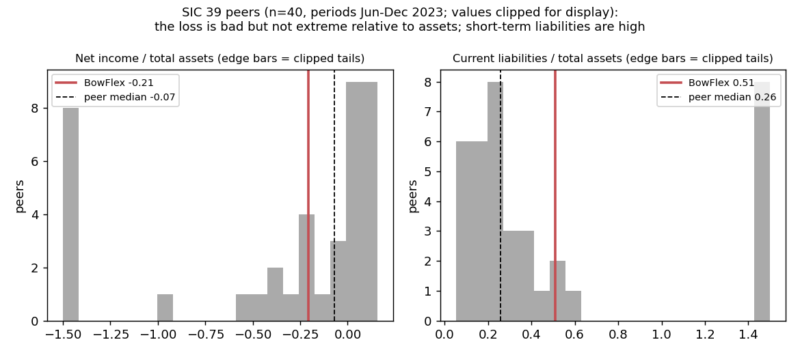

# BowFlex Inc. (CIK 1078207): 10-Q for the period to 2023-09-30, filed 2023-11-14. Model score 0.655

**Answer.** The score comes from a large loss on a mid-sized balance sheet. Net income is -$34.9m a year (-21% of assets), operating income and operating cash flow are both negative, and current liabilities are half of assets. Leverage rose to 0.72 from 0.60 a year earlier. A smaller loss than last year and positive equity probably kept it below 0.7. This ordering is my inference; I can't see each input's weight.

**Verdict: real risk.** My risk is **high, about 12%**, against a 4% base rate for the 0.5–0.7 band. **I agree with the model's flag**, and I think the score understates the risk.

## The 8 model inputs ($m; income and cash flow are half-years ×2)
| Input | Sep-23 | Sep-22 | What drives it | Peer percentile ($ / per asset) |
|---|---|---|---|---|
| Total assets | 167.7 | 226.5 | Inventory down 33% from a year ago | 48th / – |
| Current assets | 117.6 | 155.3 | Inventory $66.1m, 40% in transit | 48th / 72nd |
| Current liabilities | 85.2 | 66.9 | Trade payables $63.2m (74% of the total) | 63rd / 76th |
| Total liabilities | 120.6 | 134.9 | Debt fell $47.3m→$17.2m; payables rose | 52nd / 62nd |
| Revenue | 180.8 | 240.6 | Post-pandemic demand slump | 43rd / 66th |
| Net income | -34.9 | -146.8 | Prior year: $27.0m impairment and $8.2m deferred tax; this year: $9.0m gain on asset sales | 10th / 42nd |
| Operating income | -43.5 | -131.1 | Gross margin about 21% | 11th / 30th |
| Operating cash flow | -15.9 | -19.2 | Includes +$34.8m from payables | 10th / 35th |

Peers: 40 SIC-39 filers, periods Jun–Dec 2023; percentile = share of peers below BowFlex. Nothing is missing. Among 12 similar-size peers ($50m–$1bn assets) BowFlex ranks 8th on NI/assets, 100th on current liabilities/assets and 0th on OCF/assets, so this is not a small-company effect.

## Main reasons, in inferred order
1. **Large recurring loss (model input).** The loss after non-cash items is about -$35m a year in H1 FY24. Every period is adjusted the same way: D&A, stock pay, impairments, deferred tax and other non-cash items added back, asset-sale gains removed. On that basis Q2 alone lost $8.9m, about $3.0m a month. [10-Q 2023-11-14](https://www.sec.gov/Archives/edgar/data/1078207/000107820723000136/bfx-20230930.htm)
2. **Sales still falling, guidance cut (from the filings).** *"The Company now expects full year net revenue to be in the range of $215 million to $240 million, compared to previous guidance of a range of $270 million to $300 million."* (10-Q, 2023-11-14, MD&A). That implies H2 sales of $125–150m, against $166m a year earlier. [10-Q](https://www.sec.gov/Archives/edgar/data/1078207/000107820723000136/bfx-20230930.htm)
3. **Thin cash, propped up by payables (model input and filings).** *"As of September 30, 2023, we had $10.3 million of cash, cash equivalents and restricted cash, and $29.0 million was available for borrowing under the ABL Credit Facility"* (10-Q, MD&A Liquidity). Cash fell $8.0m in Q2. *"Trade payables increased by $33.9 million to $63.2 million as of September 30, 2023"*. The current ratio is 1.38 (peer median 1.96). [10-Q](https://www.sec.gov/Archives/edgar/data/1078207/000107820723000136/bfx-20230930.htm)
4. **Lenders shrinking the revolver (from the filings).** First: *"the ABL Amendment will reduce the maximum revolving loan commitment amount from $100 million to $60 million"* (8-K, 2023-05-02, Item 1.01) [link](https://www.sec.gov/Archives/edgar/data/1078207/000107820723000022/nls-20230425.htm). Then: *"the ABL Amendment reduces the maximum revolving loan commitment amount under the ABL Credit Facility from $60.0 million to $40.0 million."* (10-Q, 2023-11-14, debt note) [link](https://www.sec.gov/Archives/edgar/data/1078207/000107820723000136/bfx-20230930.htm). Term loan rate: 13.92%.
5. **Listing notice, cheap equity, asset sales (from the filings).** The stock *"was less than $1.00 per share over a consecutive 30 trading-day period"* (8-K, 2023-09-27, Item 3.01) [link](https://www.sec.gov/Archives/edgar/data/1078207/000107820723000123/nls-20230921.htm). The June raise was about $5m: *"Each Share is being sold at an offering price of $1.22"* (8-K, 2023-06-15, Item 1.01) [link](https://www.sec.gov/Archives/edgar/data/1078207/000119312523168081/d516265d8k.htm). The company *"completed the sale of intellectual property for $10.5 million as part of our ongoing comprehensive strategic review"* (10-Q, 2023-11-14, MD&A) [link](https://www.sec.gov/Archives/edgar/data/1078207/000107820723000136/bfx-20230930.htm)

## Evidence against
- No "substantial doubt" appears in the 10-K or either FY24 10-Q. On the auditor: *"We determined that there are no critical audit matters."* (10-K, 2023-06-01, auditor's report) [link](https://www.sec.gov/Archives/edgar/data/1078207/000107820723000055/nls-20230331.htm)
- *"As of September 30, 2023, we were in compliance with the financial covenants contained in the agreements governing both the SLR Term Loan and ABL Credit Facility"*. Management expects its resources *"to be sufficient to fund our operating and capital requirements for at least the next twelve months."* (10-Q, 2023-11-14, MD&A) [link](https://www.sec.gov/Archives/edgar/data/1078207/000107820723000136/bfx-20230930.htm)
- Debt is only $17.2m: *"Borrowings under the SLR Credit Agreement will mature, and all outstanding amounts thereunder will be payable on October 29, 2026"* (8-K, 2022-12-01, Item 1.01) [link](https://www.sec.gov/Archives/edgar/data/1078207/000107820722000206/nls-20221130.htm)
- No missed payments, forbearance, NT filings or restructuring advisers. The loss is a quarter of last year's, and inventory is built for the Oct–Mar season. Cash plus availability less the $7m floor is $32.3m, about 11 months at the Q2 burn of $2.96m a month before working capital. [10-Q](https://www.sec.gov/Archives/edgar/data/1078207/000107820723000136/bfx-20230930.htm)

## How it developed
- **2020:** sales $552.6m and profit $59.8m (pandemic boom). **FY22 (to Mar-22):** sales $589.5m, loss $22.4m. [10-K 2022-06-03](https://www.sec.gov/Archives/edgar/data/1078207/000107820722000114/nls-20220331.htm)
- **2022-09-26:** *"we announced the launch of our comprehensive review of strategic alternatives"* (10-Q, 2022-11-09, MD&A) [link](https://www.sec.gov/Archives/edgar/data/1078207/000107820722000201/nls-20220930.htm)
- **2022-11-30:** an SLR term loan at SOFR+8.25% refinances Wells Fargo. [8-K](https://www.sec.gov/Archives/edgar/data/1078207/000107820722000206/nls-20221130.htm)
- **FY23 (to Mar-23):** sales halve to $286.8m; loss $105.4m, including a $27.0m impairment. [10-K](https://www.sec.gov/Archives/edgar/data/1078207/000107820723000055/nls-20230331.htm)
- **Apr–Jul 2023:** revolver cut to $60m and then $40m, asset sales, equity raised at $1.22. The chief accounting officer resigned. [8-K](https://www.sec.gov/Archives/edgar/data/1078207/000107820723000022/nls-20230425.htm), [8-K 2023-07-10](https://www.sec.gov/Archives/edgar/data/1078207/000107820723000095/nls-20230630.htm)
# wrong links. It should have been Aug and Nov 2023 10-Qs linked here to justify 
- **2023-09-21:** NYSE price notice. **2023-11-14:** guidance cut, cash $10.3m. [8-K](https://www.sec.gov/Archives/edgar/data/1078207/000107820723000123/nls-20230921.htm), [10-Q](https://www.sec.gov/Archives/edgar/data/1078207/000107820723000136/bfx-20230930.htm)

## Dates to watch and what would change my mind
- **About Feb 2024: Q3 10-Q (holiday quarter).** A sales miss, cash under $10m or "substantial doubt" → very high. Hitting guidance would move me to medium. [10-Q](https://www.sec.gov/Archives/edgar/data/1078207/000107820723000136/bfx-20230930.htm)
- **About 2024-03-21: end of the NYSE cure period.** *"the Company has a period of six months following the receipt of the Notice to regain compliance"* [8-K](https://www.sec.gov/Archives/edgar/data/1078207/000107820723000123/nls-20230921.htm)
- **About June 2024: FY24 10-K** (going-concern assessment). **Any time:** strategic-review outcome (a sale or new money lowers risk), further revolver cuts. [8-K](https://www.sec.gov/Archives/edgar/data/1078207/000107820723000022/nls-20230425.htm)

## Charts

Sales more than halved after the boom. [10-K 2022](https://www.sec.gov/Archives/edgar/data/1078207/000107820722000114/nls-20220331.htm), [10-K 2023](https://www.sec.gov/Archives/edgar/data/1078207/000107820723000055/nls-20230331.htm), [10-Q](https://www.sec.gov/Archives/edgar/data/1078207/000107820723000136/bfx-20230930.htm)

The loss is still real after non-cash items. [10-K 2023](https://www.sec.gov/Archives/edgar/data/1078207/000107820723000055/nls-20230331.htm), [10-Q](https://www.sec.gov/Archives/edgar/data/1078207/000107820723000136/bfx-20230930.htm)

Liquidity is thin and the revolver keeps shrinking. [10-Q 2022-11](https://www.sec.gov/Archives/edgar/data/1078207/000107820722000201/nls-20220930.htm), [10-Q 2023-08](https://www.sec.gov/Archives/edgar/data/1078207/000107820723000108/nls-20230630.htm), [10-Q 2023-11](https://www.sec.gov/Archives/edgar/data/1078207/000107820723000136/bfx-20230930.htm)

Short-term liabilities are high against peers; the loss is worse than the median but not extreme. Source: shared/financials.csv, rows filed on or before 2023-11-14.

## How sure I am, and what I couldn't check
I am moderately confident. From 4%, I moved up for the guidance cut, revolver cuts, Q2 cash drop and reliance on payables. Distant maturities and covenant compliance held me back. I couldn't check the borrowing base, the exact covenant floor (assumed $7m), the earnings-release 8-Ks or market data. **Disclosure:** I knew from memory what happened to BowFlex after this date. I did not use it, but it may have biased me.

## Filings used
10-Q 2023-11-14; 10-Q 2023-08-09; 10-K 2023-06-01; 10-Q 2022-11-09; 10-K 2022-06-03; 8-K 2022-12-01; 8-K 2023-05-02; 8-K 2023-06-15; 8-K 2023-07-10; 8-K 2023-09-27; 8-K 2022-05-19, 2022-06-21, 2022-07-15 (routine).
