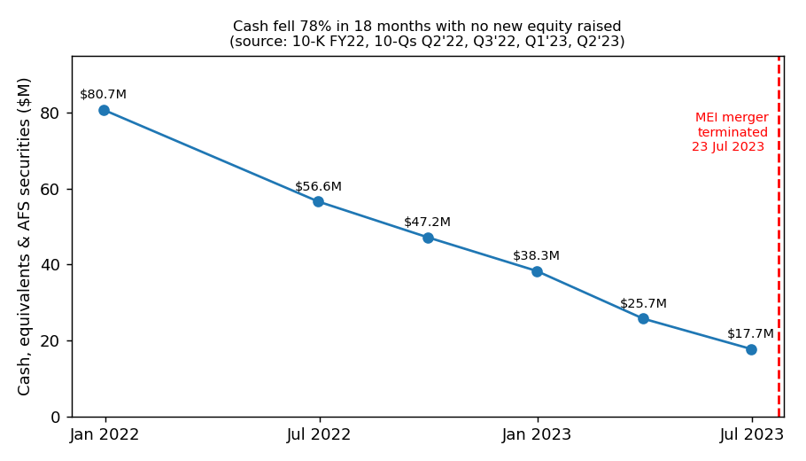
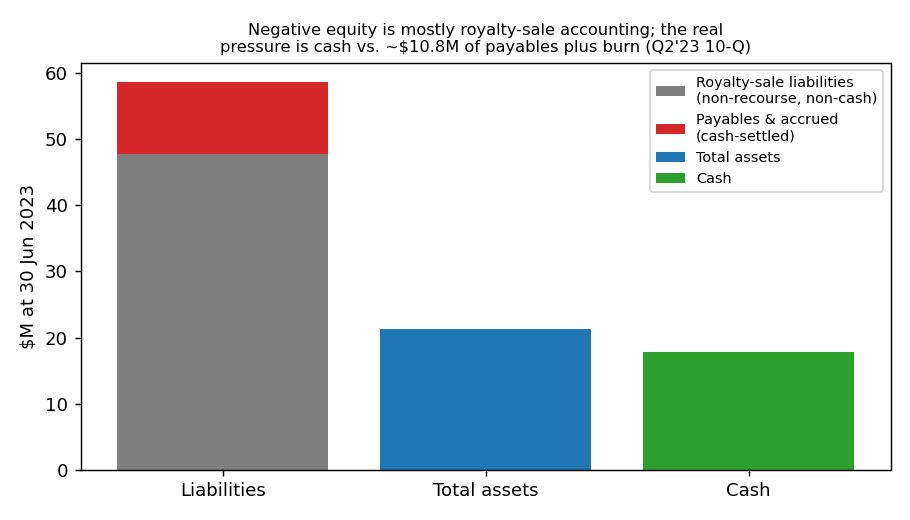
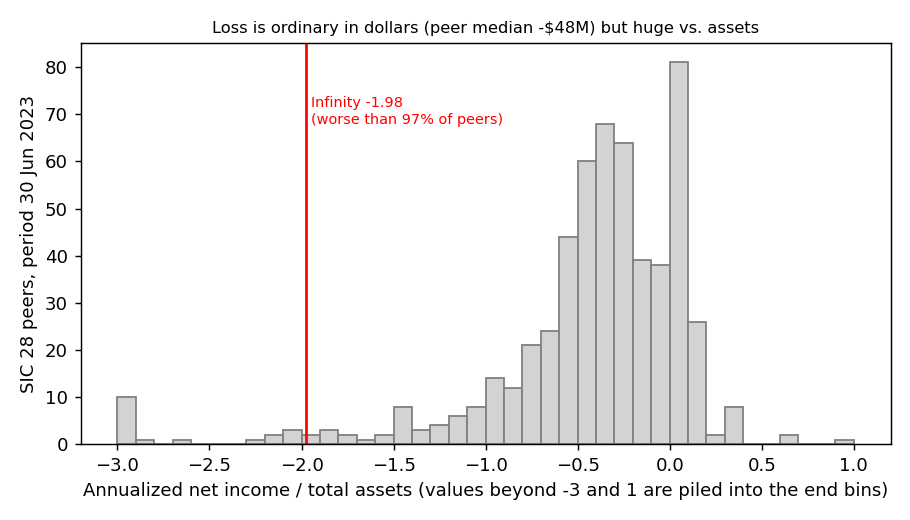

# Infinity Pharmaceuticals (CIK 1113148): 10-Q for the period ending 30 Jun 2023, model score 0.729

*Written as of 10 Aug 2023. I know what happened later; I did not use it.*

## Answer
The score is high because the annualized loss (−$42.0M) is about twice total assets ($21.2M) and liabilities ($58.6M) are 2.8× assets: a small, shrinking company with negative equity. Leverage is inflated: 82% of liabilities are non-recourse royalty-sale accounting. The real danger is in the text: the rescue merger failed on 23 Jul 2023, about six months of cash is left, and management says a wind-down "through a bankruptcy proceeding or otherwise" is likely.

**Verdict: real risk.** My risk: **high, about 50%** (band base rate 18%). **I agree with the model**, partly for reasons it can't see.

## The 8 numbers (income and cash flow are H1 figures ×2)
| Input | 30 Jun 2023 | 30 Jun 2022 | What drives it | Percentile among 567 SIC-28 peers (0 = lowest) |
|---|---|---|---|---|
| Total assets | $21.2M | $61.9M | Cash spent, nothing raised | 10th |
| Current assets | $19.9M | $59.6M | Cash $17.7M | 12th |
| Current liabilities | $12.1M | $14.3M | Accrued expenses $10.6M | 26th |
| Total liabilities | $58.6M | $63.0M | Royalty-sale liabilities $47.8M | 47th |
| Revenue | $2.6M | $2.7M | Royalties only, no product sales | 18th |
| Net income | −$42.0M | −$48.8M | R&D + G&A | 52nd |
| Operating income | −$43.3M | −$48.9M | Same | 55th |
| Operating cash flow | −$41.2M | −$48.3M | Same, mostly cash | 52nd |

No input is missing. In dollars the loss is typical (peer median −$48M). Scaled by size it is extreme: net income/assets −1.98, worse than 97% of peers; liabilities/assets 2.76, higher than 98% (median 0.37).

## Main reasons, in order
The order is my inference; I can't see each input's effect on the score.

1. **Loss far larger than assets (model input).** Net income/assets is −1.98, against a peer median of −0.33. Non-cash items (cash flow statement, same method each year) are only 5–10% of the loss (FY21 5.4%, FY22 6.7%, H1'23 9.6%). [Q2'23 10-Q, cash flow statement](https://www.sec.gov/Archives/edgar/data/1113148/000111314823000009/infi-20230630.htm); [financials.csv](../../shared/financials.csv)
2. **Negative equity (model input, partly an artefact).** Equity is −$37.4M; $47.8M of the $58.6M liabilities are royalty-sale liabilities: "We are not obligated to repay any of the proceeds received under the HCR Agreement." Without them, liabilities/assets is 0.51. [Q2'23 10-Q, Note 10](https://www.sec.gov/Archives/edgar/data/1113148/000111314823000009/infi-20230630.htm)
3. **About 5–7 months of cash (from the filings and inputs).** Cash $17.7M; Q2 burn $8.0M gives 6.6 months, the H1 average 5.2. $3.4M severance follows in Q3; nothing raised in H1: "We also believe that it is unlikely that we will be able secure any additional source of liquidity to fund our operations." [Q2'23 10-Q, MD&A Capital Requirements](https://www.sec.gov/Archives/edgar/data/1113148/000111314823000009/infi-20230630.htm)
4. **The rescue merger failed, and bankruptcy is named as a path (from the filings).** "MEI did not obtain MEI stockholder approval for the Merger"; the board "would likely conclude that it is in the best interest of stockholders to pursue a wind-down of remaining operations, a liquidation of remaining assets, and a dissolution of our company through a bankruptcy proceeding or otherwise." [Q2'23 10-Q, Note 3](https://www.sec.gov/Archives/edgar/data/1113148/000111314823000009/infi-20230630.htm)
5. **Going-concern doubt (from the filings).** "These conditions raise substantial doubt about our ability to continue as a going concern for at least twelve months from the date these condensed consolidated financial statements are issued on August 10, 2023." The FY22 auditor notes the company "has stated that substantial doubt exists about the Company’s ability to continue as a going concern". [10-K FY22](https://www.sec.gov/Archives/edgar/data/1113148/000111314823000003/infi-20221231.htm)
6. **Signs of shutdown (from the filings).** "will reduce our overall headcount by 21 positions, representing approximately 78% of our workforce" ([10-Q Note 15](https://www.sec.gov/Archives/edgar/data/1113148/000111314823000009/infi-20230630.htm)); "each of Samuel Agresta, Sujay R. Kango and Brian Schwartz resigned from the Board, effective immediately" ([8-K 25 Jul 2023](https://www.sec.gov/Archives/edgar/data/1113148/000114036123036062/brhc20056430_8k.htm)). Nasdaq "has determined to delist the Company’s common stock from The Nasdaq Global Select Market" ([8-K 30 Jun 2023](https://www.sec.gov/Archives/edgar/data/1113148/000114036123032462/brhc20055271_8k.htm)).

## Evidence against
- **No funded debt.** No covenants or maturities; Part II has no Item 3 (defaults). Royalty liabilities are repaid only from partners' royalties ([10-Q Note 10](https://www.sec.gov/Archives/edgar/data/1113148/000111314823000009/infi-20230630.htm)).
- **Cash covers the payables.** Cash ($17.7M) exceeds the $10.8M of cash-settled current liabilities (current ratio 1.65), so an out-of-court dissolution ("or otherwise") is possible ([10-Q](https://www.sec.gov/Archives/edgar/data/1113148/000111314823000009/infi-20230630.htm)).
- **Small inflows.** "we believe MEI is required to reimburse us in the amount of $1.0 million"; the burn should fall after the 78% cut ([10-Q MD&A](https://www.sec.gov/Archives/edgar/data/1113148/000111314823000009/infi-20230630.htm)).
- **Normal for the sector.** Pre-revenue losses are typical for clinical-stage biotech; the dollar loss is at the peer median ([financials.csv](../../shared/financials.csv)).

## How it developed
- **Feb 2021:** raised $85.8M; cash was $80.7M at the end of 2021 ([10-K FY22](https://www.sec.gov/Archives/edgar/data/1113148/000111314823000003/infi-20221231.htm)).
- **24 May 2022:** first Nasdaq notice for a bid price below $1 ([8-K](https://www.sec.gov/Archives/edgar/data/1113148/000114036122020431/brhc10038060_8k.htm)).
- **14 Nov 2022:** cash "will be adequate to satisfy our current operating plans for at least the next twelve months" ([Q3'22 10-Q](https://www.sec.gov/Archives/edgar/data/1113148/000111314822000022/infi-20220930.htm))
- **23 Feb 2023:** merger agreed with MEI Pharma; 13% of staff cut ([8-K](https://www.sec.gov/Archives/edgar/data/1113148/000114036123008332/brhc10048558_8k.htm)).
- **28 Mar 2023:** going-concern doubt appears for the first time: "we do not expect that we would have the necessary time or financial resources to pursue another strategic transaction like the proposed Merger." ([10-K FY22](https://www.sec.gov/Archives/edgar/data/1113148/000111314823000003/infi-20221231.htm))
- **27 Jun 2023:** Nasdaq delisting determination; the company appealed ([8-K](https://www.sec.gov/Archives/edgar/data/1113148/000114036123032462/brhc20055271_8k.htm)).
- **23–25 Jul 2023:** merger terminated, 78% of staff cut, three directors resigned ([8-K 24 Jul](https://www.sec.gov/Archives/edgar/data/1113148/000114036123035755/ny20009606x6_8k.htm), [8-K 25 Jul](https://www.sec.gov/Archives/edgar/data/1113148/000114036123036062/brhc20056430_8k.htm)).

## Dates to watch
- **Q3 2023:** severance paid; board decides on a transaction or a wind-down ([10-Q](https://www.sec.gov/Archives/edgar/data/1113148/000111314823000009/infi-20230630.htm)).
- **2 Oct 2023:** the market-value rule grace period "expires on October 2, 2023" ([8-K 30 Jun](https://www.sec.gov/Archives/edgar/data/1113148/000114036123032462/brhc20055271_8k.htm)).
- **By 26 Dec 2023:** the latest date the Nasdaq Panel can extend listing to ([10-Q](https://www.sec.gov/Archives/edgar/data/1113148/000111314823000009/infi-20230630.htm)).
- **Mid-Nov 2023:** Q3 10-Q shows cash after the cuts (last year's Q3 came [14 Nov](https://www.sec.gov/Archives/edgar/data/1113148/000111314822000022/infi-20220930.htm)).
- **What would change my mind:** an asset sale, a cash-rich reverse merger or a state-law dissolution plan would lower my estimate; restructuring advisors or cash below ~$8M would raise it.

## Charts

Cash fell from $80.7M to $17.7M in 18 months ([10-K FY22](https://www.sec.gov/Archives/edgar/data/1113148/000111314823000003/infi-20221231.htm), [Q2'23 10-Q](https://www.sec.gov/Archives/edgar/data/1113148/000111314823000009/infi-20230630.htm)).

Most liabilities are non-recourse; cash-settled payables are below cash ([Q2'23 10-Q](https://www.sec.gov/Archives/edgar/data/1113148/000111314823000009/infi-20230630.htm)).

Loss relative to assets is extreme among peers ([financials.csv](../../shared/financials.csv)).

## Facts vs. inference, confidence, gaps
**From the filings:** quotes, balances, events. **Inference:** reason order, months of cash, the ~50%. I moved up from the 18% base rate for four specific facts: the failed merger, bankruptcy named as a likely route, no source of liquidity, and under 7 months of cash. Going-concern doubt and negative equity alone would not.

**Confidence: medium.** The open question is an in-court versus out-of-court wind-down. I couldn't check cash after June, the Nasdaq hearing outcome, talks with HCR or Takeda, or the score's feature attributions.

## Filings used
10-Q (10 Aug 2023); 10-Q (9 May 2023); 10-K (28 Mar 2023); 10-Q (14 Nov 2022); 10-Q (9 Aug 2022); 10-K (29 Mar 2022); 8-K (25 Jul 2023); 8-K (24 Jul 2023); 8-K (30 Jun 2023); 8-K (7 Apr 2023); 8-K (23 Feb 2023); 8-K (30 Dec 2022); 8-K (24 May 2022); 8-K (29 Mar 2022).
