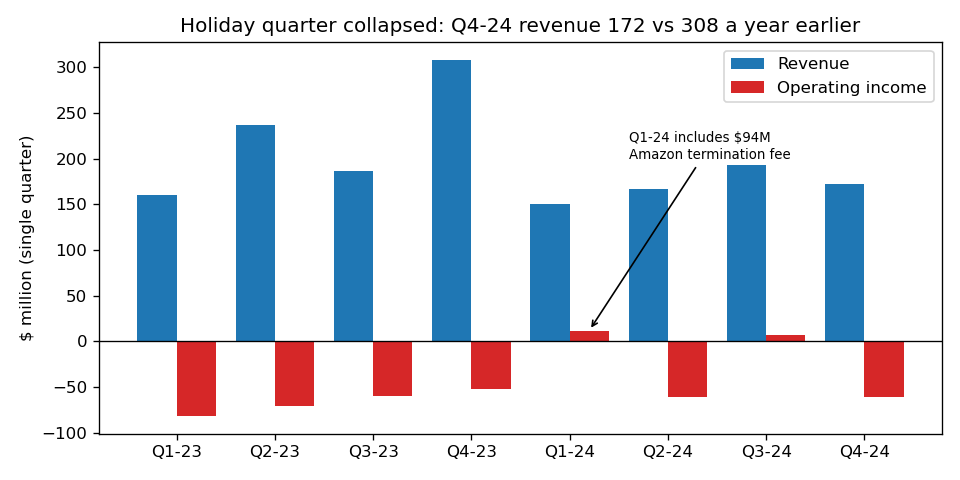
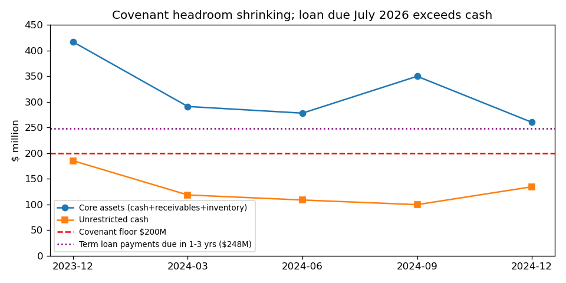
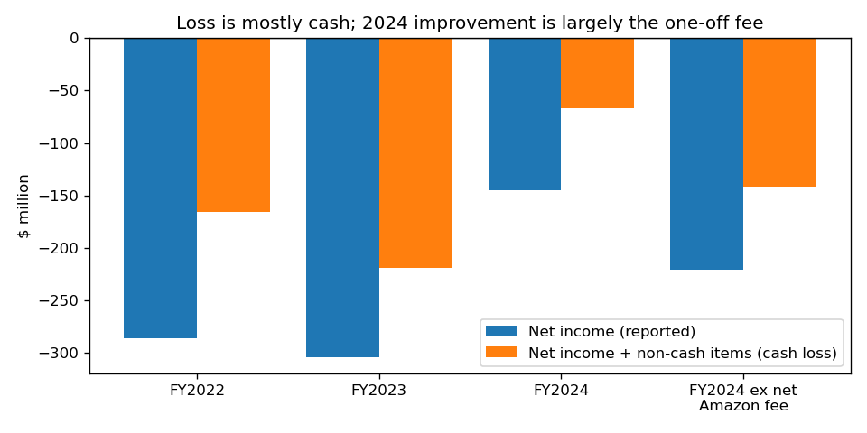

# iRobot Corp: 10-K for FY2024 (filed 2025-03-12), model score 0.648

## Answer
The score comes from a large loss (net income −$145.5M, bottom 10% of peers), liabilities equal to 88% of assets, and negative operating income and operating cash flow. The numbers flatter the business: the loss includes a one-off $94M Amazon fee (about −$221M without it). The model can't see going-concern doubt, a covenant breach that lenders have waived only until May 6, 2025, and a term loan due July 2026 that is larger than the company's cash.

## Verdict
**Real risk.** My own risk is **high, about 30–40%** of a bankruptcy filing within 365 days, against the 4% base rate for the 0.5–0.7 band. I agree it is high risk; 0.648 understates it.

## The 8 inputs (USD M; peer percentile = share of 263 SIC-36 peers with a lower value)
| Input | FY2023 | FY2024 | Driver | Peer pct |
|---|---|---|---|---|
| Total assets | 733.7 | 516.1 | inventory halved, cash down | 54 |
| Current assets | 465.5 | 288.5 | inventory 152.5→76.0 | 56 |
| Current liabilities | 287.1 | 218.2 | payables cut by $71M | 69 |
| Total liabilities | 537.2 | 454.9 | $200.6M term loan (fair value) | 67 |
| Revenue | 890.6 | 681.8 (−23%) | Q4 172 vs 308 | 66 |
| Net income | −304.7 | −145.5 | includes +$94M fee | **9.5** |
| Operating income | −264.1 | −103.0 | fee booked in G&A | 12 |
| Operating cash flow | −114.8 | −33.2 | fee plus working-capital release | 12 |

None missing. iRobot is larger than the median peer ($516M vs $328M assets), so size isn't the driver. Shares: liabilities/assets 0.88 (82nd pct), current ratio 1.32 (26th), NI/assets −0.28 (30th). Source: [financials.csv](../../shared/financials.csv), [peers.py](scripts/peers.py).

## Main reasons (my order is inferred, since I can't see each input's weight)
1. **Large loss (model input).** Net income was −$145.5M, against a peer median of −$5.9M. Non-cash items were $78.6M (stock comp $24.5M, D&A $21.7M, loan fair value $24.6M), leaving a cash loss of −$66.9M, or −$142M without the net fee: "This decrease was driven by receipt of the $94.0 million Parent Termination Fee" (10-K, 2025-03-12, MD&A G&A). [10-K](https://www.sec.gov/Archives/edgar/data/1159167/000115916725000011/irbt-20241228.htm)
2. **High leverage (model input).** Liabilities/assets went from 0.43 (2022) to 0.73 to 0.88. Goodwill is $167M of the assets, so tangible equity is about −$109M. [10-K balance sheet](https://www.sec.gov/Archives/edgar/data/1159167/000115916725000011/irbt-20241228.htm)
3. **Going-concern doubt and covenant breach (from the filings).** The 10-K says: "there is substantial doubt about the Company's ability to continue as a going concern for a period of at least 12 months from the date of issuance of the consolidated financial statements" (10-K, Note 2). It also says the auditor's paragraph causes a "breach of the Going Concern Covenant" (10-K, MD&A Liquidity). The breach can't be cured soon: "The earliest we would be able to regain compliance with the Going Concern Covenant is upon the filing of our Annual Report on Form 10-K for the year ending January 3, 2026, which we do not anticipate will be filed until March 2026." (10-K, Item 1A). [10-K](https://www.sec.gov/Archives/edgar/data/1159167/000115916725000011/irbt-20241228.htm)
4. **Short, costly waiver (from the filings).** The lenders get warrants for 6% of the stock at $0.01, plus a 2% PIK fee: "warrants to purchase an aggregate of 1,840,503 shares of the Company’s common stock" (8-K, 2025-03-12, Item 1.01). The $40M that had been drawn for inventory went back to the lenders' controlled account. That leaves about $94M of pro-forma free cash out of $134.3M. [8-K](https://www.sec.gov/Archives/edgar/data/1159167/000119312525052480/d937654d8k.htm)
5. **Debt due exceeds cash (from the filings).** "The Term Loan matures on July 24, 2026" (10-K, MD&A Liquidity). Payments due in 1–3 years are $248.3M, which is 1.85× cash. The board is "exploring a potential sale or strategic transaction and refinancing our debt" (10-K, MD&A Liquidity). [10-K](https://www.sec.gov/Archives/edgar/data/1159167/000115916725000011/irbt-20241228.htm)
6. **Plan rests on one bet (from the filings).** "the forecast depends heavily on the assumption of a successful new product launch in 2025 achieving topline growth and improved profitability" (10-K, Note 2).

## Evidence against
- There is no missed payment, default notice or forbearance. "As of the date of filing of this Annual Report on Form 10-K, we are in compliance with the Minimum Core Assets Covenant." (10-K, MD&A). Core assets were $260M against a $200M floor. [10-K](https://www.sec.gov/Archives/edgar/data/1159167/000115916725000011/irbt-20241228.htm)
- The lender cooperated: it granted the waiver and deferred the $4M use fee. [8-K 2025-03-12](https://www.sec.gov/Archives/edgar/data/1159167/000119312525052480/d937654d8k.htm)
- $134.3M of cash: 48 months at FY24 burn, 39 at Q3×4, 147 at Q4×4 (seasonal). Without the fee, 15 months (10 on the $94M pro forma). Maturity is over 12 months away. [analysis.py](scripts/analysis.py)
- Costs are falling (two workforce cuts in 2024), and selling a known brand is a possible way out.

## How it developed
- **2023-07-25**: the $200M Carlyle term loan was taken as a bridge while the Amazon deal was pending. [8-K](https://www.sec.gov/Archives/edgar/data/1159167/000119312523192862/d502452d8k.htm)
- **2024-01-29**: the Amazon merger was terminated. The CEO left and staff was cut by "approximately 350 employees, which represents 31% of the Company’s global workforce" (8-K, Item 2.05). [8-K](https://www.sec.gov/Archives/edgar/data/1159167/000119312524017523/d741198d8k.htm)
- **2024-02-27**: the FY2023 10-K still said cash "will be sufficient to meet our current and anticipated needs for at least the next twelve months" (MD&A Liquidity). [10-K FY23](https://www.sec.gov/Archives/edgar/data/1159167/000115916724000008/irbt-20231230.htm)
- **Q3 2024**: $40M of restricted cash was drawn for inventory, and unrestricted cash fell to $99.4M. [10-Q Q3](https://www.sec.gov/Archives/edgar/data/1159167/000115916724000083/irbt-20240928.htm)
- **2024-11-05**: a second cut, "approximately 105 employees, which represents 16% of the Company’s global workforce" (8-K, Item 2.05). [8-K](https://www.sec.gov/Archives/edgar/data/1159167/000115916724000077/irbt-20241105.htm)
- **Q4 2024**: holiday-quarter revenue was $172M against $308M a year earlier, with an operating loss of −$61M.
- **2025-03-11/12**: going-concern doubt, the waiver, the warrants and a strategic review. [8-K](https://www.sec.gov/Archives/edgar/data/1159167/000119312525052480/d937654d8k.htm)

## Dates to watch and what would change my mind
- **2025-05-06**: the waiver ends. If it isn't extended, there is an event of default. A long extension or a refinancing would lower my risk; an expiry or a forbearance agreement would raise it. [8-K](https://www.sec.gov/Archives/edgar/data/1159167/000119312525052480/d937654d8k.htm)
- **Monthly core-asset test ($200M)**: a breach of the floor is the next tripwire. [10-K](https://www.sec.gov/Archives/edgar/data/1159167/000115916725000011/irbt-20241228.htm)
- **Q1/Q2 2025 10-Qs**: these show whether the March 2025 product launch is growing revenue.
- **Strategic review**: a signed sale would lower the risk; restructuring advisors or a missed interest payment (about $20M/yr) would raise it.
- **2026-07-24**: loan maturity, about 16 months away.

## Charts

Quarters derived from YTD rows in [financials.csv](../../shared/financials.csv); Q1-24 includes the fee.

From the [10-Qs](https://www.sec.gov/Archives/edgar/data/1159167/000115916724000064/irbt-20240629.htm) and [10-K](https://www.sec.gov/Archives/edgar/data/1159167/000115916725000011/irbt-20241228.htm); $248M is a future payment.

Same non-cash lines each year, from the [10-K](https://www.sec.gov/Archives/edgar/data/1159167/000115916725000011/irbt-20241228.htm) cash flow statement.

## How sure I am
Moderately sure (about 70%); the main unknown is how the lenders will act. Not checked: the credit agreement exhibit (does restricted cash count as core assets?), cash after year end, each input's weight in the score, and peer matching beyond 2-digit SIC. I know from general knowledge that iRobot later filed for Chapter 11 in late 2025. I didn't use that; every claim rests on sources filed by 2025-03-12.

## Filings used
10-K 2025-03-12; 8-K 2025-03-12; 10-Qs 2024-11-06, 2024-08-07, 2024-05-08; 10-K 2024-02-27; 8-Ks 2024-11-06, 2024-11-05, 2024-08-13 (+8-K/A), 2024-08-07, 2024-06-13, 2024-06-05, 2024-05-23, 2024-05-07, 2024-03-26, 2024-01-29, 2023-07-25. No NT filings.
