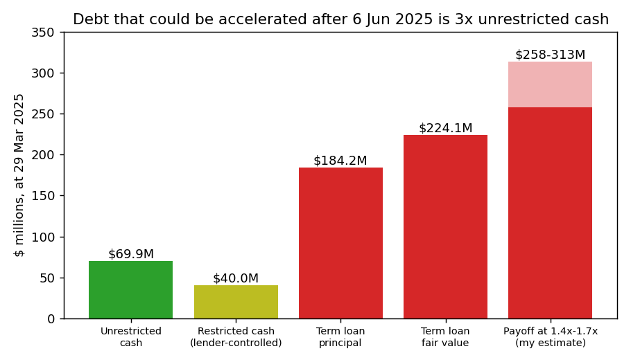
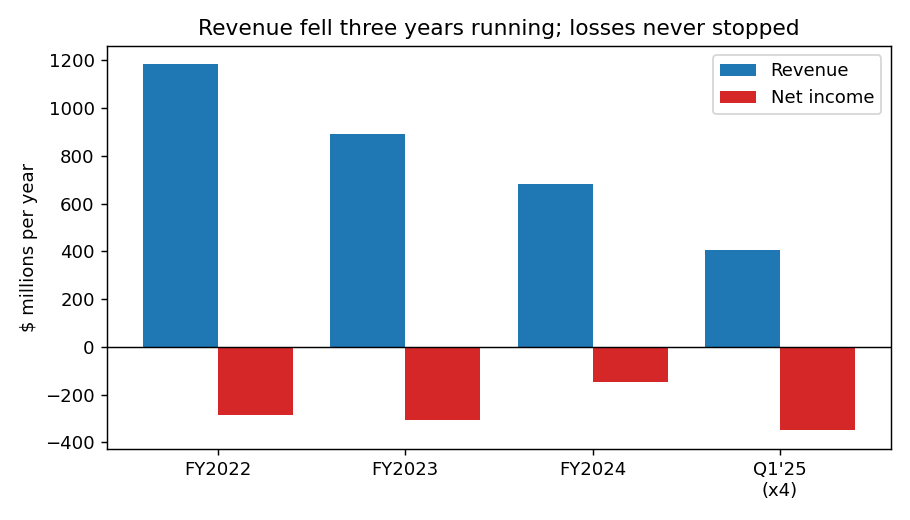
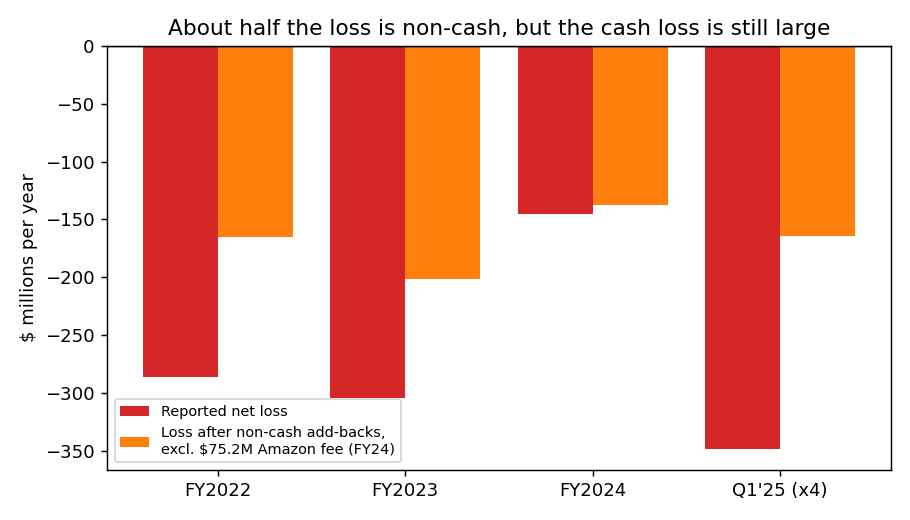
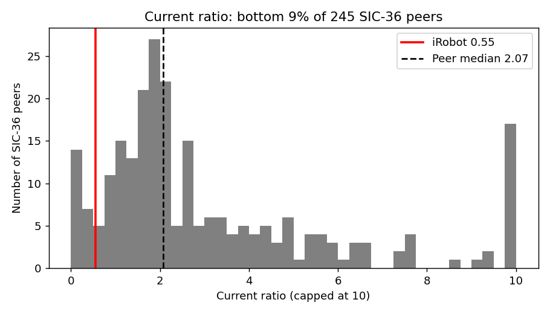

# iRobot Corp: 10-Q for Q1 2025 (filed 6 May 2025). Score 0.684

## Answer
The main reason for the score is a large loss: Q1 net income of −$87.3M (−$349M a year) ranks 14th-worst of 247 SIC‑36 peers. The $224M Carlyle loan also moved into current liabilities (current ratio 0.55), because the lenders have waived a covenant breach only until **6 June 2025**.

**Verdict: real risk.** My risk is **high, about 40%**, against the 4% base rate for scores of 0.5–0.7. **I agree with the model.**

## The 8 inputs ($M; income and cash flow ×4)
| Input | Q1'25 | Q1'24 | Driver | Peer rank (1 = lowest) |
|---|---|---|---|---|
| Total assets | 461.5 | 626.1 | Cash used | 129/249 |
| Current assets | 234.3 | 371.9 | Cash $69.9M + restricted $40.0M | 125/249 |
| Current liabilities | 427.9 | 207.4 | Loan reclassified as current | 186/246 |
| Total liabilities | 462.3 | 422.1 | Loan fair value +$26M | 161/249 |
| Revenue | 406.3 | 600.1 | −32% | 135/241 |
| Net income | −349.1 | +34.4 | Q1'24 had a $75.2M Amazon fee | **14/247** |
| Operating income | −183.0 | +47.6 | Same | **14/238** |
| Operating cash flow | −105.8 | +5.7 | Same | **15/249** |

None missing. Liabilities/assets **1.00** (peer median 0.50); current ratio **0.55** (median 2.07); equity −$0.8M. Size isn't the cause: assets and revenue are near the peer median. Source: [financials.csv](../../shared/financials.csv), rows after 20250506 removed.

## Main reasons
Order is my inference.

1. **Losses (model input).** The net loss is 86% of revenue (peer median −5%). About half is non-cash ($46.2M in Q1: loan revaluation, warrants, stock pay, depreciation). Adjusting every year the same way, the cash-level loss was −$165M (FY22), −$201M (FY23), −$138M (FY24, excluding the fee) and −$164M (Q1×4), so it is not shrinking. *"The decrease in revenue was primarily related to the additional promotional activity to stimulate sell-through of our legacy products before the full launch of our 2025 product lineup."* (10-Q, 6 May 2025, MD&A) [link](https://www.sec.gov/Archives/edgar/data/1159167/000115916725000051/irbt-20250329.htm)
2. **The loan is callable once the waiver ends (model input, explained by the filings).** *"As of March 29, 2025, the fair value of the Term Loan was $224.1 million, which significantly exceeded the Company's available cash and cash equivalents and there continues to be substantial doubt about the Company's ability to continue as a going concern."* (10-Q, Note 2) [link](https://www.sec.gov/Archives/edgar/data/1159167/000115916725000051/irbt-20250329.htm)
   - Loan is 3.2× unrestricted cash; early repayment owes a guaranteed 1.4–1.7× of the $184.2M principal, about $258–313M (my estimate).
3. **Short waivers, needed for 10 more months (from the filings).** *"The earliest we would be able to regain compliance with the Going Concern Covenant is upon the filing of our Annual Report on Form 10-K for the year ending January 3, 2026, which we do not anticipate will be filed until March 2026."* (10-Q, Part II Item 1A) [link](https://www.sec.gov/Archives/edgar/data/1159167/000115916725000051/irbt-20250329.htm)
   - The waiver was extended by one month only ([8-K, 6 May 2025](https://www.sec.gov/Archives/edgar/data/1159167/000115916725000050/irbt-20250430.htm)).
   - The core-assets covenant is also waived. Cash + receivables + inventory = $169.7M, below the $200.0M floor unless restricted cash counts (my calculation).
4. **Runway (model input plus filings).** At the Q1 burn of $8.8M a month, unrestricted cash lasts **7.9 months**.
   - FY24 burn ex-fee gives 7.7 months (25 months as reported, flattered by the fee). No revolver; lenders control the $40.0M restricted cash.
5. **Auditor's going-concern doubt (from the filings).** *"the Company has a history of operating losses and negative cash flows from operations that raise substantial doubt about its ability to continue as a going concern"* (10-K, 12 Mar 2025, PwC auditor's report) [link](https://www.sec.gov/Archives/edgar/data/1159167/000115916725000011/irbt-20241228.htm)
   - The company names *"commencing a case under the U.S. Bankruptcy Code"* as a possible outcome (10-Q, Item 1A).

## Evidence against
- **The lender is cooperating so far.** It has granted two waivers: *"The Company remains actively engaged in ongoing collaborative and constructive discussions with its primary lender while the Board continues its strategic review process."* (10-Q, Note 2) [link](https://www.sec.gov/Archives/edgar/data/1159167/000115916725000051/irbt-20250329.htm)
- **A sale or refinancing is being explored, and the brand has value.** The goodwill test *"resulted in no impairment to goodwill"* (10-Q, Note 2) [link](https://www.sec.gov/Archives/edgar/data/1159167/000115916725000051/irbt-20250329.htm)
- **No near-term principal or missed obligations.** The loan matures on 24 Jul 2026, 444 days away. No payment has been missed and there are no late-filing (NT) notices ([filing index](https://www.sec.gov/cgi-bin/browse-edgar?action=getcompany&CIK=1159167&type=&dateb=20250506)).
# no link as such but an EDGAR search page so wrong link
- **Cost cuts are working.** The Q1 cash-level loss was −$41.1M, compared with −$53.2M a year earlier excluding the fee. R&D fell 57% ([10-Q](https://www.sec.gov/Archives/edgar/data/1159167/000115916725000051/irbt-20250329.htm)).

## How it developed
- **25 Jul 2023:** A $200M Carlyle loan at SOFR+9% was taken to bridge to the Amazon merger ([8-K](https://www.sec.gov/Archives/edgar/data/1159167/000119312523192862/d502452d8k.htm)).
- **29 Jan 2024:** The Amazon deal was terminated. $35M of the $94M fee repaid part of the loan, the CEO left, and 31% of staff were cut ([8-K](https://www.sec.gov/Archives/edgar/data/1159167/000119312524017523/d741198d8k.htm)). The FY23 10-K did not mention substantial doubt ([10-K](https://www.sec.gov/Archives/edgar/data/1159167/000115916724000008/irbt-20231230.htm)).
- **5 Nov 2024:** Another 16% of staff were cut ([8-K](https://www.sec.gov/Archives/edgar/data/1159167/000115916724000077/irbt-20241105.htm)). The Q3 10-Q still did not mention substantial doubt ([10-Q](https://www.sec.gov/Archives/edgar/data/1159167/000115916724000083/irbt-20240928.htm)).
- **11–12 Mar 2025:** The auditor raised going-concern doubt and the covenant was breached. The waiver cost warrants for 6% of the shares, and a strategic review began ([8-K](https://www.sec.gov/Archives/edgar/data/1159167/000119312525052480/d937654d8k.htm), [10-K](https://www.sec.gov/Archives/edgar/data/1159167/000115916725000011/irbt-20241228.htm)). Executive retention bonuses followed ([8-K](https://www.sec.gov/Archives/edgar/data/1159167/000115916725000039/irbt-20250326.htm)).
- **30 Apr – 6 May 2025:** The waiver was extended one month, the loan became current and equity turned negative ([10-Q](https://www.sec.gov/Archives/edgar/data/1159167/000115916725000051/irbt-20250329.htm)).

## Dates to watch
- **6 Jun 2025: the waiver ends** ([8-K](https://www.sec.gov/Archives/edgar/data/1159167/000115916725000050/irbt-20250430.htm)).
  - No extension, or an extension of only weeks, would raise my risk.
  - A waiver running to March 2026 would lower it.
- **Q2 10-Q (around Aug 2025):** whether the new products lift revenue, and how much cash is left ([10-Q](https://www.sec.gov/Archives/edgar/data/1159167/000115916725000051/irbt-20250329.htm)).
- **Any 8-K under items 1.01, 1.03 or 2.04:** a sale, a refinancing or a default.
- **24 Jul 2026:** the loan's scheduled maturity.

What would change my mind: a signed sale or refinancing that repays the loan.

## Charts

Source: [10-Q, balance sheet and Note 9](https://www.sec.gov/Archives/edgar/data/1159167/000115916725000051/irbt-20250329.htm). The payoff bar is my estimate.

Source: [financials.csv](../../shared/financials.csv).

Source: cash-flow statements in the [FY24 10-K](https://www.sec.gov/Archives/edgar/data/1159167/000115916725000011/irbt-20241228.htm) and the [Q1 10-Q](https://www.sec.gov/Archives/edgar/data/1159167/000115916725000051/irbt-20250329.htm).

Source: [financials.csv](../../shared/financials.csv).

## How sure I am
I'm fairly sure of the direction: the deadline, the debt being larger than cash and the company's own bankruptcy wording are all explicit. The 40% figure is a judgement.

What I couldn't check:
- Credit agreement exhibit and exact payoff terms.
- Lender intentions; whether bidders exist.

SIC‑36 is broad electronics, not consumer robots.

I know from outside this dataset that iRobot filed for Chapter 11 in December 2025. I did not use that; everything here relies only on sources filed on or before 6 May 2025.

## Filings used
- 10-Q, 6 May 2025
- 8-Ks: 6 May, 1 Apr, 19 Mar, 12 Mar 2025
- 10-K, 12 Mar 2025
- 10-Q, 6 Nov 2024
- 8-Ks: 6 Nov, 5 Nov, 13 Aug, 7 Aug, 13 Jun, 5 Jun, 23 May, 7 May, 26 Mar 2024
- 10-K, 27 Feb 2024
- 8-Ks: 29 Jan 2024, 25 Jul 2023
