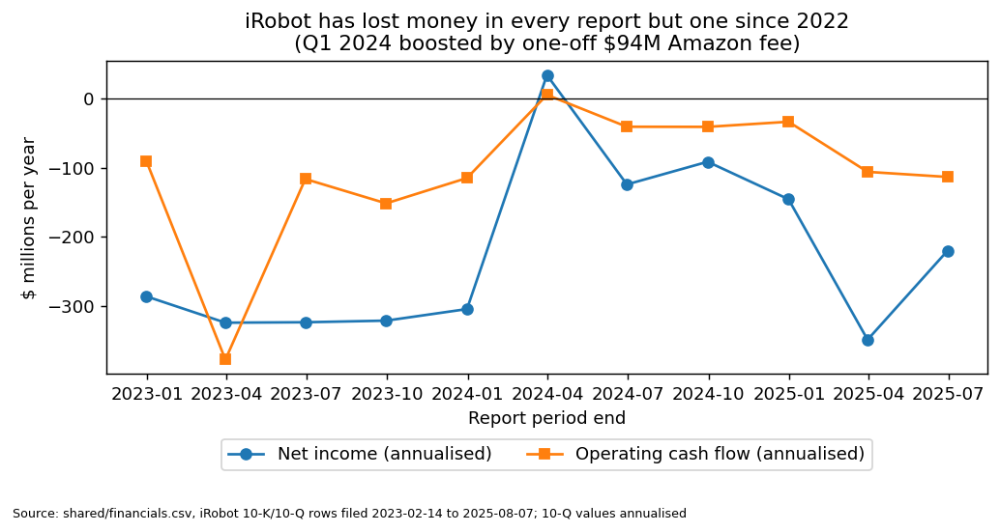
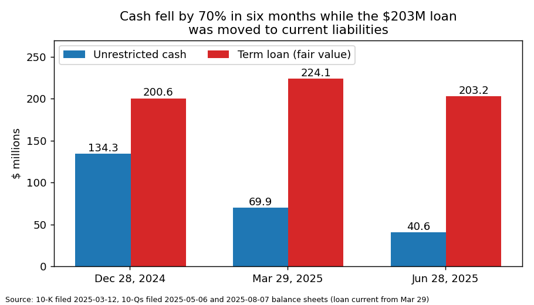
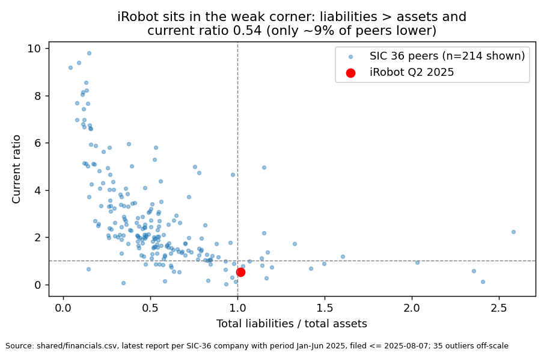

# iRobot Corp — 10-Q, period ending 2025-06-28 (filed 2025-08-07), score 0.701

**Answer.** The score is high mainly because the annualised net loss (−$220M, −48% of revenue) is in the bottom 6% of SIC-36 peers. Liabilities are also larger than assets, and the current ratio is 0.54 because the $203M term loan became current. The filings confirm the problem: a covenant-breach waiver ends on Sept 19, 2025, and without another one management expects to default and "would likely seek bankruptcy protection."

**Verdict: real risk.** My risk: **very high, about 60%** (the band's base rate is 18%). I **agree** with the model.

*I know from outside knowledge that iRobot filed for Chapter 11 in December 2025. I did not use it; every source here is dated on or before 2025-08-07.*

## The 8 inputs ($M; 10-Q figures annualised)

| Input | Q2-25 | Q2-24 | Driver | Peer percentile (n≈247) |
|---|---|---|---|---|
| Total assets | 480.3 | 585.9 | cash down; goodwill 182.4 | 52nd |
| Current assets | 244.8 | 340.1 | cash 40.6 + restricted 36.0 | 51st |
| Current liabilities | 456.6 | 221.6 | loan 203.2 now current; payables +60 | 76th |
| Total liabilities | 488.0 | 436.9 | 102% of assets (peer median 50%) | 67th |
| Revenue | 458.3 | 632.8 | Q2 down 23% | 56th |
| Net income | −220.2 | −124.1 | −48% of revenue | **6th** |
| Operating income | −164.9 | −98.3 | −36% of revenue | 6th |
| Operating cash flow | −113.2 | −40.5 | 2024 helped by the Amazon fee | 6th |

None of the inputs is missing. iRobot is mid-sized (47% of peers have more assets), so the score isn't a small-company effect. Peers are the latest report of each SIC-36 company with a period end in Jan–Jun 2025, iRobot excluded ([financials.csv](../../shared/financials.csv)).

## Main reasons, in order (the order is my inference; I can't see what each input contributed)

1. **Large loss (model input).** The H1 net loss was $110.1M. Of that, $37.0M was non-cash, so the cash loss was $73.1M, against $26.7M in H1-24 (which was helped by the $75.2M Amazon fee). Using the same cash-flow-statement adjustment, the cash loss was FY22 −$166M, FY23 −$219M and FY24 −$67M. The 10-Q describes the loss as "offset by the non-cash charges of $37.0 million" ([10-Q, MD&A](https://www.sec.gov/Archives/edgar/data/1159167/000115916725000069/irbt-20250628.htm)).
2. **Debt that cash can't cover (model input + filings).** The loan is $203.2M, 5 times the $40.6M of cash, and equity is −$7.7M. The 10-Q says "the fair value of the Term Loan was $203.2 million, which significantly exceeded the Company's available cash and cash equivalents and there continues to be substantial doubt about the Company's ability to continue as a going concern." ([10-Q, Note 2](https://www.sec.gov/Archives/edgar/data/1159167/000115916725000069/irbt-20250628.htm))
3. **Breach covered only by short waivers (filings).** The auditor's going-concern opinion breached a loan covenant. Since then there have been four waivers of 1–2 months each. The 10-Q says: "Absent further waiver of the breach of the Specified Covenants by the Lenders, we expect to be in default under the Credit Agreement on September 19, 2025 unless there is a favorable resolution from the strategic review." The breach can't be cured until the FY2025 10-K, "which we do not anticipate will be filed until March 2026" ([10-K FY24](https://www.sec.gov/Archives/edgar/data/1159167/000115916725000011/irbt-20241228.htm)).
4. **Cash burn (model input).** Operating cash outflow was $30.2M in Q2 and $26.5M in Q1. At Q2's pace that leaves about **4 months** of unrestricted cash, or about 8 months counting restricted cash, which needs lender consent. The burn is already flattered by $59.4M of stretched payables ([10-Q, cash flows](https://www.sec.gov/Archives/edgar/data/1159167/000115916725000069/irbt-20250628.htm)).
5. **Shrinking sales and costly debt (filings).** "Revenue for the three months ended June 28, 2025 decreased $38.8 million to $127.6 million, or 23.3%". Repaying the loan early would cost a guaranteed multiple: "return rate increased to 1.7x on July 23, 2025". The share sales program is stopped: "we suspended any sales of our common stock pursuant to the ATM Agreement" ([10-Q](https://www.sec.gov/Archives/edgar/data/1159167/000115916725000069/irbt-20250628.htm)).

Chart sources: [financials.csv](../../shared/financials.csv), [10-K FY24](https://www.sec.gov/Archives/edgar/data/1159167/000115916725000011/irbt-20241228.htm), [10-Q Q1](https://www.sec.gov/Archives/edgar/data/1159167/000115916725000051/irbt-20250329.htm), [10-Q Q2](https://www.sec.gov/Archives/edgar/data/1159167/000115916725000069/irbt-20250628.htm).

## Evidence against

- **The lender keeps extending.** It has agreed to four amendments. "On July 29, 2025, with the lenders' consent, the Company drew down an additional $10.0 million of the $36.0 million remaining in the restricted cash account." The company describes "ongoing collaborative and constructive discussions with its primary lender" ([10-Q, Note 2](https://www.sec.gov/Archives/edgar/data/1159167/000115916725000069/irbt-20250628.htm)).
- **A sale is possible.** The board is "exploring a potential sale or strategic transaction and refinancing the Company's debt" ([10-Q](https://www.sec.gov/Archives/edgar/data/1159167/000115916725000069/irbt-20250628.htm)), and executives have sale bonuses ([8-K 2025-04-01](https://www.sec.gov/Archives/edgar/data/1159167/000115916725000039/irbt-20250326.htm)).
- **Q2 operations improved.** Gross margin rose to 30.0% from 16.5%. The Q2 loss of $22.8M, however, includes a $23.3M non-cash gain on the loan's value; without it the loss is about $46M ([10-Q](https://www.sec.gov/Archives/edgar/data/1159167/000115916725000069/irbt-20250628.htm)).
- I found no missed payments, NT filings or delisting notices.

## How it developed

- **2023-07-25:** iRobot took a $200M Carlyle term loan while waiting for the Amazon deal to close ([8-K](https://www.sec.gov/Archives/edgar/data/1159167/000119312523192862/d502452d8k.htm)).
- **2024-01-29:** "On January 28, 2024, the Company and Amazon mutually agreed to terminate the Merger Agreement". The CEO left and 31% of staff were cut ([8-K](https://www.sec.gov/Archives/edgar/data/1159167/000119312524017523/d741198d8k.htm)).
- **2025-03-12:** The auditor flagged "the Company has a history of operating losses and negative cash flows from operations that raise substantial doubt about its ability to continue as a going concern." Waiver No. 1 came the same day ([10-K](https://www.sec.gov/Archives/edgar/data/1159167/000115916725000011/irbt-20241228.htm), [8-K](https://www.sec.gov/Archives/edgar/data/1159167/000119312525052480/d937654d8k.htm)).
- **2025-05-06:** The loan was classed as current, and Waiver No. 2 ran to June 6 ([10-Q Q1](https://www.sec.gov/Archives/edgar/data/1159167/000115916725000051/irbt-20250329.htm), [8-K](https://www.sec.gov/Archives/edgar/data/1159167/000115916725000050/irbt-20250430.htm)).
- **2025-06-06:** Waiver No. 3 ran to Aug 14, in exchange for a $4M paydown and penny warrants on 5% of the shares ([8-K](https://www.sec.gov/Archives/edgar/data/1159167/000119312525136125/d42654d8k.htm)).
- **2025-08-06:** Waiver No. 4 runs to Sept 19 ([10-Q](https://www.sec.gov/Archives/edgar/data/1159167/000115916725000069/irbt-20250628.htm)).

## Dates to watch

- **2025-09-19:** the waiver ends, and the company defaults if it isn't extended ([10-Q](https://www.sec.gov/Archives/edgar/data/1159167/000115916725000069/irbt-20250628.htm)).
- **Q3 10-Q (~Nov 2025):** cash against a burn of about $10M a month.
- **2026-07-24:** "The Term Loan matures on July 24, 2026" ([10-Q](https://www.sec.gov/Archives/edgar/data/1159167/000115916725000069/irbt-20250628.htm)).

**What would change my mind:** my estimate would go down with a signed sale or refinancing that repays Carlyle, or a waiver that runs to the FY25 10-K. It would go up if the waiver is not renewed, the loan is accelerated, or restructuring advisors are hired.

## How sure I am

I am fairly sure. I started from the 18% base rate. Losses and going-concern doubt are already built into that rate, so they didn't move me. What raised my estimate was specific facts: an uncurable breach covered only by waivers lasting weeks, a loan 5 times the size of cash, about 4 months of cash, and management's own statement that it would likely seek bankruptcy protection.

What I couldn't check: what the lender intends, how far sale talks have gone, the text of Amendment No. 4 (no 8-K for it before the cutoff), and the effect of tariffs on demand.

## Filings used

10-Q 2025-08-07; 10-Q 2025-05-06; 10-K 2025-03-12; 10-K 2024-02-27; 8-Ks 2025-06-06, 2025-05-20, 2025-05-06, 2025-04-01, 2025-03-19, 2025-03-12, 2024-11-06, 2024-08-13 (×2), 2024-08-07, 2024-06-13, 2024-06-05, 2024-05-23, 2024-05-07, 2024-03-26, 2024-01-29, 2023-07-25.
