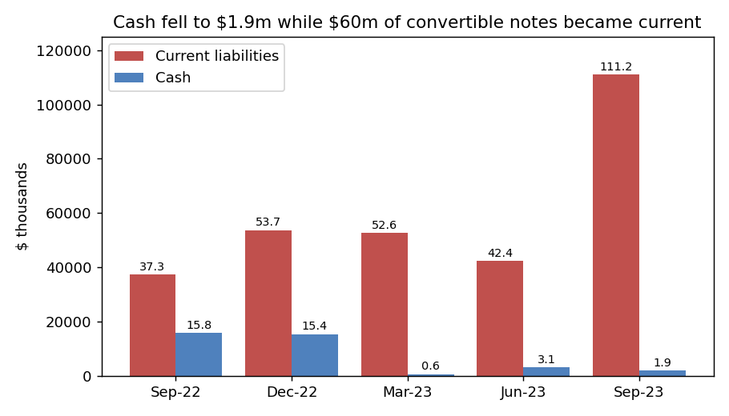
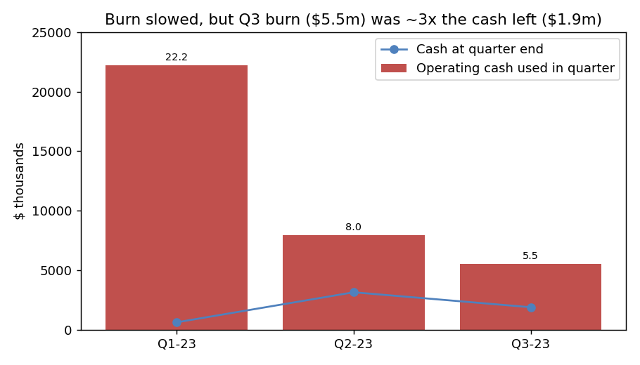
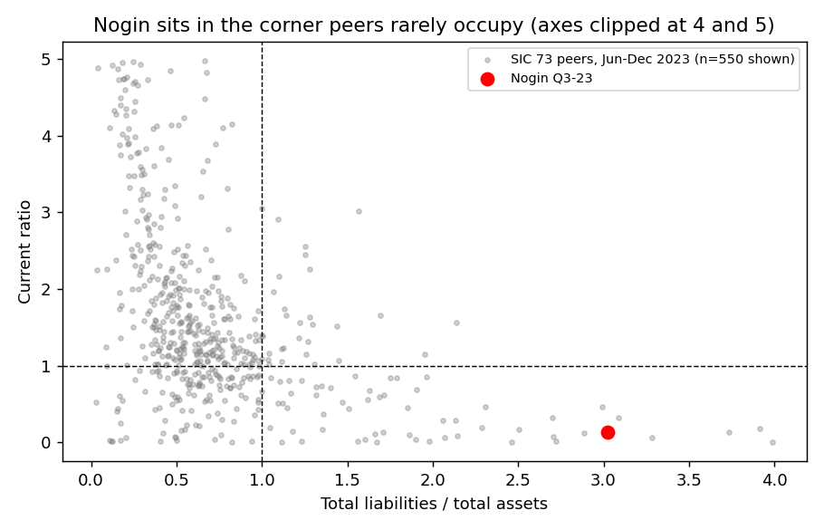
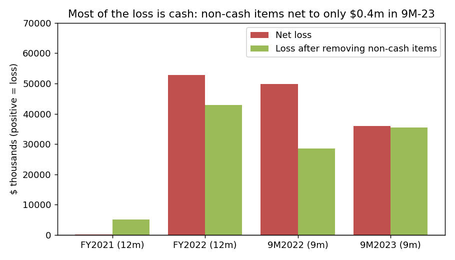

# Nogin, Inc. 10-Q for Q3 2023 (filed 2023-11-22), model score 0.732

**Answer.** The model sees a small company with an annualized loss about the size of its assets (−$48.0m against $47.3m), operating cash outflow of the same size, current liabilities 7× current assets, and liabilities 3× assets. In all four, Nogin sits among the worst tenth to quarter of its peers. The score is not an artefact. The 10-Q it scored says Nogin has already signed an agreement to file for bankruptcy by 1 December 2023.

**Verdict: real risk. My own risk: very high, about 95%** (band base rate 18%). I agree with the model, and I think it understates the risk. *Disclosure: I know from outside this data that Nogin later filed for Chapter 11. I did not use that. Every claim below relies only on sources dated 2023-11-22 or earlier.*

## The 8 model inputs ($m; income and cash flow are 9 months × 4/3)

| Input | Q3-23 | Q3-22 | What drives it (filings) | Peer percentile* |
|---|---|---|---|---|
| Total assets | 47.3 | 60.9 | Goodwill written off; inventory and cash run down | 33 |
| Current assets | 15.5 | 43.1 | Cash $1.9m, inventory $9.4m | 30 |
| Current liabilities | 111.2 | 37.3 | $60.4m convertible notes moved to current; $7.6m loans | 56 |
| Total liabilities | 142.8 | 131.1 | Notes, payables, leases | 49 |
| Revenue | 53.8 | 88.7 | Q3 revenue $10.9m vs $21.0m | 33 |
| Net income | −48.0 | −66.4 | Includes $6.7m goodwill impairment and $9.0m derivative gains | 23 |
| Operating income | −53.0 | −36.8 | G&A $44.5m on $40.3m revenue (9M) | 20 |
| Operating cash flow | −47.7 | −33.7 | Cash losses | 6 |

*Percentile among 702 SIC-73 peers with periods ending Jun–Dec 2023, using the latest report filed by 2023-11-22 and excluding Nogin; percentile = share of peers with a lower value. No input is missing. As ratios: liabilities/assets 3.02 (91st; high is bad), current ratio 0.14 (12th), net income/assets −1.01 (14th), operating cash flow/assets −1.01 (9th). Among the 92 peers with $20–100m of assets, the median liabilities/assets is 0.42 and only 2.2% exceed 3. So being small does not explain the score.

## Main reasons, most important first (my inference: I can't see the model's weights)

1. **Bankruptcy already agreed (from the filings).** On 16 Nov 2023, B. Riley and holders of 90% of the notes signed a restructuring support agreement. 10-Q (2023-11-22), Note 20: *"The Agreement provides for the sale of Nogin and contemplates that Nogin will file a voluntary petition for bankruptcy no later than December 1, 2023."* [10-Q][q3]
2. **Losses and cash burn are real cash (model input).** The 9M net loss was $36.0m. Applying the same cash-flow-statement adjustments to every period, the non-cash items net to only +$0.4m in 9M-23 (FY22: +$9.9m). Goodwill impairment is $6.7m, 19% of the loss. Operating cash flow was −$35.8m. [10-Q][q3]
3. **No cash to cover current debts (model input + filings).** Cash was $1.9m against $111.2m of current liabilities. Burn was $5.5m in Q3 ($1.8m a month), which leaves **1.0 month** of cash; at the 9-month average it is 0.5 months. Note 2: *"the Company did not meet its financial covenants during the September 30, 2023, reporting period, and is in discussions with its convertible noteholders"* [10-Q][q3]
4. **Expensive emergency borrowing (from the filings).** Merchant-cash-style loans were taken in Jul–Sep 2023, the latest at *"an annual interest rate of 42%"*. Weekly repayments total $232k. [10-Q, Note 7][q3]
5. **Late filing that names bankruptcy (from the filings).** NT 10-Q (2023-11-15): *"the Company is considering all strategic alternatives including restructuring of its capital structure, including obtaining relief under the U.S. Bankruptcy Code"* [NT 10-Q][nt]

## Evidence against

- **New money.** On 16 Nov Nogin borrowed $8.53m: *"pursuant to which Nogin borrowed $8,530,000"*. At Q3 burn that is about 5.6 months of cash with the existing balance. But it is tied to the bankruptcy plan. [10-Q][q3]
- **Backing from the owners and lenders.** *"the plan sponsor would provide a debtor-in-possession loan"* [10-Q][q3]. This means the business may keep operating, but through Chapter 11, not instead of it.
- **Earlier rescues.** The March interest default was waived [8-K][w], and an April offering raised about $22m gross [8-K][o]. Both were used up within two quarters.
- **Burn is slowing.** Quarterly operating cash use fell from $22.2m to $8.0m to $5.5m [10-Q Q1][q1], [10-Q Q2][q2]. That is still not enough.

None of these offsets the signed agreement to file.

## How it developed

- **Aug 2022:** The SPAC merger brought in $65.5m of 7% convertible notes [8-K][m]. Q3-22 loss: $28.9m [10-Q Q3-22][q322].
- **Dec 2022:** Nasdaq minimum-bid-price notice [8-K][d1].
- **Mar 2023:** The auditor's going-concern paragraph says conditions *"raise substantial doubt about the Company’s ability to continue as a going concern"* [10-K][k]. Nogin *"did not timely make payment of the accrued interest due March 1, 2023"*, and the default was waived [8-K][w]. Cash at 31 Mar was $0.6m [10-Q Q1][q1].
- **Apr 2023:** $22m equity offering [8-K][o].
- **Jul–Sep 2023:** Nasdaq notices on public float [8-K][d2] and bid price [8-K][d3]. High-rate short-term loans (Note 7) [10-Q][q3].
- **Nov 2023:** NT 10-Q [nt]. Restructuring agreement signed; Q3 10-Q filed [q3].

## Dates to watch

- **1 Dec 2023:** The agreed deadline to file the petition [q3]. If Nogin files, the risk is confirmed. **What would change my mind:** the agreement ending, or new equity not tied to bankruptcy (I see no sign of either).
- **8 Jan 2024 / 4 Mar 2024:** Nasdaq compliance deadlines for public float [d2] and bid price [d3].
- **Mar 2024:** The short-term loans are due [q3].

## Charts

Source: balance sheets in the [q322], [k], [q1], [q2] and [q3] filings.

Source: cash-flow statements in [q1], [q2], [q3] (quarter = difference between year-to-date totals).

Source: shared/financials.csv, with the Nogin row drawn from [q3].

Source: cash-flow statements in [k], [q322] (9M-22 comparatives as shown in [q3]) and [q3].

## How sure I am

I am highly confident. The deciding fact is stated directly by the company in the scored filing. What I couldn't check: the exact covenant thresholds, whether the B. Riley loan has been drawn and spent, the actual court filing, and any bankruptcy-related exhibits (I didn't read them). Peer percentiles cover all of SIC 73, which mixes very different businesses.

## Filings used
10-Q 2022-11-14; 8-K 2022-09-01; 8-K 2022-12-05; 8-K 2023-01-27, 2023-02-03, 2023-02-14 (officer and director changes); 10-K 2023-03-23; 8-K 2023-03-27; 8-K 2023-04-04; 10-Q 2023-05-15; 8-K 2023-05-17; 8-K 2023-06-20; 8-K 2023-07-14; 8-K 2023-07-28; 8-K 2023-08-03; 10-Q 2023-08-14; 8-K 2023-09-08; 8-K 2023-11-02; NT 10-Q 2023-11-15; 10-Q 2023-11-22.

[q3]: https://www.sec.gov/Archives/edgar/data/1841800/000121390023089471/f10q0923_nogininc.htm
[nt]: https://www.sec.gov/Archives/edgar/data/1841800/000119312523277991/d610951dnt10q.htm
[q2]: https://www.sec.gov/Archives/edgar/data/1841800/000095017023042370/nogn-20230630.htm
[q1]: https://www.sec.gov/Archives/edgar/data/1841800/000095017023021940/nogn-20230331.htm
[k]: https://www.sec.gov/Archives/edgar/data/1841800/000095017023009502/nogn-20221231.htm
[q322]: https://www.sec.gov/Archives/edgar/data/1841800/000095017022024994/nogn-20220930.htm
[w]: https://www.sec.gov/Archives/edgar/data/1841800/000119312523079897/d467224d8k.htm
[o]: https://www.sec.gov/Archives/edgar/data/1841800/000119312523090983/d485640d8k.htm
[m]: https://www.sec.gov/Archives/edgar/data/1841800/000119312522236634/d292151d8k.htm
[d1]: https://www.sec.gov/Archives/edgar/data/1841800/000119312522298440/d428389d8k.htm
[d2]: https://www.sec.gov/Archives/edgar/data/1841800/000119312523187341/d864945d8k.htm
[d3]: https://www.sec.gov/Archives/edgar/data/1841800/000119312523231567/d551597d8k.htm
