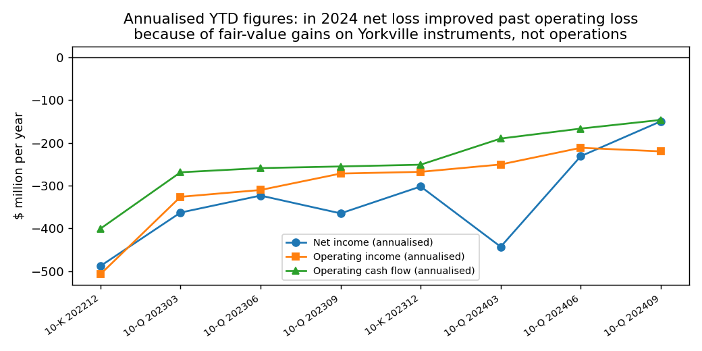
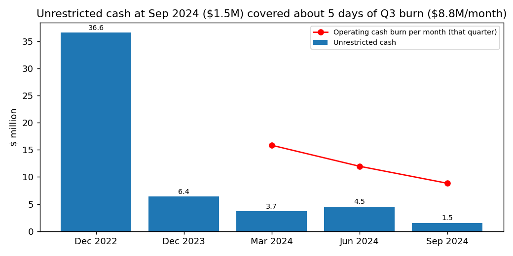
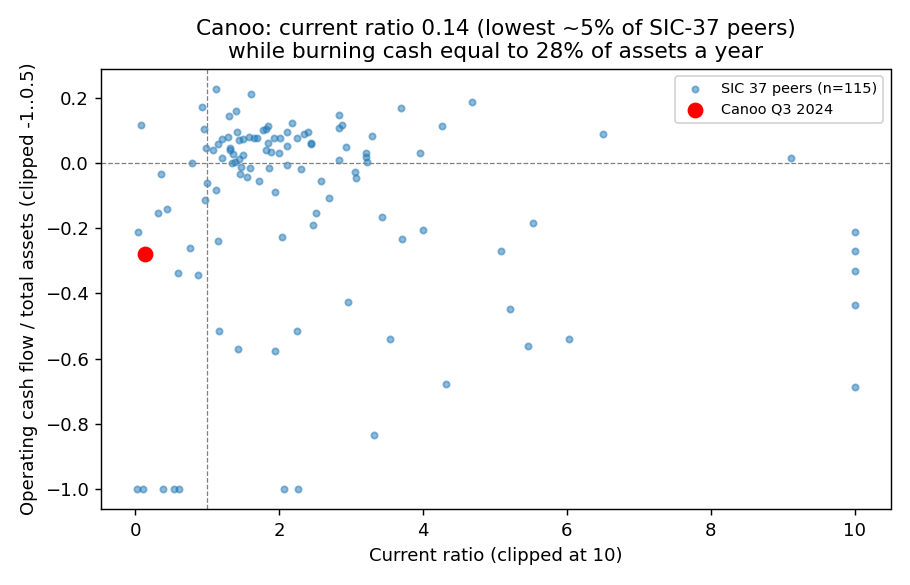

# Canoo Inc. (CIK 1750153): 10-Q for the period ending 30 Sep 2024, filed 14 Nov 2024. Score 0.663

**Answer.** The score comes from large annualised losses (net −$150M, operating −$220M, operating cash flow −$147M), almost no revenue ($2.0M), and current assets that cover only 14% of current liabilities. Net income is the *least* bad of these inputs: a $61.8M non-cash fair-value gain on Yorkville instruments made Q3 a $3.3M profit. So the score likely *understates* the distress, because the company has $1.5M of cash against about $8.8M a month of burn.

**Verdict: real risk.** My own risk estimate is **very high, about 45%** within 365 days, against a 4% base rate for this score band. I agree with the model's direction but think it ranks this report too low.

## The 8 inputs ($M; income and cash flow annualised)

| Input | Q3 2024 | Q3 2023 | Driver | Peer pctile (SIC 37) |
|---|---|---|---|---|
| Total assets | 523.3 | 534.3 | Plant and equipment $368.7M | 43rd |
| Current assets | 29.0 | 32.8 | Cash $1.5M, restricted $3.9M, inventory $9.9M | 20th (2nd as % of assets) |
| Current liabilities | 202.3 | 187.6 | Payables $81.0M, accruals $75.1M, Yorkville debt $42.6M | 51st |
| Total liabilities | 301.3 | 368.7 | Derivative and warrant liabilities marked down | 42nd |
| Revenue | 2.0 | 0.7 | Early EV sales | 13th |
| Net income | −149.9 | −364.8 | $100.6M of fair-value gains year to date | 15th |
| Operating income | −220.0 | −271.8 | R&D, SG&A, $16.1M reorganisation | 10th |
| Operating cash flow | −146.6 | −255.2 | Burn, eased by unpaid bills | 10th |

None missing. Leverage 0.58 (peer median 0.60); current ratio 0.14 (5th pctile, median 1.87); working capital −$173M. Net loss/assets ranks 27th pctile, so this is not just a size effect. [financials.csv](../../shared/financials.csv), [script](scripts/fin_compare.py)

**Cash-adjusted loss.** Net loss plus every non-cash cash-flow line, same method each period: FY2022 −$407M, FY2023 −$219M, 9M 2024 −$120M, Q3 −$37M. Monthly operating burn: Q1 $15.8M, Q2 $12.0M, Q3 $8.8M, though $9.5M of Q3's help came from growing payables. **Runway:** $1.5M ÷ $8.8M/month ≈ **5 days** (1.8 months with restricted cash). [script](scripts/analysis.py)

## Main reasons (the order is my inference; I can't see the model's attributions)

1. **No cash (from the filings).** "As of September 30, 2024, we had unrestricted cash and cash equivalents in the amount of $1.5 million" (10-Q, 14 Nov 2024, MD&A). Down from $36.6M (Dec 2022). [10-Q Q3 2024](https://www.sec.gov/Archives/edgar/data/1750153/000162828024047749/goev-20240930.htm)
# link wrong, correct link should have been in FY2023 10-K
2. **Heavy losses and burn with no revenue (model input).** Operating cash flow is −28% of assets (20th percentile), and the operating loss is 110× revenue (6th percentile). [10-Q Q3 2024](https://www.sec.gov/Archives/edgar/data/1750153/000162828024047749/goev-20240930.htm)
3. **Debt default waived the day before filing (from the filings).** "The event of default related to the company’s stock price being below the Floor Price for five of the preceding seven trading days July 2024 without monthly repayments of amounts outstanding under the Pre-Paid Advance Agreements." (10-Q, Part II Item 5). Waiver dated 13 Nov 2024, conditional. [10-Q Q3 2024](https://www.sec.gov/Archives/edgar/data/1750153/000162828024047749/goev-20240930.htm)
4. **Needs money within weeks (from the filings).** "we will need to raise substantial additional capital to fund operations through the end of 2024 to continue operations" (10-Q, Part II Item 1A). Going concern note: "These conditions and events raise substantial doubt about the Company’s ability to continue as a going concern." (Note 1). [10-Q Q3 2024](https://www.sec.gov/Archives/edgar/data/1750153/000162828024047749/goev-20240930.htm)
5. **Unpaid suppliers (from the filings).** "Several of our key vendors, including some single-source suppliers, have sent us notices of nonpayment of amount owed by us." (10-Q, Part II Item 1A). Dana sued on 13 Sep 2024 for more than $8.5M. Payables are 53× cash. [10-Q Q3 2024](https://www.sec.gov/Archives/edgar/data/1750153/000162828024047749/goev-20240930.htm)
6. **Current ratio of 0.14 (model input),** at the 5th percentile of peers. [financials.csv](../../shared/financials.csv)

## Evidence against

- **CEO funding:** affiliate AFV lent $3.8M, then a secured facility up to $12M ($6.9M drawn). But "Any additional advances beyond what has already been borrowed are subject to AFV’s discretion." (10-Q, Note 19). [8-K 5 Nov 2024](https://www.sec.gov/Archives/edgar/data/1750153/000110465924114394/tm2427513d2_8k.htm), [8-K 24 Oct 2024](https://www.sec.gov/Archives/edgar/data/1750153/000110465924111165/tm2426767d1_8k.htm)
# 8-Ks support only the 3.8M and 12M but the quote and 6.9M is not there in those links rather its there in 10-Q link
- **Yorkville** advanced $25.2M (28 Aug) and $2.7M (11 Oct 2024) and waived the default; financing raised $114.8M in 9M 2024. [8-K 29 Aug 2024](https://www.sec.gov/Archives/edgar/data/1750153/000110465924094225/tm2422966d1_8k.htm)
# link only supports only 25.2M. The 2.7M and 114.8M are in 10-Q link which is not there
- **Cuts and assets:** burn fell 44% Q1→Q3; $368.7M of plant could be sold or pledged; equity +$222M. Item 3 (Defaults Upon Senior Securities) says "None." [10-Q Q3 2024](https://www.sec.gov/Archives/edgar/data/1750153/000162828024047749/goev-20240930.htm)
- **Old doubt:** going concern flagged since Q1 2022; already in the base rate.

## How it developed

- **Q1 2022:** First going concern doubt (per Q3 2024 10-Q). [10-Q](https://www.sec.gov/Archives/edgar/data/1750153/000162828024047749/goev-20240930.htm)
- **27 Mar 2023:** A Nasdaq bid-price notice gave "a compliance period of 180 calendar days, or until September 25, 2023" (8-K, Item 3.01). [8-K 31 Mar 2023](https://www.sec.gov/Archives/edgar/data/1750153/000121390023025434/ea176232-8k_canooinc.htm), [8-K 15 Sep 2023](https://www.sec.gov/Archives/edgar/data/1750153/000110465923101194/tm2326204d1_8k.htm)
- **Dec 2023:** Cash was down to $6.4M. The auditor wrote: "These matters raise substantial doubt about the Company’s ability to continue as a going concern." (10-K, auditor's report). [10-K FY2023](https://www.sec.gov/Archives/edgar/data/1750153/000162828024014075/goev-20231231.htm)
- **8 Mar 2024:** A 1-for-23 reverse split. **Jul 2024:** The stock fell below the floor price, triggering the Yorkville default. **Aug 2024:** Torrance reorganisation ($16.1M). **13 Sep 2024:** Dana lawsuit. [10-Q](https://www.sec.gov/Archives/edgar/data/1750153/000162828024047749/goev-20240930.htm)
- **18 Oct – 5 Nov 2024:** The CEO-affiliate loans began. On 31 Oct the company announced it was "furloughing 23% of its factory workers for a period of twelve weeks" (10-Q, Note 19). [8-K 5 Nov 2024](https://www.sec.gov/Archives/edgar/data/1750153/000110465924114394/tm2427513d2_8k.htm)

## Dates to watch (source: [10-Q Q3 2024](https://www.sec.gov/Archives/edgar/data/1750153/000162828024047749/goev-20240930.htm))

- **22 Nov 2024:** The Yorkville ATM consent window closes.
- **31 Dec 2024:** The company's own deadline for raising substantial capital.
- **About late Jan 2025:** The furlough ends.
- **About 5 Mar 2025:** The 120-day repayment of the AFV draws falls due.
- **8 Mar 2025:** One year since the reverse split. The 10-Q says: "Our stock price has recently fallen under $1.00 and, although we have not received a notice of noncompliance from Nasdaq, we are seeking stockholder approval for an additional reverse stock split." (Part II Item 1A).
- **About Mar 2025:** The FY2024 10-K and its auditor opinion.
- **Would lower my risk:** a large equity raise or strategic investor, full AFV facility, vendor settlements. **Would raise it:** AFV stops advancing, new Yorkville default, more supplier suits.

## Charts

The improvement in net loss came from fair-value gains, not operations. [financials.csv](../../shared/financials.csv)

Cash covers about 5 days of burn. [10-Q](https://www.sec.gov/Archives/edgar/data/1750153/000162828024047749/goev-20240930.htm), [10-K](https://www.sec.gov/Archives/edgar/data/1750153/000162828024014075/goev-20231231.htm)

Canoo pairs very low liquidity with heavy burn (axes are clipped). [financials.csv](../../shared/financials.csv)

## Confidence and limits

Confident in direction, less in the %. I moved from 4% to 45% for: under a week of cash, a recent default, nonpayment notices, and discretionary insider funding. Not checked: Yorkville balance by tranche, AFV's intentions, market data, per-input score effects. **Hindsight:** I know Canoo filed Chapter 7 in January 2025; I did not use this, and all sources are dated on or before 14 Nov 2024.

## Filings used

10-K 2024-04-01; 10-Q 2024-05-15, 2024-08-14, 2024-11-14; 8-K 2023-03-31, 06-28, 07-07, 08-04, 08-31, 09-13, 09-15, 09-26, 10-02, 11-22, 12-20, 2024-01-05, 01-12, 01-31, 02-07, 03-14, 04-11, 06-13, 07-22, 08-29, 09-13, 10-15, 10-24, 11-05. No NT filings.
