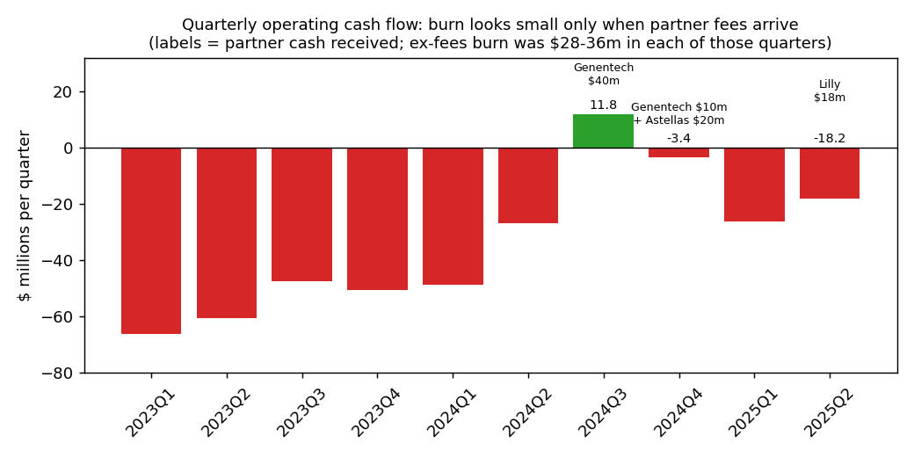
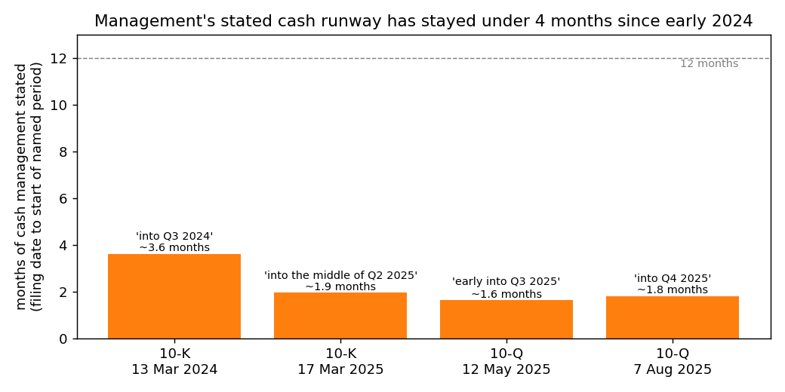
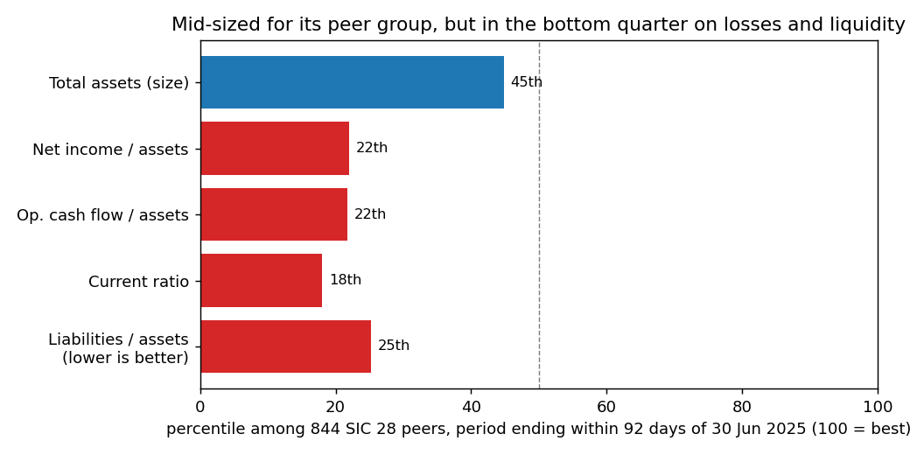
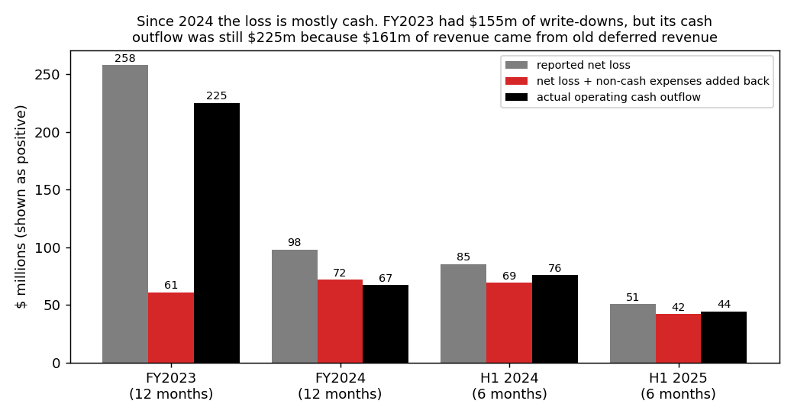

# Sangamo Therapeutics (CIK 1001233): 10-Q to 30 Jun 2025, filed 7 Aug 2025. Score 0.688

**Answer.** The model sees an annualized net loss of $101M on $98M of assets, an $89M cash outflow, and current liabilities about equal to current assets. Those numbers put Sangamo in the bottom quarter of its peers, even though it is mid-sized. The filings make it look worse: the inputs are flattered by a one-off $18M Lilly fee, cash lasts only "into the fourth quarter of 2025", and management has explored filing for bankruptcy.

**Verdict: real risk.** My own risk: **high, about 25%** within 12 months, against a 4% base rate for the 0.5–0.7 band. I agree with the model, and I think 0.688 understates the risk.

## The 8 inputs (annualized $M; peers = 844 SIC-28 filers, period end within 92 days, Sangamo excluded)

| Input | Q2 2025 | Q2 2024 | Driver | Peer percentile |
|---|---|---|---|---|
| Total assets | 97.6 | 93.0 | $38.3M cash, $19.1M tax credits, $15.1M leases | 45th |
| Current assets | 49.9 | 40.1 | Mostly cash | 40th |
| Current liabilities | 47.7 | 39.0 | Payables, accruals, deferred revenue | 67th |
| Total liabilities | 78.0 | 69.3 | Leases, deferred revenue; **no debt** | 62nd |
| Revenue | 49.5 | 1.7 | One-off fees: $18M Lilly, $5M Pfizer | 49th |
| Net income | −101.2 | −170.4 | R&D for the Fabry BLA; no impairments in 2025 | 24th |
| Operating income | −95.0 | −177.2 | Same | 28th |
| Operating cash flow | −88.6 | −151.1 | Same, helped by the fees | 25th |

Percentile = share of peers lower. Liabilities/assets 0.80 (25% of peers higher); current ratio 1.05 (18th percentile); equity $19.6M. No input is missing.

## Main reasons (the order is my inference; I can't see how much each input moved the score)

1. **About one quarter of cash left (from the filings).** Cash was $38.3M, plus $8.9M from at-the-market (ATM) stock sales after 30 June. H1 burn without one-off fees was $67.3M, or $11.2M a month, which leaves about 4.2 months. The filing agrees: cash "will be sufficient to meet our liquidity requirements only into the fourth quarter of 2025" (10-Q, 7 Aug 2025, MD&A Going Concern). [10-Q](https://www.sec.gov/Archives/edgar/data/1001233/000162828025038860/sgmo-20250630.htm)
2. **Big loss for its size (model input).** Net income/assets is −1.04 (peer median −0.40). Only 17% of the H1 loss is non-cash ($8.7M of $50.6M). Without the one-off fees, the annualized loss would be about $147M. [10-Q cash flow statement](https://www.sec.gov/Archives/edgar/data/1001233/000162828025038860/sgmo-20250630.htm)
3. **Bankruptcy is openly considered (from the filings).** "We have explored, and will continue to explore, whether filing for bankruptcy protection is in the best interest of our Company and our stakeholders." (10-Q, MD&A). [10-Q](https://www.sec.gov/Archives/edgar/data/1001233/000162828025038860/sgmo-20250630.htm)
4. **The key deal has not happened (from the filings).** Talks on a Fabry commercialization partner continue, "but have been unsuccessful in consummating any such transaction to date" (10-Q, MD&A). [10-Q](https://www.sec.gov/Archives/edgar/data/1001233/000162828025038860/sgmo-20250630.htm)
5. **Delisting deadline (from the filings).** "we have 180 calendar days, or until October 27, 2025, to regain compliance with the Bid Price Requirement" (10-Q, Part II Item 1A). The May 2025 offering was priced at $0.50 a unit. [8-K, 6 May 2025](https://www.sec.gov/Archives/edgar/data/1001233/000162828025022664/sgmo-20250430.htm)
# they tell 10-Q reference in the reason itself but 8-K file was linked in this so wrong

## Evidence against

- **No debt, so no lender can force a filing.** Part II Item 3 (Defaults Upon Senior Securities) reads "Not applicable." [10-Q](https://www.sec.gov/Archives/edgar/data/1001233/000162828025038860/sgmo-20250630.htm)
- **It has refilled the tank every time so far.** Sources: Genentech $50M (2024), Astellas $20M (Dec 2024), Lilly ("upfront license payment in April 2025"), a $21.1M offering and ATM sales. [10-Q Notes 6 and 9](https://www.sec.gov/Archives/edgar/data/1001233/000162828025038860/sgmo-20250630.htm)
- **ATM capacity:** "Approximately $168.8 million remained available under the sales agreement as of June 30, 2025." [10-Q Note 9](https://www.sec.gov/Archives/edgar/data/1001233/000162828025038860/sgmo-20250630.htm)
- **A sellable asset:** positive Fabry data, with an FDA filing (BLA) "submission under the Accelerated Approval pathway as early as the first quarter of 2026". [10-Q MD&A](https://www.sec.gov/Archives/edgar/data/1001233/000162828025038860/sgmo-20250630.htm)

## How it developed

- **Aug–Nov 2023:** Biogen and Novartis collaborations ended (June 2023). The Aug 2023 10-Q still said management's plans "sufficiently alleviate the risk of substantial doubt". The 1 Nov 2023 10-Q first stated "substantial doubt about our ability to continue as a going concern". [10-Q Aug 2023](https://www.sec.gov/Archives/edgar/data/1001233/000162828023028200/sgmo-20230630.htm), [10-Q Nov 2023](https://www.sec.gov/Archives/edgar/data/1001233/000162828023035989/sgmo-20230930.htm)
- **13 Mar 2024:** FY2023 loss was $258M, including $155M of write-downs. The runway was "only into the third quarter of 2024", and the 10-K said "we have explored, and continue to explore, whether filing for bankruptcy protection". [10-K FY2023](https://www.sec.gov/Archives/edgar/data/1001233/000162828024010788/sgmo-20231231.htm)
- **24 Apr 2024:** first Nasdaq notice for a bid price below $1. [8-K](https://www.sec.gov/Archives/edgar/data/1001233/000162828024019337/sgmo-20240424.htm)
- **Aug–Dec 2024:** the Genentech and Astellas deals bridged the gap. **22 Dec 2024:** Pfizer ended the hemophilia A partnership. [8-K](https://www.sec.gov/Archives/edgar/data/1001233/000162828024052579/sgmo-20241222.htm)
- **17 Mar 2025:** EY's audit opinion included a going concern paragraph. The runway was "only into the middle of the second quarter of 2025". [10-K FY2024](https://www.sec.gov/Archives/edgar/data/1001233/000162828025013088/sgmo-20241231.htm)
- **Apr–May 2025:** the Lilly deal, a second Nasdaq notice and a $0.50 offering. The runway was "only early into the third quarter of 2025". [10-Q Q1 2025](https://www.sec.gov/Archives/edgar/data/1001233/000162828025024650/sgmo-20250331.htm)
# wrong link of 10-Q . It should have been Aug 10-Q link

Partner fees, not lower costs, are what make the burn look small. Sources: [10-Q](https://www.sec.gov/Archives/edgar/data/1001233/000162828025038860/sgmo-20250630.htm) and shared/financials.csv.

Stated runway under 4 months at every filing since 2024 (approximate: filing date to start of named period). Sources: [10-K FY2023](https://www.sec.gov/Archives/edgar/data/1001233/000162828024010788/sgmo-20231231.htm), [10-K FY2024](https://www.sec.gov/Archives/edgar/data/1001233/000162828025013088/sgmo-20241231.htm), [10-Q May](https://www.sec.gov/Archives/edgar/data/1001233/000162828025024650/sgmo-20250331.htm), [10-Q Aug](https://www.sec.gov/Archives/edgar/data/1001233/000162828025038860/sgmo-20250630.htm).

Not a small-company artefact: assets are near the peer median. Source: shared/financials.csv.

Same non-cash add-backs every period, from the cash flow statements. Sources: [10-K FY2024](https://www.sec.gov/Archives/edgar/data/1001233/000162828025013088/sgmo-20241231.htm), [10-Q](https://www.sec.gov/Archives/edgar/data/1001233/000162828025038860/sgmo-20250630.htm).

## Dates to watch, and what would change my mind

- **Q4 2025:** the stated point where cash runs out. A Fabry deal or a raise of $50M or more would cut my risk to about 10%. [10-Q](https://www.sec.gov/Archives/edgar/data/1001233/000162828025038860/sgmo-20250630.htm)
- **27 Oct 2025:** the Nasdaq deadline. A reverse split or extension would help. Delisting would hurt ATM funding. [8-K](https://www.sec.gov/Archives/edgar/data/1001233/000162828025022664/sgmo-20250430.htm)
- **Nov 2025:** the Q3 10-Q. A runway of a quarter or less with no deal keeps the risk high. Advisor or wind-down language would raise it above 40%. [10-Q](https://www.sec.gov/Archives/edgar/data/1001233/000162828025038860/sgmo-20250630.htm)
- **Q1 2026:** the Fabry BLA submission. [10-Q](https://www.sec.gov/Archives/edgar/data/1001233/000162828025038860/sgmo-20250630.htm)

## How sure I am

Medium. The direction is clear; the size hinges on a deal or raise before Q4 2025. Biotechs with no debt that run out of cash often wind down or merge outside court, which is why I say 25% and not more. Things I could not check: the share price, the terms of the Fabry talks, lease exit costs, and the exact quarter the $5M Pfizer cash was received. SIC 2836-only peers give similar ranks.

I have some general knowledge of events after 7 Aug 2025 and did not use it. Every claim traces to filings or data rows dated on or before 7 Aug 2025.

## Filings used

10-Q (7 Aug 2025); 10-Q (12 May 2025); 10-K (17 Mar 2025); 10-K (13 Mar 2024); 10-Q (1 Nov 2023) and 10-Q (8 Aug 2023), used only to date the onset; 8-K (16 Jun 2025); 8-K (6 May 2025); 8-K (30 Dec 2024); 8-K (5 Jun 2024); 8-K (30 Apr 2024). No NT 10-K or NT 10-Q was filed.
