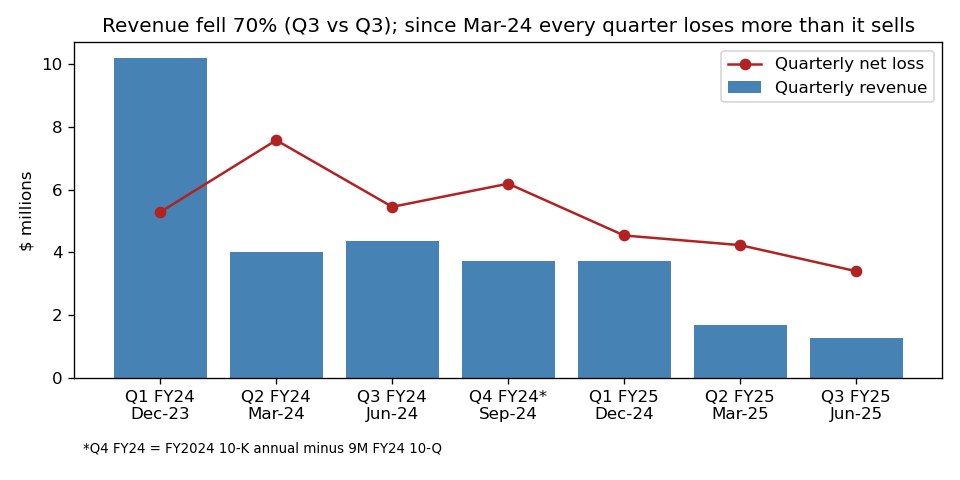
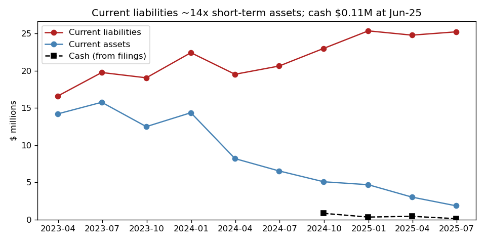
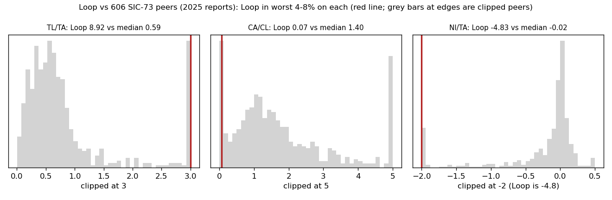

# Loop Media, Inc. — 10-Q for the quarter to 30 Jun 2025 (filed 14 Aug 2025), model score 0.718

[10-Q]: https://www.sec.gov/Archives/edgar/data/1643988/000164117225023889/form10-q.htm
[10-K24]: https://www.sec.gov/Archives/edgar/data/1643988/000149315224049828/form10-k.htm
[10-K23]: https://www.sec.gov/Archives/edgar/data/1643988/000155837023019889/lptv-20230930x10k.htm
[Q2]: https://www.sec.gov/Archives/edgar/data/1643988/000164117225010677/form10-q.htm
[8K-delist]: https://www.sec.gov/Archives/edgar/data/1643988/000149315224030877/form8-k.htm
[8K-gemcap]: https://www.sec.gov/Archives/edgar/data/1643988/000149315224044880/form8-k.htm
[8K-ascap]: https://www.sec.gov/Archives/edgar/data/1643988/000164117225019542/form8-k.htm
[8K-agile]: https://www.sec.gov/Archives/edgar/data/1643988/000164117225021060/form8-k.htm
[8K-afg]: https://www.sec.gov/Archives/edgar/data/1643988/000164117225023252/form8-k.htm
[8K-may23]: https://www.sec.gov/Archives/edgar/data/1643988/000164117225017405/form8-k.htm
[8K-excel]: https://www.sec.gov/Archives/edgar/data/1643988/000149315225008308/form8-k.htm
[8K-aud]: https://www.sec.gov/Archives/edgar/data/1643988/000149315224052512/form8-k.htm
[csv]: ../../shared/financials.csv
[out]: scripts/analysis_output.txt

## Answer
The model saw a $3.4M company that loses about five times its assets each year (annualised net loss −$16.2M), owes $30.0M against those assets, and has current assets covering only 7% of current liabilities. On all three it sits in the worst 4–8% of 606 business-services peers. The filings make it worse than the numbers suggest: $110k of cash, and lenders and licensors demanding about $6.9M after missed payments.

**Verdict: real risk. My risk: high, about 40% of a court bankruptcy or receivership within 12 months (band base rate 18%). I agree with the model.**

## The 8 numbers (income and cash flow annualised from 9 months; [csv], [out])
| Item | Q3 FY25 | Q3 FY24 | What drives it | Peer rank (606 SIC-73) |
|---|---|---|---|---|
| Total assets | $3.36M | $10.34M | receivables and equipment run down | below 85% of peers |
| Current assets | $1.84M | $6.53M | cash $0.11M; receivables $1.04M | below 82% |
| Current liabilities | $25.24M | $20.64M | payables $9.4M (+51% since Sep-24), defaulted debt | above only 36% (small firm) |
| Total liabilities | $30.00M | $22.80M | $11.2M debt principal | above 34% |
| Revenue | $8.93M | $24.70M | 9M revenue −64%; Q3 −70% | below 77% |
| Net income | −$16.24M | −$24.41M | 36% non-cash; interest $3.2M (9M) | worse than 74% |
| Operating income | −$11.92M | −$21.17M | SG&A cut but gross profit collapsed | worse than 73% |
| Operating cash flow | −$5.64M | −$6.60M | helped by stretching payables (+$4.1M) | worse than 82% |

None of the 8 is missing. Ratios: liabilities/assets 8.9 (peer median 0.59), current ratio 0.07 (1.40), net income/assets −4.8 (−0.02). Size alone doesn't explain it: among the 129 peers with under $10M of assets, Loop is still in the worst 28% on liabilities/assets and the worst 19% on loss/assets.

## Main reasons, in order (the order is my inference; I can't see how much each input moved the score)
1. **Losses far larger than the asset base (model input).** Net loss/assets −4.8 vs a peer median of −0.02. After adding back non-cash items the same way every year (stock pay, depreciation, amortisation, bad debt, disposal losses), the cash loss is still −$7.8M for 9M FY25, against −$9.3M for 9M FY24 and about −$11.9M in each of FY24 and FY23. The losses are real. [10-Q], [out]
2. **Liabilities 8.9× assets; equity −$26.6M (model input).** The going-concern note in the 10-Q (filed 2025-08-14) says: "These factors raise substantial doubt about our ability to continue as a going concern." [10-Q]
3. **Defaults and acceleration across the debt stack (from the filings).** The May-2023 credit line matured unpaid. The $2.0M Bellino note, 1800 Diagonal, Agile ($1.0M), Balboa, AFG ($268k), ASCAP ($1.175M) and Cara ($362k) all sent default or demand notices between June and August 2025. NRS sued for $827,825 using a confession of judgment. 10-Q Note 8: "We have received notices of default and acceleration letters from certain lenders related to outstanding debt obligations." [10-Q], [8K-agile], [8K-ascap], [8K-afg], [8K-may23]
4. **Cash covers well under one month of burn (model input plus filings).** Cash was $109,692 at 30 Jun 2025. Burn was $470k a month over 9M and $332k a month in Q3, so cash lasts about 0.2–0.3 months. MD&A: "If we are unable to raise funds when required or on acceptable terms, we may have to significantly reduce or discontinue our operations." [10-Q]
5. **The business is shrinking (model input).** Q3 revenue was $1.29M against $4.35M a year earlier, and gross margin was 21%. [10-Q]

## Evidence against
- **The majority owner keeps funding the company.** Bruce Cassidy's Excel entity holds a $2.5M revolver and a $3.0M convertible note. In February 2025 it swapped $1.1M of debt for shares ("in order to reduce the Company’s debt, the Company and Excel entered into an exchange agreement", 8-K 2025-02-26 [8K-excel]). On 15 Jul 2025 he took over the defaulted Bellino note: "the Bellino Trust $2.0M Convertible Note was assigned to Mr. Cassidy with no changes to the terms." (10-Q, Note 13 [10-Q]). He also advanced $217,183 that day. About $7.5M of the $11.2M debt principal is now held by insiders, who are unlikely to force a filing.
- **No creditor has enforced yet.** "no further action has been taken against the Company with respect to the Agile Agreements" (10-Q, Note 13 [10-Q]). The Capital Foundry revolver was still being drawn in July and August 2025 (balance $1.715M of $2.0M).
- **Small OTC companies often just stop operating or filing**, which would not count as bankruptcy here.

## How it developed
- **19 Dec 2023, FY2023 10-K:** management said the doubt "is alleviated". [10-K23]
- **9 Aug 2024:** NYSE American "suspended trading of the Company’s common stock and determined to commence proceedings to delist". The stock moved to OTC Pink. [8K-delist]
- **12 Nov 2024:** senior lender GemCap accelerated the loan and moved toward a UCC sale. The company paid it off on 27 Nov 2024 with expensive replacement debt at 20–44% interest. [8K-gemcap], [10-Q]
- **12 Dec 2024, FY2024 10-K:** the auditor wrote "These conditions raise substantial doubt about the Company’s ability to continue as a going concern." The company dismissed the auditor on 30 Dec 2024. [10-K24], [8K-aud]
- **May–Aug 2025:** the debt defaults described above. Converting lenders received shares at prices as low as $0.001353. [10-Q], [Q2]

## Dates to watch, and what would change my mind
- **About 15 Sep 2025:** deadline to answer the NRS judgment suit. If judgment is entered, NRS can seize assets. [10-Q]
- **18 Oct 2025:** the $2.0M ex-Bellino note matures. **23 Oct 2025:** the Agile $800k note matures. **26 Nov 2025:** the Excel $3.0M note matures. [10-Q]
- **Late Dec 2025:** the FY2025 10-K is due. A late filing (NT 10-K) or a missing audit opinion would raise my risk.
- **Lower risk:** a sale of the company, an insider conversion of debt to equity, or settlements with the trade creditors. **Higher risk:** a lawsuit or seizure by Agile, ASCAP or AFG, or Cassidy stopping his support.

## Charts

Revenue collapsed, and losses have exceeded revenue every quarter since March 2024 (source: [10-Q], [Q2], [10-K24]).

Current assets shrank toward zero while current liabilities rose (source: [csv]).

Loop sits in the far tail of its peers on leverage, liquidity and loss (source: [csv], [out]).

## How sure I am, and what I couldn't check
Fairly sure the distress is real; less sure it ends in a court filing rather than a wind-down or an insider takeover. I could not see the model's feature contributions or the stock's price and trading volume. I have no reliable knowledge of what happened to Loop Media after 14 Aug 2025, and I used none.

## Filings used
- 10-Q: 2025-08-14, 2025-05-15, 2025-02-04
- 10-K: 2024-12-12, 2023-12-19
- 8-K: 2024-03-19, 2024-04-03, 2024-04-24, 2024-06-03, 2024-07-18, 2024-08-01, 2024-08-09, 2024-08-21, 2024-08-30, 2024-09-05, 2024-10-04, 2024-10-18, 2024-10-24, 2024-11-04, 2024-11-12, 2024-11-27, 2024-12-04, 2024-12-10, 2024-12-23, 2024-12-30, 2025-01-03, 2025-02-26, 2025-03-31, 2025-07-01, 2025-07-14, 2025-07-21, 2025-07-25, 2025-08-12
