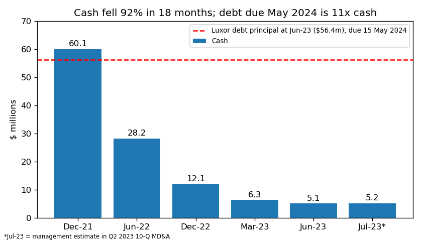
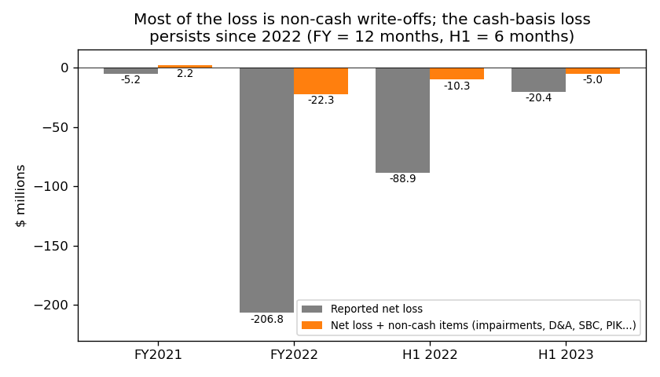
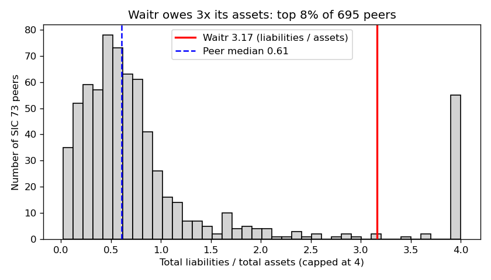

# Waitr Holdings (ASAP) — 10-Q for the period ending 30 Jun 2023, filed 18 Aug 2023, score 0.821

**Answer.** The score is high because the 8 inputs show a small company with deep losses (annualized net loss −$40.8m = −67% of revenue), negative operating cash flow, and liabilities 3.2× assets. Current liabilities ($78.6m) are 6× current assets because the $56.4m Luxor debt now falls due within a year. The filings back this up: going concern doubt, delisting, lender concessions, and debt maturing on 15 May 2024 that is 11× cash.

**Verdict: REAL RISK.** My risk estimate: **high, about 50%** (the base rate for scores above 0.7 is 18%). **I agree with the model.**

## The 8 inputs (annualized flows, $m)
Year before = 10-Q for the period ending Jun 2022 ([filing](https://www.sec.gov/Archives/edgar/data/1653247/000165324722000126/wtrh-20220630.htm)). Peers = 703 SIC-73 companies with periods ending Mar–Jun 2023 ([financials.csv](../../shared/financials.csv)). Percentile = share of peers below Waitr.

| Input | Jun-23 | Jun-22 | What drives it | Peer pctile ($ / ratio) |
|---|---|---|---|---|
| Total assets | 25.4 | 154.5 | Goodwill written off ($9.5m in Q2), cash down | 28 / – |
| Current assets | 12.6 | 38.0 | Cash $5.1m | 28 / 53 (of assets) |
| Current liabilities | 78.6 | 32.5 | Luxor debt reclassified to current | 50 / **93** (of assets) |
| Total liabilities | 80.3 | 96.9 | Mostly $56.4m Luxor debt | 43 / **92** (of assets) |
| Revenue | 61.3 | 132.4 | Orders −64% y/y | 35 / – |
| Net income | −40.8 | −177.8 | Includes $9.5m impairment (2022: $67.2m) | 26 / **20** (of revenue) |
| Operating income | −37.0 | −165.5 | Same | 26 / 21 |
| Operating cash flow | −11.5 | −27.7 | Burn is slowing | 17 / 24 |

No input is missing. Liabilities/assets 3.17 (peer median 0.61); current ratio 0.16 (peer median 1.35, 10th percentile); equity −$55.0m. Burn: $5.7m in H1 (≈5 months of cash) but $0.9m in Q2 (≈17 months).

## Main reasons (in order; I can't see the model's feature weights, so this order is my inference)
1. **Debt due within a year that cash can't cover** *(model input: current liabilities; detail from the filings)*. 10-Q (18 Aug 2023, MD&A Liquidity): "As of June 30, 2023, the Company has outstanding debt in the principal amount of $56,355 with a maturity date of May 15, 2024." That is 11× cash; current liabilities/assets 3.10, top 7% of peers. [10-Q](https://www.sec.gov/Archives/edgar/data/1653247/000165324723000057/wtrh-20230630.htm)
2. **Large losses, negative equity** *(model input)*. Net margin −67% (bottom 20% of peers); liabilities 3.2× assets. [10-Q](https://www.sec.gov/Archives/edgar/data/1653247/000165324723000057/wtrh-20230630.htm)
3. **Going concern doubt and a short cash runway** *(from the filings)*. 10-Q MD&A: "We believe that we have sufficient cash on hand to fund operations through at least the third fiscal quarter of 2023." It names "commencing a case under the U.S. Bankruptcy Code" as an option. Moss Adams' FY2022 audit report also cites "substantial doubt". [10-Q](https://www.sec.gov/Archives/edgar/data/1653247/000165324723000057/wtrh-20230630.htm), [10-K](https://www.sec.gov/Archives/edgar/data/1653247/000165324723000038/wtrh-20221231.htm)
4. **Lenders are granting concessions** *(from the filings)*. Interest is paid in kind (added to the loan), booked as troubled debt restructurings. 10-Q Note 8: "Management concluded that there were indicators of financial difficulty for the Company at this date." 8-K (30 Jun 2023): "PIK one hundred percent of the accrued interest". Cash interest paid H1 2023: $40k. [8-K Jun-23](https://www.sec.gov/Archives/edgar/data/1653247/000165324723000046/wtrh-20230630.htm)
5. **Equity funding is shut off** *(from the filings)*. Nasdaq "had determined that the Company’s common stock will be delisted from the Nasdaq Capital Market" (8-K, 24 Jan 2023). 10-Q: "The Company does not anticipate utilizing its ATM Program in fiscal 2023." [8-K Jan-23](https://www.sec.gov/Archives/edgar/data/1653247/000165324723000013/wtrh-20230124.htm)
6. **The business is shrinking** *(model input: revenue)*. Q2 revenue $14.0m vs $31.2m (−55%); daily orders 18,070 → 6,559 (−64%). [10-Q](https://www.sec.gov/Archives/edgar/data/1653247/000165324723000057/wtrh-20230630.htm)

Source: balance sheets in the 10-K and 10-Qs ([10-Q](https://www.sec.gov/Archives/edgar/data/1653247/000165324723000057/wtrh-20230630.htm)).

## Evidence against
- **Most of the loss is non-cash.** Adding back the same cash-flow-statement non-cash items each period, H1 2023 loss is −$5.0m (not −$20.4m); FY2022 −$22.3m (not −$206.8m). Still negative since 2022. [10-Q](https://www.sec.gov/Archives/edgar/data/1653247/000165324723000057/wtrh-20230630.htm), [10-K](https://www.sec.gov/Archives/edgar/data/1653247/000165324723000038/wtrh-20221231.htm)
- **The lender is an insider and has been supportive.** "Jonathan Green, a board member of the Company, is a partner at Luxor Capital." (10-Q Note 16). Luxor has repeatedly amended, waived and converted debt; 10-Q Part II Item 3 (Defaults): "Not applicable". [10-Q](https://www.sec.gov/Archives/edgar/data/1653247/000165324723000057/wtrh-20230630.htm)
- **Cash burn is slowing and costs are being cut.** Q2 operating outflow $0.9m; management reports cash of ~$5.2m at 31 Jul. 10-Q Note 1: "Uber Direct will provide the delivery services for the Company’s online ordering of food and other items" (my inference: lower driver costs). [10-Q](https://www.sec.gov/Archives/edgar/data/1653247/000165324723000057/wtrh-20230630.htm)

Source: cash-flow statements, [10-K](https://www.sec.gov/Archives/edgar/data/1653247/000165324723000038/wtrh-20221231.htm), [10-Q](https://www.sec.gov/Archives/edgar/data/1653247/000165324723000057/wtrh-20230630.htm).

## How it developed
- **Jan 2022:** Waitr receives a Nasdaq notice that its share price is below $1 ([8-K Jul-22](https://www.sec.gov/Archives/edgar/data/1653247/000165324722000114/wtrh-20220727.htm)).
- **Q1 2022:** A $67.2m goodwill impairment ([10-Q Q2-22](https://www.sec.gov/Archives/edgar/data/1653247/000165324722000126/wtrh-20220630.htm)).
- **May 2022:** "Waitr Inc. has made a $20 million prepayment with respect to the term loan", and maturity is extended to 15 May 2024 ([8-K](https://www.sec.gov/Archives/edgar/data/1653247/000165324722000054/wtrh-20220510.htm)).
- **Jul 2022:** $6.75m of notes are converted to shares ([8-K](https://www.sec.gov/Archives/edgar/data/1653247/000165324722000111/wtrh-20220725.htm)).
- **FY2022:** Impairments total $154m and cash falls from $60.1m to $12.1m ([10-K](https://www.sec.gov/Archives/edgar/data/1653247/000165324723000038/wtrh-20221231.htm)).
- **6 Jan 2023:** Lenders agree to "waive the requirement for the audit report to be unqualified as to going concern" ([8-K](https://www.sec.gov/Archives/edgar/data/1653247/000165324723000006/wtrh-20230109.htm)).
- **2 Feb 2023:** Delisted from Nasdaq; shares move to OTCQB ([8-K](https://www.sec.gov/Archives/edgar/data/1653247/000165324723000013/wtrh-20230124.htm)).
- **31 Mar 2023:** NT 10-K filed (late annual report); first 100% interest-in-kind amendment ([NT 10-K](https://www.sec.gov/Archives/edgar/data/1653247/000165324723000022/wtrh-20221231xnt10xk.htm), [8-K](https://www.sec.gov/Archives/edgar/data/1653247/000165324723000025/wtrh-20230403.htm)).
- **Jun–Aug 2023:** Interest paid in kind again; NT 10-Q filed (late quarterly report); the debt becomes current ([NT 10-Q](https://www.sec.gov/Archives/edgar/data/1653247/000165324723000054/wtrh-20230630xnt10xq.htm)).

Source: [financials.csv](../../shared/financials.csv), SIC 73, filed on or before 18 Aug 2023.

## Dates to watch
- **30 Sep 2023:** Q3 interest PIK allowed; watch whether Q4 PIK is granted ([8-K](https://www.sec.gov/Archives/edgar/data/1653247/000165324723000046/wtrh-20230630.htm)).
- **Q3 2023 end:** management's cash runway; Uber Direct rollout ([10-Q](https://www.sec.gov/Archives/edgar/data/1653247/000165324723000057/wtrh-20230630.htm)).
- **19 Nov 2023:** Q3 statements due to lenders ([8-K](https://www.sec.gov/Archives/edgar/data/1653247/000165324723000046/wtrh-20230630.htm)).
- **15 May 2024:** $56.4m of debt matures ([10-Q](https://www.sec.gov/Archives/edgar/data/1653247/000165324723000057/wtrh-20230630.htm)).
- **Lower my risk:** maturity extension or note conversion by Luxor, or a private placement funding ~12 months ([10-Q](https://www.sec.gov/Archives/edgar/data/1653247/000165324723000057/wtrh-20230630.htm)).
- **Raise it:** missed payment, forbearance, restructuring advisors, another NT filing ([NT 10-Q](https://www.sec.gov/Archives/edgar/data/1653247/000165324723000054/wtrh-20230630xnt10xq.htm)).

## How sure I am
Moderately sure.
- **Moved above 18% by:** debt 11× cash due in 9 months; no ATM access; runway stated only through Q3 2023; TDR concessions.
- **Held below "very high" by:** insider lender, slowing burn.
- **Not checked:** exhibit texts, Luxor's equity stake, model weights.
- **Data:** CSV has only three Waitr rows; year-before figures come from the 2022 10-Q, whose annualized H1 includes a $67.2m impairment.
- **Hindsight:** I know from outside this exercise that Waitr later entered bankruptcy (2024). I did not use it; every claim comes from sources dated on or before 18 Aug 2023.

## Filings used
10-Q 2023-08-18; 10-Q 2023-05-11; 10-K 2023-04-17; 10-Q 2022-08-08; NT 10-Q 2023-08-14; NT 10-K 2023-03-31; 8-K 2023-06-30, 2023-04-03, 2023-02-03, 2023-01-24, 2023-01-23, 2023-01-09, 2022-10-04, 2022-08-18, 2022-07-27, 2022-07-25, 2022-05-25, 2022-05-17, 2022-05-10, 2022-04-22.
