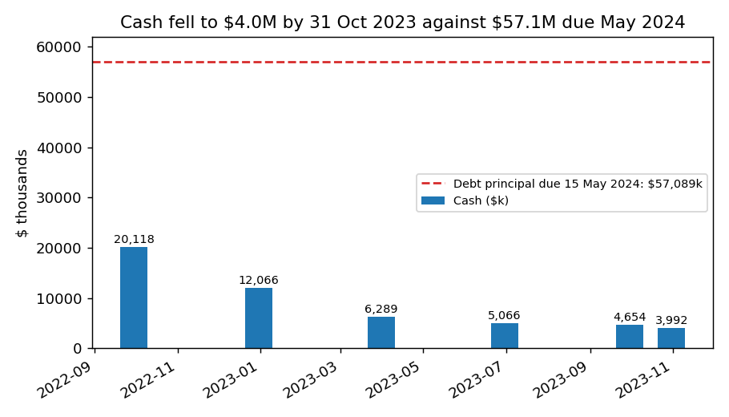
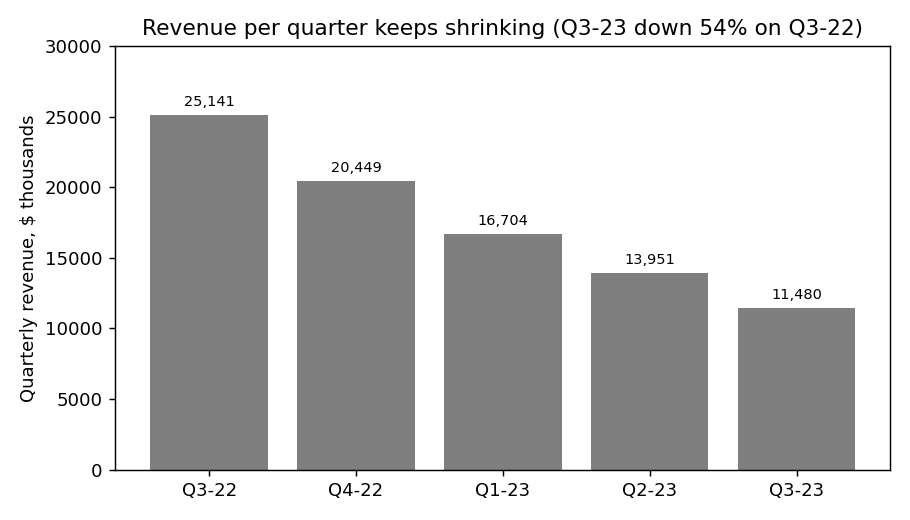
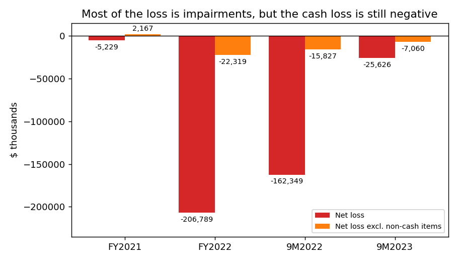
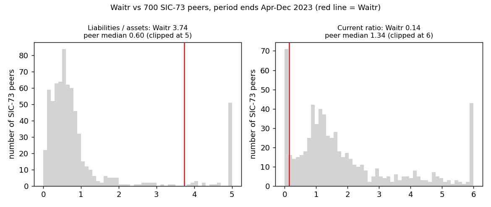

# Waitr Holdings 10-Q, period 30 Sep 2023, filed 13 Nov 2023 – score 0.709

**Answer.** The score is high because the annualized net loss ($34.2M) is 1.6× total assets ($21.6M), liabilities are 3.7× assets, and current liabilities are 7× current assets. Most of the loss is impairments, but the balance sheet is real: $57.1M of debt is due 15 May 2024, and cash was $4.0M on 31 Oct 2023.

**Verdict: real risk.** My own risk is **high, about 50%** of bankruptcy within 12 months, up from the band's 18%. What moved me up: debt 14× cash due within six months, cash running out before maturity, and no equity route. What held me back: an insider lender that has always accommodated. I agree with the model.

## The 8 model inputs ($ thousands; income and cash flow annualized ×4/3 from nine months)

| Input | Q3 2023 | Q3 2022 | What drives it | Peer rank (700 SIC-73 peers) |
|---|---|---|---|---|
| Total assets | 21,585 | 90,651 | Goodwill and intangibles written off | 26th pct |
| Current assets | 10,814 | 29,890 | Cash down to 4,654 | 29th pct |
| Current liabilities | 79,520 | 28,579 | Lender debt reclassified as due within 1 year | 51st pct |
| Total liabilities | 80,650 | 86,816 | Mostly Luxor loans (57,089 principal) | 44th pct |
| Revenue | 56,180 | 121,803 | Daily orders down 68% | 33rd pct |
| Net income | −34,168 | −216,465 | Goodwill impairment 9,536 (2022: 121,088) | 27th pct |
| Operating income | −30,147 | −194,111 | Same impairments | 26th pct |
| Operating cash flow | −8,029 | −28,935 | Cost cuts, interest paid in kind | 17th pct |

None missing. Percentile = share of peers with a lower value. Scaled to size, Waitr is extreme: liabilities/assets 3.74 (peer median 0.60; 9% of peers higher), current ratio 0.14 (median 1.34; 11% lower), net income/assets −1.58 (median −0.07). Mid-pack in dollar size, so not a small-company effect. *Driver order is my inference; I can't see each input's effect.*

## Main reasons, in order

1. **Debt due that cash can't cover (from the filings).** Cash of $3,992k (31 Oct) covers 7% of $57,089k due 15 May 2024. *"As of September 30, 2023, the Company has outstanding debt in the principal amount of $57,089 with a maturity date of May 15, 2024."* (10-Q, 13 Nov 2023, MD&A Liquidity) [source](https://www.sec.gov/Archives/edgar/data/1653247/000165324723000072/wtrh-20230930.htm)
2. **About six months of cash (filings, my calculation).** Cash fell $662k in October, leaving 6.0 months at that pace; the Q3 loss excluding non-cash items ($674k/month) gives 6.9. Q3 operating cash flow (−$295k) is flattered by working capital and in-kind interest. *"We believe that we have sufficient cash on hand to fund operations through at least the fourth fiscal quarter of 2023."* (10-Q, 13 Nov 2023, MD&A Liquidity) [source](https://www.sec.gov/Archives/edgar/data/1653247/000165324723000072/wtrh-20230930.htm)
3. **Liabilities far above assets (model input).** Equity is −$59,065k. Liabilities/assets went from 0.96 a year earlier to 3.74. [source](https://www.sec.gov/Archives/edgar/data/1653247/000165324723000072/wtrh-20230930.htm)
4. **Losses and a shrinking business (model input).** Q3 revenue fell 54% year on year. *"Average Daily Orders for the three months ended September 30, 2023 and 2022 were approximately 4,557 and 14,156, respectively"* (10-Q, 13 Nov 2023, MD&A Overview) [source](https://www.sec.gov/Archives/edgar/data/1653247/000165324723000072/wtrh-20230930.htm)
5. **Funding routes closed (from the filings).** Delisted from Nasdaq; at-the-market (ATM) share sales unusable: *"The Company does not anticipate being able to utilize its ATM Program."* (10-Q, 13 Nov 2023, Note 3) [source](https://www.sec.gov/Archives/edgar/data/1653247/000165324723000072/wtrh-20230930.htm). Management names bankruptcy: *"including commencing a case under the U.S. Bankruptcy Code."* (same filing, MD&A Liquidity)
6. **Lender concessions treated as troubled debt (from the filings).** *"Management concluded that there were indicators of financial difficulty for the Company at this date."* (10-Q, 13 Nov 2023, Note 8 Debt) [source](https://www.sec.gov/Archives/edgar/data/1653247/000165324723000072/wtrh-20230930.htm). Auditor quit: *"Moss Adams made the decision to decline to stand for re-appointment"* (8-K, 11 Sep 2023, Item 4.01) [source](https://www.sec.gov/Archives/edgar/data/1653247/000165324723000065/wtrh-20230911.htm)

## Evidence against

- **Mostly non-cash loss.** Adjusting every period the same way from the cash-flow statement, non-cash items are 72% of the 9M-2023 loss (FY2022: 89%); excluding them, the loss is −$7,060k (9M-2022: −$15,827k). [source](https://www.sec.gov/Archives/edgar/data/1653247/000165324723000072/wtrh-20230930.htm)
- **Insider lender keeps accommodating.** Luxor has granted repeated amendments, waivers and in-kind interest. *"Jonathan Green, a board member of the Company, is a partner at Luxor Capital."* (10-Q, 13 Nov 2023, Note 16 Related-Party) [source](https://www.sec.gov/Archives/edgar/data/1653247/000165324723000072/wtrh-20230930.htm). It extended maturity in May 2022 (10-K, 17 Apr 2023) [source](https://www.sec.gov/Archives/edgar/data/1653247/000165324723000038/wtrh-20221231.htm)
- **No missed payments.** Part II Item 3 (Defaults) reads "Not applicable"; cost cuts reduced the nine-month cash burn by 72%: *"the Company discontinued the use of independent contractor drivers and outsourced all delivery services to Uber Direct"* (10-Q, 13 Nov 2023, MD&A) [source](https://www.sec.gov/Archives/edgar/data/1653247/000165324723000072/wtrh-20230930.htm)

## How it developed

- **May 2022:** The company paid $20,000 of cash to push the maturity out to 15 May 2024 (10-K, 17 Apr 2023, Liquidity) [source](https://www.sec.gov/Archives/edgar/data/1653247/000165324723000038/wtrh-20221231.htm)
- **9 Nov 2022:** First going-concern doubt, after $121M of goodwill impairments (10-Q, 9 Nov 2022, Note 3) [source](https://www.sec.gov/Archives/edgar/data/1653247/000165324722000158/wtrh-20220930.htm)
- **9 Jan 2023:** Lender waiver: *"waive the requirement for the audit report to be unqualified as to going concern"* (8-K, 9 Jan 2023, Item 1.01) [source](https://www.sec.gov/Archives/edgar/data/1653247/000165324723000006/wtrh-20230109.htm)
- **24 Jan 2023:** Nasdaq delisting notice; trading moved to OTCQB on 2 Feb (8-K, 24 Jan 2023, Item 3.01) [source](https://www.sec.gov/Archives/edgar/data/1653247/000165324723000013/wtrh-20230124.htm)
- **31 Mar / 14 Aug 2023:** Late-filing notices (NT 10-K [source](https://www.sec.gov/Archives/edgar/data/1653247/000165324723000022/wtrh-20221231xnt10xk.htm); NT 10-Q [source](https://www.sec.gov/Archives/edgar/data/1653247/000165324723000054/wtrh-20230630xnt10xq.htm))
- **17 Apr 2023:** Auditor: *"the Company has suffered recurring losses from operations and declines in cash positions that raise substantial doubt about its ability to continue as a going concern"* (10-K, Auditor's report) [source](https://www.sec.gov/Archives/edgar/data/1653247/000165324723000038/wtrh-20221231.htm)
- **Q2 2023:** Debt became current; current ratio fell from 0.60 to 0.16 (10-Q, 18 Aug 2023) [source](https://www.sec.gov/Archives/edgar/data/1653247/000165324723000057/wtrh-20230630.htm)
- **30 Jun 2023:** 100% interest in kind allowed only through Q3 2023 (8-K, 30 Jun 2023, Item 1.01) [source](https://www.sec.gov/Archives/edgar/data/1653247/000165324723000046/wtrh-20230630.htm)

## Dates to watch and what would change my mind

- **31 Dec 2023:** cash guidance ends; first note-interest date after the 100% in-kind allowance lapses (normally ~33%) [source](https://www.sec.gov/Archives/edgar/data/1653247/000165324723000072/wtrh-20230930.htm)
- **Early 2024:** new auditor (8-K 4.01) and FY2023 10-K due ~end-March; an NT 10-K would be a warning [source](https://www.sec.gov/Archives/edgar/data/1653247/000165324723000065/wtrh-20230911.htm)
- **15 May 2024:** $57.1M maturity [source](https://www.sec.gov/Archives/edgar/data/1653247/000165324723000072/wtrh-20230930.htm)
- **Lower my risk:** a Luxor extension or conversion, or new private placement (8-K Item 1.01/3.02). **Raise it:** forbearance, restructuring advisors, or a missed interest payment (8-K Item 2.04). Plans: [source](https://www.sec.gov/Archives/edgar/data/1653247/000165324723000072/wtrh-20230930.htm)

## Charts

Cash vs debt due ([source](https://www.sec.gov/Archives/edgar/data/1653247/000165324723000072/wtrh-20230930.htm)).

Q4-22 = FY2022 minus 9M-2022 ([source](https://www.sec.gov/Archives/edgar/data/1653247/000165324723000038/wtrh-20221231.htm)).

Net loss vs loss excluding non-cash items ([source](https://www.sec.gov/Archives/edgar/data/1653247/000165324723000072/wtrh-20230930.htm)).

Peers: shared/financials.csv, SIC 73xx, periods Apr–Dec 2023, filed by 13 Nov 2023, Waitr excluded; Waitr values: [source](https://www.sec.gov/Archives/edgar/data/1653247/000165324723000072/wtrh-20230930.htm).

## How sure I am

Moderately confident; the cash-versus-maturity gap is clear. The key unknown is Luxor, lender and insider, which could extend, convert or foreclose out of court; only some paths are bankruptcy. Not checked: loan exhibits, Luxor's intentions, sale talks. Peer data are annualized and SIC-73 is broad. **Disclosure:** I believe I know from outside this record that Waitr later entered bankruptcy in 2024; I did not use it. All sources are dated on or before 13 Nov 2023.

## Filings used

10-Q 2023-11-13; 8-K 2023-09-11; 10-Q 2023-08-18; NT 10-Q 2023-08-14; 8-K 2023-06-30; 10-Q 2023-05-11; 10-K 2023-04-17; 8-K 2023-04-03; NT 10-K 2023-03-31; 8-K 2023-02-03, 01-24, 01-23, 01-09; 10-Q 2022-11-09; 8-K 2022-11-03, 10-04, 08-18, 07-25; 10-K 2022-03-11
