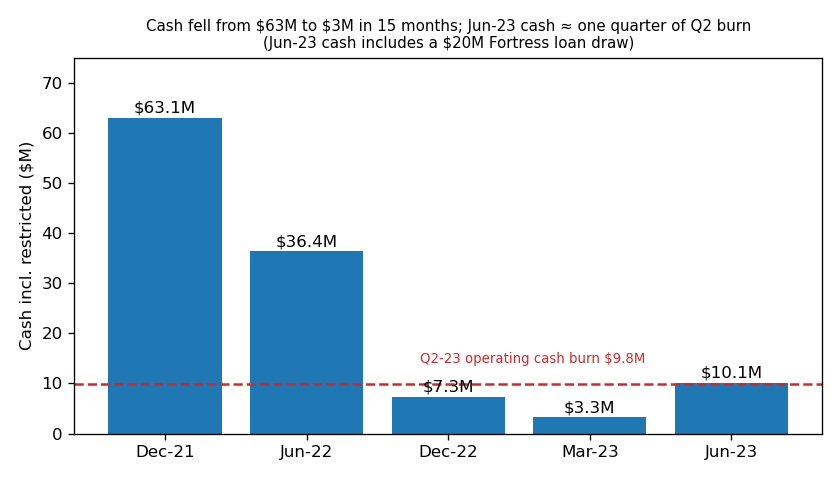
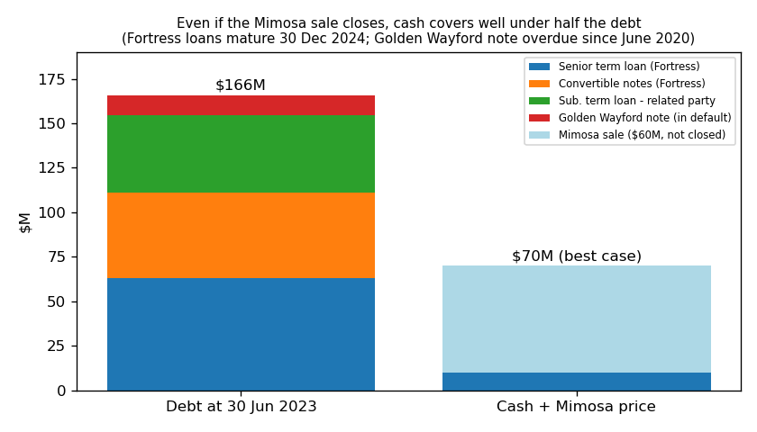
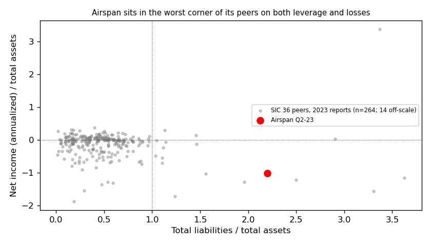
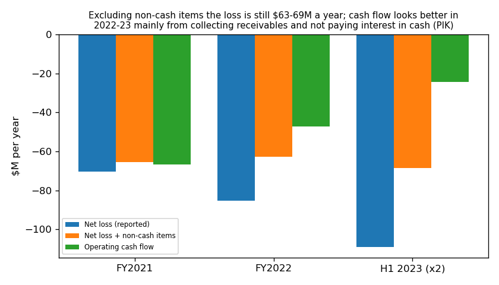

# Airspan Networks Holdings (CIK 1823882): 10-Q for 30 Jun 2023, filed 9 Aug 2023. Score 0.771

**Answer.** The annualized net loss (−$109M) is about as large as total assets ($108M), and liabilities are 2.2 times assets. Both are in the worst ~10% of SIC-36 peers, which is why the score is high. The filings confirm this is real distress: cash covers about one quarter of burn, payments were missed in March 2023, and the lender now demands a sale or refinancing that repays it in full.

**Verdict: real risk.** My risk: **high, ~50%** (base rate for scores above 0.7: 18%). I **agree** with the model.

*I know what later happened to Airspan; I did not use it. All sources are dated on or before 9 Aug 2023.*

## The 8 model inputs ($M)
Flows = H1 × 2. Prior = 31 Dec 2022 (balance sheet) or H1 2022 × 2 (flows). Peer pct = share of ~280 SIC-36 2023 reports below this value.

| Input | Q2-23 | Prior | Driver | Peer pct ($ / % of assets) |
|---|---|---|---|---|
| Total assets | 108.4 | 125.1 | Cash use; Mimosa moved to held-for-sale | 40th / – |
| Current assets | 75.0 | 89.7 | Receivables collected | 43rd / 68th |
| Current liabilities | 78.0 | 198.7 | Debt moved back to long-term after the May waiver | 54th / 93rd |
| Total liabilities | 238.2 | 205.9 | $20M new loan, unpaid (PIK) interest, fees | 62nd / **94th** |
| Revenue | 113.8 | 169.0 | Product sales −36% | 43rd / 79th |
| Net income | −109.0 | −101.5 | Operating loss, $8.3M debt-extinguishment loss, $7.2M inventory write-down | **11th / 9th** |
| Operating income | −76.8 | −87.0 | Cost cuts | 15th / 12th |
| Operating cash flow | −24.3 | −45.0 | Receivable collections and PIK interest flatter it | 20th / 22nd |

None missing. The company is mid-sized (40th percentile of assets), so this is not a small-company effect.

**Derived:** liabilities/assets 2.20 (peer median 0.46); current ratio 0.96 (peer median 2.35); equity −$129.8M. Cash $10.1M against a Q2 operating burn of $9.8M (Q1: $2.4M) gives **3.1 months** (4.6 at the H1 rate incl. capex).

## Main reasons
The order is my inference; I can't see feature attributions.

1. **The loss is about the size of the asset base** *(model input)*. Net income/assets is −1.01 (peer median −0.04). Adding back non-cash items the same way each year (cash-flow "Total adjustments" line), the loss is still −$65M (FY21), −$63M (FY22) and −$69M (H1-23 ×2). Non-cash items are only 37% of the H1 loss. [10-Q](https://www.sec.gov/Archives/edgar/data/1823882/000182912623005250/airspannetworks_10q.htm), [10-K](https://www.sec.gov/Archives/edgar/data/1823882/000182912623002099/airspannetworks_10k.htm)
2. **Liabilities are 2.2× assets, with $166M of debt** *(model input + filings)*. Fortress holds $111M of it, secured and due 30 Dec 2024. Only 6% of peers are more leveraged. The 10-Q, Note 10, says: "As a result of any of these actions, the Company could be forced into bankruptcy or liquidation." [10-Q](https://www.sec.gov/Archives/edgar/data/1823882/000182912623005250/airspannetworks_10q.htm)
3. **Missed payments, and more breaches expected** *(from the filings)*. The 10-Q, Note 10, says: "The Company did not make the payments due under the Fortress Credit Agreement and the Fortress Convertible Note Agreement on March 31, 2023, which was an event of default". It also says: "the Company has concluded it may not be in compliance with certain of the prospective financial covenants under the May 2023 Credit Agreement Amendment". [10-Q](https://www.sec.gov/Archives/edgar/data/1823882/000182912623005250/airspannetworks_10q.htm)
4. **The lender is forcing an exit** *(from the filings)*. The 8-K of 7 Jul 2023, Item 1.01, requires that by 30 Nov 2023 the company enter "a bona fide letter of intent and an exclusivity agreement for a sale of the Airspan Parties or their assets, or refinancing, which will result in net cash proceeds upon closing sufficient to repay all of the then outstanding Obligations". [8-K](https://www.sec.gov/Archives/edgar/data/1823882/000182912623004588/airspannet_8k.htm)
5. **Going concern doubt and delisting pressure** *(from the filings)*. The 10-Q, Note 2, says: "These conditions raise substantial doubt about the Company’s ability to continue as a going concern". The stock traded at "a 30-trading day average of less than $0.20 per share" (8-K, 11 Jul 2023). [8-K](https://www.sec.gov/Archives/edgar/data/1823882/000182912623004627/airspannet_8k.htm)

## Evidence against
- **The lender is still supporting the company.** Fortress waived the defaults and lent about $20M new money. The 10-Q, Note 10, says: "Each of these defaults was waived pursuant to the May 2023 Fortress Credit Agreement Amendment". [8-K, 18 May 2023](https://www.sec.gov/Archives/edgar/data/1823882/000182912623003579/airspannetworks_8k.htm)
- **An asset sale is pending.** Mimosa is being sold to Radisys, a Reliance Jio affiliate (Reliance Jio is a shareholder), "for an aggregate purchase price of approximately $60,000,000 in cash" (8-K, 9 Mar 2023). The 10-Q, Note 1, says: "We anticipate that the closing will occur in August 2023." [8-K](https://www.sec.gov/Archives/edgar/data/1823882/000182912623001923/airspannetworks_8k.htm)
- **No Fortress maturity before Dec 2024; costs cut.** Part of the interest is paid in kind. The 8-K of 27 Jul 2023 says the company "is engaged in a restructuring program to reduce operating costs". [8-K](https://www.sec.gov/Archives/edgar/data/1823882/000182912623004960/airspannetworks_8k.htm)

My inference: even the best case ($10M cash + $60M Mimosa = $70M) is far below $166M of debt.

## How it developed
- **Jun 2020:** Golden Wayford note matured unpaid; still in default. [10-Q](https://www.sec.gov/Archives/edgar/data/1823882/000182912623005250/airspannetworks_10q.htm)
- **Aug 2021:** SPAC merger raised $115.5M net; Dec-21 cash $63.1M. [10-K](https://www.sec.gov/Archives/edgar/data/1823882/000182912623002099/airspannetworks_10k.htm)
- **Mar–Apr 2022:** Late FY21 10-K; covenants reset, then the 10-K said "there is no longer substantial doubt". [8-K](https://www.sec.gov/Archives/edgar/data/1823882/000182912622007857/airspannetworks_8k.htm), [10-K 2022](https://www.sec.gov/Archives/edgar/data/1823882/000182912622007958/airspannetworks_10k.htm)
- **29 Nov 2022:** Minimum-liquidity covenant breached until May 2023 (10-Q, Note 10).
- **16 Mar 2023:** The auditor flagged going concern doubt; the company "was in default of certain debt covenants of its senior term loan agreement". Cash was $7.3M. [10-K](https://www.sec.gov/Archives/edgar/data/1823882/000182912623002099/airspannetworks_10k.htm)
- **31 Mar 2023:** Fortress payments missed; cash $3.3M. [Q1 10-Q](https://www.sec.gov/Archives/edgar/data/1823882/000182912623003233/airspannetworks_10q.htm)
- **18 May 2023:** Waiver, new loan at a higher rate, $0.01 lender warrants, CEO change. [8-K](https://www.sec.gov/Archives/edgar/data/1823882/000182912623003579/airspannetworks_8k.htm)
- **Jun–Jul 2023:** NYSE American notices; lender M&A milestone. [8-K](https://www.sec.gov/Archives/edgar/data/1823882/000182912623004149/airspan_8k.htm)

## Dates to watch
- **15 Aug 2023:** Mimosa termination date. Failure raises my risk; closing with cash retained lowers it. [8-K](https://www.sec.gov/Archives/edgar/data/1823882/000182912623004861/airspannet_8k.htm)
- **30 Sep / 31 Dec 2023:** Covenant tests (new breaches or waivers). [10-Q](https://www.sec.gov/Archives/edgar/data/1823882/000182912623005250/airspannetworks_10q.htm)
- **30 Nov 2023:** Fortress LOI deadline; a full refinancing or buyer would sharply cut my risk. [8-K](https://www.sec.gov/Archives/edgar/data/1823882/000182912623004588/airspannet_8k.htm)
- **10 Jan 2024:** NYSE reverse-split/price deadline. [8-K](https://www.sec.gov/Archives/edgar/data/1823882/000182912623004627/airspannet_8k.htm)
- **30 Dec 2024:** About $111M of Fortress debt matures.

## Charts

Sources: [10-K](https://www.sec.gov/Archives/edgar/data/1823882/000182912623002099/airspannetworks_10k.htm), [Q1 10-Q](https://www.sec.gov/Archives/edgar/data/1823882/000182912623003233/airspannetworks_10q.htm), [Q2 10-Q](https://www.sec.gov/Archives/edgar/data/1823882/000182912623005250/airspannetworks_10q.htm)

Sources: [10-Q](https://www.sec.gov/Archives/edgar/data/1823882/000182912623005250/airspannetworks_10q.htm), [8-K](https://www.sec.gov/Archives/edgar/data/1823882/000182912623001923/airspannetworks_8k.htm)

Source: `shared/financials.csv` (rows filed ≤ 20230809) and the [10-Q](https://www.sec.gov/Archives/edgar/data/1823882/000182912623005250/airspannetworks_10q.htm)

Sources: [10-K](https://www.sec.gov/Archives/edgar/data/1823882/000182912623002099/airspannetworks_10k.htm), [10-Q](https://www.sec.gov/Archives/edgar/data/1823882/000182912623005250/airspannetworks_10q.htm)

## Confidence and limits
I'm **fairly sure** the risk is real; 50% is a judgement. Not checked: undrawn Fortress capacity ($25M delayed-draw line set up, $20M drawn, remainder unclear), whether Mimosa proceeds must go to Fortress, and customer concentration. Peers are matched by 2-digit SIC only. The dataset has only 3 company rows, so FY21 figures come from the filings.

## Filings used
- 10-Q: 9 Aug 2023; 10 May 2023
- 10-K: 16 Mar 2023; 8 Apr 2022
- 8-K: 27 Jul, 25 Jul, 11 Jul, 7 Jul, 14 Jun, 18 May, 12 May, 9 Mar, 10 Jan 2023; 23 Jun, 6 Apr, 30 Mar 2022
- 8-K/A: 26 May 2023
- NT 10-K: 16 Mar 2022; NT 10-K/A: 31 Mar 2022
