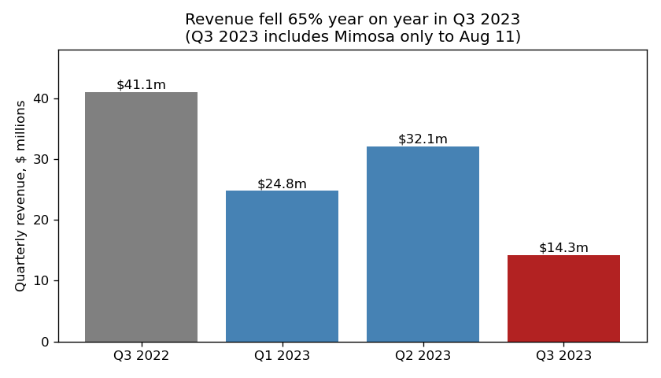
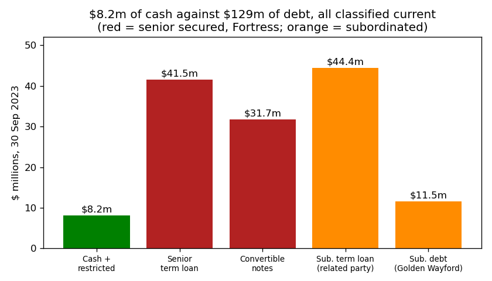
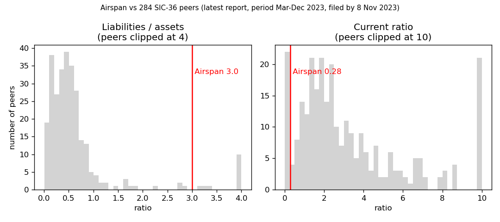

# Airspan Networks Holdings (CIK 1823882): 10-Q to 30 Sep 2023, filed 8 Nov 2023. Score 0.710

## Answer
The numbers show liabilities at 3.0 times assets, current liabilities at 3.6 times current assets, and a $59m annualized loss on $95m of revenue, flattered by a one-off $28.6m gain on the Mimosa sale. The filing is worse: the company **missed a payment to its senior lender on 31 Oct 2023** and holds $8.2m of cash against $129m of debt, all of it current.

**Verdict: real risk.** My risk: **very high, about 60%** within 12 months. **I agree with the model.**

## The 8 model inputs ($m; flows are 9 months annualized)
| Input | Q3 2023 | FY2022 | Driver | Peer pct (SIC 36) |
|---|---|---|---|---|
| Total assets | 59.0 | 125.1 | Mimosa sold; receivables down | 32nd |
| Current assets | 47.8 | 89.7 | Cash only 8.2 | 36th |
| Current liabilities | 172.3 | 198.7 | All debt current (covenant breaches) | 67th |
| Total liabilities | 176.7 | 205.9 | $45m repaid from the sale proceeds | 55th |
| Revenue | 94.9 | 167.3 | −43% over 9 months, −65% in Q3 | 42nd |
| Net income | −59.5 | −85.4 | Includes the $28.6m gain; −97.7 without it | 17th (10th of NI/assets) |
| Operating income | −65.7 | −68.0 | Gross profit fell faster than opex | 16th |
| Operating cash flow | −39.2 | −47.2 | Q3 alone −17.2 | 14th (9th of OCF/assets) |

Source: [financials.csv][csv]. None missing. FY2022 is used because the CSV has no Q3 2022 row. Size doesn't explain the score (assets at the 32nd percentile). The ratios do: liabilities/assets 3.00 against a peer median of 0.47 (96th pct), current ratio 0.28 against 2.33 (8th pct).

## Main reasons
The order is my inference; I can't see each input's weight.

1. **Missed payment, live defaults** (filings, [Q3 10-Q][q3] Note 10). "the Company did not make the principal and interest payments due under the Fortress Credit Agreement on October 31, 2023, which was an event of default under the Fortress Credit Agreement and the Fortress Convertible Note Agreement." Also "not in compliance with the minimum liquidity covenant under the Fortress Credit Agreement and the Fortress Convertible Note Agreement at all times since October 26, 2023". No waiver is reported.
2. **Cash cannot cover the debt** (model inputs plus filings). Cash $8.2m vs debt $129.2m ($73.3m senior secured with Fortress, $55.9m subordinated), 15.8 times cash. [Q3 10-Q][q3] Note 2: "Cash on hand will not allow the Company to reasonably expect to meet its ongoing cash requirements" and "As a result of any of these actions, the Company could be forced into bankruptcy or liquidation."
3. **About 1.4 months of cash** (model input). Quarterly operating cash flow went from −$2.4m in Q1 to −$9.8m in Q2 and −$17.2m in Q3 ([Q1][q1], [Q2][q2], [Q3][q3] cash flow statements). That leaves 1.4 months at the Q3 rate, 2.5 at the 9-month average. OCF/assets is −0.66 against a peer median of −0.01.
4. **The loss is cash** (model input). I applied one rule to every period: net loss plus the cash flow statement's "Total adjustments". That gives −$62.8m (FY2022), −$53.6m (9M 2022) and −$52.0m (9M 2023) ([10-K][k], [Q3 10-Q][q3]). The underlying loss is not shrinking. Net income/assets is −1.01 against a peer median of −0.06.
5. **Going concern, listing, governance** (filings). The [Q3 10-Q][q3] says "These conditions raise substantial doubt about the Company’s ability to continue as a going concern". The NYSE share-price cure must happen by a date "no later than January 10, 2024" ([8-K Jul 2023][nyse]). "On November 8, 2023, Dominique Trempont resigned from the board of directors of the Company effective immediately" ([Q3 10-Q][q3] Part II Item 5).

## Evidence against
- **The lender has forgiven before.** After the missed 31 Mar 2023 payment, "Each of these defaults were waived pursuant to the May 2023 Fortress Credit Agreement Amendment and the May 2023 Fortress Convertible Note Agreement Amendment and the missed payments were paid at a later date." Fortress lent $20m new money in Q2 ([Q3 10-Q][q3]; [8-K May 2023][may]).
- **The subordinated lender is tied to Fortress.** "This related party has an indirect, non-controlling beneficial interest in Fortress" ([Q3 10-Q][q3] Note 17).
- **Assets are saleable:** Mimosa fetched ~$60m ([8-K Aug 2023][aug]).
- **Maturities are 30 Dec 2024** ([Q3 10-Q][q3]); NYSE accepted the equity plan to 9 Dec 2024 ([8-K Aug 25][plan]).

None of these supplies money after 31 Oct.

## How it developed
- **30 Jun 2020:** the Golden Wayford note matured and has "remained outstanding as of September 30, 2023 and in default under the terms of the arrangement." ([Q3 10-Q][q3] MD&A).
- **16 Mar 2023:** cash had fallen from $62.9m to $7.3m in 2022; the auditor flagged going concern because "the Company was in default of certain debt covenants of its senior term loan agreement" ([10-K][k]).
- **8 Mar 2023:** the company agreed to sell Mimosa ([8-K Mar 2023][mar]). **31 Mar:** missed a Fortress payment ([Q3 10-Q][q3] Note 10). **18 May:** waiver, rate raised to 10%, new $25m commitment ([8-K May 2023][may]).
- **Jun–Jul 2023:** sale-or-refinance milestone added ([8-K Jul 7][m]); NYSE notices ([8-K Jul 2023][nyse]).
- **11 Aug 2023:** the sale closed, leaving only $10.5m of net cash ([Q3 10-Q][q3] Note 2).
- **26/31 Oct 2023:** covenant breach, missed payment; **6–8 Nov:** two directors quit ([Q3 10-Q][q3]).

## Dates to watch
- **30 Nov 2023:** the company must have "entered into a bona fide letter of intent and an exclusivity agreement for a sale of the Airspan Parties or their assets, or refinancing" ([8-K Jul 7][m]).
- **31 Dec 2023:** convertible-note interest due. **10 Jan 2024:** NYSE share-price deadline ([8-K Jul 2023][nyse]). **Mar 2024:** FY2023 10-K and auditor opinion. **30 Dec 2024:** maturities ([Q3 10-Q][q3]).
- **Lower risk if:** a forbearance with new money, or a sale repaying secured debt. **Confirmed if:** acceleration, an 8-K Item 2.04, restructuring advisers, or a missed 31 Dec payment.

## Charts

Source: [Q3 10-Q][q3]; Q1–Q2 from [financials.csv][csv].

Source: [Q3 10-Q][q3] balance sheet.

Source: [financials.csv][csv], 284 SIC-36 peers.

## How sure I am
Fairly sure; the missed payment is explicit. I started from the band's 18% base rate and moved up for the unwaived payment default, cash at 6% of debt, 1.4 months of runway and the 30 Nov milestone. The lender's waiver history keeps me from going higher. Couldn't check: forbearance talks, the size of the 31 Oct payment, backlog, or the value of the remaining business. **Disclosure:** I know from training that Airspan filed Chapter 11 in 2024; I did not use it. Every source is dated on or before 8 Nov 2023.

## Filings used
10-Q (8 Nov, 9 Aug, 10 May 2023); 10-K (16 Mar 2023); 8-K (2023: 25/11 Aug, 27/25/11/7 Jul, 14 Jun, 18/12 May, 9 Mar, 10 Jan; 23 Jun 2022); 8-K/A (26 May 2023); NT 10-K, NT 10-K/A (Mar 2022, FY2021: "additional time to finalize its financial statements").

[q3]: https://www.sec.gov/Archives/edgar/data/1823882/000182912623007197/airspannetworks_10q.htm
[q2]: https://www.sec.gov/Archives/edgar/data/1823882/000182912623005250/airspannetworks_10q.htm
[q1]: https://www.sec.gov/Archives/edgar/data/1823882/000182912623003233/airspannetworks_10q.htm
[k]: https://www.sec.gov/Archives/edgar/data/1823882/000182912623002099/airspannetworks_10k.htm
[mar]: https://www.sec.gov/Archives/edgar/data/1823882/000182912623001923/airspannetworks_8k.htm
[may]: https://www.sec.gov/Archives/edgar/data/1823882/000182912623003579/airspannetworks_8k.htm
[m]: https://www.sec.gov/Archives/edgar/data/1823882/000182912623004588/airspannet_8k.htm
[nyse]: https://www.sec.gov/Archives/edgar/data/1823882/000182912623004627/airspannet_8k.htm
[aug]: https://www.sec.gov/Archives/edgar/data/1823882/000182912623005342/airspannetworks_8k.htm
[csv]: ../../shared/financials.csv
[plan]: https://www.sec.gov/Archives/edgar/data/1823882/000182912623005668/airspan_8k.htm
