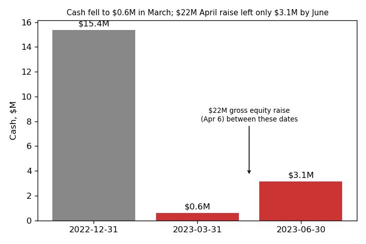
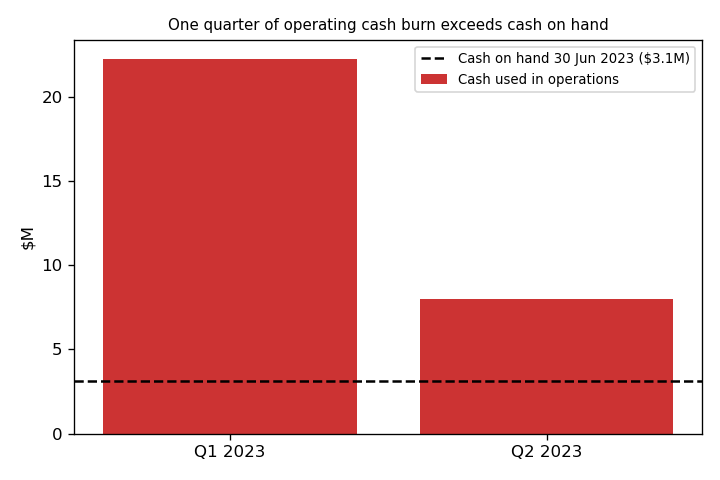
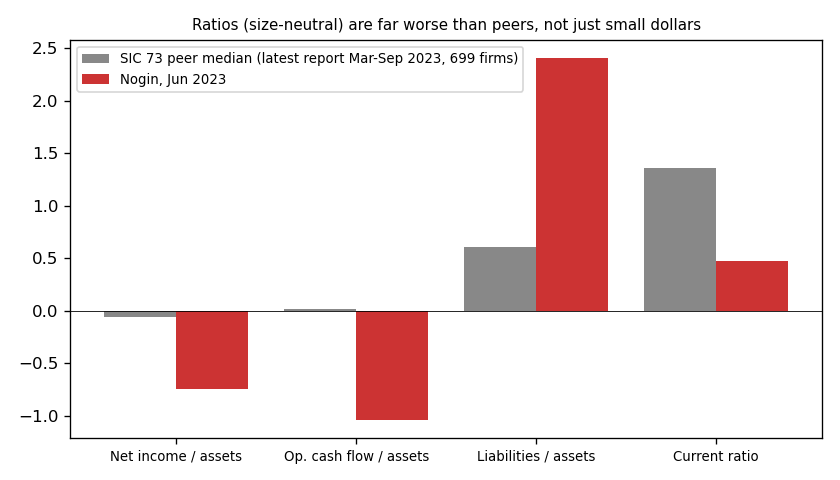

# Nogin, Inc. — 10-Q for Q2 2023 (filed 2023-08-14), model score 0.701

**Answer.** The score is high because the loss, the cash burn and the debt are all large next to a small asset base. Annualized net loss is $43.5M on $57.9M of assets, operating cash flow is −$60.4M, and liabilities are 2.4× assets. The filings make the picture worse: the company has already missed a bond interest payment, and it had $3.1M of cash against about $2.7M of monthly burn.

**Verdict: real risk.** My own risk is **high, about 45%** of bankruptcy within 12 months, against 18% for the >0.7 band. I agree with the model.

## The 8 inputs (income and cash flow annualized, $M)

| Input | Jun-2023 10-Q | FY2022 10-K | What drives it (filings) | Peer rank* |
|---|---|---|---|---|
| Total assets | 57.9 | 74.9 | Cash fell $12.2M | 34th pct |
| Current assets | 20.2 | 35.2 | Cash $3.1M, inventory $13.1M | 31st |
| Current liabilities | 42.4 | 53.7 | H1 paydown of $7.3M due to clients | 42nd |
| Total liabilities | 139.3 | 148.0 | $59.1M convertible notes | 49th; **89th as % of assets** |
| Revenue | 58.8 | 94.5 | Q2 revenue −37% year on year | 34th |
| Net income | −43.5 | −52.7 | G&A $33.1M in H1 = 113% of revenue | 25th; **16th as % of assets** |
| Operating income | −44.8 | −40.1 | Same | 24th |
| Operating cash flow | −60.4 | −26.6 | Q1 −$22.2M, Q2 −$8.0M | **6th**; 8th as % of assets |

*Percent of the 699 SIC-73 peers (latest report with a period end from Mar to Sep 2023, Nogin excluded) that are below Nogin. None of the inputs is missing. The CSV has no June-2022 row; the 10-Q's H1-2022 figures annualize to revenue $91.1M, net loss $41.8M.

## Main reasons, in order

My ranking of the drivers is an inference, because I can't see each input's contribution to the score.

1. **Large loss that is real cash (model input).** Net loss is −75% of assets against a peer median of −6%. Adding back every non-working-capital cash-flow item, same rule each period: FY2022 non-cash items were +$9.9M, but in H1 2023 they net to **−$4.0M** (fair-value gains on the notes and warrants). So the cash-basis H1 loss of $25.8M is *worse* than the reported $21.7M. No impairment; stock pay $0.37M.
2. **Cash nearly gone (model input plus filings).** Cash was $15.4M in Dec 2022, $0.6M in Mar 2023 and $3.1M in Jun 2023, even after a $22M raise. At the Q2 burn of $2.66M a month that is **1.2 months** of cash; at the H1 average it is 0.6 months. The current ratio is 0.48 against a peer median of 1.36. The 10-Q says: "These conditions provide substantial doubt about our ability to continue as a going concern for at least twelve months from the date that these consolidated financial statements are issued." (10-Q, 2023-08-14, Note 1 / MD&A Liquidity)
3. **Payment default already happened (from the filings).** "In March 2023, the Company did not timely make the payment of the accrued interest on the Convertible Notes due on March 1, 2023 of $2.3 million, resulting in a default." (10-Q, 2023-08-14, MD&A) Noteholders waived it and took promissory notes instead of cash interest for March and September 2023. Covenants were tightened.
4. **Expensive stop-gap borrowing (from the filings).** The company relies on merchant-cash-advance loans repaid from future receipts. "On July 25, 2023, the Company refinanced the February 2023 Loan" at a 34% annual rate, with weekly repayments of $74K. In June it also agreed a payment plan with a vendor owed $2M.
5. **Deep negative equity and a shrinking business (model input).** Stockholders' deficit is −$81.4M. Revenue fell from $20.4M in Q2 2022 to $12.7M in Q2 2023.
6. **Listing pressure (from the filings).** Nasdaq sent a bid-price notice in Dec 2022 and a market-value notice on 2023-07-10, with a compliance deadline of January 8, 2024. The 10-Q says the July letter "is only a notification of deficiency, not of imminent delisting".

## Evidence against

- **New money came in.** "On April 6, 2023, the Company consummated the April 2023 Offering and received gross proceeds of approximately $22 million in connection with the offering before deducting placement agent fees and other offering expenses." (10-Q, MD&A)
- **Patient noteholders.** No cash coupon is due in September 2023, and the $65.5M of convertibles mature on **September 1, 2026**. The 10-Q reports Item 3 Defaults Upon Senior Securities as "None".
- **Burn is falling.** Operating cash burn dropped from $22.2M in Q1 to $8.0M in Q2, though H1 included a $7.3M paydown of amounts due to clients. Adjusted EBITDA improved from −$9.3M to −$7.5M (Q2 year on year).
- No restructuring advisor, forbearance, acceleration or late filing is disclosed.

These buy weeks, not a year: June cash does not cover one quarter of Q2 burn.

## How it developed

- **2022-08-26/09-01:** SPAC merger closes. The company is funded mainly by $65.5M of 7% convertible notes, not equity.
- **2023-01-27:** Co-CEO and Chairman resigns (8-K 5.02).
- **2023-03-01:** $2.3M interest payment missed.
- **2023-03-23:** The FY2022 10-K carries the auditor's going-concern paragraph: "These conditions, along with other matters as set forth in Note 2, raise substantial doubt about the Company's ability to continue as a going concern." (10-K, Report of Independent Registered Public Accounting Firm)
- **2023-03-26/28:** Waiver and supplemental indenture are signed, and a 1-for-20 reverse split takes effect. Cash was $0.6M at 2023-03-31.
- **2023-04-06:** $22M equity raise at $3.00 a share.
- **2023-07-10/25:** Nasdaq market-value notice; the merchant loan is refinanced at 34%.

## Dates to watch

- **Q3 2023 10-Q (due mid-Nov 2023):** cash level, compliance with the minimum-liquidity covenant, and any new raise.
- **Each quarter-end in 2023 and Q1 2024:** the minimum-liquidity tests under the supplemental indenture. The level is not disclosed.
- **January 8, 2024:** the Nasdaq compliance deadline.
- **March 1, 2024:** the first cash coupon after the deferral (my inference from the waiver terms).

**What would change my mind:** a new equity or debt raise covering roughly 12 months of burn (about $25–30M), a sale of the company, or two quarters of near-zero operating cash flow. Higher: a covenant breach notice, forbearance, a missed payment on the merchant loans, or a restructuring advisor.

## Confidence and limits

Moderate to high on direction, low on the exact %. Not checked: covenant liquidity levels, cash after June 30, usable warrants/standby facility, full waiver exhibit. Peers are all of SIC 73, and annualized interim figures are compared with full-year peer reports.

**Disclosure:** I know Nogin later filed Chapter 11 (late 2023). I did not use this; everything above traces to sources dated ≤ 2023-08-14.

## Filings used

10-Q 2023-08-14; 10-Q 2023-05-15; 10-K 2023-03-23; 8-Ks 2022-09-01, 2022-12-05, 2023-01-27, 2023-02-03, 2023-02-14, 2023-03-27, 2023-03-28, 2023-04-04, 2023-05-17, 2023-06-20, 2023-07-14, 2023-07-28, 2023-08-03; shared/financials.csv (rows filed ≤ 2023-08-14).
