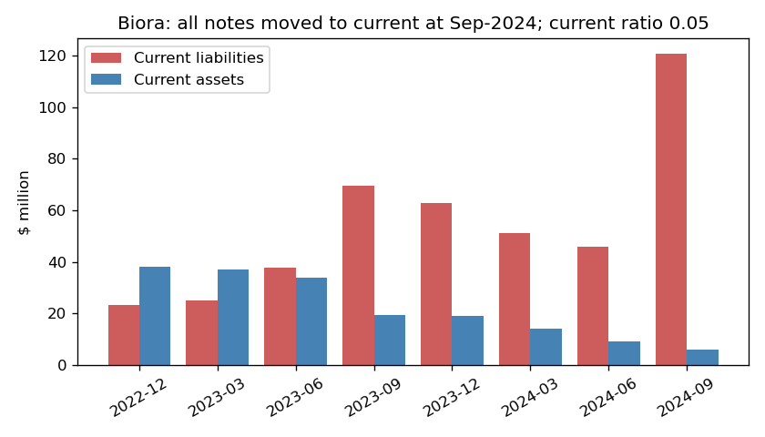
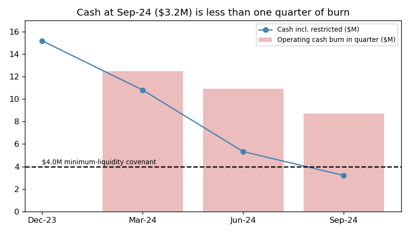
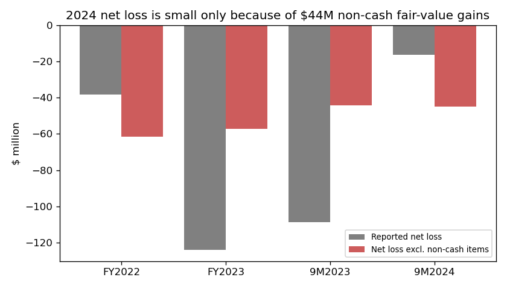
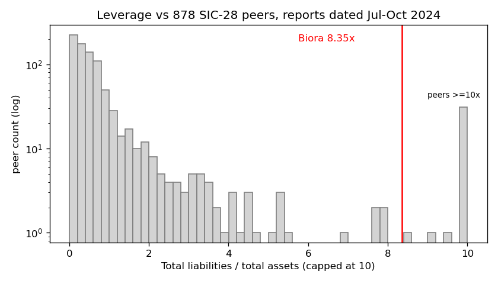

# Biora Therapeutics (CIK 1580063) – 10-Q for Q3 2024, filed 2024-11-14 – score 0.615

## Answer
The model sees a tiny balance sheet ($14.5M of assets) carrying $121M of liabilities, almost all of them current, plus heavy operating losses. Net income looks mild (−$21.5M annualized, near the peer median), but only because of $44M of non-cash fair-value gains. The filings add risks the model can't see: about one month of cash, a forbearance that has already been used, lender funding that is discretionary, and a final Nasdaq deadline that would let noteholders demand cash.

## Verdict
**Real risk.** My own risk is **very high, about 50%**, against the 4% base rate for the 0.5–0.7 band. I agree with the model, and I think it under-ranks this case. Three facts moved me above the base rate: (1) cash can't cover the $62.9M of notes now classified as current, (2) the company has already needed a covenant forbearance, and (3) delisting by Dec 9 would trigger a note put.

## The 8 inputs
Income and cash-flow items are 9 months ×4/3. Peers are 878 SIC-28 filers with periods ending Jul–Oct 2024.

| Input | Q3-24 | Q3-23 | Driver | Peer rank (% of peers below) |
|---|---|---|---|---|
| Total assets | $14.5M | $34.7M | cash spent | 23% (median $131M) |
| Current assets | $6.1M | $19.2M | cash $3.2M | 20% |
| Current liabilities | $120.6M | $69.5M | notes and derivatives reclassified to current | 82%; 8.3× assets (97%) |
| Total liabilities | $121.1M | $153.5M | $62.9M face of notes, warrant and derivative liabilities | 69%; 8.35× assets (96%) |
| Revenue | $1.2M | $0.01M | minor | 21% |
| Net income | −$21.5M | −$144.9M | +$35.2M warrant and +$8.7M derivative gains | 53%; −1.48× assets (17%) |
| Operating income | −$63.4M | −$71.7M | R&D and SG&A | 35%; −4.4× assets (6%) |
| Operating cash flow | −$42.9M | −$46.3M | steady burn | 34%; −3.0× assets (6%) |

None of the 8 are missing. I can't see how much each input moved the score, so the order of reasons below is my inference.

## Main reasons
1. **Liabilities 8.35× assets and a current ratio of 0.05 (model input).** Equity is −$106.6M. Only 20% of peers have liabilities above their assets. The 10-Q (2024-11-14, Note 1) says: "As a result, all Convertible Notes and related derivative liabilities have been reclassified to current".
2. **Cash is nearly gone (from the filings).** Cash was $3.2M, of which $0.2M is restricted. Burn was $2.9M a month in Q3 and $3.6M a month over 9 months, which leaves 0.9–1.1 months. Since September the company has added about $7.3M (a $4.0M lender draw, $0.5M from the ATM, and about $2.8M net from a registered direct; the net figure is my estimate). That stretches cash to about 3.6 months, or 2.2 months while staying above the $4.0M covenant floor. The 10-Q (Note 1) says: "Management does not expect that the Company's current cash and cash equivalents will be sufficient to fund its operations for at least 12 months".
3. **Covenant stress has already needed a forbearance (from the filings).** The noteholders forbore "as a result of the Company's potential failure to comply with minimum liquidity requirement of Section 3.13 thereof" (10-Q, Note 6). The forbearance was extended twice, through Oct 31, 2024. The indenture "requires the Company to maintain minimum liquidity of $ 4.0 million". September cash of $3.2M sits below that, yet the company says it is in compliance, and I couldn't reconcile the two. The 10-Q (Note 1) adds: "indications suggest that such forecasts are unlikely to be sufficient for the Company to be able to continue to maintain compliance with the financial covenants under its debt agreements".
4. **The Nasdaq deadline is also a debt trigger (from the filings).** "December 9, 2024 represents the full extent of Nasdaq’s discretion to provide additional time for compliance." (10-Q, Risk Factors). A Fundamental Change, which allows a cash put of the notes, includes "certain de-listing events with respect to the Company’s common stock, including delisting from the Nasdaq Global Market" (10-Q, Note 6). The notes are about 20× cash.
5. **The underlying loss is not shrinking (model input, adjusted).** I took out the same non-cash items every year using the cash-flow statement: stock compensation, inducement and extinguishment losses, fair-value changes, discontinued-operations gains and the Enumera write-off. The adjusted loss was −$61.5M in FY22, −$57.1M in FY23 and −$45.0M in 9M-24 (about −$60M a year). The small 2024 net loss is an accounting effect, not an improvement.

## Evidence against
- Lenders keep funding. They put in $4M each in August, September and October and accepted PIK interest in June. Athyrium is both a secured lender and a 29.7% shareholder.
- Equity raises still close (about $3.0M gross in October).
- The going concern doubt is not new. It has been there since the FY23 10-K, where the auditor said the losses "raise substantial doubt about its ability to continue as a going concern" (10-K, 2024-04-01). A pre-revenue biotech often looks like this.
- 10-Q Item 3 (Default Upon Senior Securities) reads "None." There are no missed payments.
- These cushions are limited. The last $4M draw is at the holders' option ("in its sole discretion, up to a maximum of $4,000,000 for all Purchasers", 8-K 2024-08-12). The ATM is capped ("aggregate gross sales price of up to $6,000,000", 8-K 2024-07-01).

## How it developed
- **2021:** the lab business closed; pivot to drug delivery.
- **Sep 2023:** $50M of 2025 notes swapped into equity ($53.2M inducement loss).
- **Dec 2023:** $72.5M of 2025 notes exchanged into secured 2028 notes. Nasdaq market-value notice on Dec 11.
- **Apr 2024:** going concern doubt in the FY23 10-K.
- **Jun 2024:** interest paid in kind. Nasdaq delisting determination (8-K 2024-06-14).
- **Jul 3, 2024:** minimum-liquidity forbearance.
- **Aug–Oct 2024:** priority notes ($12M of $16M drawn) and warrant repricing. 1-for-10 reverse split on Oct 18.
- **Nov 14, 2024:** this 10-Q. All notes are current and cash is $3.2M.

## Dates to watch
- **Dec 1, 2024:** 2028-note interest (about $3.8M at 13% on $58.3M), paid in cash or in kind.
- **Dec 9, 2024:** final Nasdaq deadline. Delisting means a Fundamental Change put.
- **Dec 2024 to Jan 2025:** the last discretionary $4M draw, with cash around the $4.0M floor.
- **Dec 1, 2025:** $4.6M of 2025 notes mature.
- **What would lower my risk:** a large raise or partnership, regaining Nasdaq compliance, or lenders converting or extending.
- **What would raise it:** a missed or forborne interest payment, a delisting notice, restructuring advisors, or a refused draw.

## Charts

## Confidence and limits
- I'm fairly confident the distress is real. The 50% figure is a judgment, not a calculation.
- I couldn't check the indenture's definition of "liquidity", the exact October net proceeds, the company's market value against the $50M Nasdaq test, or whether the last draw was requested.
- **Disclosure:** I know from outside these sources that Biora filed for Chapter 11 in late December 2024. I did not use that fact. Every claim here comes from rows and filings dated on or before 2024-11-14.

## Filings used
10-Q 2024-11-14; 10-Q 2024-08-12; 10-Q 2024-05-15; 10-K 2024-04-01; 8-Ks dated 2023-06-08, 2023-06-14, 2023-06-15, 2023-09-19, 2023-10-06, 2023-12-15, 2023-12-18, 2024-03-11, 2024-04-02, 2024-06-14, 2024-07-01, 2024-08-12, 2024-08-21, 2024-09-13, 2024-10-07, 2024-10-11, 2024-10-29. No NT 10-K or NT 10-Q was filed.
