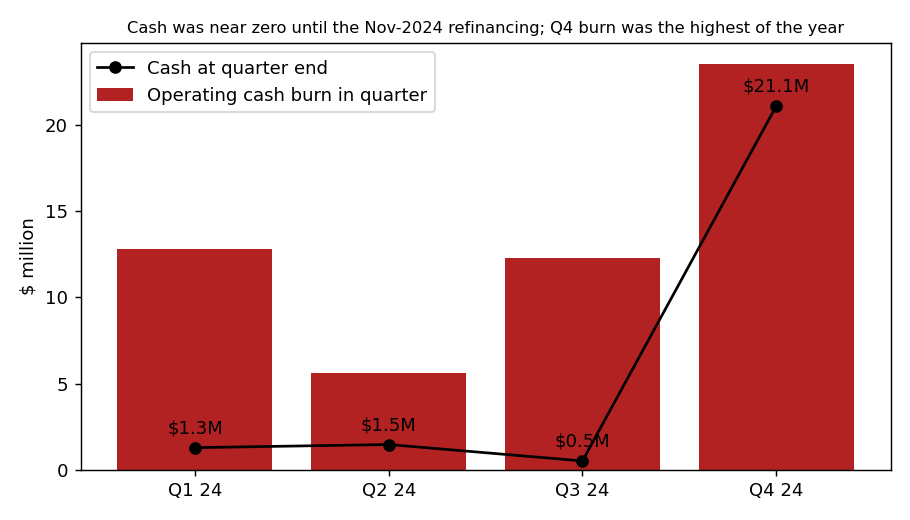
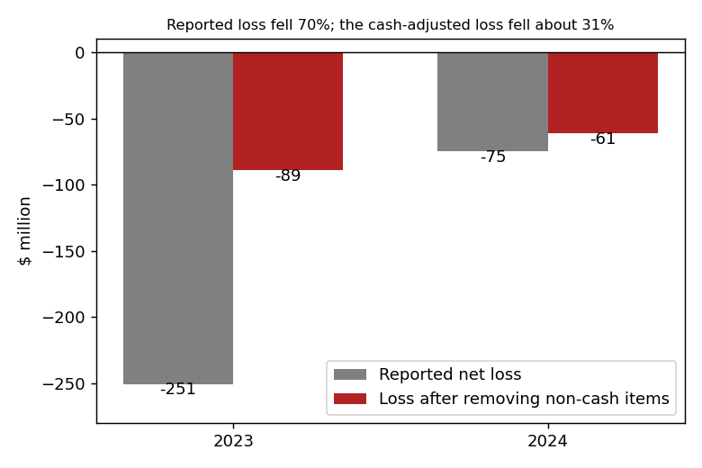
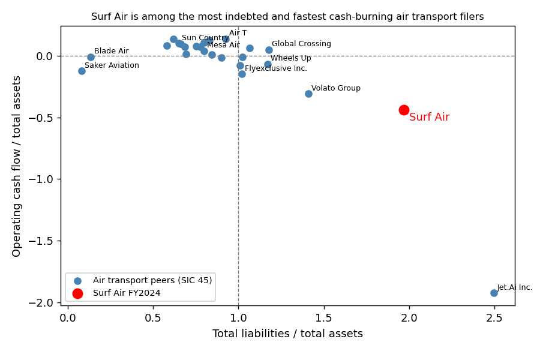

# Surf Air Mobility Inc.: 10-K FY2024 (filed 2025-03-21), score 0.794

## Answer
Surf Air is a small regional airline. Its liabilities are twice its assets, it lost $74.9M on $119.4M of revenue, and it burned $54.3M of operating cash. On each of these it is near the worst of 24 air-transport peers, so the score is high. The reported loss flatters the year: a $32.3M non-cash stock-comp reversal made Q4 look profitable, while Q4 cash burn was the year's worst.

## Verdict
**Unclear, close to the band's rate. My risk: high, about 15%** (the band's base rate is 18%). I agree with the model that this is high risk. The distress is real, but a November 2024 refinancing backed by insiders pushed nearly all debt to 2028.

## The 8 model inputs ($M)
| Input | FY2024 | FY2023 | Driver | Rank among 24 SIC-45 peers |
|---|---|---|---|---|
| Total assets | 124.1 | 111.0 | Aircraft, intangibles, loan cash | Smaller than 88% |
| Current assets | 33.9 | 17.7 | Cash up from $1.7M to $21.1M | 27% of assets, near median |
| Current liabilities | 89.6 | 140.1 | Insider notes moved to long term | 72% of assets, higher than 88% |
| Total liabilities | 244.1 | 188.5 | $45M term loan, $50M insider note | 197% of assets, 2nd highest |
| Revenue | 119.4 | 60.5 | First full year of Southern Airways | Smaller than 88% |
| Net income | −74.9 | −250.7 | 2023: $60M impairment, $48M stock comp | −60% of assets, 3rd worst |
| Operating income | −60.3 | −196.8 | Same | 2nd worst |
| Operating cash flow | −54.3 | −64.4 | Low pilot and aircraft utilisation | −44% of assets, 2nd worst |

No input is missing. How much each input moved the score is not visible; the order below is inferred.

## Main reasons
1. **Cash runway (model input and filings).** Cash was $21.1M on 31 Dec. At the year's average burn of $4.5M a month that lasts about 4.7 months; at Q4's $7.9M a month, about 2.7 months, which is roughly the filing date. The 10-K gives no cash figure for 2025. January made it worse: "During January 2025, the Company utilized an abundance of caution and voluntarily cancelled a significant number of scheduled flights due to maintenance concerns." (10-K, 2025-03-21, MD&A)
2. **The losses are cash losses (model input).** I removed the same non-cash items from both years using the cash flow statements. The adjusted loss fell 31%, from $89.2M to $61.3M, while the reported loss fell 70%. Only 18% of the 2024 loss was non-cash. Q4 net income of +$1.3M includes the reversal: "These actions resulted in a $32.3 million reversal of previously accrued stock-based compensation expense" (10-K, Note 18). Without it, Q4 lost about $31M.
3. **Leverage (model input).** Equity is −$120.0M, against −$77.5M a year earlier. The current ratio is 0.38; the peer median is 0.78, and 0.57 for small peers.
4. **Defaults and going-concern doubt (filings).** "the Company is currently in default of certain excise and property taxes as well as certain debt obligations": $7.7M of IRS excise tax, $1.6M of property tax, and a $0.5M note unpaid since 2019. "These factors raise substantial doubt about the Company’s ability to continue as a going concern." (10-K, Note 1; the PwC audit report says the same.)
5. **Limited access to equity (filings).** "the daily volume limitations under the Share Purchase Agreement significantly restricted our ability to take additional draws" (10-K, Note 1). The facility also needs an NYSE listing, and the company has been below NYSE standards since May 2024.

## Evidence against
- **Debt runs to 2028.** Only $2.5M of debt is due in 2025. "The loans under the Credit Agreement have no payments due other than interest, in advance of the maturity date on November 14, 2028." (10-K, Note 11). A $5.5M delayed-draw line covers 18 months of interest. The $50M LamVen note and $8M PFG note mature in December 2028.
- **Insiders keep paying.** Founder-linked entities lent $34.5M in 2024 and $22.5M in 2023. "The Credit Agreement is fully backstopped by a letter of credit issued by HSBC Bank USA, N.A. and arranged by Park Lane, a related party" (10-K, Note 11).
- **No lender default now.** "As of December 31, 2024, the Company was in compliance with all covenants in the loan agreements." (10-K, Note 11)
- **Revenue doubled**, and part of it is federal Essential Air Service subsidy. An S-3 shelf was filed on 2025-02-11.

## How it developed
- **2018–2019:** IRS excise-tax lien; payment plan defaulted.
- **27 Jul 2023:** NYSE listing and the Southern acquisition. The 2023 loss was $250.7M.
- **29 Mar 2024:** FY2023 10-K with substantial doubt; cash was $1.7M.
- **Apr–May 2024:** NYSE notices. One cited "30 trading-day average market capitalization was approximately $40.9 million and its last reported stockholders’ deficit as of March 31, 2024, was approximately ($106.3) million" (8-K, 2024-05-24, Item 3.01). The CEO resigned.
- **30 Sep 2024:** Cash was $0.5M. "As of September 30, 2024, the Company was in arrears of $818 thousand in contractual interest payments due under the Convertible Note Purchase Agreement." (10-Q, 2024-11-14, debt note)
- **14 Nov 2024:** $44.5M Comvest loan, $50M LamVen note and PFG extension, all running to 2028.
- **Dec 2024 – Jan 2025:** Stock-comp reversal, then flight cancellations. The Palantir JV closing slipped to 31 May 2025.

## Dates to watch
- **About 15 May 2025, Q1 10-Q:** cash after the January cancellations, and any new equity.
- **31 May 2025:** deadline to close the Palantir JV, which needs outside capital.
- **About 20 Nov 2025:** end of the NYSE cure period. Delisting would also close the GEM facility.
- **Any time:** IRS collection on the $7.7M.

**What would change my mind.** I would raise my risk if Q1 cash is under about $10M with no new raise, if Comvest interest is missed or the letter of credit is drawn, if the NYSE starts delisting, or if restructuring advisors are hired. I would lower it if the company raises more than about $40M of equity or the JV closes with outside money.

## Charts

*Cash stayed near zero until the refinancing, and Q4 burn was the year's highest.*

*Most of the drop in reported loss came from non-cash items.*

*Surf Air is an outlier on both leverage and burn.*

## Confidence and limits
I am moderately sure. The key unknown is cash at the filing date, which no filing discloses, and I couldn't see whether the shelf had been used. The quarterly figures are derived from year-to-date totals, and some of Q4's burn may be catch-up payments to suppliers. Most peers are large airlines; I also checked the 10 under $2B of assets. I have a vague memory that the company kept operating and raised capital later in 2025. I did not use it.

## Filings used
10-K 2025-03-21; 10-K 2024-03-29; 10-Q 2024-05-15, 2024-08-14, 2024-11-14; 8-K 2023-12-27, 2023-12-28, 2024-03-06, 2024-04-05, 2024-05-20, 2024-05-24, 2024-06-27, 2024-07-05, 2024-08-13, 2024-08-19, 2024-12-10, 2024-12-19; filing index (S-3 2025-02-11). Data: shared/financials.csv rows filed on or before 2025-03-21.
