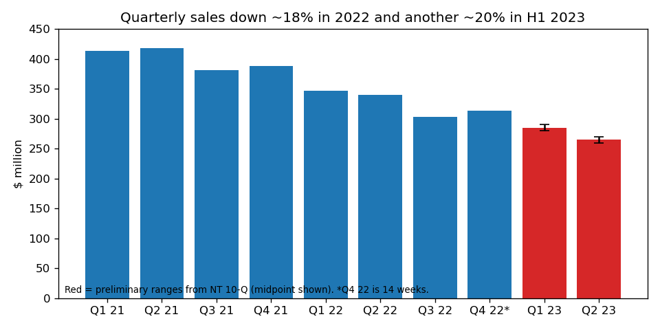
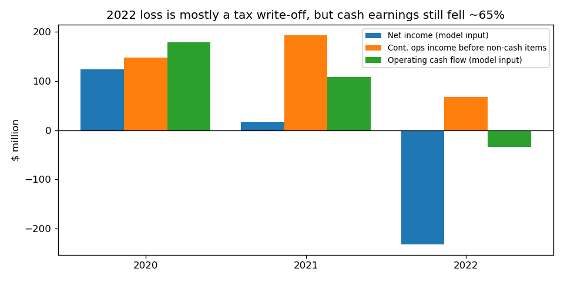
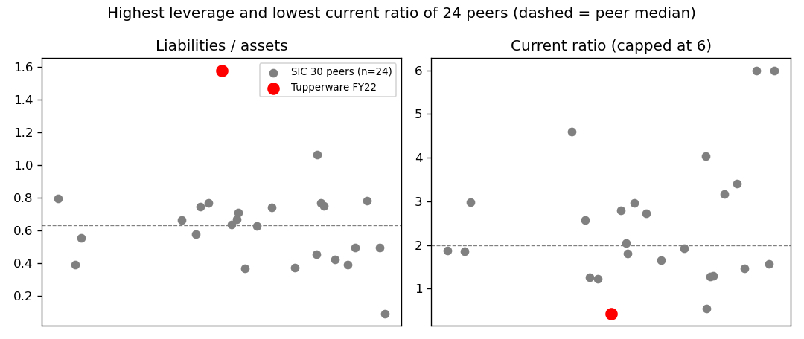
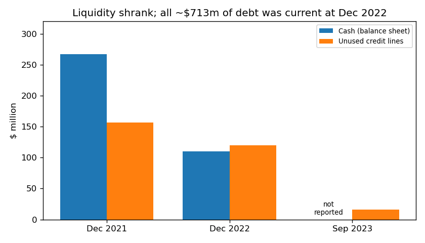

# Tupperware Brands Corp: FY2022 10-K (filed 2023-10-13), model score 0.537

## Answer
The score comes mostly from a $232.5m net loss and negative operating cash flow, with liabilities at 158% of assets and a current ratio of 0.43. That is the worst or near-worst among SIC-30 peers. The loss is mostly a non-cash tax write-off. But the filings show what the model can't see: missed interest, lender defaults, a restructuring officer, months-late filings, and sales down another ~20% in 2023.

## Verdict
- **Real risk.** My own risk is **high, about 30%** for bankruptcy within 12 months, against the band's 4%.
- **I agree with the model's direction, but I think the score understates the risk.**
- *Disclosure:* I know from outside this exercise that Tupperware filed Chapter 11 in September 2024. I did not use that fact; every source here is dated on or before 2023-10-13.

## The 8 model inputs ($m)
2021 figures are as restated in this 10-K. Peers: 24 SIC-30 filers, latest report with period end Jun-2022 to Jun-2023. Lower counts peers below Tupperware.

| Input | FY2022 | FY2021 | What drives it | Peers lower / median |
|---|---|---|---|---|
| Total assets | 743.6 | 1,240.1 | $186m deferred tax asset written off; cash −$157m | 10 of 24; 2,036 |
| Current assets | 431.6 | 651.9 | cash 267→110 | 12 of 24; 466 |
| Current liabilities | 1,001.9 | 545.1 | all $709.8m of debt reclassified as current | 18 of 24; 172 (135% vs 21% of assets) |
| Total liabilities | 1,173.4 | 1,458.8 | debt flat at ~$713m | 14 of 24; 983 (158% vs 63% of assets) |
| Revenue | 1,304.0 | 1,600.6 | −18.5%: volume, FX, shrinking sales force | 11 of 21; 1,271 |
| Net income | −232.5 | 15.6 | $211.3m deferred tax charge, $36.8m impairments | 1 of 23 (Goodyear) |
| Operating income | 23.6 | 247.2 | −90%; gross profit −$232m | 8 of 21; 52 |
| Operating cash flow | −34.0 | 108.8 | lower profit; payables −$79m | 1 of 23 |

None of the eight inputs is missing.

## Main reasons, in order
I can't see how much each input moved the score, so this order is my inference.

1. **Net loss of −31% of assets (model input).** The peer median is +2.2%. Most of the loss is non-cash: "resulting in a $179.4 million valuation allowance of deferred tax assets" (10-K, 2023-10-13, Item 1). Adding back the same cash-flow-statement non-cash items each year, continuing operations earned $68.0m in 2022, against $193.1m in 2021 and $147.5m in 2020 (chart 2). So the loss overstates the damage, but cash earnings still fell ~65%.
2. **Liabilities above assets and a current ratio of 0.43 (model input).** Both are the worst among the peers (chart 3). Equity was −$429.8m. It was already −$218.7m in 2021, which I attribute to past buybacks (inference).
3. **Operating cash flow of −$34.0m (model input).** Free cash flow was −$65.8m. Cash of $110.1m lasts about 20 months at that rate, or about 9 months at the Q1-2022 burn of −$36.4m. Q4 2022 (the last quarter) brought in +$24.4m, so no burn. But 97% of cash ($107.2m) was abroad.
4. **Missed interest and defaults (from the filings).** A waiver allowed a borrowing, "the proceeds of which were used on such date to pay past-due interest owing by the Company under the Credit Agreement" (8-K, 2023-05-08, Item 1.01). Earlier: "If such demand for repayment were to occur, the Company does not have the financial resources to repay such obligations." (8-K, 2023-04-07, Item 8.01).
5. **Almost no liquidity left (from the filings).** "As of September 30, 2023, the Company had $16.3 million of unused lines of credit, including $13.1 million of unused Revolver capacity" (10-K, MD&A Liquidity). Interest "is projected to increase to $94.4 million in 2023, of which $56.8 million is expected to be paid in cash in 2023" (same section). That cash interest is 2.4× the 2022 operating income.
6. **Sales still falling (from the filings).** Q2 2023 revenue is expected to "be within the range of $260 - $270 million" (NT 10-Q, 2023-08-03, Part IV), which is −21% to −24% year on year. Q1 2023 was −17% to −19% (chart 1). The 10-K also notes "additional working capital pressure primarily from supplier requests to reduce payment terms" (MD&A Liquidity).
7. **Going concern doubt and late filings (from the filings).** PwC writes that the company "has experienced liquidity challenges and is uncertain about its ability to comply with debt covenants" (10-K, auditor's report). The 10-K is 7 months late, the 2023 10-Qs are unfiled, and the NYSE has sent two notices. Management warns it "may be forced to file for bankruptcy protection, which could include either reorganization or liquidation" (10-K, Item 1).

## Evidence against
- **The lenders are cooperating.** The August 2023 restructuring waived the defaults and provides "the extension of the stated maturity of approximately $348 million of principal and reallocated interest and fees to fiscal year 2027 with PIK interest" (8-K, 2023-08-03, Item 1.01). It also cut amortization by about $55m through 2025. Nothing large falls due before July 2025.
- **Underlying earnings are positive** ($68m before non-cash items).
- **One-off cash is coming in:** Indonesian property sales ($12.3m), a Brazil deposit refund ($12.3m), Indonesian tax refunds ($25.7m, of which $20.8m has been received), and the Hemingway plant sale ($15.0m).
- **Deadlines have been extended:** lenders extended the filing deadlines on 2023-10-05, and the NYSE gave until 2024-03-31.

## How it developed
- **2019:** the "multi-year decline" begins (10-K, Item 1).
- **Q1 2022:** $75m buyback; cash falls from $267m to $119m by mid-2022.
- **2022-11-02:** the Q3 10-Q first states substantial doubt about going concern.
- **Dec 2022 to Feb 2023:** two credit agreement amendments ahead of expected covenant breaches.
- **2023-03-16:** non-reliance on past financials (Item 4.02) and an NT 10-K.
- **2023-04-07:** going concern doubt confirmed; first NYSE notice.
- **2023-05-05:** past-due interest and defaults; Fourth Amendment; Alvarez & Marsal restructuring officer appointed.
- **2023-08-02:** Debt Restructuring Agreement, with warrants issued to the lenders.

## What to watch
- **Filing and repayment deadlines:** Q1 10-Q due 2023-12-29. Q2 10-Q and the first $40m Term A repayment milestone due 2024-01-31. Q3 10-Q due 2024-03-15. NYSE deadline 2024-03-31.
- **From the quarter ending ~2024-03-31:** leverage, interest-coverage and minimum-EBITDA ($87–143m) covenants start being tested. Lender-defined EBITDA was $129.7m in 2022, and sales are down ~20% since, so I expect a breach (inference).
- **Lower risk if:** new equity comes in, the filings arrive on time, sales stabilise, or quarterly cash flow turns positive.
- **Higher risk if:** another payment is missed, the lenders move to forbearance, a covenant is breached, or the NYSE delists the stock.

## Charts

## How sure I am
Moderately sure of the direction, less of the 30%. From the 4% band rate I moved up for missed interest, events of default, ~$16m of liquidity against $57m of cash interest, falling sales and unfiled reports; partly back down for the lender restructuring and no large maturity before 2025.

What I couldn't check:
- 2023 cash and cash flows, since no 2023 10-Q exists yet.
- Earlier dataset rows, since the dataset has only this one row for the company.
- Peer comparability, since peers' report dates vary.
- The $120.1m of Dec 2022 credit lines could not actually be drawn in early 2023.

## Filings used
- 10-K: 2023-10-13, 2022-02-23
- 10-Q: 2022-05-05, 2022-08-04, 2022-11-02
- NT 10-K: 2023-03-16
- NT 10-Q: 2023-05-08, 2023-08-03
- 8-K: 2022-05-04, 2022-06-06, 2022-08-03, 2022-11-02, 2022-12-22, 2023-01-06, 2023-02-28, 2023-03-16, 2023-04-07, 2023-05-08, 2023-06-07, 2023-07-07, 2023-08-03, 2023-08-11, 2023-08-25, 2023-09-18, 2023-10-10
- shared/financials.csv, rows filed on or before 2023-10-13
