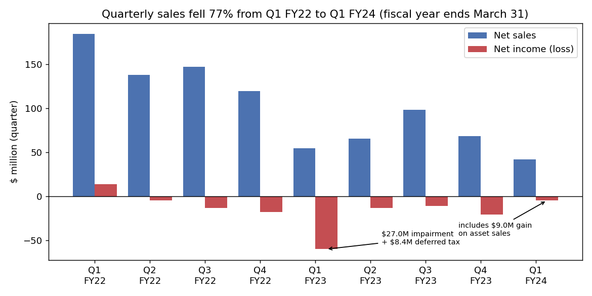
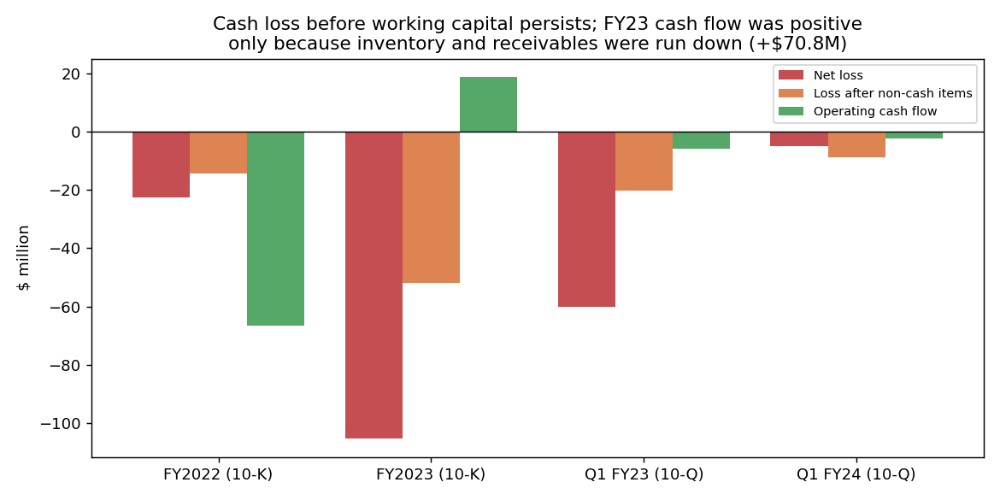
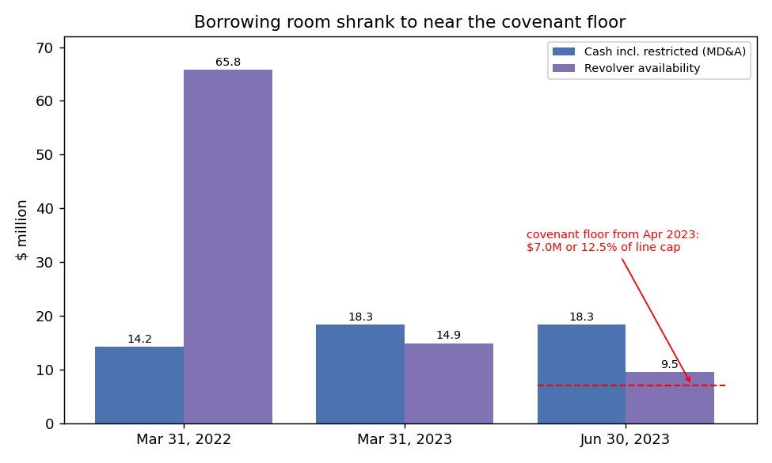

# Nautilus, Inc. (CIK 1078207): 10-Q for the quarter ended 30 Jun 2023, filed 9 Aug 2023. Model score 0.644

## Answer
The model sees a home-fitness maker whose annualized operating loss (−$42.1M) is 30% of its assets, near the bottom of its peers. The quarter's net loss (−$4.9M) understates the problem because it includes a one-off $9.0M gain on asset sales. Before working-capital changes the business still loses about $8.7M of cash a quarter, and its borrowing room is near a covenant floor.

**Verdict: real risk.** My risk estimate is **medium, about 12%**, against a 4% base rate for the 0.5–0.7 band. **I agree with the model**, and I think this report is riskier than its band suggests.

## The 8 model inputs ($M; income and cash flow are one quarter × 4)
| Input | 30 Jun 23 | 30 Jun 22 | Driver | Rank in 21 SIC-39 peers with revenue ≥ $100M |
|---|---|---|---|---|
| Total assets | 140.2 | 229.1 | Inventory $103.9M→$39.8M | Smallest |
| Current assets | 86.4 (62% of TA) | 157.6 | Inventory and receivables run down | – |
| Current liabilities | 43.3 | 62.5 | Payables paid | Current ratio 2.0, median 2.2 |
| Total liabilities | 81.1 (58% of TA) | 124.3 | Debt cut to $17.3M | TL/TA 0.58, median 0.56 |
| Revenue | 167.0 | 219.3 | −24% y/y; Q1 is the slowest quarter (19% of FY23) | Rev/TA above median |
| Net income | −19.7 (−14% of TA) | −240.7 | $9.0M gain now; $27.0M impairment last year | NI/TA 3rd-worst of 22 |
| Operating income | −42.1 (−30% of TA) | −204.7 | Gross margin 20.7% (12.7%); opex excluding charges −40% | OI/TA 2nd-worst of 21 |
| Operating cash flow | −9.5 | −23.9 | $6.4M working-capital release | OCF/TA 4th-worst of 22 |

No input is missing. Against all 39 SIC-39 peers (many shells) the ratios sit mid-pack, so small size does not explain the score. **The order below is my inference**; I cannot see each input's contribution.

## Main reasons, in order
1. **Operating loss and net loss (model input).** The operating loss is −30% of assets against a peer median of +4.5%. Without the gain, the quarter's pre-tax loss would be −$13.4M rather than −$4.4M. The 10-Q (9 Aug 2023, MD&A) says *"headwinds in Retail re-orders persist as our retail partners continue to act conservatively in light of uncertainty in the economic environment"* and *"We have had significant difficulty in forecasting near-term demand"*.
2. **Cash loss masked by working capital (from the filings).** Adjusting every period the same way (cash-flow-statement lines before working-capital changes), the cash loss was −$14.4M in FY22, −$52.0M in FY23 and −$8.7M in Q1 FY24. FY23 operating cash flow was +$18.8M only because $70.8M of working capital was released. With inventory at $39.8M, little is left to release, and purchase commitments rose from $12.1M to $33.0M.
3. **Thin liquidity (from the filings).** Cash including restricted cash is $18.3M. That is ~15.5 months at last quarter's free-cash burn ($3.5M), but ~5.5 months at the underlying cash loss plus capex (~$9.9M a quarter). The 10-Q says *"As of June 30, 2023, we were in compliance with the financial covenants contained in the agreements governing both the SLR Term Loan and ABL Credit Facility, and $9.5 million was available for borrowing under WF ABL Credit Facility."* The floor is "$7.0 million and 12.5% of the Combined Line Cap". The 10-Q also says *"the ABL Amendment reduced the maximum revolving loan commitment amount from $100 million to $60 million"*, and the July amendment cut it to $40M. A new caveat reads *"including if we are able to maintain compliance with debt-related financial covenants"*.
4. **Selling core assets and issuing cheap equity (from the filings).** The 10-Q says *"the Company completed the sale of intellectual property for $10.5 million as part of its ongoing comprehensive strategic review"*, *"which included the Nautilus brand trademark assets and related licenses"*. The 8-K of 15 Jun 2023 says *"Each Share is being sold at an offering price of $1.22"*, for only $4.6M net. The Chief Accounting Officer *"notified the Company that she would resign effective as of August 9, 2023"* (8-K, 10 Jul 2023).

## Evidence against
- There is no "substantial doubt" language in the 10-K or 10-Q. The auditor gave a clean opinion: *"We determined that there are no critical audit matters."* (10-K, 1 Jun 2023)
- Management says: *"We expect our cash, cash equivalents, restricted cash and amounts available for borrowing under our SLR Term Loan and ABL Credit Facility as of June 30, 2023, along with cash expected to be generated from operations, to be sufficient to fund our operating and capital requirements for at least the next twelve months."* (10-Q, MD&A)
- Debt is small: $17.3M, 29% of the $59.1M equity. The term loan matures 29 Oct 2026. There have been no missed payments, defaults, waivers or late filings.
- The lenders agreed amendments in April and July 2023, which looks like cooperation, not forbearance.
- Costs are down and margins up; the strong October–March season lies ahead (FY23 Q3 sales $98.1M vs $54.8M in Q1).

## How it developed
- **FY22 (to Mar 2022):** sales fell from $184.6M in Q1 to $119.7M in Q4 after the pandemic boom. Inventory built up and operating cash flow was −$66.6M.
- **Q1 FY23 (Jun 2022):** sales $54.8M; −$60.2M loss incl. $27.0M impairment.
- **30 Nov 2022:** a new $30M SLR term loan at SOFR + 8.25% *"to refinance the existing term loan facility with Wells Fargo Bank"* (8-K, 1 Dec 2022).
- **Apr–Jun 2023:** strategic review, sale of the brand IP and Vi Labs, $11.8M term-loan prepayment, revolver cut to $60M, equity raise at $1.22.
- **28 Jul 2023:** second amendments; revolver cut to $40M.

## Dates to watch
- **Each month:** excess availability against the floor. A breach, waiver or forbearance would raise my estimate sharply.
- **Q2 FY24 10-Q (about Nov 2023):** cash drain from the holiday inventory build; any "substantial doubt" language.
- **Dec 2023:** the $1.35 warrants become exercisable. Also watch for more asset sales or a strategic-review outcome.
- **FY24 10-K (about Jun 2024):** the auditor's going-concern assessment.
- **Would lower my estimate:** positive peak-season cash flow, a sale of the company, or new capital.

## Confidence and limits
Confidence is moderate. I could not see:
- the line cap, so the covenant headroom (roughly $2.5M) is approximate;
- monthly cash movements;
- the stock price or any NYSE notices (none were filed).

Annualizing the slow Q1 understates revenue. **Hindsight:** I know that this company (later renamed BowFlex Inc.) filed for Chapter 11 in 2024. I did not use that; every claim above relies on sources dated on or before 9 Aug 2023.

## Filings used
10-Q 2023-08-09; 10-K 2023-06-01; 10-Q 2023-02-09; 10-Q 2022-11-09; 10-Q 2022-08-09; 8-K 2023-07-10; 8-K 2023-06-15; 8-K 2023-05-02; 8-K 2022-12-01; 8-K 2022-07-15; 8-K 2022-06-21; 8-K 2022-05-19; 8-K 2022-02-25; shared/financials.csv (rows filed ≤ 2023-08-09).
