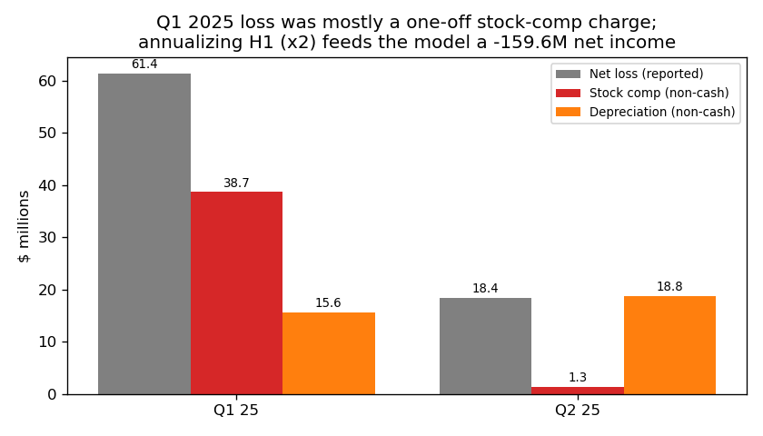
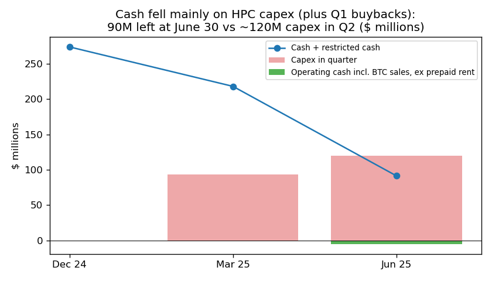
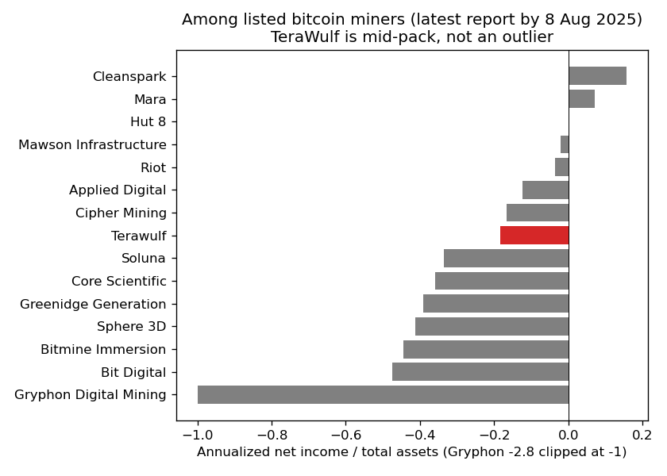

# TeraWulf Inc. — 10-Q for 30 Jun 2025 (filed 8 Aug 2025), model score 0.623

## Answer
The score is mostly driven by an annualized net loss of $159.6M, about 97% of revenue. That figure is the first half doubled, and the first half held a one-off $38.7M stock-comp charge in Q1. Current liabilities also exceed current assets, mostly because of $47.7M of prepaid customer rent. The weakness that does matter is cash. TeraWulf had $90M at 30 June and spent about $120M on data-center capex in Q2, so it needs new funding to finish the build. It has no debt due before 2030.

**Verdict: false alarm. Own risk: low, about 2%** (the 0.5–0.7 band's base rate is 4%). I partly disagree with the model. The loss it sees is inflated, but there is a real funding need it cannot see.

## The 8 inputs (annualized $M; prior year = Q2 2024 10-Q)

| Input | Jun 2025 | Jun 2024 | What drives it | Peer rank (SIC 61, n≈50–128) |
|---|---|---|---|---|
| Total assets | 869.4 | 479.6 | HPC buildout, PP&E $604.8M | 44th pct |
| Current assets | 99.1 | 111.0 | cash fell 274→90 | 11% of assets, 12th pct |
| Current liabilities | 151.3 | 92.4 | $47.7M prepaid rent + $30M earnout | 17% of assets, 40th pct |
| Total liabilities | 695.1 | 93.3 | $500M converts (Oct 2024) | 80% of assets, 41st pct |
| Revenue | 164.1 | 156.0 | bitcoin mining only | 51st pct |
| Net income | −159.6 | −41.0 | Q1 stock-comp $38.7M, depreciation | 6th pct ($); −97% of revenue, 22nd pct |
| Operating income | −150.4 | −18.2 | same | 5th pct |
| Operating cash flow | 3.4 | 78.5 | +$90M prepaid rent; bitcoin sales now booked in investing | 55th pct |

No inputs are missing. SIC 61 mixes lenders and miners; among 15 listed miners TeraWulf's net income/assets (−0.18) ranks 8th (chart 3).

## Main reasons, in order (my inference; I can't see the model's weights)
1. **Large annualized loss (model input).** The −$159.6M is H1 × 2. Q2 alone was −$18.4M, or −$73.5M a year, which matches FY2024's −$72.4M. The 10-Q puts the H1 SG&A rise down partly to "increased stock-based compensation of $28.2 million" (10-Q, 8 Aug 2025, MD&A). I adjusted every period the same way, adding back stock comp, depreciation, debt-cost amortization, disposal losses and stock-settled related-party expense. The adjusted result is −$15.6M for FY2023, +$47.5M for FY2024 and +$2.0M for H1 2025, so the business is about break-even before non-cash items.
2. **Cash vs capex (from the filings).** Cash and restricted cash fell from $274.1M to $218.2M to $91.4M. Q2 capex was $119.9M. Operating cash, counting bitcoin sales and excluding the prepaid rent, was −$5.1M. At Q2's pace (−$41.7M a month after capex) that is about 2.2 months of cash; at the H1 pace it is 2.5 months. "As of June 30, 2025, the Company had cash and cash equivalents of $90.0 million, a working capital balance of $(52.2) million" (10-Q, MD&A Financial Condition). The 10-Q names no committed financing for the rest of the build and makes no statement that cash will last 12 months.
3. **Current ratio 0.66 (model input).** Most of the gap is non-debt: $47.7M of deferred rent is settled by providing space, not cash, and $30M is earnout. Without those two items the ratio is 1.35.
4. **Leverage 0.80 (model input).** This is close to the peer median (0.84). Equity is $174.3M.

## Evidence against distress
- No debt matures before 2030. "The 2030 Convertible Notes mature on February 1, 2030" (10-Q, Note 10). The notes are $500M at 2.75%, which is about $13.75M of interest a year.
- No defaults. 10-Q Part II Item 3 (Defaults Upon Senior Securities) reads "None". There is no going-concern doubt, and the FY2024 audit opinion (10-K, 3 Mar 2025) is clean.
- New money from the customer: "the Company received $90.0 million in prepaid rent from the Company's HPC customer ahead of lease commencement" (10-Q, MD&A Liquidity).
- Equity is still available: "the remaining capacity of the ATM Program to offer and sell shares of Common Stock is $200.0 million" (10-Q, Note 14).
- The HPC build is progressing: "In July 2025, the CB-1 Earnout Milestone was achieved" (10-Q, MD&A), and the company says it "remains on track to deliver 72.5 MW of HPC colocation capacity" for Core42 (10-Q, MD&A Overview).
- Some spending was optional: H1 included $33.3M of buybacks and $18.9M of tax withholding, and capex can slow.

## How it developed
- **31 Mar 2023 (FY2022 10-K):** An earlier liquidity crisis was resolved by amending the term loan. The filing says "there is no longer substantial doubt about the Company's ability to continue as a going concern".
- **8 Jul 2024 (8-K):** The term loan was "paid off in full", ahead of its December 2024 maturity.
- **Aug 2024:** Auditor changed (RSM to Deloitte), no disagreements.
- **Oct 2024 (8-Ks):** Sold Nautilus stake ($85M), signed 35-year site lease, issued $500M converts; FY2024 buybacks $118M.
- **Dec 2024 – Q1 2025:** It signed the Core42 leases and received $90M of prepaid rent. Q1 had the $38.7M stock-comp charge.
- **21 May 2025 (8-K):** It bought Beowulf E&D, the related-party operator.
- **Q2 2025:** It spent $120M on capex, ending with $90M of cash and negative working capital.

## Dates to watch
- 1 Nov 2025 and 1 May 2026: note coupons of about $6.9M each.
- H2 2025: Core42 leases start paying (only half of base rent is paid in cash while the prepaid rent is used up).
- The "Project Financing Closing" for CB-1/CB-2, an earnout milestone in Note 3.
- Q3 10-Q (~Nov 2025): cash and any going-concern language.
- **Would raise my risk:** no new financing while capex keeps running near $120M a quarter, Core42 delays or terminations, or a bitcoin price slump that turns mining cash-negative.
- **Would lower it:** project financing, a new lease, or ATM sales.

## Charts

## How sure I am, and what I couldn't check
I am moderately confident. The capex runway is the open question. I couldn't see remaining capex commitments (not disclosed), the share price, bitcoin holdings beyond the $0 digital currency line, or Core42's credit terms. The miner peer set is small.

**Hindsight disclosure:** I know from general knowledge that in mid-August 2025, after this filing date, TeraWulf announced a large HPC lease with a Google backstop and raised substantial new financing. I also briefly saw post-8 Aug 2025 rows for this company in financials.csv before filtering them out. Neither was used in this analysis.

## Filings used
10-Q (8 Aug 2025); 10-Q/A (25 Jul 2025); 10-K/A (25 Jul 2025); 10-Q (9 May 2025); 10-K (3 Mar 2025); 8-K (30 May 2025); 8-K (27 May 2025); 8-K (21 Nov 2024); 8-K (25 Oct 2024); 8-K (10 Oct 2024); 8-K (3 Oct 2024); 8-K (21 Aug 2024); 8-K (9 Jul 2024); 8-K (23 May 2024); 10-K (31 Mar 2023, history only).
