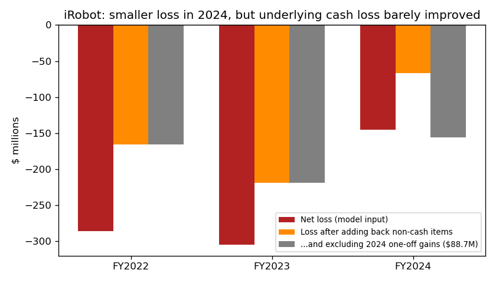
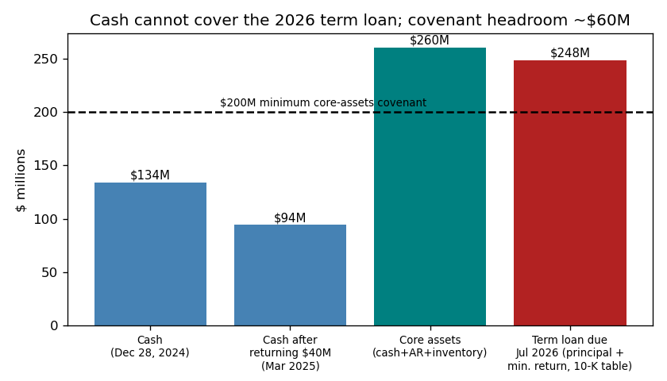
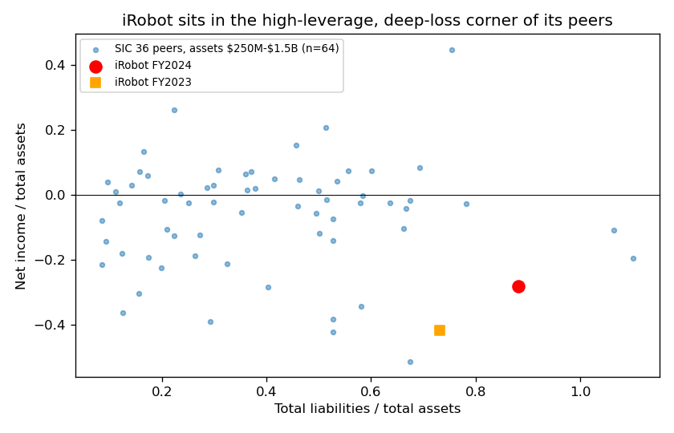

# iRobot Corp: 10-K for FY2024 (filed 2025-03-12), model score 0.648

## Answer
The score comes mostly from a $145.5M net loss, which is 28% of assets. Liabilities are 88% of assets and equity has shrunk to $61M. The filings look worse: the loss was cushioned by $88.7M of one-offs. The auditor raised going-concern doubt, and that doubt itself breaks the term-loan covenant. Lenders have waived the breach only until May 6, 2025.

**Verdict: real risk.** My risk: **high, about 30%** within 12 months, against 4% for the 0.5–0.7 band. I agree with the model's flag, and I think its band understates the risk.

## The 8 model inputs ($M)
| Input | FY2024 | FY2023 | What drives it | Rank vs 67 SIC-36 peers with $250M–1.5B assets (percentile, 0 = lowest) |
|---|---|---|---|---|
| Total assets | 516.1 | 733.7 | inventory halved, cash down | 33rd |
| Current assets | 288.5 | 465.5 | inventory $152M→$76M | 39th |
| Current liabilities | 218.2 | 287.1 | payables paid down $71M | 82nd |
| Total liabilities | 454.9 | 537.2 | $200.6M Carlyle term loan (fair value) | 73rd; 94th as % of assets |
| Revenue | 681.8 | 890.6 | −23%, weaker demand and price competition | 79th |
| Net income | −145.5 | −304.7 | includes +$75.2M Amazon fee (net) and +$13.5M settlement | 15th (also 15th as % of assets) |
| Operating income | −103.0 | −264.1 | 40% then 16% headcount cuts | 30th |
| Operating cash flow | −33.2 | −114.8 | helped by the fee and inventory sell-down | 21st |

None of the inputs is missing. Current ratio is 1.32 (12th percentile; peer median 2.72). Liabilities/assets is 0.88 (peer median 0.37).

## Main reasons, in order
I can't see how much each input moved the score, so this order is my inference.

1. **Large loss (model input).** The −$145.5M loss is 28% of assets, against a peer median of −2.5%. It looks like an improvement on 2023. It mostly isn't. After adding back non-cash items from the cash-flow statement the same way each year (depreciation, stock pay, inventory provisions, loan fair-value changes, deferred tax, other), the cash loss was −$166M in 2022, −$219M in 2023 and −$67M in 2024. Excluding the $88.7M of one-offs, 2024 was **−$156M**. 10-K Note 2: *"the forecast depends heavily on the assumption of a successful new product launch in 2025 achieving topline growth and improved profitability"*.
2. **Covenant breach waived for only 8 weeks (from the filings).** 10-K risk factors: *"we are dependent on continued waivers from the Lenders to avoid an event of default related to the Going Concern Covenant, which waivers are in the Lenders' sole discretion"*. No cure possible before the March 2026 10-K. The Minimum Core Assets covenant ($200M) was also waived. Core assets were $260M at year-end, about $60M of headroom. For the waiver, lenders took a 2% payment-in-kind (PIK) fee and penny warrants for 6% of the shares.
3. **Debt larger than cash (model input plus filings).** The 10-K table shows $248.3M of term-loan principal and minimum return falling due in 1–3 years. *"The Term Loan matures on July 24, 2026"* (10-K MD&A). Cash is $134.3M, and only about $94M is unrestricted once the $40M goes back to the lender-controlled account.
4. **Going concern doubt (from the filings).** Auditor's report: *"the Company has a history of operating losses and negative cash flows from operations that raise substantial doubt about its ability to continue as a going concern"*. This is the first time it appears. The FY2023 10-K said cash would be *"sufficient to meet our current and anticipated needs for at least the next twelve months."*
5. **Fewer ways to raise money (from the filings).** *"we have suspended any sales of our common stock pursuant to the ATM Agreement"* (10-K MD&A). *"Our Board of Directors has initiated a formal strategic review to evaluate a broad range of alternatives, including, but not limited to, exploring a potential sale or strategic transaction and refinancing our debt."* (10-K Note 2).

## Runway (cash $134.3M; $94.3M after returning the $40M)
| Burn basis | $/yr | Months, $134M | Months, $94M |
|---|---|---|---|
| FY2024 OCF | 33.2 | 48 | 34 |
| FY2024 OCF without net Amazon fee | 108.4 | 15 | 10 |
| Q4 2024 OCF ×4 (holiday quarter) | 11.0 | 147 | 103 |
| Q2+Q3 2024 average ×4 | 63.8 | 25 | 18 |

Q1 is seasonally heavy: Q1 2024 OCF was +$1.4M only thanks to the $94M fee.

## Evidence against
- No missed payments or default; the lender waived rather than accelerated. *"As of the date of filing of this Annual Report on Form 10-K, we are in compliance with the Minimum Core Assets Covenant."*
- The loan doesn't mature until July 2026, outside the 12-month window.
- Costs are much lower: *"Total operating loss was reduced by $161.1 million to $103.0 million in fiscal 2024 despite revenue decline of 23%."* Q4 operating cash flow was only −$2.7M.
- Asset-light (2024 capex $0.1M); $682M revenue and a known brand could attract a buyer.

## How it developed
- **2022:** post-pandemic revenue drop; net loss −$286M.
- **2023-07-24:** $200M Carlyle term loan (8-K) to bridge to the Amazon merger.
- **2024-01-29:** Amazon deal terminated. The $94M fee came in, $35M of it repaid the loan, and 31% of staff were cut (8-K).
- **Mar–Aug 2024:** new CEO; former Chief Restructuring Officer named COO (8-Ks).
- **Q3 2024:** $40M of restricted cash drawn for inventory. **2024-11-05:** a further 16% cut (8-K). **2024-12-02:** CFO changed.
- **2025-03-11/12:** covenant waiver to May 6, going concern doubt, ATM suspended, strategic review.

## Dates to watch
- **May 6, 2025:** the waiver ends. Without an extension the loan is in default. This is the key date.
- **Q1 2025 10-Q (May):** cash after the seasonal burn, and whether core assets stay above $200M.
- **Strategic review:** a sale or refinancing.
- **July 2026:** maturity.

**Would change my mind:** a waiver through March 2026, a refinancing or buyer, or Q1 burn under ~$30M with rising revenue (lower). A short or missed extension, core-assets breach or restructuring advisers (higher).

## Charts

## Confidence and limits
My confidence is moderate to high on direction and low on the exact %. I moved from the 4% band rate because of specific facts: a covenant breach already in place with only an 8-week waiver, no cure possible for a year, debt due of $248M against $94–134M of cash, a lender extracting warrants, and an underlying cash loss of about $156M. Not checkable: monthly core assets, lender intentions, Q1 2025 trading, tariffs. Peers are SIC-only.

**Disclosure:** I know from outside this exercise that iRobot later filed for Chapter 11 (December 2025). I didn't use it; every claim rests on sources dated ≤ 2025-03-12, though it may bias my estimate upward.

## Filings used
10-K 2025-03-12; 10-K 2024-02-27; 10-Q 2024-05-08, 2024-08-07, 2024-11-06; 8-K 2023-07-25, 2024-01-29, 2024-03-26, 2024-05-07, 2024-05-23, 2024-06-05, 2024-06-13, 2024-08-07, 2024-08-13, 8-K/A 2024-08-13, 8-K 2024-11-05, 2024-11-06; shared/financials.csv (rows filed ≤ 2025-03-12).
