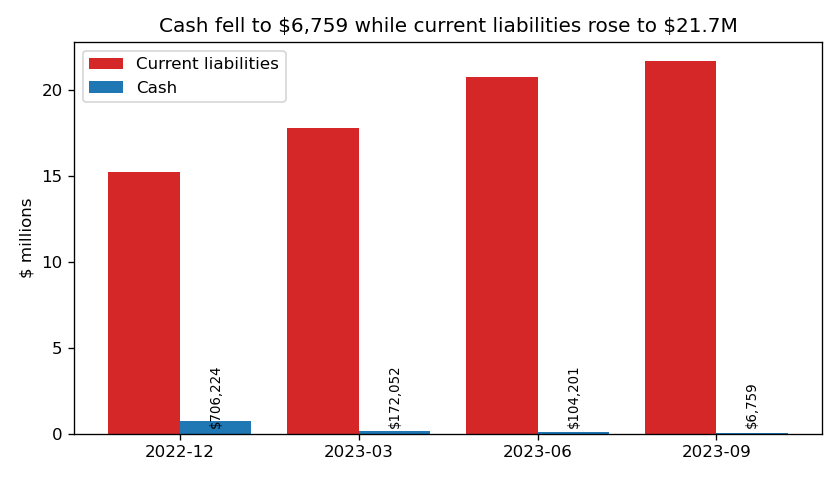
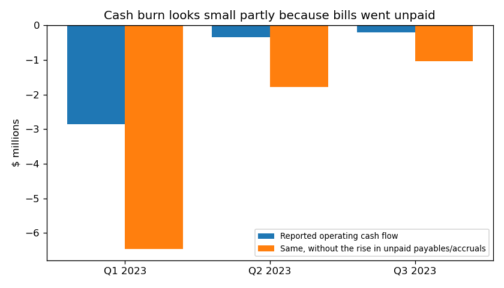
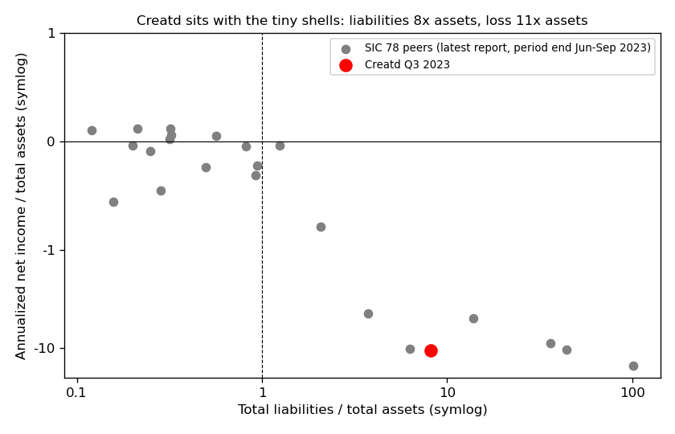

# Creatd, Inc. — 10-Q for Q3 2023 (filed 2023-11-15), model score 0.523

## Answer
The score comes mainly from an annualized loss of $31.0M on just $2.9M of assets, with liabilities 8 times assets. The order of drivers is my inference, since I can't see each input's effect. The filings are worse than the numbers: cash was **$6,759**, many notes were already in default, and the cash burn looks small only because unpaid bills grew by $5.9M.

**Verdict: real risk.** My risk is **high, about 12%**, against a 4% base rate for the 0.5–0.7 band. I raised it from 4% for three specific facts: $6,759 of cash against $7.8M of notes, defaults already in place, and payables growing unpaid. Lenders extending and converting the notes hold it down. I agree with the flag, but the model ranks this report too low.

## The 8 numbers (flows annualized; pctile = % of 23 SIC-78 peers below Creatd, Jun–Sep 2023)

| Input | Q3 2023 | FY 2022 | What drives it | Peer pctile ($ / % of assets) |
|---|---|---|---|---|
| Total assets | $2.89M | $4.82M | Mostly a $1.86M lease right-of-use asset | 32 / – |
| Current assets | $0.36M | $1.48M | Cash $6,759 | 43 / 38 |
| Current liabilities | $21.69M | $15.21M | Payables $13.4M, convertibles $6.0M | 48 / 81 |
| Total liabilities | $23.61M | $17.32M | Equity −$20.7M | 41 / 82 |
| Revenue | $2.83M | $4.80M | Q3 revenue −57% year on year | 30 / 84 |
| Net income | −$31.03M | −$32.29M | Stock pay $8.3M and debt-discount accretion $4.3M (9 months) | 30 / **5** |
| Operating income | −$24.46M | −$29.03M | Stock pay | 24 / 19 |
| Operating cash flow | −$4.51M | −$16.81M | Kept small by unpaid payables | 36 / 23 |

None of the 8 is missing. Net income is the amount attributable to Creatd ($23.28M × 4/3). Current ratio is 0.017 (peer median 0.35) and liabilities/assets is 8.16 (median 0.85). Creatd sits with the tiny shells among peers (chart 3).

## Main reasons, in order
1. **Loss far larger than the company (model input).** Loss is 10.7 times assets, worse than 95% of peers. Adjusting every period the same way from the cash flow statement, non-cash items were 56% of the 9M 2023 loss (43% in FY2022 and FY2021). That leaves a cash-basis loss of $10.2M (9M 2022: $17.0M).
2. **Essentially no cash (from the filings).** Cash was $6,759. The 9-month burn is $376k/month, so cash covers 0.02 months. Even the Q3-only burn of $65k/month gives 0.1 months. Note 3 says: "its cash position may not be sufficient to support its daily operations." (10-Q, 2023-11-15, Note 3)
3. **Debt in default (from the filings).** "As of September 30, 2023, the Company is in default on $2,265,447 in principal on senior secured notes from The July 2022 Convertible Note Offering." (10-Q, 2023-11-15, Part II Item 3). Another $828k of promissory notes, including the PPP loan, are flagged in default. For the PPP loan, "the lender may require immediate payment of all amounts owed under the Loan or file suit and obtain judgment." (10-Q, Note 5). Total note principal is about $7.8M against $6,759 of cash.
4. **Hidden burn (from the filings, my inference).** Payables and accruals rose $5.9M in nine months. Without that rise, Q3 operating cash flow would have been −$1.04M instead of −$0.19M (chart 2). MD&A: "This increase is primarily attributable to a reduction in cash and an increase in accounts payable and accrued liabilities." (10-Q, MD&A Liquidity)
5. **Going concern doubt, delisting, late filings (from the filings).** The FY2022 auditor's report flagged substantial doubt (10-K, 2023-04-19), and the 10-Q repeats it: "These factors raise substantial doubt about the Company’s ability to continue as a going concern for a period of one year from the issuance of these financial statements." (Note 3). Nasdaq "has determined to delist the Company’s common stock from the Exchange" (8-K, 2022-09-06, Item 3.01). There were three late-filing notices, the auditor was replaced in May 2023, and the CFO changed twice in 2023.

## Evidence against
- **Lenders extend and convert instead of enforcing.** The October 6 deal agreed to "extend the maturity dates for the Debentures, which have a cumulative remaining balance of $2,485,000," to February 28, 2024 (8-K, 2023-11-01, Item 1.01). Note payments were deferred, and a former CEO's judgment claim was settled for $75k plus shares (Note 14).
- **56% of the loss is non-cash**, and the cash-basis loss fell 40% year on year.
- **Small amounts of funding still come in:** a $100k note, a $75k equity-line draw, a $20,500 PIPE and $68k in crowdfunding (Note 14).
- No restructuring advisors or forbearance are mentioned. Most liabilities are unsecured payables and convertibles. My inference is that a company this small is more likely to keep diluting or go dark than to pay for a Chapter 11.
- **Disagreement in the filings:** the 10-Q still says the December 2022, January 2023 and February 2023 debentures are "in default" as of filing, while the 8-K says they were extended.

## How it developed
- **FY2021:** net loss $37.4M, operating cash flow −$20.5M.
- **2022-03-01 / 2022-06-30:** Nasdaq market-value rule missed, then stockholders' deficit.
- **2022-09-02:** May and July 2022 notes default, and the CEO leaves with a confession of judgment. **2022-09-07:** trading moves to OTC. **2022-09-21:** Lind Global sues for over $920k.
- **2022-12-31:** cash $706k against $15.2M of current liabilities; auditor raises going concern doubt.
- **2023-06-13:** $2.485M of debentures mature unpaid.
- **2023-10:** debentures restructured at a $0.025 conversion price; stock sold at $0.017.

## Dates to watch
- **2023-12-15:** deferred note payments due.
- **2024-02-28:** $2.485M debentures mature.
- **~2024-04-01:** FY2023 10-K. Another NT filing or a further going concern opinion is likely.

**Would raise my risk:** a lender suing or accelerating, or a stop in SEC filings. **Would lower it:** an equity raise above about $2M, or conversion of most of the notes.

## How sure I am
Moderately sure. The distress is plain, but whether it ends in formal bankruptcy rather than dilution or going dark is a judgment call. I couldn't check the note agreements (security, cross-default), the share price, room in authorized shares, the Lind case status, or the Nasdaq Form 25 (download failed).

I have some general memory of this company after November 2023. I did not use it, and nothing here relies on it.

## Filings used
10-Q 2023-11-15; 10-Q 2023-08-14; 10-Q 2023-05-18; 10-K 2023-04-19; 8-K 2023-11-01, 2023-05-22, 2023-05-03, 2023-02-10 (×3), 2023-01-20, 2022-11-18, 2022-11-07, 2022-10-25, 2022-09-26, 2022-09-19, 2022-09-09, 2022-09-06, 2022-07-29; NT 10-Q 2023-05-15, 2022-11-14; NT 10-K 2023-03-31. Data: shared/financials.csv rows filed on or before 2023-11-15.
