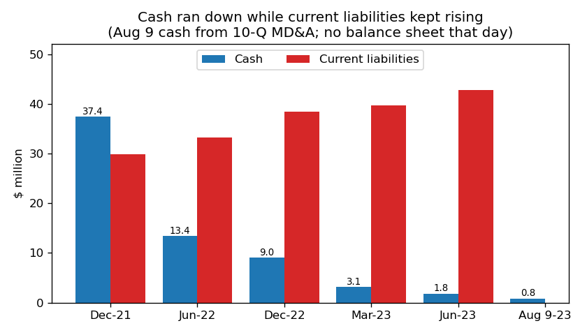
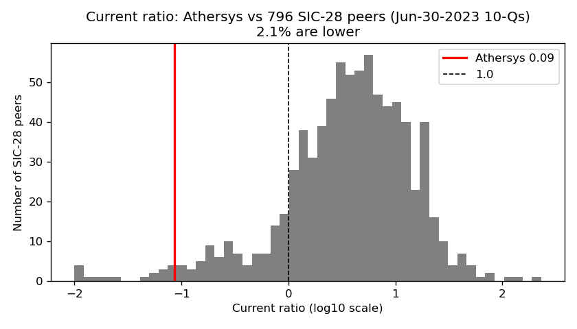
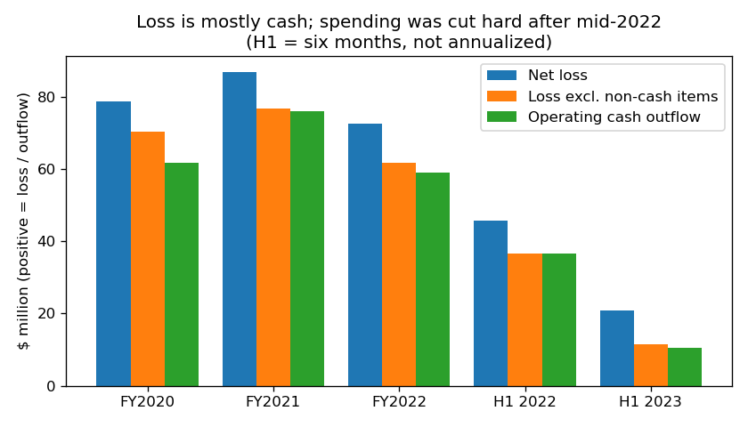

# Athersys, Inc. — 10-Q for Q2 2023 (filed 2023-08-16), model score 0.582

**Answer.** Athersys has $10.5m of assets against $47.9m of liabilities, a current ratio of 0.09, and an annualized loss four times its assets. Those ratios are in the worst 2–3% of SIC-28 peers; the dollar loss is ordinary, so the ratios most likely drive the score (my inference). The filings are worse: $0.8m cash on 9 Aug 2023, and management says it would likely file for bankruptcy without new money.

**Verdict: real risk.** My risk is **very high, about 50%** within 365 days, against a 4% base rate for the 0.5–0.7 band. I agree with the model's direction; the score understates it.

I moved up from 4% because of: about two weeks of cash; forbearance on $20.9m of past-due supplier debt, with payments from October that cash can't cover; management's bankruptcy statement; and lawsuits that could trigger the note's default clause.

## The 8 numbers (US$ m; flows are H1 × 2)

| Input | Q2 2023 | Q2 2022 | Driver | Peer percentile (816 SIC-28 Jun-2023 10-Qs) |
|---|---|---|---|---|
| Total assets | 10.5 | 35.2 | cash spent; $7.5m lease asset written off | 12th (median 157.8) |
| Current assets | 3.7 | 21.4 | cash 1.8 | 8th |
| Current liabilities | 42.7 | 33.2 | $15.6m supplier note, $7.9m deferred payable, $8.4m lease, all current | 66th |
| Total liabilities | 47.9 | 46.9 | plus $5.2m Healios advance | 55th |
| Revenue | 0.1 | 10.5 | Healios service work ended | 9th |
| Net income | −41.5 | −91.7 | R&D cut after 2022 restructuring | 45th (median −32.5) |
| Operating income | −40.6 | −93.3 | same | 48th |
| Operating cash flow | −21.1 | −73.2 | spending cut, bills unpaid | 55th |

None missing. **Ratios:** liabilities/assets 4.57 (year ago 1.33; 2.8% of peers exceed 4); current ratio 0.09 (0.64; ~2% of peers lower); net loss/assets −3.96 (3rd pct); equity −$37.4m.

**Burn:** Q2 operating outflow $4.6m ($1.5m/month; H1 $1.8m/month). Cash covered ~1.2 months at 30 June, ~0.5 month at 9 August, and 4% of current liabilities.

**Non-cash items.** Adjusted loss, adding back the same cash-flow items each period (depreciation, impairments, stock pay, fair-value changes, extinguishment gain):

| Period | Adjusted loss ($m) |
|---|---|
| FY2020 | −70.5 |
| FY2021 | −76.7 |
| FY2022 | −61.9 |
| H1 2022 | −36.7 |
| H1 2023 | −11.5 |

Each is close to that period's operating cash flow, so the loss is real cash.

## Main reasons, in order

Order is my inference.

1. **No liquidity (model input).** Cash $1.8m against $42.7m current liabilities. 10-Q 2023-08-16, MD&A: "As of August 9, 2023, we had $0.8 million of cash and cash equivalents and accounts payable of $16.5 million".
2. **Liabilities 4.6× assets (model input),** top 3% of peers; 1.33 a year earlier.
3. **The loss is 3.96× assets (model input),** although in dollars it is near the peer median.
4. **Management names bankruptcy (from the filings).** 10-Q 2023-08-16, Note 2 Going Concern: "If we are unable to obtain adequate financing, we likely would have to file for protection under the bankruptcy laws to continue to pursue potential transactions and conduct a wind down of our Company."
5. **Forbearance on overdue supplier debt (from the filings).** 8-K 2023-05-23, Item 2.03: the deal "restructures the Company’s matured and unmatured liabilities owed to the supplier under the Agreements, comprised of past due and current due obligations in the approximate amount of $20.9 million". Result: a $15.0m note and $11.8m deferred payables at $0.25m a month from October 2023. 10-Q, Note 11: "If any cash payment remains unpaid for more than 60 days following the date such cash payment was due, the supplier has the right to declare the entire remaining balance due immediately and payable without further notice."
6. **Lawsuits (from the filings).** 10-Q, Note 5: "On June 9, 2023, the landlord, Seasons Business Center Four, LLC, brought suit against the Company". Note 6: "Healios has alleged that we are in material breach of our Framework Agreement". A judgment over $3m defaults the note.
7. **Delisting (from the filings).** 10-Q, Note 14: the Nasdaq Panel "granted our request for an exception through September 15, 2023".

## Evidence against

- A pre-revenue Phase 3 biotech; such losses and going-concern doubt are already in the base rate.
- It keeps raising money ($30.8m net in 2022, $3.3m in April 2023), though raises are shrinking.
- The supplier chose forbearance; the note's interest is paid in kind and it matures 17 May 2026.
- A Healios consulting MOU (10-Q, Note 14: "Healios agreed to compensate the ABT/ATHX for the aforementioned consultation services"), but the deposit is only $150k.
- The NT 10-Q gives an accounting reason for the delay ("including additional time to complete a warrant and convertible note valuation"); the 10-Q was filed within the grace period.
- An out-of-court wind-down would not count as bankruptcy.

## How it developed

- **Mar–Jun 2022:** first Nasdaq bid-price notice; restructuring cut staff by "up to 70%". Manufacturer contracts were suspended. The Q2 2022 10-Q already shows substantial doubt.
- **Jul 2022:** Aspire ended its $100m equity line after the executives left. An Ankura adviser became interim CFO.
- **Aug–Nov 2022:** dilutive raises; 1-for-25 reverse split.
- **Apr 2023:** the 10-K auditor said the company "has a working capital deficiency as of December 31, 2022, and has stated that substantial doubt exists about the Company’s ability to continue as a going concern". Nasdaq deadline missed; $3.3m raise.
- **May 2023:** supplier forbearance.
- **Jun 2023:** lease abandoned; the landlord sued.
- **Jul–Aug 2023:** bid-price notice; cash $0.8m; NT 10-Q.

## Dates to watch

- **15 Sep 2023:** the Nasdaq market-value exception ends.
- **End of Oct 2023:** the first $0.25m supplier payment is due. 60 days late lets the supplier call everything.
- **Mid-Nov 2023:** Q3 10-Q cash.
- **24 Jan 2024:** the bid-price deadline.
- **Healios:** joining MASTERS-2, or suing.

What would change my mind:
- **Toward medium:** a >$20m raise or a partnership funding a year.
- **Higher:** missed supplier payment, judgment, delisting, bankruptcy counsel.

## How sure I am

Fairly sure the distress is real; less sure the outcome is a court filing rather than an out-of-court wind-down or asset sale.

Unchecked: cash after 9 August; the landlord's claim (only "in excess of $25,000"); financing talks; input weights.

Peers are all SIC 28. Year-ago figures come from the Q2 2022 10-Q (the dataset has three company rows).

I knew from outside this exercise that Athersys filed Chapter 11 in January 2024; I did not use it. All sources are dated by 2023-08-16.

## Filings used

10-Q 2023-08-16; NT 10-Q 2023-08-15; 8-K 2023-08-11; 8-K 2023-07-31; 8-K 2023-05-23; 10-Q 2023-05-15; 8-K 2023-04-18; 8-K 2023-04-14; NT 10-K 2023-04-03; 10-K 2023-04-03; 8-K 2023-01-05; 8-K 2022-12-29; 8-K 2022-11-10; 8-K 2022-11-01; 8-K 2022-10-20; 8-K 2022-09-22; 8-K 2022-08-17; 10-Q 2022-08-12; 8-K 2022-08-04; 8-K 2022-08-02; 8-K 2022-07-08; 8-K 2022-06-21; 8-K 2022-06-02; 8-K 2022-05-12; 8-K 2022-04-28; 8-K 2022-03-24; financials.csv rows filed ≤ 2023-08-16.
