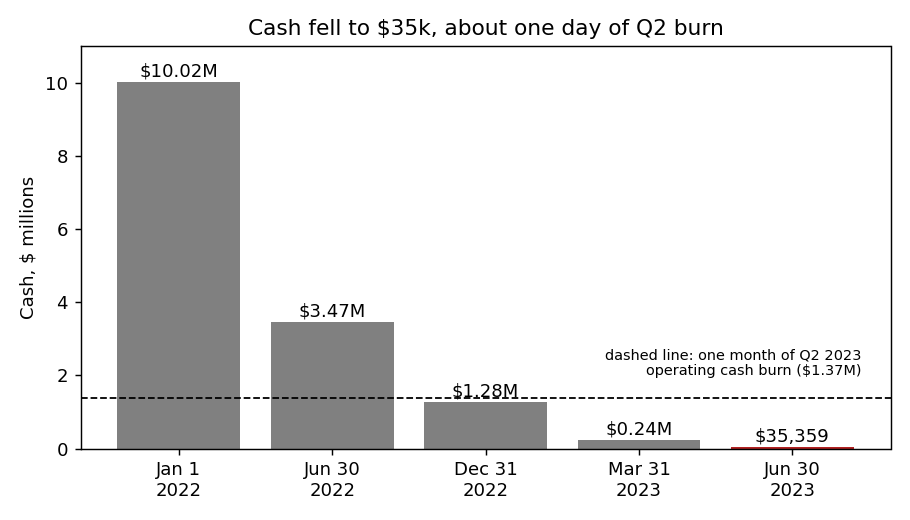
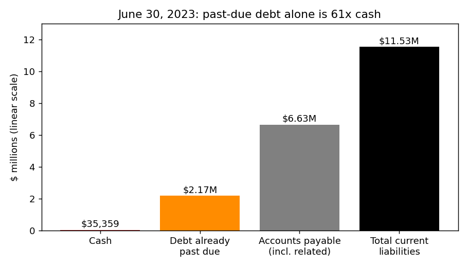
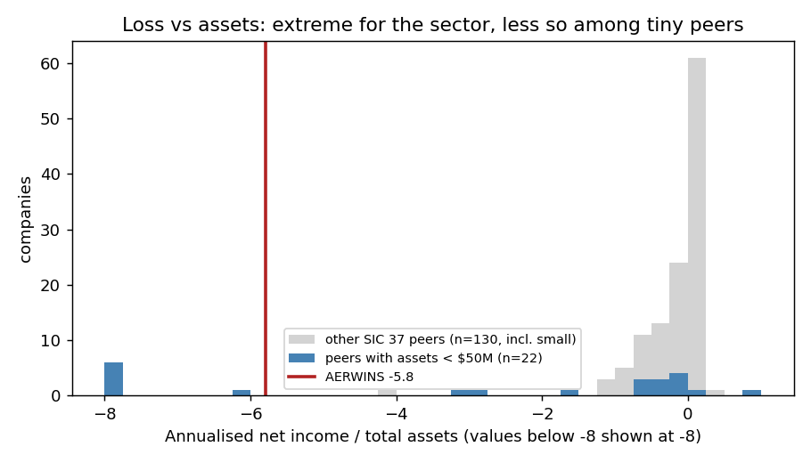

# AERWINS Technologies (CIK 1855631): 10-Q for the period ending 30 Jun 2023, filed 21 Aug 2023. Score 0.536

## Answer
The score comes mainly from a huge loss on a tiny balance sheet. The annualised net loss is $38.4M against $6.6M of assets (−5.8x), liabilities are 2.7x assets, and revenue is almost nothing. Among peers under $50M of assets those ratios are bad but not unusual, so the score sits in the middle band. The filings are far worse than the numbers: cash was **$35,359**, $2.17M of debt was past due, and a bank account was seized.

**Verdict: real risk. My risk: very high, about 35% within 12 months (band base rate 4%). I agree with the flag; the score understates it.**

## The 8 model inputs
"Year before" uses the company's own comparatives in this 10-Q: first-half 2022 ×2, and the 31 Dec 2022 balance sheet. (The dataset's year-earlier row is the pre-merger SPAC.) Peer rank is the share of 132 SIC-37 peers (period ending Apr–Jun 2023) with a lower value. Nothing is missing.

| Input | This report | Year before | Driver | Peer rank |
|---|---|---|---|---|
| Total assets | $6.63M | $11.78M | PP&E and intangibles impaired to zero | 10th pct |
| Current assets | $5.46M | $8.23M | $2.92M supplier advances, $1.54M inventory, $35k cash | 13th |
| Current liabilities | $11.53M | $5.90M | Payables $6.32M, unpaid notes $1.48M, CEO loan $0.69M | 19th |
| Total liabilities | $18.01M | $9.87M | Lind notes, $2.7M warrant/derivative liabilities | 18th |
| Revenue (ann.) | $0.92M | $3.87M | Drone unit discontinued; Q2 revenue $25,703 | 6th |
| Net income (ann.) | −$38.4M | −$14.5M | G&A $10.1M (incl. $3.66M stock pay), R&D $6.8M, $1.57M impairment | 29th ($); 5th (% of assets) |
| Operating income (ann.) | −$34.2M | −$14.8M | Same costs | 27th |
| Operating cash flow (ann.) | −$16.3M | −$18.1M | Held flat only because payables rose $2.87M | 33rd |

- Liabilities/assets: 2.71 (all peers 0.63, peers under $50M 1.35).
- Current ratio: 0.47 (all peers 1.74, small peers 0.38).
- Equity: −$11.4M.
- Operating cash burn: $1.36M a month over the first half, $1.37M a month in Q2. **Cash covers 0.03 months, under one day.**
- Adjusted for non-cash items the same way in both years (cash-flow lines), the continuing loss was $13.0M in H1 2023 against $6.7M in H1 2022. Non-cash items were only 29% of the 2023 loss, so the real loss doubled.

## Main reasons (the order is my inference; I can't see the model's weights)
1. **No cash left (from the filings).** "As of June 30, 2023, we had $35,359 in cash as compared to $1,278,026 as of December 31, 2022." (10-Q, 21 Aug 2023, MD&A Liquidity.)
2. **Debt in default (from the filings).** On the $1.48M of SPAC notes: "the Company has not paid by the due date. Accordingly, the Company is regarded as in default" (10-Q, Note 1). On ¥100M ($0.69M) of the CEO loan: "Accordingly, the Company is regarded in default and negotiates the terms with the lender." (10-Q, Note 8.) Together that is 61x cash.
3. **Creditors are enforcing (from the filings).** "As of August 10, 2023, the health insurance association seized our bank account in Japan for delinquent health insurance premiums." (10-Q, Note 24 Subsequent Events.) The CEO loan becomes due immediately "if provisional seizure, preservation seizure, seizure order, or delinquent disposition is received by A.L.I." (8-K, 2 Mar 2023, Item 1.01). My inference is that the seizure may have triggered this.
4. **Loss very large for its size (model input).** Net income/assets of −5.8 is worse than 95% of all peers but only 68% of small peers. Part of the score is simply size.
5. **Negative equity and illiquidity (model input).** Liabilities/assets is worse than 95% of peers.
6. **Going concern doubt, listing and governance stress (from the filings).** "These factors raise substantial doubt on the Company’s ability to continue as a going concern." (10-Q, Note 2.) There were two Nasdaq deficiency notices, the auditor was dismissed in April, the CEO, COO and three other directors left, and both 10-Qs needed an NT 10-Q.

## Evidence against
- Lind's third tranche ($1.5M, about one month of burn). It needs an effective registration and closes only "So long as no Event of Default has occurred under the Convertible Note sold at the First Closing and the Second Closing" (10-Q, MD&A).
- A $100M YA equity line. With the stock at $0.298 and a 4.99% ownership cap, it can raise little.
- Insiders paid $312k of bills. The CEO lender is negotiating, not suing.
- Drone unit closed to cut costs; Lind notes mature in 2025; no restructuring advisers named.
- Part II Item 3 (Defaults) says "Not applicable", which contradicts Notes 1 and 8.

## How it developed
- **2022:** the operating company lost about $14.5M; cash fell from $10.0M to $1.28M.
- **Jan–Feb 2023:** SPAC holders redeemed "approximately $118.9 million" (10-K, 31 Mar 2023). The merger (3 Feb) brought in only $1.6M net.
- **27 Feb:** a ¥200M emergency loan from the CEO, due 15 Apr. He resigned on 20 Mar.
- **Apr–Jun:** $3.5M from Lind notes; Nasdaq notices (20 Apr, 8 Jun); auditor dismissed; first NT 10-Q.
- **30 Jun:** SPAC notes and half the CEO loan in default; cash $35k.
- **18 Jul:** a Funding Committee formed "to consider funding alternatives" (8-K, 20 Jul 2023).
- **10 Aug:** bank account in Japan seized. **14 Aug:** second NT 10-Q.

## Dates to watch
- **17 Oct 2023:** Nasdaq bid-price deadline.
- **5 Dec 2023:** market-value deadline. After it the company "will receive written notification from Nasdaq that its securities are subject to delisting" (8-K, 13 Jun 2023).
- S-1 effectiveness and Lind's third tranche; the Q3 10-Q (mid-Nov 2023).
- **Would lower my risk:** a raise of more than $10M, or the defaulted debt settled or converted.
- **Would raise it:** the loan being accelerated, more seizures, a Lind default, or a court filing in Japan.

## Charts

## How sure I am
Confident about the distress (company's own filings); less sure of its form. The likeliest route is insolvency of the Japanese A.L.I. subsidiary; whether the US parent also files is unclear, so 35%, not higher.

What I couldn't check:
- The 10-Q is unaudited.
- The Lind cross-default terms.
- The A.L.I. audited 2022 statements (8-K/A exhibits).
- The MD&A working-capital deficit ($6,037,574) doesn't match the balance sheet ($6,075,741).

**Hindsight:** I have some recollection of what happened to A.L.I. after this date. I did not use it. All sources are dated on or before 21 Aug 2023.

## Filings used
- 10-Q (21 Aug 2023; 23 May 2023)
- 10-K (31 Mar 2023)
- NT 10-Q (16 May 2023; 14 Aug 2023)
- 8-K (2 Mar, 24 Mar, 30 Mar, 21 Apr, 27 Apr, 19 May, 26 May, 30 May, 13 Jun, 20 Jul, 7 Aug 2023)
- 8-K/A (27 Apr 2023)
- SPAC-era 8-Ks (2022 to Feb 2023), background
- shared/financials.csv, rows filed on or before 21 Aug 2023
