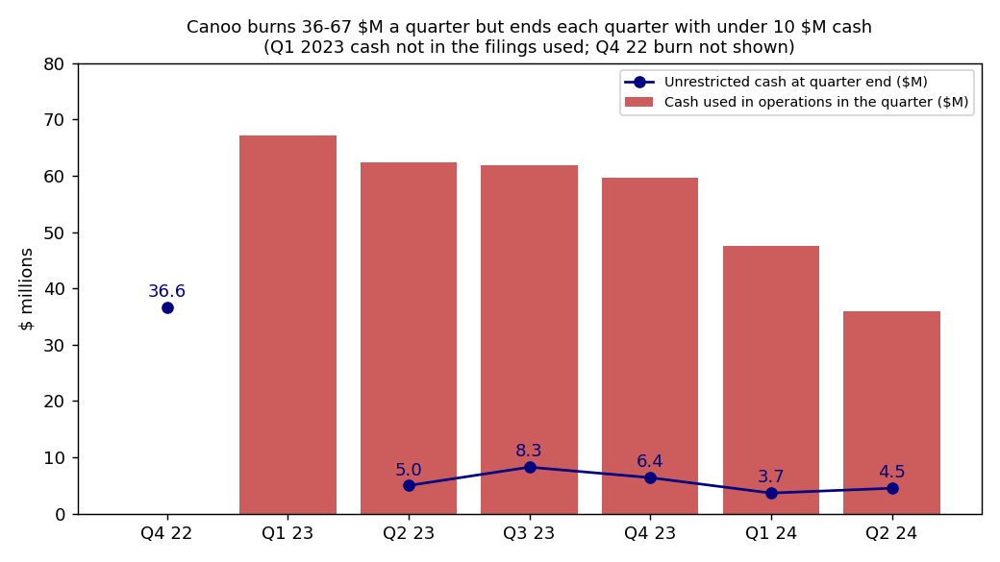
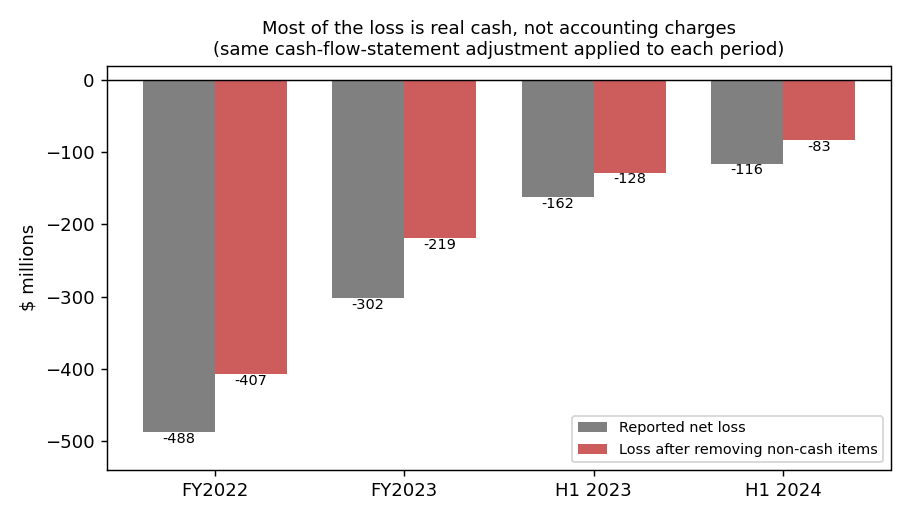
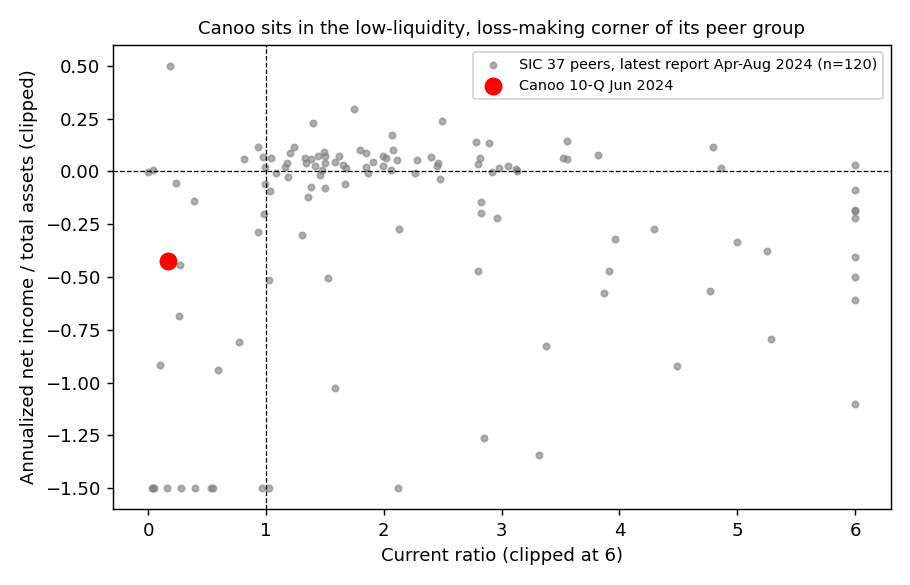
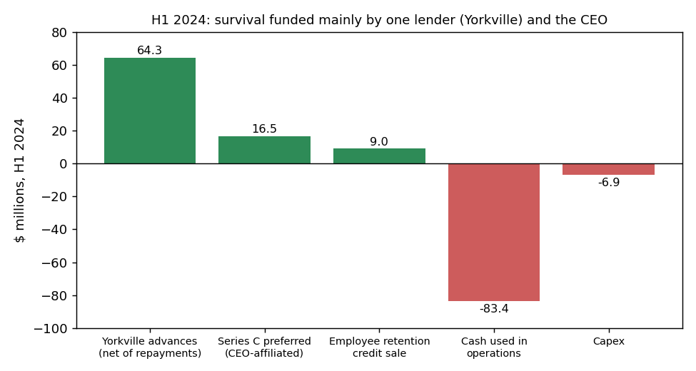

# Canoo Inc. (CIK 1750153), 10-Q to 30 Jun 2024, filed 14 Aug 2024. Score 0.606

## Answer
The score comes from a large loss with almost no revenue. Annualized net income is –$231M on $1.2M of revenue, and current assets cover only 17% of current liabilities. The filings show something the eight numbers can't: $4.5M of unrestricted cash, under two weeks of burn. The company survives on short, rolling advances from one lender, Yorkville.

**Verdict: real risk.** My own risk is **high, about 30%**, against the 4% base rate for the 0.5–0.7 band. I agree with the flag, but I think the score understates the risk.

## The 8 inputs (income and cash flow annualized, $M)
| Input | Jun-24 | Jun-23 | Driver | Peer pct* |
|---|---|---|---|---|
| Total assets | 543.3 | 522.1 | Mostly the $380M Oklahoma plant and equipment | 46 |
| Current assets | 33.4 | 25.5 | Only $4.5M unrestricted cash | 24 |
| Current liabilities | 195.0 | 202.4 | Payables, accruals, $47.2M Yorkville debt | 53 |
| Total liabilities | 347.0 | 289.4 | Warrant liability up to $56.0M | 49 |
| Revenue | 1.2 | 0.0 | First deliveries ($0.6M in Q2) | 12 |
| Net income | –231.3 | –323.2 | H1 loss ×2. Q2 alone was –$5.0M, thanks to a $48.3M gain on warrant and derivative fair values | 10 |
| Operating income | –211.7 | –310.2 | R&D and SG&A, now being cut | 10 |
| Operating cash flow | –166.8 | –259.1 | Cash burn | 11 |

*Percentile among 128 SIC-37 peers (latest report filed 1 Apr–14 Aug 2024; Canoo excluded). None of the inputs is missing.

## Main reasons
I can't see how much each input moved the score, so this order is my inference.

1. **Big loss with almost no revenue (model input).** The loss is –43% of assets against a peer median of –0.5%. That ranks 24th percentile as a share of assets and 10th in dollars. I removed non-cash items using the cash-flow statement, the same way each period. The cash loss is $407M (FY22), $219M (FY23) and $83M (H1 24), so most of the loss is real cash (chart 2).
2. **Almost no liquidity (model input; the filings make it worse).** The current ratio is 0.17 (6th percentile). Working capital is –$162M. Q2 operating burn was $35.9M, about $12M a month. That leaves **0.4 months** of cash, or about 1.6 months counting the July advance (about $14.1M net). From the 10-Q (14 Aug 2024), MD&A Liquidity: *"As of the date of this report, we believe that our existing cash resources and additional sources of liquidity are not sufficient to support planned operations for the next 12 months."*
3. **Lender debt that cash can't cover (from the filings).** Yorkville principal was $46.0M at 30 Jun. Another $15M was added in July. The June advance matures in six months. These advances are meant to be repaid in shares. But the 10-Q, Note 9, says that if the VWAP stays below the floor, *"then the Company is required to make monthly cash payments of amounts outstanding under any Pre-Paid Advance"*. The largest advance has a $2.30 floor. The 10-Q valued it at a $2.13 share price on 30 Jun. My inference is that the trigger is close; the filing does not say it has happened.
4. **Going concern doubt since Q1 2022 (from the filings).** 10-K (1 Apr 2024), auditor's report: *"These matters raise substantial doubt about the Company’s ability to continue as a going concern."* 10-Q Note 1: *"management cannot conclude as of the date of this filing that its plans are probable of being successfully implemented."*

## Evidence against
- **No default.** The 10-Q's Part II Item 3 "Defaults Upon Senior Securities" says "None." There is no NT filing and no advisors.
- **Funders keep paying in.** Yorkville made new advances in June and July. CEO vehicles bought $16.5M of preferred. 8-K (11 Apr 2024): *"special purpose vehicles managed by entities affiliated with Mr. Tony Aquila, the Company’s Chief Executive Officer and Executive Chair"*.
- **Burn is falling.** Quarterly burn fell from $67M (Q1 23) to $36M (Q2 24). The Torrance staff cut was announced 14 Aug.
- **Listing kept.** 10-K: *"the Company has regained compliance with Nasdaq’s listing rules"* (Mar 2024, after a 1-for-23 reverse split).
- **Hard assets.** Equity including preferred is $196M, mostly the plant. It could back a loan (my inference).
- It has had under $10M of cash at every quarter end since mid-2023 and survived.

## How it developed
- **Q1 2022:** first going-concern doubt.
- **Jul 2022:** Yorkville PPA signed.
- **Mar 2023:** Nasdaq bid-price notice.
- **Apr–Oct 2023:** frequent Yorkville debentures. The plant is sold and leased back from a CEO-affiliated entity. The floor is cut to $2.30.
- **Dec 2023:** $6.4M cash, $251M FY burn, auditor raises substantial doubt.
- **Jan–Mar 2024:** three PPA supplements, each refinancing the last. Reverse split.
- **Apr 2024:** the CEO funds $16.5M of Series C.
- **Jun–Jul 2024:** two new $15M Yorkville advances. Cash $4.5M.
- **14 Aug 2024:** WARN notices at Torrance.

## Dates to watch
- **26 Aug and 24 Oct 2024:** the June advance is repriced. Watch whether the shares stay above the $2.30 floor.
- **~17 Sep 2024:** the July advance switches to variable pricing with a $1.00 floor.
- **Nov 2024:** Q3 10-Q, for cash and any new Yorkville extension.
- **~13 Dec 2024:** the June advance matures.
- **Early 2025:** the FY24 10-K and its audit opinion, or an NT 10-K.

**What would change my mind:** an equity raise, a strategic investor or an asset-backed or government loan giving 12 months of cash would move me toward medium. Any of these would move me higher: a cash-payment trigger, a default notice, a late filing, a Nasdaq notice or restructuring advisors.

## Charts

## How sure I am
I'm moderately confident. The cash shortfall is clear. How long Yorkville and the CEO keep funding is not. I couldn't check daily share prices against the floor, the full PPA exhibits, or Q1 2023 cash.

**My risk estimate:** I started from 4%. Two specific facts moved me up: under one month of cash, and $61M of lender debt with cash triggers next to $4.5M of cash. Going concern doubt and losses are already in the base rate.

**Knowledge disclosure:** I know Canoo later filed Chapter 7 (January 2025). I did not use it. Every claim here traces to sources dated on or before 14 Aug 2024.

## Filings used
10-Q 14 Aug 2024; 10-Q 15 May 2024; 10-K 1 Apr 2024; 10-Q 14 Nov 2023. 8-Ks: 31 Mar, 10 Apr, 25 Apr, 28 Jun, 7 Jul, 4 Aug, 31 Aug, 13 Sep, 15 Sep, 26 Sep, 2 Oct, 22 Nov, 20 Dec 2023; 5 Jan, 12 Jan, 31 Jan, 7 Feb, 14 Mar, 11 Apr, 13 Jun, 22 Jul 2024. Data: shared/financials.csv, rows filed on or before 14 Aug 2024.
