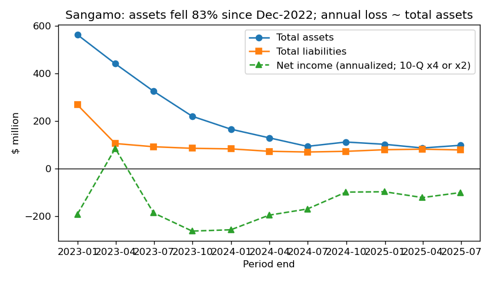
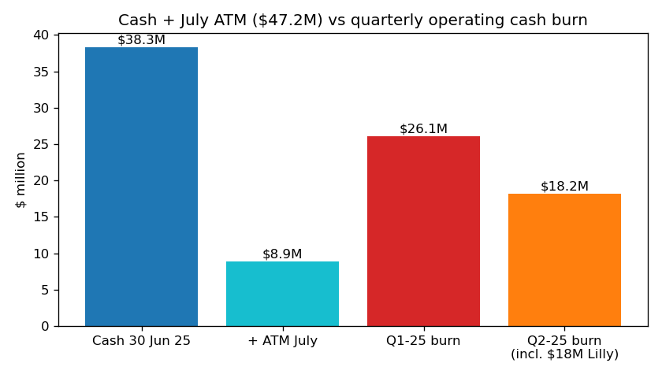
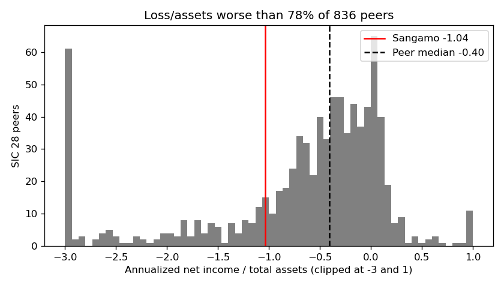

# Sangamo Therapeutics (CIK 1001233): 10-Q for the period ending 30 Jun 2025, filed 7 Aug 2025. Model score 0.688

## Answer
The score comes from an annualized loss (−$101M) about as big as total assets ($98M), liabilities at 80% of assets and a current ratio of about 1.0, all far worse than most peers. The text, which the model cannot see, is worse still: cash lasts "only into the fourth quarter of 2025" and management has explored filing for bankruptcy.

**Verdict: real risk.** My own risk is **high, about 20–25%** against the 4% base rate for the 0.5–0.7 band. **I agree with the model's flag, and I think the score is too low.**

## The 8 model inputs (10-Q flows annualized: first half ×2)
| Input | 30 Jun 2025 | 30 Jun 2024 | What drives it | Rank among 836–844 SIC-28 peers* |
|---|---|---|---|---|
| Total assets | $97.6M | $93.0M | Mostly cash of $38.3M; PP&E and lease assets | 45th pct (about median size) |
| Current assets | $49.9M | $40.1M | Cash plus tax credits | 40th pct; 51% of assets vs 78% median |
| Current liabilities | $47.7M | $39.0M | Payables, accruals, deferred revenue | 67th pct; 49% of assets vs 18% median |
| Total liabilities | $78.0M | $69.3M | Adds $23.5M of leases. **No debt** | 62nd pct; 80% of assets vs 45% median |
| Revenue | $49.5M | $1.7M | One-off: $18.0M Lilly upfront and $5.0M Pfizer | 49th pct |
| Net income | −$101.2M | −$170.4M | R&D of $53M in the half | 24th pct; −1.04× assets vs −0.40 median |
| Operating income | −$95.0M | −$177.2M | Same | 28th pct |
| Operating cash flow | −$88.6M | −$151.1M | Same | 25th pct; −0.91× assets vs −0.38 median |

*Latest filing per peer with a period end from Mar to Jun 2025, filed on or before 7 Aug 2025, company excluded. No inputs are missing.

Derived: liabilities/assets **0.80**, equity **$19.6M**, current ratio **1.05** (peer median 3.26). Monthly burn: **$7.4M** in the first half (5.2 months of cash), **$6.1M** in Q2 (6.3 months), **$8.7M** in Q1 (4.4 months); 5.4–7.8 months with the $8.9M July ATM. Q2 burn looks low only because it includes the $18M Lilly payment.

Non-cash items, measured the same way each period (depreciation, lease amortization, stock compensation, impairment): 45% of the FY2023 loss, 28% of FY2024, **17% of H1 2025** (cash loss $41.9M). The loss is almost all cash.

## Main reasons, in order
I cannot see how much each input moved the score, so this order is my inference.

1. **Loss as large as the asset base (model input).** −$101M is 1.04× assets, worse than 78% of peers, and flattered: without the one-off Lilly and Pfizer payments, first-half revenue was $1.7M.
2. **Cash runs out within months (from the filings).** "will be sufficient to meet our liquidity requirements only into the fourth quarter of 2025" (10-Q, 7 Aug 2025, MD&A Liquidity). My 4–8 month estimate matches.
3. **Management has looked at bankruptcy (from the filings).** "We have explored, and will continue to explore, whether filing for bankruptcy protection is in the best interest of our Company and our stakeholders." (10-Q, 7 Aug 2025, MD&A Going Concern; the same sentence is in the FY2024 10-K)
4. **Thin liquidity and leverage (model input).** The current ratio is 1.05 against a peer median of 3.26, and liabilities are 80% of assets (75th percentile).
5. **Survival depends on one partnering deal (from the filings).** "we are engaged in business development discussions with potential counterparties concerning a commercialization agreement for our Fabry disease program, but have been unsuccessful in consummating any such transaction to date" (10-Q, 7 Aug 2025, Note 1 / MD&A)
6. **Going concern doubt and listing risk (from the filings).** "management believes that substantial doubt exists about the Company’s ability to continue as a going concern" (10-Q, Note 1). The auditor's FY2024 report also flags it. There is also a Nasdaq bid-price deficiency with a deadline of 27 Oct 2025 (8-K, 6 May 2025, Item 3.01).

## Evidence against
- **No debt** (Item 3 "Not applicable"), so no creditor can force a filing; liabilities are leases, payables and deferred revenue.
- **It keeps raising money:** $21.1M offering (May 2025), $17.6M ATM in H1, $8.9M after 30 June; about $168.8M of ATM capacity remains.
- **Runway has been extended before:** "only into the middle of the second quarter of 2025" (10-K), "early into the third quarter" (Q1 10-Q), now Q4, each time via a deal or raise.
- **Assets that could bring cash:** Lilly licence ("up to $1.4 billion" in milestones, Q1 10-Q); Fabry BLA "as early as the first quarter of 2026".
- **Costs falling:** H1 operating expenses $72.2M vs $89.4M.
- **Normal biotech profile:** 80% of SIC-28 peers lose money, and a wind-down outside court would not count as bankruptcy.

## How it developed
- **2023:** April and November restructurings, pivot to neurology; assets $563M → $165M; $65.5M impairment.
- **Mar 2024:** France wind-down; $21.9M raise.
- **24 Apr 2024:** First Nasdaq bid-price notice (8-K, Item 3.01).
- **22 Dec 2024:** Pfizer terminates the hemophilia A collaboration (8-K 1.02), ending up to $220M of milestones.
- **17 Mar 2025:** 10-K: going concern doubt, cash to mid-Q2 2025, bankruptcy-exploration sentence.
- **Apr 2025:** Lilly licence ($18M upfront); second Nasdaq notice 30 Apr.
- **May 2025:** $21.1M offering at $0.50 per share plus warrants.
- **7 Aug 2025:** Runway only into Q4 2025; no Fabry partner.

## Dates to watch
- **27 Oct 2025:** Nasdaq compliance deadline (a reverse split or a second 180-day period is possible).
- **Q3 10-Q (about Nov 2025):** updated runway and ATM usage.
- **Q4 2025:** cash runs out on management's plan.
- **Q1 2026:** Fabry BLA submission target.

**What would change my mind:** a signed Fabry partnership or a raise above about $50M would cut my risk toward the band rate. Restructuring advisors, program-halting layoffs, runway under a quarter or delisting would raise it.

## Charts

Assets fell 83% since Dec 2022; the annual loss now about equals assets.

$47M including the July ATM covers about two quarters of burn.

Loss/assets is in the worst 22% of SIC-28 peers.

## How sure I am
**Moderately sure** of real distress (a few months of cash and explicit bankruptcy exploration). **Less sure of the outcome:** with no debt, the company could keep surviving on small raises or wind down outside court. I couldn't check the share price, the status of the Fabry talks, the 8.01-only 8-Ks (skipped), or older 10-Qs. Peers are a crude SIC-28 group annualized mechanically. I may have some knowledge of what happened to Sangamo after 7 Aug 2025; I did not use any, and every claim here comes from sources dated on or before 7 Aug 2025.

## Filings used
- 10-Q, 7 Aug 2025
- 10-Q, 12 May 2025
- 10-K, 17 Mar 2025
- 8-K (Items 5.02/5.07), 16 Jun 2025
- 8-K (Item 3.01), 6 May 2025
- 8-K (Item 1.02), 30 Dec 2024
- 8-K (Item 3.01), 30 Apr 2024
