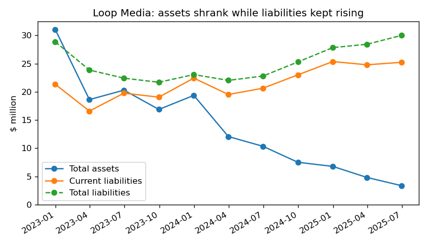
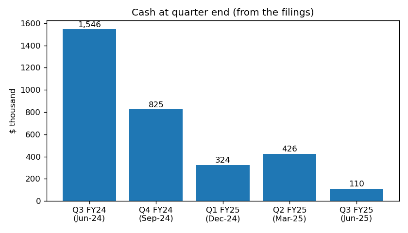
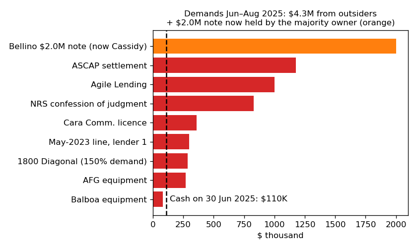
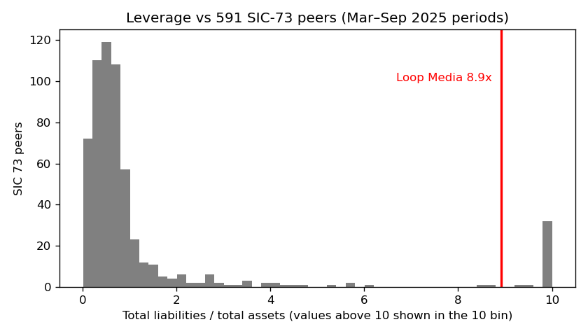

# Loop Media, Inc.: 10-Q for the quarter ended 30 Jun 2025 (filed 14 Aug 2025), score 0.718

## Answer
The score is high because the numbers describe a very small company that owes far more than it owns. Liabilities are 8.9x assets, current assets cover 7% of current liabilities, and the annualized net loss ($16.2M) is 4.8x assets. The filing is worse than the numbers: the company is in uncured payment default with several creditors, with $110K of cash against about $4.3M of outside demands.

**Verdict: real risk.** My risk: **high, about 45%**, against 18% for this score band. **I agree with the model.**

## The 8 numbers (income and cash flow annualized from 9 months)
| Input | Jun-25 | Jun-24 | Driver | % of 598 SIC-73 peers below Loop |
|---|---|---|---|---|
| Total assets | $3.36M | $10.34M | Content and equipment run down, cash used | 14% |
| Current assets | $1.84M | $6.53M | Cash $110K | 17% |
| Current liabilities | $25.24M | $20.64M | Payables $9.4M, royalties $4.7M, defaulted debt | 36% |
| Total liabilities | $30.00M | $22.80M | New convertible and short-term debt | 33% |
| Revenue | $8.93M | $24.70M | Quarterly revenue -70% year on year | 22% |
| Net income | -$16.24M | -$24.41M | Cost cuts; interest rising | 26% (loss/assets: 4%) |
| Operating income | -$11.92M | -$21.17M | Cost cuts | 28% |
| Operating cash flow | -$5.64M | -$6.60M | Helped by unpaid payables (+$4.1M) | 18% (OCF/assets: 6%) |

No input is missing. Peers are SIC 73 companies with periods ending Mar–Sep 2025, filed by 14 Aug 2025. Leverage is 8.9x against a peer median of 0.59x (above 94% of peers). The current ratio is 0.07 against 1.42 (below 92% of peers). Equity is -$26.6M.

Size matters: among the 145 peers with under $20M of assets, the median loss is 0.8x assets and 25% have higher leverage than Loop. Part of the score comes from the company being tiny. The filings are what turn it into real distress.

## Main reasons
The order is my inference; I can't see how much each input moved the score.

1. **Liabilities far larger than assets (model input).** Leverage went from 2.2x to 8.9x in a year (chart 1).
2. **Large losses, mostly cash (model input).** The non-cash share of the loss, taken from the cash flow statement the same way each year, fell from 63% (FY2023) to 51% (FY2024) to 36% (9M FY2025). After removing non-cash items the loss was -$11.9M, -$12.0M and -$7.8M.
3. **No cash left (model input and filings).** Cash was $109,692. The last quarter's burn of $0.997M ($332K a month) leaves **about 0.3 months** of cash (0.2 months at the 9-month rate). See chart 2. 10-Q, 14 Aug 2025, MD&A: "If we are unable to raise funds when required or on acceptable terms, we may have to significantly reduce or discontinue our operations."
4. **Uncured defaults and accelerations (from the filings).** From June to August 2025, eight outside creditors declared defaults or demanded full payment: ASCAP $1.175M, Agile $1.0M, NRS $0.83M, Cara $0.36M, a May-2023 line lender $0.30M, 1800 Diagonal $0.29M, AFG $0.27M and Balboa $0.08M. That is $4.3M, or 39x cash (chart 3). 10-Q, Part II Item 3: "these defaults have not yet been cured; however, no further action has been taken against the Company with respect to these defaults." NRS has gone to court: "NRS filed the following documents commencing a Civil Action to enforce the confession of judgment against the Company" (10-Q, Subsequent Events).
5. **Going concern doubt and delisting (from the filings).** 10-K, 12 Dec 2024, auditor's report: "These conditions raise substantial doubt about the Company’s ability to continue as a going concern." 8-K, 9 Aug 2024: NYSE American "suspended trading of the Company’s common stock and determined to commence proceedings to delist the Company’s common stock from the NYSE American". Notes are now being converted into stock at $0.001–0.013 a share.

## Evidence against
- **Owner support.** "In a private transaction on July 15, 2025, the Bellino Trust $2.0M Convertible Note was assigned to Mr. Cassidy with no changes to the terms." (10-Q, Subsequent Events). Mr. Cassidy, the majority owner, also advanced $217,183 in July and holds $3.0M of related-party convertible debt. An insider holding the largest defaulted note is unlikely to push the company into bankruptcy.
- **Revolver still funding.** Capital Foundry draws were made on 28 Jul and 7 Aug 2025 (balance $1.715M).
- **Creditors have mostly sent letters so far.** The company is in "discussions with the lenders" and settled GemCap's foreclosure threat in Nov 2024.
- **Burn is falling.** Operating cash outflow is down 20% year on year for the nine months.
- **A court filing may never happen.** With $3.4M of assets, foreclosure, a sale or a quiet wind-down outside court is plausible, and none of those count as bankruptcy here. This is the main reason I do not go higher.

## How it developed
- **FY2023:** loss $32.0M, operating cash burn $14.6M.
- **Apr 2024:** NYSE American deficiency letter. **Jun 2024:** the $50M share facility (ATM) was terminated and a $2.45M direct offering raised (8-K, 3 Jun 2024). The NRS payment plan with a confession of judgment was signed the same month.
- **8 Aug 2024:** trading suspended; the stock moved to OTC Pink.
- **Oct–Nov 2024:** the Bellino note put the company in default with senior lender GemCap, which accelerated the debt and set a UCC asset sale. The company paid GemCap off on 27 Nov.
- **12 Dec 2024:** going concern opinion. **30 Dec 2024:** auditor Marcum dismissed.
- **Dec 2024–Mar 2025:** refinanced with costly short-term lenders.
- **10 May 2025:** credit line matured unpaid. **Jun–Aug 2025:** cascade of defaults, with five item 2.04 8-Ks in six weeks.

## Dates to watch
- **Aug–Sep 2025:** whether AFG, Agile or ASCAP enforce, and whether the NRS judgment is entered.
- **About 29 Dec 2025:** FY2025 10-K due. An NT 10-K or no filing would be a strong warning.
- **Ongoing:** "We continue to explore potential strategic alternatives". A sale would lower my estimate.

**What would change my mind:** forbearance deals or a large equity injection by Mr. Cassidy would lower it. A lender foreclosing, levies after the judgment, or restructuring counsel being hired would raise it.

## Charts

## Confidence and limits
I am fairly sure the distress is real, because the defaults are stated plainly. I am less sure it ends in a court filing rather than an informal wind-down, hence 45% and not higher. Things I could not check:
- creditor actions after 14 Aug 2025;
- the terms of Mr. Cassidy's support;
- the new auditor's view;
- the revolver's maturity.

Some demand amounts include default multipliers and have since been partly converted to stock. I used nothing after 14 Aug 2025; I have no reliable memory of the company's later fate, and nothing here depends on it.

## Filings used
- 10-Q: 14 Aug 2025, 15 May 2025, 4 Feb 2025
- 10-K: 12 Dec 2024
- 8-K: 3 Apr, 24 Apr, 3 Jun, 18 Jul, 1 Aug, 9 Aug, 21 Aug, 30 Aug, 5 Sep, 4 Oct, 18 Oct, 24 Oct, 4 Nov, 12 Nov, 27 Nov, 4 Dec, 10 Dec, 23 Dec and 30 Dec 2024; 3 Jan, 26 Feb, 31 Mar, 1 Jul, 14 Jul, 21 Jul, 25 Jul and 12 Aug 2025
- Data: shared/financials.csv, rows filed by 14 Aug 2025
