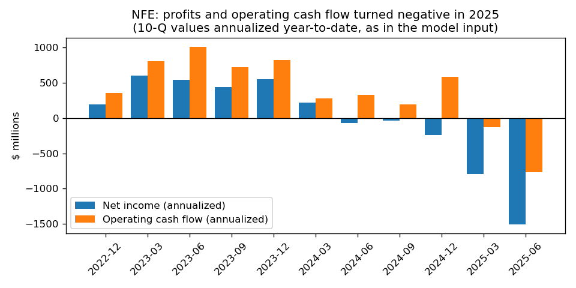
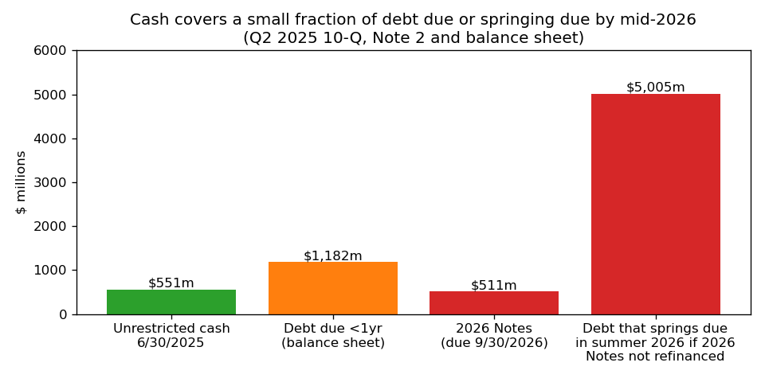
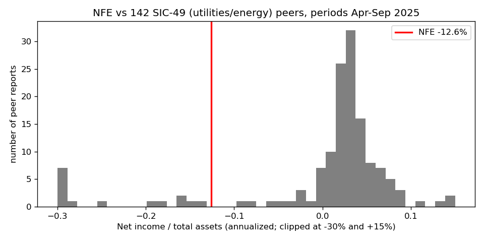
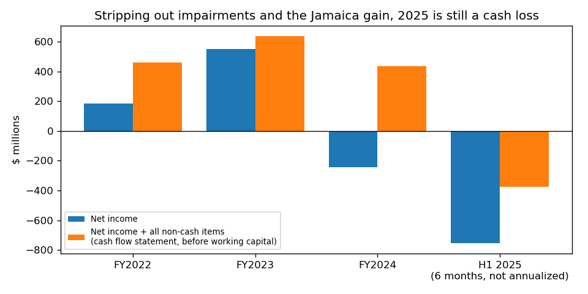

# New Fortress Energy Inc. (CIK 1749723): 10-Q for the period ended 2025-06-30, filed 2025-09-05

**Model score: 0.636.** Band 0.5–0.7: 4% of reports went bankrupt.

## Answer
The score comes from a very large loss: annualized net income of −$1.51bn (−12.6% of assets), with negative operating income and operating cash flow, liabilities at 88% of assets and a current ratio of 0.67. The footnotes, which the model cannot see, are worse: an uncured default trigger, an expected covenant breach, a fully drawn revolver, and about $5.5bn of debt that can come due by mid-2026.

**Verdict: real risk.** My risk: **very high, about 50%** within 365 days. I agree with the flag, but the model's band understates the risk.

## The 8 model inputs ($m; the 10-Q income and cash flow lines are annualized)
| Item | Q2 2025 | Q2 2024 | What drives it | Peer rank ($, 144 SIC-49 peers) |
|---|---|---|---|---|
| Total assets | 11,957 | 11,408 | Goodwill cut from $766m to $16m; Jamaica sold | 54th pct |
| Current assets | 1,482 | 1,124 | $551m cash + $270m restricted | 68th |
| Current liabilities | 2,201 | 1,565 | Current debt $1,182m (was $539m at Dec-24) | 70th (88th as % of assets) |
| Total liabilities | 10,564 | 9,623 | ~$9.0bn debt | 63rd (93rd as % of assets) |
| Revenue | 1,224 | 1,801 | "Operating revenue" only; Puerto Rico power ended, Jamaica sold | 33rd (8th as % of assets) |
| Net income | −1,508 | −70 | $700m impairments, $420m interest (H1), offset by $473m Jamaica gain | lowest |
| Operating income | −812 | 458 | Impairments and $87m transaction costs | lowest |
| Operating cash flow | −768 | 326 | Real cash loss, mostly interest | lowest |

None missing. Extreme values match the 10-Q. The dataset's revenue is six-month operating revenue ($612m) times 2; total six-month revenue was $772m.

## Main reasons, in order
I cannot see how much each input moved the score, so this order is my own inference.

1. **Large loss (model input).** The six-month loss was $754m; 93% of it is non-cash impairment ($700m). Adding back all non-cash cash-flow-statement lines the same way each year, cash earnings were +$460m in FY2022, +$635m in FY2023 and +$436m in FY2024, but **−$374m in H1 2025** (chart 4). About 10% of peers have worse net income/assets.
2. **Operating cash burn (model input).** Q2 alone: OCF −$352m, capex $312m. $551m unrestricted cash lasts 4.7 months at the Q2 operating burn, 8.6 at the H1 burn, 2.5 including capex.
3. **Default triggers and acceleration (from the filings).** The 10-Q (filed 2025-09-05, Note 2) says the $79.1m PortoCem guarantee "was not provided by the deadline, and as a result, a majority of debenture holders have the right to call for a meeting of holders and declare an event of early maturity." It also says: "If substantially all of the Company's outstanding indebtedness is accelerated, the Company would not have sufficient liquidity or capital resources to satisfy the outstanding principal obligations." It expects to fail first-lien and fixed-charge covenants for Q3 2025.
4. **Maturity wall and no backup liquidity (from the filings).** MD&A says: "As of June 30, 2025, the Revolving Facility was fully drawn with $710.4 million in revolving loans and $19.5 million in letters of credit." If the $511m of 2026 Notes are not dealt with, about $5.0bn more springs due between July and August 2026 (chart 2).
5. **Advisors, short waivers, late filings (from the filings).** Note 2 says the company "has retained a financial advisor to assist in this evaluation" of strategic alternatives. The letter-of-credit facility was rolled forward week by week (July 17, 24, 31, August 8), then only to 2025-11-14. NT 10-K plus two NT 10-Qs; the August one cites "ongoing negotiations related to additional credit support that is required to be delivered under one of our debt instruments". Nasdaq notices (May, August 2025); material weaknesses.

Leverage is 0.88 (peer median 0.67) and the current ratio is 0.67 (peer median 0.86).

## Evidence against
- No payment has been missed. Part II Item 3, "Defaults Upon Senior Securities", says "None."
- Lenders keep waiving: "On August 7, 2025 the debenture holders unanimously waived their ability to declare an early maturity event"; the L/C facility became committed.
- Jamaica sold for $1.055bn (8-K 2025-05-21); $98.6m escrow, the Puerto Rico claim and up to $110m from Genera are possible inflows.
- Book equity +$1.35bn; cash flow healthy until 2024; the chairman/CEO bought shares in the October 2024 offering.
- Most of the reported loss is non-cash.

## How it developed
- **FY2023:** peak year, net income $549m and OCF $825m.
- **Mar 2024:** Puerto Rico temporary power ended; losses from Q2 2024.
- **Nov 2024:** Q3 10-Q substantial doubt (2025 Notes); Q4 2024 refinancing resolved it.
- **Mar 2025:** NT 10-K; 10-K found plans "probable of being implemented" (doubt alleviated).
- **May 2025:** NT 10-Q, CAO resigned, Jamaica sold, Nasdaq notice.
- **Jun 2025:** downgrade (06-05); Q1 10-Q, substantial doubt returns.
- **Jul–Aug 2025:** serial L/C deferrals; $79.1m guarantee deadline missed (08-17); NT 10-Q.
- **2025-09-05:** this 10-Q; advisor retained.

## Dates to watch
- **2025-09-12:** Puerto Rico gas supply agreement expires.
- **Any time:** PortoCem holders' meeting (the early maturity right is live).
- **2025-10-05:** L/C commitments step down to about $155m.
- **2025-11-14:** L/C facility matures.
- **About November 2025:** Q3 covenant test; a waiver or acceleration follows.
- **2026-07-01:** 2029 Notes and revolver spring due. **2026-07-31:** Term Loan B. **2026-08-01:** Term Loan A. **2026-09-30:** 2026 Notes mature.

**What would change my mind:** a PortoCem waiver plus covenant relief and a 2026 Notes refinancing would cut risk toward 15%; acceleration, forbearance or a missed interest payment would push it above 70%.

## Charts

## How sure I am
Moderately sure: the direction is clear, but lenders may again agree an out-of-court fix (as in Q4 2024). Not checked: debt documents, Q3 interest dates, asset market values, 8-K exhibits. I have some general knowledge of NFE after 2025-09-05 (continued creditor negotiations); I did not use it.

## Filings used
- 10-Q, 2025-09-05
- NT 10-Q, 2025-08-12
- 10-Q, 2025-06-30
- 10-K/A, 2025-06-30
- NT 10-Q, 2025-05-13
- 10-K, 2025-03-10
- NT 10-K, 2025-03-04
- 10-Q, 2024-11-12
- 8-Ks: 2025-08-22, 2025-08-14, 2025-05-27, 2025-05-21, 2025-05-12, 2025-03-27, 2025-03-07, 2025-02-06, 2025-01-03, 2024-12-11, 2024-11-27, 2024-11-15, 2024-11-07, 2024-10-24, 2024-10-02, 2024-10-01, 2024-09-30, 2024-09-06, 2024-07-25, 2024-03-25, 2024-03-08
- shared/financials.csv, rows filed on or before 2025-09-05
