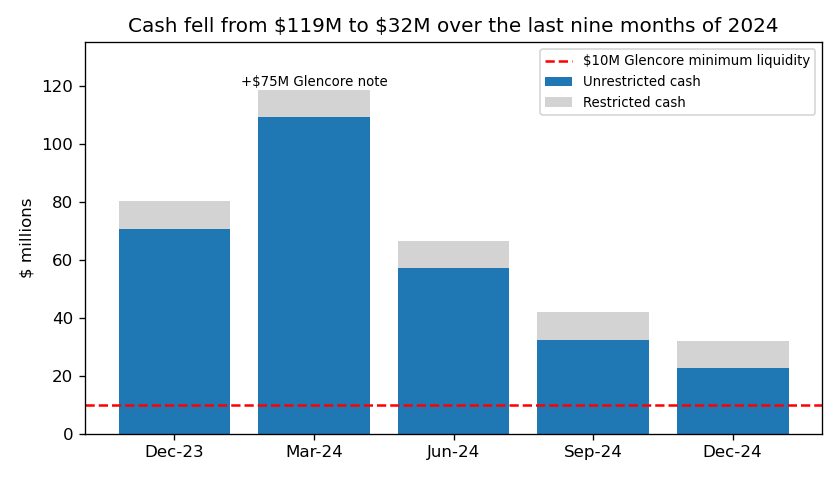
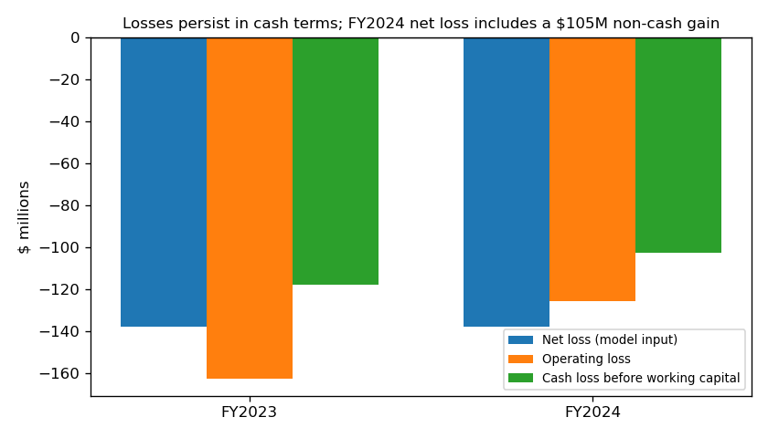
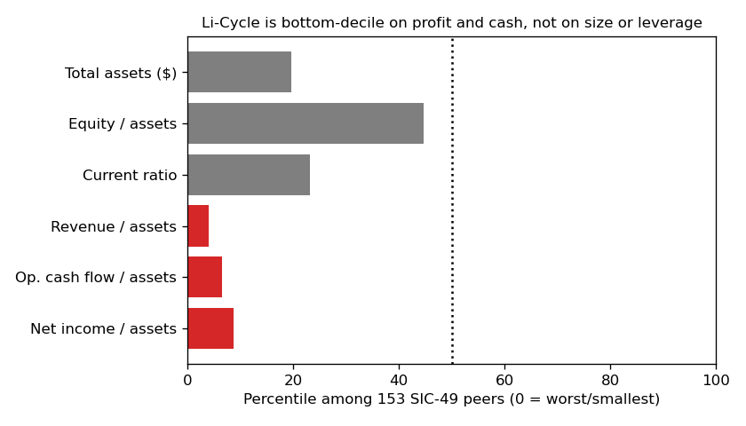

# Li-Cycle Holdings Corp. — 10-K for FY2024 (filed 2025-03-31), model score 0.640

## Answer
The score is high because Li-Cycle lost $137.7M on just $28.0M of revenue and burned $106.4M of operating cash. That puts it in the bottom 3% of utility/waste (SIC 49) peers on net income and the bottom 2% on operating cash flow. Size and leverage are ordinary for the group, so it is not a small-company artefact. The filings look worse: the loss is held down by a $105.1M non-cash gain, cash covers a few months, and the secured lender has proposed a deal that "may assign limited or no value" to shareholders.

**Verdict: real risk.** My risk: **very high, about 50–60%** of a court-supervised filing within 365 days. That is far above the 4% base rate for the 0.5–0.7 band. I agree with the flag and think 0.640 understates the risk.

## The 8 model inputs ($M)
| Input | FY2024 | FY2023 | What drives it | Peer rank (n≈150, 0=lowest) |
|---|---|---|---|---|
| Total assets | 861.2 | 886.0 | Mostly the paused Rochester Hub | 20th pct |
| Current assets | 86.4 | 149.0 | Cash fell to $22.6M | 17th |
| Current liabilities | 150.0 | 156.7 | Includes $89.7M of unpaid Hub bills | 22nd |
| Total liabilities | 598.1 | 509.6 | $363.1M convertible debt; new $75M note plus interest paid in kind (PIK) | 23rd |
| Revenue | 28.0 | 18.3 | Black-mass sales from slowed plants | 10th (4th as % of assets) |
| Net income | −137.7 | −138.0 | Includes +$105.1M fair-value gain, −$58.9M debt-extinguishment charge, −$61.9M interest | 3rd (9th as % of assets) |
| Operating income | −125.5 | −162.6 | Costs of the construction pause and restructuring | 4th |
| Operating cash flow | −106.4 | −99.8 | Cash burn | 2nd (7th as % of assets) |

No input is missing. Leverage (liabilities/assets) is 0.69, up from 0.58, which is about the peer median (55th percentile). The current ratio is 0.58, down from 0.95 (23rd percentile). Peers: latest SIC-49 report per company, periods ending Jul–Dec 2024.

## Main reasons, in order
The ranking is my inference; I can't see the model's feature contributions.

1. **Large losses relative to the business (model input).** Net loss is 4.9× revenue; the peer median *earns* 11%. Adjusted the same way in both years from the cash flow statement, the cash loss before working capital was −$102.5M (2024) and −$117.9M (2023). The 2024 non-cash items largely offset (+$105.1M fair-value gain vs −$58.9M extinguishment and −$54.0M accretion), so the loss is real.
2. **Cash runs out within months (from the filings plus inputs).** Unrestricted cash was $22.6M at 12/31/24 (plus $9.3M restricted), and $17.3M gross was raised in January 2025. Burn (operating cash flow plus capex) was $5.7M a month in Q4 and $10.9M a month for the year: 7.0 or 3.7 months of cash. Glencore's notes require at least $10.0M of liquidity, "to be tested monthly". Above that floor: 5.2 or 2.8 months, against $89.7M of Hub payables and $43.0M of other payables. The 10-K (MD&A, Liquidity) says: *"Accordingly, without additional financing in the near term, we will not have adequate liquidity during the 12 months following December 31, 2024, casting substantial doubt about our ability to continue as a going concern."*
3. **The rescue money can't be drawn (from the filings).** The $475M DOE loan needs about $173.0M of equity first, and federal disbursements were paused on 2025-01-20. The 10-K (MD&A) says: *"We will require significant additional funding before drawing down on the DOE Loan Facility and we cannot know or guarantee when, if ever, or how much, if any, funds will be available or received from the DOE Loan Facility."*
4. **The secured creditor is positioned to take control (from the filings).** Glencore holds all three Glencore notes, including the senior secured one. On 2025-03-14 it sent a letter proposing a transaction. The 10-K (Item 1A) says: *"Given the Company’s current financial position, the terms of any such strategic transaction may assign limited or no value to the Company’s existing equity."* My inference, not the filing's: such deals are often done through a court process.
5. **Delisting and auditor doubt (from the filings).** The 10-K (Subsequent events) says: *"The Company did not appeal the NYSE’s delisting determination."* The auditor's report says *"the Company has a significant working capital deficiency, has incurred significant losses and needs to raise additional funds to meet its obligations and sustain its operations."*

## Evidence against
- No debt comes due soon. The first maturity is the KSP note on 2026-09-29, and interest can be paid in kind. The 10-K (MD&A) says: *"We have no material short-term debt maturities or requirements to pay cash interest associated with our convertible debt under the Company’s option to elect PIK interest."*
- Lenders cooperate: Glencore and Wood River waivers (8-Ks 2025-01-16, 2025-02-27); Glencore lent $75M in 2024 and funds the Portovesme study.
- New money: $16.4M from the at-the-market (ATM) program in 2024, $17.3M in January 2025, $58.6M ATM capacity left.
- No missed payments or forbearance in any filing.
- The Glencore deal could be done out of court.

## How it developed
- **2023-10-23:** Rochester Hub construction paused; Cash Preservation Plan on 2023-11-01.
- **2023-11-13:** Moelis hired as financial advisor. The NT 10-K (2024-02-29) says the company *"engaged Moelis & Company LLC (“Moelis”) as its financial advisor to assist in evaluating financing and strategic alternatives for the Company."*
- **2024-03-15:** FY2023 10-K, late, with KPMG going-concern paragraph.
- **2024-03-25:** $75M Glencore secured note; layoffs; CFO and Chair out. KPMG then declined reappointment (8-K 2024-04-02).
- **2024-11-07:** DOE loan signed, with unmet conditions.
- **2025-01:** $17.3M offering at $1.00; Glencore waiver.
- **2025-02-26:** NYSE suspension; shares moved to the OTCQX market.
- **2025-03-14:** Glencore letter proposing a transaction.
- **2025-03-31:** FY2024 10-K with substantial doubt.

## Dates to watch
- **Monthly:** the $10M liquidity test.
- **~2025-04-14:** ATM suspension ends.
- **~2025-05-15:** Q1 10-Q (cash; any NT 10-Q).
- **Spring 2025:** the outcome of the Glencore letter.
- **~2025-09:** the Series A warrants expire.
- **2025-11-07:** deadline for the first DOE draw.

**Lower my view:** a signed out-of-court deal, a raise above ~$50M, or a DOE disbursement. **Raise it:** a covenant breach, a sale process, or court-related language.

## Charts

## Confidence and limits
**Confidence: moderate-high.**
- Annual history in the dataset starts only with FY2023; earlier years were filed on 20-F and aren't included.
- The $17.3M raise is gross; I don't know the net proceeds.
- Q4 burn may reflect working-capital timing.
- I didn't read the Glencore letter itself.
- SIC 49 is a loose peer group for a battery recycler.
- I know from outside this exercise what happened to Li-Cycle after 2025-03-31. I did not use it; every claim traces to sources dated on or before 2025-03-31.

## Filings used
10-K 2025-03-31; 10-K 2024-03-15; 10-Q 2024-05-10, 2024-08-08, 2024-11-07; NT 10-K 2024-02-29; 8-K 2024-03-12, 2024-03-25, 2024-03-26, 2024-04-02, 2024-05-15, 2024-06-04, 2024-06-05 (8-K/A), 2024-06-28, 2024-07-18, 2024-08-09, 2024-10-31, 2024-11-07, 2024-12-10, 2025-01-14, 2025-01-16, 2025-01-31, 2025-02-27; shared/financials.csv (rows filed ≤ 2025-03-31).
