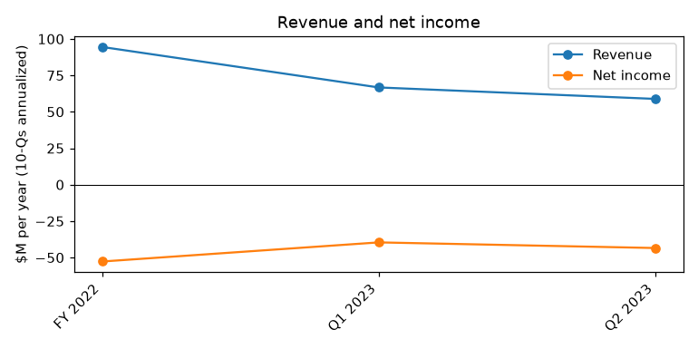
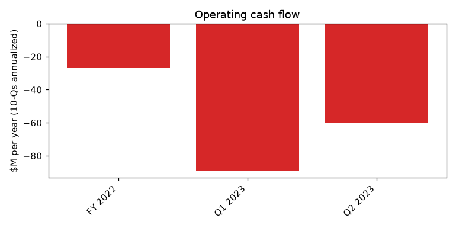
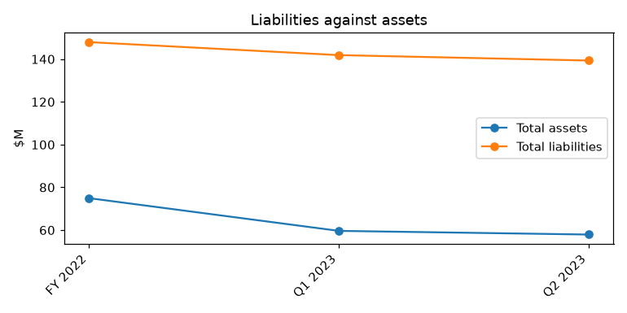

# NOGIN, INC. (CIK 1841800): 10-Q for the period ending 2023-06-30, filed 2023-08-14, model score 0.701

## Answer

All eight model inputs point toward distress, which puts the score just above 0.7. Liabilities are 2.41x assets (peer median 0.61), the current ratio is 0.48 (peer median 1.36), and annualized operating cash burn of $60.4M exceeds total assets of $57.9M. The filings confirm the distress: about one month of cash, a missed secured-note coupon, and borrowing at 34–39%.

## Verdict

| | |
|---|---|
| Verdict | **Real risk** |
| Own risk | **High, about 40%** within 365 days |
| Agree with model | **Yes** |

Reports scored above 0.7 went bankrupt 18% of the time. Our estimate is higher because of the default and the very short runway.

## The numbers

Income and cash-flow figures are annualized. "Year before" is the prior-year column of this filing. The peer group is 699 companies.

| Input | This report ($M) | Year before ($M) | % of assets | Peer pct | What drives it |
|---|---|---|---|---|---|
| Total assets | 57.9 | 232.2 | 100.0 | 33 | Smaller after the 2022 de-SPAC (our inference) |
| Current assets | 20.2 | 0.4 | 34.8 | 37 | Cash is only $3.1M |
| Current liabilities | 42.4 | 2.9 | 73.2 | 83 | Short-term debt and payables |
| Total liabilities | 139.3 | 10.9 | 240.6 | 90 | Mostly the $65.5M secured convertible notes |
| Revenue | 58.8 | 91.1 | 101.6 | 77 | Shrinking; high rank reflects small assets |
| Net income | -43.5 | -41.8 | -75.1 | 17 | Large, mostly cash losses |
| Operating income | -44.8 | -31.7 | -77.4 | 14 | Q2 Adjusted EBITDA -$7.5M |
| Operating cash flow | -60.4 | -26.4 | -104.3 | 9 | About $30M burned in six months |

## Main reasons

**1. About one month of cash, with going-concern doubt (from the filings)**
Cash was $3,143K at 2023-06-30, down $12,242K in six months despite about $22M raised in April. We estimate burn at about $2.5–5M a month, which leaves roughly 0.6–1.2 months of cash.
"These conditions provide substantial doubt about our ability to continue as a going concern for at least twelve months from the date that these consolidated financial statements are issued." (10-Q, 2023-08-14, Note 1/2 Liquidity)

**2. A payment default on secured debt (from the filings)**
The $2.3M coupon on the $65.5M 7% secured notes was missed. It was waived only in exchange for promissory notes and warrants repriced to $0.01.
"the Company did not timely make the payment of the accrued interest on the Convertible Notes due on March 1, 2023 of $2.3 million, resulting in a default." (10-Q, 2023-08-14, Note 1 Liquidity)

**3. Book insolvency and negative working capital (model input)**
Liabilities are $139.3M against assets of $57.9M, a ratio of 2.41 (90th percentile; peer median 0.61). Current assets are $20.2M against current liabilities of $42.4M, a ratio of 0.48 (peer median 1.36). (10-Q, 2023-08-14, balance sheet)

**4. Cash burn exceeds the asset base (model input)**
Operating cash flow is -$60.4M annualized, or -104% of assets (9th percentile). That is more than double the year before (-$26.4M). (10-Q, 2023-08-14, cash flow statement)

**5. Emergency borrowing (from the filings)**
The company took a $3M loan at 39%, repaid from future receipts. It was refinanced on 2023-07-25 at 34%, with $74K paid weekly. A $2M vendor payable was moved onto a $125K-a-month payment plan.
"the Company obtained a loan for $3 million with a third-party with an annual interest rate of 39%" (10-Q, 2023-08-14, Note 7 Debt; Note 20)

## Evidence against

- **Noteholders have cooperated so far.** They waived the default and deferred coupons. "The Supplemental Indenture, among other things, lowered the minimum amounts of liquidity the Company must maintain on a consolidated basis for each quarter in 2023 and the first quarter of 2024." (10-Q, 2023-08-14, Note 7 Debt)
- **The company can still raise equity.** "On April 6, 2023, the Company consummated the April 2023 Offering and received gross proceeds of approximately $22 million" (10-Q, 2023-08-14, Note 1 Liquidity)
- **No principal falls due soon.** The notes mature 2026-09-01.
- **Cost cuts are underway.** The 10-Q cites "reduced headcount and elimination of certain discretionary and general and administrative expenses" (10-Q, 2023-08-14, Note 1 Liquidity).
- **The notes are carried below par.** "As of June 30, 2023 and December 31, 2022, the fair value of the Convertible Notes were $59.1 million and $62.5 million" (10-Q, 2023-08-14, Note 7 Debt). Our inference is that the holders may prefer an out-of-court equitization to a filing.

## How it developed

| Date | Turning point |
|---|---|
| 2022-08-26 | De-SPAC closes; about $173M redeemed; $65.5M of secured notes issued |
| 2023-02 | $3M loan taken at 39% |
| 2023-03-01 | $2.3M coupon missed |
| 2023-03-23 | 10-K carries an auditor going-concern paragraph |
| 2023-03-26 | Waiver and Supplemental Indenture |
| 2023-03-31 | Cash falls to $0.6M |
| 2023-04-06 | About $22M equity raise closes |
| 2023-07-14 | Nasdaq MVPHS deficiency notice |
| 2023-07-25 | Loan refinanced at 34% |
| 2023-08-14 | 10-Q reaffirms going-concern doubt |

## Dates to watch

- **2023-08-27 and 2023-09-26:** conversion-rate resets on the notes
- **2023-09-30:** Q3 minimum liquidity covenant test
- **Around 2023-10-06:** the equity-issuance restriction ends, so a new raise becomes possible
- **Mid-November 2023:** Q3 10-Q, with cash and any new waivers
- **2024-01-08:** Nasdaq MVPHS compliance deadline
- **2024-03-01:** next cash coupon and the Q1 2024 liquidity test

## What would change my mind

- **Lower risk:** a raise of $15M or more by the end of Q3 2023, an out-of-court conversion of the notes into equity, or operating cash flow near breakeven.
- **Higher risk:** a covenant breach, a missed weekly loan payment, an acceleration notice, hiring restructuring advisers, or Nasdaq delisting before a new raise.

## Charts

## How sure we are

**Confidence: moderate.** The distress is well documented. The timing is less certain because noteholders have cooperated rather than enforced.

We could not check:
- How the cash burn split between Q1 and Q2 (the monthly range is our estimate)
- The exact covenant amounts and remaining headroom
- The current share price and remaining equity capacity
- What makes up the roughly $80M of liabilities that are not the convertible notes

## Filings used

- 10-Q 2023-08-14
- 10-K 2023-03-23
- 10-Q 2023-05-15
- 8-K 2023-08-03
- 8-K 2023-07-28
- 8-K 2023-07-14
- 8-K 2023-06-20
- 8-K 2023-05-17
- 8-K 2023-04-04
- 8-K 2023-03-27
- 8-K 2023-02-14
- 8-K 2023-02-03
- 8-K 2023-01-27
- 8-K 2022-12-05
- 8-K 2022-09-01
- 8-K 2022-04-25
- 8-K 2022-02-14
- 8-K/A 2022-02-14
- 8-K 2022-02-14