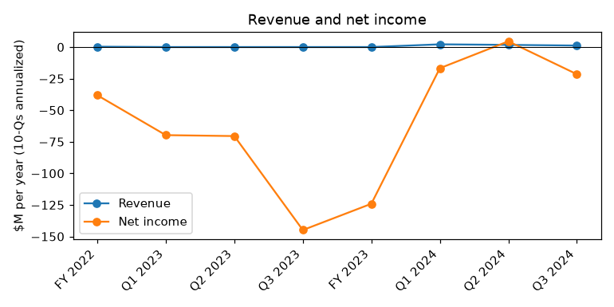
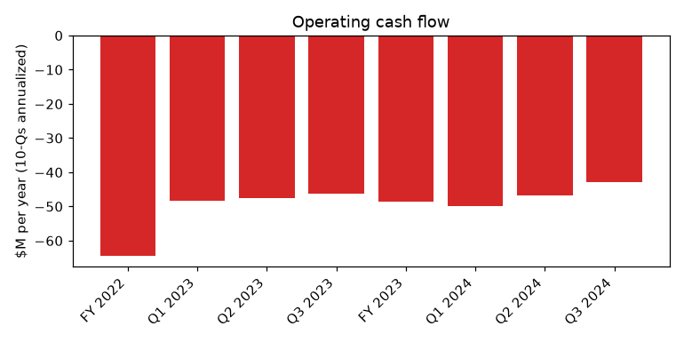
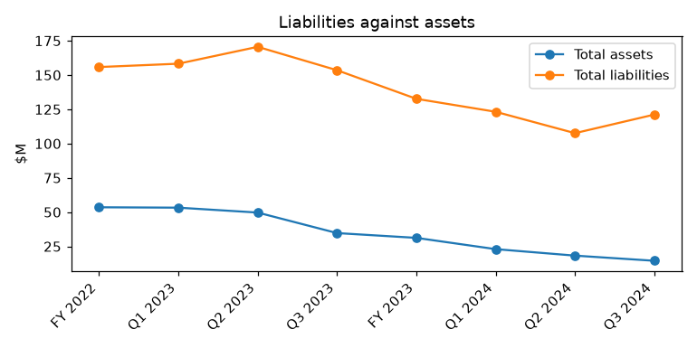

# BIORA THERAPEUTICS, INC. (CIK 1580063): 10-Q for the period ending 2024-09-30, filed 2024-11-14, model score 0.615

## Answer

The score comes mainly from the balance sheet: liabilities are 8.35 times assets and the current ratio is 0.05, both in the worst 3-4% of 878 peers. Operating income and operating cash flow are also deeply negative. Net loss looks milder than reality because of non-cash fair-value gains, so the model may even understate the distress.

**Verdict:** real risk. **Own risk:** high, about 45%. **Agree with the model:** partly (right direction, but the filings show more distress than the score suggests).

## The numbers

| Input | This report ($M) | Year before ($M) | What drives it | Peer percentile |
|---|---|---|---|---|
| Total assets | 14.5 | 34.7 | Cash fell from $15.2M to $3.2M in nine months | 23 |
| Current assets | 6.1 | 19.2 | Shrinking cash | 23 |
| Current liabilities | 120.6 | 69.5 | All convertible notes reclassified to current | 97 |
| Total liabilities | 121.1 | 153.5 | Down after 2023 debt exchanges, still 8.35x assets | 96 |
| Revenue | 1.2 | 0.0 | Very small | 31 |
| Net income | -21.5 | -144.9 | Softened by warrant ($35.2M) and derivative ($8.7M) fair-value gains | 17 |
| Operating income | -63.4 | -71.7 | Costs far above revenue | 6 |
| Operating cash flow | -42.9 | -46.3 | Ongoing cash burn | 6 |

Income and cash flow annualized. Peer medians: liabilities/assets 0.46, current ratio 3.12.

## Main reasons

1. **Liabilities far exceed assets, and all debt is now current** (model input). Liabilities $121.1M vs assets $14.5M; current liabilities $120.6M vs current assets $6.1M (96th-97th peer percentile). Operating income and cash flow sit at the 6th percentile. "As a result, all Convertible Notes and related derivative liabilities have been reclassified to current on the condensed consolidated balance sheet as of September 30, 2024." (10-Q, 2024-11-14, Note 1 Liquidity)

2. **About one month of cash, with going concern doubt** (from the filings). Cash was $3.0M against Q3 operating burn of about $8.8M (our calculation from the nine-month and six-month figures). Even with post-quarter inflows, we estimate 3-4 months of runway. This is the third quarter in a row with this warning. "As a result, substantial doubt exists about the Company’s ability to continue as a going concern for 12 months following the issuance date of the condensed consolidated financial statements" (10-Q, 2024-11-14, Note 1 Liquidity)

3. **Cash is below the covenant; the company lives on forbearance** (from the filings). Minimum liquidity is $4.0M vs $3.0M cash. Management says continued compliance is unlikely, and $62.9M of notes could be accelerated. "The parties subsequently agreed to extend the forbearance through October 31, 2024." (10-Q, 2024-11-14, Note 6 Convertible Notes)

4. **Lenders steer a restructuring that already plans for bankruptcy financing** (from the filings). The August 2024 deals require a noteholder-approved financial advisor and a restructuring milestone schedule. "the Company will agree to certain covenants regarding financing in the event it seeks bankruptcy protection under relevant bankruptcy law." (8-K, 2024-08-12, Item 1.01, Amended and Restated Indenture)

5. **Nasdaq delisting is under way** (from the filings). Any Panel extension runs no later than December 9, 2024. Delisting lets secured noteholders demand a cash repurchase, which we infer the company cannot fund. "The Company did not regain compliance with the MVLS Rule by June 10, 2024 and, accordingly, on June 11, 2024, the Staff notified the Company that its securities were subject to delisting from Nasdaq" (8-K, 2024-06-14, Item 3.01)

## Evidence against

- The company reports covenant compliance. "As of September 30, 2024 and through the date of this filing, the Company was in compliance with its debt and related covenants (see Note 6)." (10-Q, 2024-11-14, Note 1 Liquidity)
- Noteholders keep funding: three $4.0M priority note draws, with possibly one more left. "of which $4,000,000 was purchased on August 15, 2024 and an additional $4,000,000 was purchased on September 10, 2024" (8-K, 2024-10-07, Item 2.03)
- Related party Athyrium (29.7% of stock, $18.4M of 2028 notes) has backed the company repeatedly; we infer it may prefer out-of-court fixes.
- About $3.5M of new equity after quarter end.
- Total liabilities fell from $153.5M to $121.1M after exchanges, and no hard maturity comes before December 1, 2025.
- Patents (about 165 issued) could be licensed.

## How it developed

- **2023-09 / 2023-12:** Large debt exchanges; new secured 2028 notes with a $4M minimum-liquidity covenant.
- **2024-05-15:** Q1 10-Q, going concern doubt.
- **2024-06:** Interest paid in kind; Nasdaq delisting notice.
- **2024-07-03:** Forbearance on the liquidity covenant.
- **2024-08-12:** Priority notes, TDR exchange, restructuring advisor, bankruptcy-financing covenants.
- **2024-09-30:** Cash $3.0M; all notes current.
- **2024-10:** Third priority draw; 1-for-10 reverse split; forbearance ends October 31.
- **2024-11-14:** Q3 10-Q; compliance called unlikely.

## Dates to watch and what would change my mind

- November 2024: whether the last $4.0M draw is funded
- Special stockholder meeting on the note and warrant deals
- 2024-12-01: next 2028 note interest date (our inference), cash or in kind
- 2024-12-09: latest Nasdaq Panel extension date
- Any new forbearance after 2024-10-31; restructuring milestones
- 2025-12-01: 2025 notes mature

Lower risk: a raise or licensing deal funding 12+ months, noteholders converting to equity or a long-term waiver, continued listing, or an out-of-court sale that repays the secured notes. Higher risk: a missed forbearance, an acceleration notice or a failed final draw.

## Charts

## How sure we are

Moderate. We could not check: any forbearance after October 31, 2024; how the indenture defines "liquidity" (compliance is reported despite $3.0M vs $4.0M); the Nasdaq hearing outcome; the fourth draw; stockholder approval of the deals; recoupment claims from the former lab business; burn after the headcount cuts.

## Filings used

10-Q 2024-11-14; 10-K 2024-04-01; 10-Q 2024-08-12; 10-Q 2024-05-15; 8-K 2024-10-29; 8-K 2024-10-07; 8-K 2024-09-13; 8-K 2024-08-21; 8-K 2024-08-12; 8-K 2024-07-01; 8-K 2024-06-14; 8-K 2024-04-02; 8-K 2024-03-11; 8-K 2023-12-18; 8-K 2023-12-15; 8-K 2023-10-06; 8-K 2023-09-19; 8-K 2023-06-15; 8-K 2023-06-14; 8-K 2023-06-08