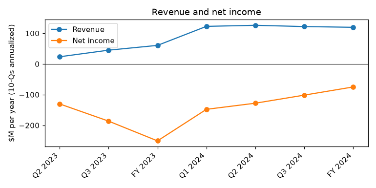
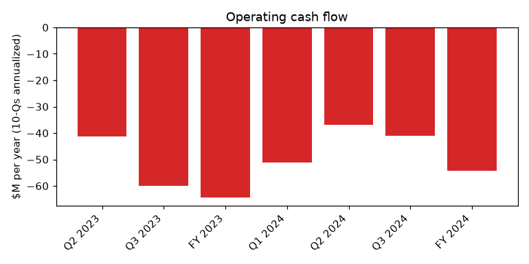
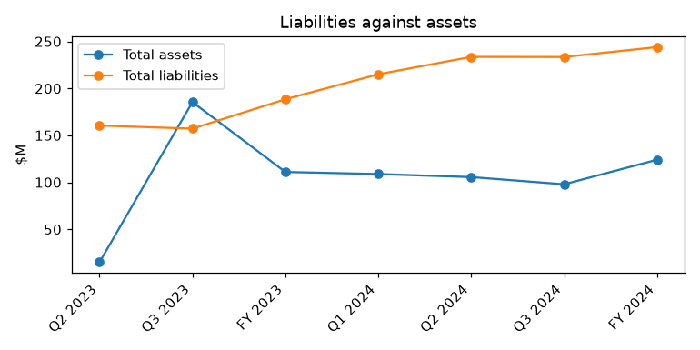

# SURF AIR MOBILITY INC. (CIK 1936224): 10-K for the period ending 2024-12-31, filed 2025-03-21, model score 0.794

## Answer
The score is high because liabilities are almost twice assets (1.97 vs a peer median of 0.81), the current ratio is 0.38, and the $74.9 million net loss and $54.3 million operating cash burn rank in the bottom 5-14% of peers. The filings confirm real distress: explicit going concern doubt, ongoing tax and SAFE-T note defaults, and only $21.1 million of cash. The late-2024 refinancing to 2028 and co-founder funding offset some of the risk.

## Verdict
- **Verdict:** real risk
- **My own risk:** high, roughly 22% (the above-0.7 band's base rate is 18%)
- **Agree with the model:** yes

## The 8 numbers
|Input|This report ($M)|Year before ($M)|What drives it|Peer percentile (22 peers)|
|---|---|---|---|---|
|Total assets|124.1|111.0|More year-end cash after the Comvest loan (inferred)|14|
|Current assets|33.9|17.7|Year-end cash $21.1M|59|
|Current liabilities|89.6|140.1|Maturities moved to 2028 in the refinancing (inferred)|86|
|Total liabilities|244.1|188.5|Debt principal up from $52.1M to $122.6M|95|
|Revenue|119.4|60.5|Revenue nearly doubled|73|
|Net income|-74.9|-250.7|2023 included a $60.0M goodwill impairment|9|
|Operating income|-60.3|-196.8|Smaller loss, still -48.6% of assets|5|
|Operating cash flow|-54.3|-64.4|Loss almost all cash; burn $4.53M a month|5|

Liabilities/assets 1.97 (peer median 0.81); current ratio 0.38 (peer median 0.78).

## Cash
Cash on hand: $21,107,000. Months of cash at the 2024 average burn ($4.53M a month): 4.66. Only about 3% of the loss is non-cash: cash-adjusted net loss -$72.5M (stock compensation was a $6.0M reversal, D&A $8.3M, no impairment).

## Main reasons
Peer comparisons exist only for the model inputs.

1. **Liabilities nearly twice assets** (model input). Liabilities $244.1M vs assets $124.1M; ratio 1.97, up from about 1.70. Peer median 0.81; 95th percentile of 22 peers. Quote: none (balance sheet inputs).
2. **Very short cash runway** (from the filings). $21.1M of cash covers 4.66 months at the average burn. My inference: the nine-month burn of $30.7M implies a Q4 burn of about $23.6M. "For the nine months ended September 30, 2024, net cash used in operating activities was $30.7 million, driven by a net loss of $76.2 million." (10-Q, 2024-11-14, MD&A, Cash Flow from Operating Activities)
3. **Going concern doubt** (from the filings). "There is substantial doubt about our ability to continue as a going concern. We will need additional financing to execute our business plan, to fund our operations and to continue as a going concern." (10-K, 2025-03-21, Summary Risk Factors; Item 1A Risk Factors)
4. **Current defaults** (from the filings). $7.7M federal excise tax in default since 2019; $1.6M property tax with a county lien on four aircraft; $0.5M SAFE-T note in default since 2019; $818 thousand of PFG interest in arrears at September 30, 2024. "We are currently in default of certain excise and property taxes, as well as certain debt, tax and other contractual obligations" (10-K, 2025-03-21, Item 1A Risk Factors - Financial Position and Capital Requirements)
5. **Large losses and cash burn** (model input). Net loss $74.9M (-60.4% of assets), operating loss $60.3M, operating cash flow -$54.3M vs -$64.4M in 2023. Net income at the 9th percentile, operating income and cash flow at the 5th. "For the year ended December 31, 2024, net cash used in operating activities was $54.3 million, driven by a net loss of $74.9 million, net reversals of $6.0 million in non-cash stock-based compensation" (10-K, 2025-03-21, MD&A - Cash Flow from Operating Activities)
6. **Cross-default risk** (from the filings). Debt rose from $52.1M to $122.6M, and the company needed a PFG waiver of the $10 million minimum cash covenant through December 31, 2024. "certain of our financing agreements are cross-collateralized, such that an event of default or acceleration of indebtedness under one agreement could result in an event of default under other financing agreements." (10-K, 2025-03-21, Item 1A Risk Factors - Covenants)

## Evidence against
- Refinancing: the LamVen debt became a $50.0M note due 2028, and the PFG $8.0M note moved from December 31, 2024 to December 31, 2028.
- New 4-year Comvest term loan of $44.5M with no required amortization lifted cash from about $1.1M to $21.1M.
- Co-founder entities lent $34.5M in 2024; total financing inflows of $77.2M covered the $54.3M burn.
- Revenue nearly doubled, the net loss fell about 70%, and current liabilities fell from $140.1M to $89.6M.
- An IRS offer-in-compromise pauses excise tax collection while the company pays $34 thousand a month.
- NYSE $1.00 price compliance regained.

## How it developed
- 2019: SAFE-T note and IRS tax plan default.
- 2023: net loss $250.7M, incl. $60.0M goodwill impairment.
- 2024-03-29: FY2023 10-K with going concern doubt.
- 2024-04/05: NYSE listing notices; CEO resigns; cash about $2.0M.
- 2024-08: GEM restored; 1-for-7 reverse split; NYSE accepts cure plan.
- 2024-09-30: cash about $1.1M; $818 thousand PFG interest in arrears.
- 2024-11-14: Comvest, LamVen and PFG refinancing disclosed, all due 2028.
- 2024-12-31: cash $21.1M, debt $122.6M.
- 2025-03-21: FY2024 10-K, again with going concern doubt and defaults.

## Dates to watch
- Mid-May 2025: Q1 10-Q cash and burn.
- Mid-2025: cash would run out at $4.53M a month without new funding.
- Covenant tests under the Comvest, LamVen and PFG debt.
- IRS decision on the offer-in-compromise.
- NYSE reviews; cure period ends about February 2026.
- New related-party funding or GEM draws.

## What would change my mind
- Lower risk: new equity or co-founder funding covering 12+ months of burn; quarterly burn well below $10M.
- Higher risk: a covenant breach, missed interest or acceleration; IRS rejection or aircraft foreclosure; NYSE delisting (which ends GEM access); the related-party lender stopping support.

## Charts

## How sure I am
Moderate. I could not check: the exact Q4 2024 burn (the $23.6M is inferred and may include one-offs); covenant compliance at year end; debt principal due in 2025 (months of cash ignore debt payments); whether the PFG arrears and past-due aircraft leases were cured; Park Lane and HSBC letter of credit terms; anything after 2025-03-21.

## Filings used
10-K 2025-03-21; 10-K 2024-03-29; 10-Q 2024-11-14; 10-Q 2024-08-14; 10-Q 2024-05-15; 8-K 2024-12-19; 8-K 2024-12-10; 8-K 2024-08-19; 8-K 2024-08-13; 8-K 2024-07-05; 8-K 2024-06-27; 8-K 2024-05-24; 8-K 2024-05-20; 8-K 2024-04-05; 8-K 2024-03-06; 8-K 2023-12-28; 8-K 2023-12-27