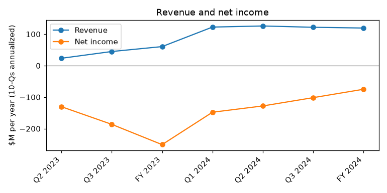
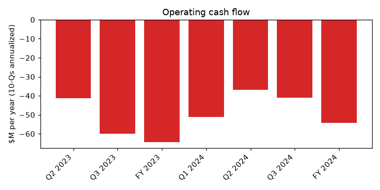
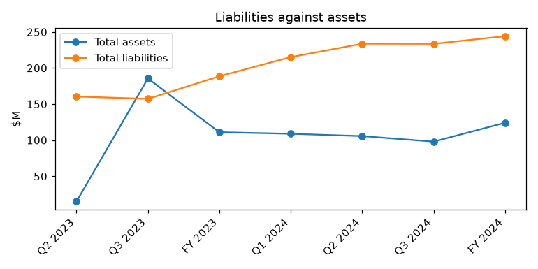

# SURF AIR MOBILITY INC. (CIK 1936224): 10-K for the period ending 2024-12-31, filed 2025-03-21, model score 0.794

## Answer

The score is high because liabilities are almost twice assets (1.97 vs a peer median of 0.81), the current ratio is 0.38, and losses and cash burn are each 44-60% of assets. The filings back this up with going concern doubt, live tax and debt defaults, aircraft tax liens and only $1.1 million of cash at September 30, 2024. Refinancings pushed the main maturities to 2028, but operations still depend on new money, mostly from a related party.

- **Verdict:** real risk
- **My own risk:** high, roughly 20%
- **Agree with the model:** yes

## The numbers

| Input | This report ($M) | Year before ($M) | What drives it | Peer percentile |
|---|---|---|---|---|
| Total assets | 124.1 | 111.0 | Small asset base | 14 |
| Current assets | 33.9 | 17.7 | Nearly doubled with 2024 financing | 59 |
| Current liabilities | 89.6 | 140.1 | Down after maturities moved to 2028 | 86 |
| Total liabilities | 244.1 | 188.5 | Debt rose to $122.6M from $52.1M | 95 |
| Revenue | 119.4 | 60.5 | Roughly doubled | 73 |
| Net income | -74.9 | -250.7 | Smaller loss, mostly from lower stock pay and listing costs | 9 |
| Operating income | -60.3 | -196.8 | Still deeply negative | 5 |
| Operating cash flow | -54.3 | -64.4 | Burn sped up to about $23.6M in Q4 | 5 |

Liabilities/assets is 1.97 (peer median 0.81). The current ratio is 0.38 (peer median 0.78). There are 22 peers.

## Main reasons

1. **Liabilities are about twice assets** (model input). Liabilities are $244.1M against $124.1M of assets, at the 95th peer percentile. There is no quote because this comes from the balance sheet inputs.

2. **Large losses and cash burn** (model input). Net income is -60.4% of assets (9th percentile) and operating cash flow is -43.8% (5th percentile). "We incurred net losses of $74.9 million and $250.7 million for the years ended December 31, 2024 and 2023, respectively." (10-K, 2025-03-21, Item 1A Risk Factors)

3. **Going concern doubt** (from the filings). "There is substantial doubt about our ability to continue as a going concern. We will need additional financing to execute our business plan, to fund our operations and to continue as a going concern." (10-K, 2025-03-21, Summary Risk Factors; Item 1A)

4. **Live defaults** (from the filings). These are a $7.7M excise tax liability, $1.6M of property tax with liens on four aircraft, and a SAFE-T note in default since 2019. "We are currently in default of certain excise and property taxes, as well as certain debt, tax and other contractual obligations" (10-K, 2025-03-21, Item 1A Risk Factors)

5. **Very little cash against the burn** (from the filings). Cash was $1.1M at September 30, 2024. "For the nine months ended September 30, 2024, net cash used in operating activities was $30.7 million, driven by a net loss of $76.2 million." (10-Q, 2024-11-14, MD&A). *My inference:* Q4 burn was about $23.6M, and year-end cash works out to about $21.7M, roughly 2.8 months at that rate.

6. **Missed interest** (from the filings). The company owed $818K of PFG interest, charged at a 15.75% default rate. "As of September 30, 2024, the Company was in arrears of $818 thousand in contractual interest payments due under the Convertible Note Purchase Agreement." (10-Q, 2024-11-14, Note 8)

## Evidence against

- The LamVen notes were refinanced into a $50.0M note due 2028, and the PFG note was extended to December 31, 2028 (10-Q, 2024-11-14, Note 19).
- A new 4-year Comvest loan has no required amortization: "pursuant to which the Company borrowed $44.5 million of term loans, and $5.5 million of delayed draw commitments." (10-Q, 2024-11-14, Note 19)
- 2024 financing of $77.2M covered the burn: "A significant amount of funding to date has been provided by entities affiliated with a co-founder of the Company." (10-K, 2025-03-21, Item 1A)
- The company regained NYSE's $1.00 price compliance as of September 30, 2024.
- The current ratio improved from about 0.13 to 0.38.

## How it developed

- **2019-07:** SAFE-T note matured and defaulted.
- **2023-12-31:** $60.0M goodwill impairment and a $250.7M net loss.
- **2024-05-15:** The CEO resigned.
- **2024-05-20:** NYSE notice that market cap and equity were below $50M.
- **2024-08-21:** NYSE accepted the company's plan, and an 18-month cure period began.
- **2024-09-30:** Cash of $1.1M and PFG interest in arrears.
- **2024-11-14:** Comvest, LamVen and PFG refinancings disclosed.
- **2025-03-21:** 10-K filed with going concern doubt and the defaults still open.

## Dates to watch and what would change my mind

- **Mid-May 2025:** Q1 10-Q, to see whether the Q4 burn rate continues
- **Through about February 2026:** NYSE cure-period reviews
- **Pending:** the IRS decision on the excise tax offer-in-compromise

**Lower risk:** year-end cash well above $21.7M, the tax arrears cured, or burn moving toward break-even.

**Higher risk:** a missed payment on the Comvest, LamVen or PFG notes, related-party support withdrawn, or NYSE delisting.

## Charts

## How sure I am

My confidence is moderate. I could not check year-end 2024 cash, whether the PFG arrears were cured, the minimum cash covenant after December 31, 2024, the Comvest covenants, or the cash needed for the 90 Cessna Caravans.

## Filings used

10-K 2025-03-21; 10-K 2024-03-29; 10-Q 2024-11-14; 10-Q 2024-08-14; 10-Q 2024-05-15; 8-K 2024-12-19; 8-K 2024-12-10; 8-K 2024-08-19; 8-K 2024-08-13; 8-K 2024-07-05; 8-K 2024-06-27; 8-K 2024-05-24; 8-K 2024-05-20; 8-K 2024-04-05; 8-K 2024-03-06; 8-K 2023-12-28; 8-K 2023-12-27