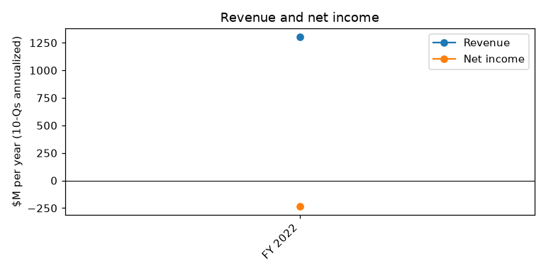
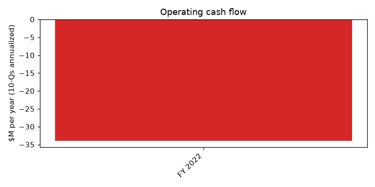
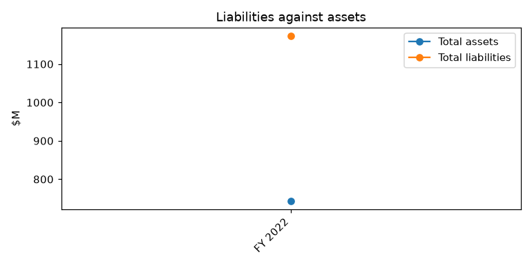

# TUPPERWARE BRANDS CORP (CIK 1008654), 10-K for period ending 2022-12-31, filed 2023-10-13, model score 0.537

## Answer

The score comes from an underwater balance sheet: liabilities are 158% of assets (peer median 64%), the current ratio is 0.43 (peer median 2.06), net income swung from +$15.6M to -$232.5M and operating cash flow turned negative. The filings show the distress is real and worse than the numbers suggest: a missed interest payment, a default before the August 2023 restructuring, and about $705M of debt the company says it cannot repay on demand.

**Verdict:** real risk. **Our risk:** high, roughly 30%. **Agree with the model:** partly; the direction is right, but its 0.5-0.7 band (4% historical bankruptcy rate) understates the risk.

## The numbers

| Input | This report ($M) | Year before ($M) | Main driver | Peer percentile |
|---|---|---|---|---|
| Total assets | 743.6 | 1,240.1 | Shrinking business, tax assets written down | 42 |
| Current assets | 431.6 | 651.9 | Lower sales and cash | 67 |
| Current liabilities | 1,001.9 | 545.1 | ~$705M debt moved to current | 100 |
| Total liabilities | 1,173.4 | 1,458.8 | Credit Agreement debt | 100 |
| Revenue | 1,304.0 | 1,600.6 | Shrinking sales force | 86 (small asset base) |
| Net income | -232.5 | 15.6 | $179.4M tax valuation allowance | 12 |
| Operating income | 23.6 | 247.2 | Lower sales | 50 |
| Operating cash flow | -34.0 | 108.8 | Lower income | 29 |

Peers: 24 companies. Year-before figures come from this filing's prior-year column.

## Main reasons

1. **Debt that cash cannot cover** (model input). Current liabilities nearly doubled; current ratio 0.43 vs peer median 2.06. Last reported cash was $102.9M (September 2022), $102.1M of it abroad. "the Company also currently expects that it will be required to classify its $705 million of borrowings under its Credit Agreement as of December 31, 2022 as a current obligation in its 2022 balance sheet." (8-K, 2023-04-07, Item 8.01)

2. **Liabilities exceed assets** (model input). $1,173.4M vs $743.6M; liabilities/assets 1.58 (year before 1.18) vs peer median 0.64. Our inference: equity of about -$430M. No quote available.

3. **Interest payments missed or at risk** (from the filings). In May 2023 lenders waived conditions so the company could borrow $5.3M for past-due interest. Then it said it "is forecasting insufficient liquidity to make its interest payment in July 2023 under the Credit Agreement, which would further limit its ability to borrow under the Credit Agreement." (8-K, 2023-07-07, Item 7.01)

4. **In default before the restructuring** (from the filings). "Prior to execution of the Debt Restructuring Agreement on August 2, 2023, the Company was in default with certain amended financial and non-financial covenants included in the Credit Agreement and had no access to its Revolver." (10-K, 2023-10-13, Item 1A. Risk Factors - Risks Related to Liquidity)

5. **Cannot repay if accelerated; bankruptcy named** (from the filings). "If such demand for repayment were to occur, the Company does not have the financial resources to repay such obligations." (10-K, 2023-10-13, Item 1A. Risk Factors - Current and future indebtedness). The restructured debt is costly (SOFR + 6.00%; 14.00% PIK), and a CRO and Moelis are in place.

6. **Losses and cash burn** (model input). Operating income $23.6M vs $247.2M; operating cash flow at the 29th peer percentile. "Cash from operations was a $34.0 million outflow in 2022 compared to $108.8 million inflow in 2021, primarily due to a decrease in income from continuing operations." (10-K, 2023-10-13, Item 7. MD&A). Our inference: cash would last about 36 months at this burn, but that is misleading because the cash is mostly abroad and the debt is the binding problem.

## Evidence against

- The August 2023 agreement "waives certain events of default existing under, and restructures the credit facilities documented by, that certain Credit Agreement dated as of November 23, 2021" (8-K, 2023-08-03, Item 1.01).
- Limited Revolver access returned, "which enabled immediate access to up to $21.0 million on the Revolver subject to liquidity and other cash covenants" (10-K, 2023-10-13, Item 1. Business - Substantial Doubt).
- Financial covenants are not tested until about March 31, 2024; the nearest maturity is July 31, 2025.
- Lenders keep granting extensions (Fifth Amendment, 8-K 2023-10-10).
- Asset sales (Indonesia, Hemingway SC, Nuvo) brought in some cash.
- Much of the loss is non-cash, "resulting in a $179.4 million valuation allowance of deferred tax assets" (10-K, 2023-10-13, Item 1. Business - Substantial Doubt).

## How it developed

- 2021-11-23: new $880.0M Credit Agreement.
- 2022-03-26: Q1 cash outflow $41.3M plus a $75.0M buyback funded by the revolver.
- 2022-11-02: Q3 10-Q discloses going concern doubt.
- 2022-12-22 to 2023-02-28: amendments loosen leverage limits, cut the revolver, shorten maturity to July 31, 2025.
- 2023-04-07: $705M to be classified as current; NYSE late-filing notice.
- 2023-05-04/08: CRO appointed; $5.3M borrowed for past-due interest; Moelis engaged.
- 2023-07-07: July interest payment at risk.
- 2023-08-02: Debt Restructuring Agreement waives defaults, adds PIK loans, fees, warrants.
- 2023-10-13: 10-K filed with going concern doubt and material weaknesses.

## Dates to watch

- Weekly: $15M minimum U.S. liquidity test and 13-week cash forecasts; quarterly cash interest.
- 2023-12-29, 2024-01-31, 2024-03-15: Q1, Q2, Q3 2023 10-Q deadlines.
- 2024-03-31: NYSE late-filer cure deadline and first leverage, interest coverage and EBITDA covenant tests.

**Would lower risk:** new equity or financing, asset sales or a Moelis deal that pays down meaningful debt, positive operating cash flow in the 2023 10-Qs.
**Would raise risk sharply:** another missed interest payment, a liquidity covenant breach, missed filing deadlines without consent, lenders accelerating the debt, NYSE delisting.

## Charts

## How sure we are

Moderate. Not checked: cash at December 31, 2022 and in 2023; 2023 operating cash flow; how much cash is usable in the U.S.; total debt after the restructuring including PIK and fees; asset sale and tax refund proceeds; whether the July 2023 interest was paid in full.

## Filings used

10-K 2023-10-13; 10-K 2022-02-23; 10-Q 2022-11-02; 10-Q 2022-08-04; 10-Q 2022-05-05; 8-K 2023-10-10; 8-K 2023-09-18; 8-K 2023-08-25; 8-K 2023-08-11; 8-K 2023-08-03; NT 10-Q 2023-08-03; 8-K 2023-07-07; 8-K 2023-06-07; 8-K/A 2023-05-08; NT 10-Q 2023-05-08; 8-K 2023-05-08; 8-K 2023-04-07; NT 10-K 2023-03-16; 8-K 2023-03-16; 8-K 2023-02-28; 8-K 2023-01-06; 8-K 2022-12-22; 8-K 2022-11-02; 8-K 2022-08-03; 8-K 2022-06-06; 8-K 2022-05-04; 8-K 2022-05-04