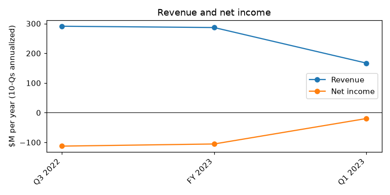
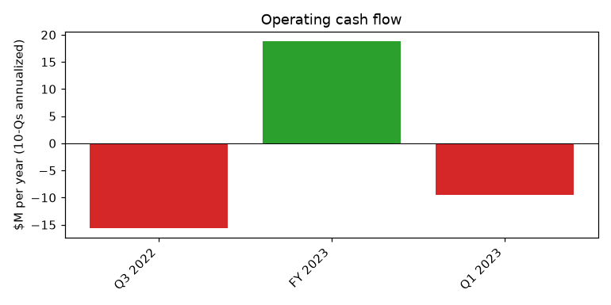
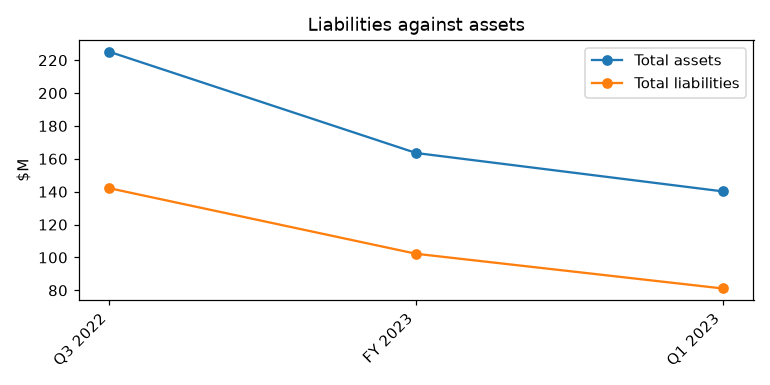

# Nautilus, Inc. (CIK 1078207): 10-Q for the period ending 2023-06-30, filed 2023-08-09, model score 0.644

## Answer
The score sits in the 0.5-0.7 band (4% of such reports went bankrupt within a year) mainly because annualized results are deeply negative against a shrinking asset base: operating income is -$42.1M, or -30.1% of assets, and total assets fell from $229.1M to $140.2M in a year. The balance-sheet ratios look ordinary, but the footnotes show a company selling assets while lenders shrink its revolver and covenant headroom stays thin.

## Verdict
- **Verdict:** real risk
- **Own risk:** medium, about 6%
- **Agree with the model:** yes

## The numbers

| Input | This report ($M) | Year before ($M) | % of assets | Peer percentile | What drives it |
|---|---|---|---|---|---|
| Total assets | 140.2 | 229.1 | 100.0 | 43 | Asset sales, inventory release |
| Current assets | 86.4 | 157.6 | 61.7 | 62 | Inventory $39.8M vs $103.9M |
| Current liabilities | 43.3 | 62.5 | 30.9 | 64 | Not broken out in the passages |
| Total liabilities | 81.1 | 124.3 | 57.9 | 51 | $11.8M term loan prepayment |
| Revenue | 167.0 | 219.3 | 119.1 | 76 | Lower product sales |
| Net income | -19.7 | -240.7 | -14.1 | 43 | Helped by $9.0M one-off gain |
| Operating income | -42.1 | -204.7 | -30.1 | 28 | $10.5M quarterly operating loss |
| Operating cash flow | -9.5 | -23.9 | -6.7 | 43 | Burn kept low by inventory release |

Income and cash flow are annualized; year-before figures come from the prior-year column of this filing. Peers: 37. Liabilities/assets 0.58 (peer median 0.57); current ratio 1.99 (peer median 2.04).

## Main reasons

1. **Thin covenant headroom, shrinking revolver** (from the filings). Availability was $9.5M, down from $14.9M a quarter earlier and $65.8M a year earlier. The minimum excess availability covenant steps from $10.0M to $9.0M to $7.0M, and the ABL commitment went from $100M to $60M to $40.0M. "the Second ABL Amendment will reduce the maximum revolving loan commitment amount from $60.0 million to $40.0 million." (10-Q, 2023-08-09, Note 20 Subsequent Events). The 10-K risk factors warn that a lender acceleration could leave the company unable to pay on time.
2. **Large operating loss** (model input). -$42.1M annualized, -30.1% of assets, 28th percentile of 37 peers. "Operating loss was $10.5 million compared to an operating loss of $51.2 million last year, primarily driven by lower operating expenses and higher gross profit." (10-Q, 2023-08-09, MD&A - Overview)
3. **Net loss flattered by a one-off gain** (model input). Net income -$19.7M annualized, 43rd percentile. The quarter's $4.9M net loss includes a $9.0M asset-sale gain. "Gain on asset dispositions (9,021) —" (10-Q, 2023-08-09, Condensed Consolidated Statements of Cash Flows)
4. **Cash burn is low only because inventory is being sold down** (model input). Operating cash flow -$9.5M annualized, 43rd percentile; inventory fell to $39.8M from $46.6M at March 31, 2023. "As of June 30, 2023, we had $18.3 million of cash, cash equivalents and restricted cash, and $9.5 million was available for borrowing under the WF ABL Revolving Facility" (10-Q, 2023-08-09, MD&A - Liquidity and Capital Resources). *Inference:* that cash lasts about 23 months at the quarter's $2.4M burn, but only about 5 months if the $10.5M quarterly operating loss had to be paid in cash.
5. **Purchase commitments nearly tripled** (from the filings). "As of June 30, 2023, we had approximately $33.0 million, compared to $12.1 million as of March 31, 2023 in non-cancellable market-based purchase obligations" (10-Q, 2023-08-09, MD&A - Off-Balance Sheet Arrangements)
6. **Limited access to new capital** (from the filings). Equity fell to $59.1M from $104.8M a year earlier. The public float is under $75M, and a 90-day lockup limits new share sales. "including if we are able to maintain compliance with debt-related financial covenants, we may be required to seek additional equity or debt financing." (10-Q, 2023-08-09, MD&A - Liquidity and Capital Resources)

## Evidence against
- No going concern doubt: management expects cash "to be sufficient to fund our operating and capital requirements for at least the next twelve months." (10-Q, 2023-08-09, MD&A - Liquidity and Capital Resources)
- "As of June 30, 2023, we were in compliance with the financial covenants contained in the agreements governing both the SLR Term Loan and ABL Credit Facility" (10-Q, 2023-08-09, Note 17 Borrowings)
- Debt is down to $17.3M after an $11.8M prepayment, and nothing matures until October 29, 2026.
- Lenders keep amending terms, including a better advance rate on Amazon receivables.
- $4.6M net equity raised in June 2023, plus $2.3M from selling Vi Labs.
- "Gross profit margins were 20.7% compared to 12.7% last year." (10-Q, 2023-08-09, MD&A - Overview)
- Unqualified audit opinion on FY2023. The 8-Ks show no defaults, late filings or delisting notices.
- Balance-sheet ratios are in line with peers.

## How it developed
- **2022-11-29 (approx.):** Refinanced with an SLR term loan of up to $30.0M at SOFR + 8.25%, due 2026-10-29.
- **2023-02 (approx.):** Restructuring with job cuts.
- **2023-03-31:** FY2023 net loss $105.4M; availability $14.9M.
- **2023-04-25:** Amendments allow asset sales and cut the ABL to $60M.
- **2023-06-15:** About $5M offering at $1.22 per share.
- **2023-06-30:** Availability $9.5M, debt $17.3M; CAO gives notice.
- **2023-07-28:** ABL cut to $40.0M; monthly reporting.
- **2023-08-09:** 10-Q filed; CAO resignation takes effect.

## Dates to watch
- Monthly borrowing base reports: availability vs the $9.0M/$7.0M floor.
- Mid-September 2023: equity lockup ends.
- 10-Q for 2023-09-30 (around November 2023): cash, availability, inventory, operating loss.
- Holiday 2023 season and the quarter ending 2023-12-31.
- Strategic review outcome (sale of the company or more asset sales).
- FY2024 10-K: auditor opinion and any going concern language.

**Would change my mind:** toward higher risk if there is a covenant breach, waiver or forbearance, a going concern paragraph, a missed interest payment, a Nasdaq bid notice, or cash burn rising toward $10.5M a quarter. Toward lower risk if the company is sold, raises sizeable capital, breaks even, or availability rises well above the floor.

## Charts

## How sure I am
Moderate. I could not check how much of the $9.5M can be drawn without breaching the covenant, the cash burn after June 2023, when the $33.0M obligations are due, the strategic review status, other SLR covenants, or how much each input moved the score.

## Filings used
10-Q 2023-08-09; 10-K 2023-06-01; 8-K 2023-07-10; 8-K 2023-06-15; 8-K 2023-05-02; 8-K 2022-12-01; 8-K 2022-07-15; 8-K 2022-06-21; 8-K 2022-05-19; 8-K 2022-02-25