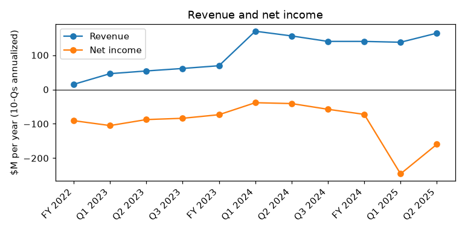
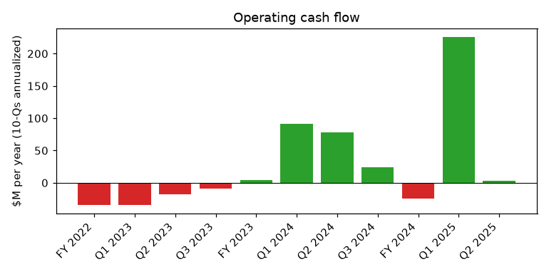
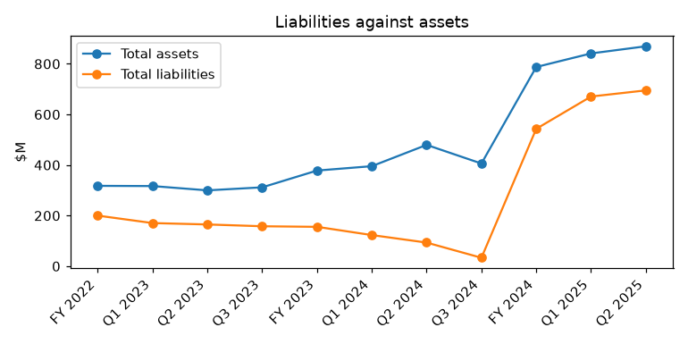

# TeraWulf Inc. (CIK 1083301): 10-Q for the period ending 2025-06-30, filed 2025-08-08, model score 0.623

## Answer

The score falls in the 0.5–0.7 band, where 4% of reports went bankrupt. Two weak model inputs put it there. Annualized net income is -$159.6M (-18.4% of assets) and operating income is -$150.4M. Current assets are only 11.4% of assets (10th peer percentile), giving a current ratio of 0.66 against a peer median of 1.42.

The filings show that about 93% of the loss is non-cash. The real pressure is liquidity: cash fell from $274.1M to $90.0M on Lake Mariner capex and buybacks. No debt is due before February 2030, and $200M of ATM capacity remains.

## Verdict

- **Verdict:** unclear
- **Own risk:** low, about 3%, close to the band's base rate
- **Agree with the model:** partly. The liquidity concern is real, but the loss inputs overstate the cash loss.

## The numbers

| Input | This report ($M) | Year before ($M) | Share of assets | Peer pct | What drives it |
|---|---|---|---|---|---|
| Total assets | 869.4 | 479.6 | 100% | 42 | Lake Mariner buildout |
| Current assets | 99.1 | 111.0 | 11.4% | 10 | Cash spent on capex, buybacks |
| Current liabilities | 151.3 | 92.4 | 17.4% | 39 | Possibly current deferred rent (inferred) |
| Total liabilities | 695.1 | 93.3 | 79.9% | 41 | $500M 2030 convertible notes |
| Revenue | 164.1 | 156.0 | 18.9% | 41 | Mining plus early HPC leases |
| Net income | -159.6 | -41.0 | -18.4% | 24 | Stock comp, D&A |
| Operating income | -150.4 | -18.2 | -17.3% | 37 | Same non-cash charges |
| Operating cash flow | 3.4 | 78.5 | 0.4% | 52 | One-off $90.0M prepaid rent |

Income and cash flow are annualized from six months. Year-before figures come from this filing's prior-year column. Liabilities/assets is 0.80, against a peer median of 0.84 across 125 peers.

**Cash and burn:**

- **Cash on hand:** $89,993,000.
- **Months of cash:** not computed, because six-month operating cash flow was positive. Cash fell about $128M in Q2 alone. At that pace, $90.0M lasts only a few months unless capex slows or funding arrives (inference).
- **Non-cash share of the loss:** 93% of the six-month loss of -$79.8M is non-cash. The cash-adjusted loss is -$5.5M.

## Main reasons

1. **Large losses, inflated by non-cash charges (model input).**
   - The six-month net loss was -$79.8M, of which Q2 was about -$18.4M.
   - Stock compensation was $40.0M and D&A was $34.4M.
   - Peers: net income is at the 24th percentile and operating income at the 37th.
   - Quote: "The Company recorded stock-based compensation expense of $1.3 million and $40.0 million during the three and six months ended June 30, 2025" (10-Q, 2025-08-08, Note 15 / Cash Flow Statement).

2. **Weak current position (model input).**
   - The current ratio is 0.66, against a peer median of 1.42. Current assets are at the 10th percentile.
   - Some current liabilities may be deferred rent settled by rent credits rather than cash (inference, not checked).
   - Quote: "As of June 30, 2025, the Company had cash and cash equivalents of $90.0 million, a working capital balance of $(52.2) million, total stockholders’ equity of $174.3 million" (10-Q, 2025-08-08, MD&A – Financial Condition).

3. **Capex and buybacks drained cash (from the filings).**
   - Over six months, capex was -$213.6M, buybacks -$33.3M and tax withholdings -$18.9M.
   - Cash went from $274.1M to $218.2M at Q1, then to $90.0M at Q2.
   - Quote: "increases in purchase of and deposits on plant and equipment of $120.1 million related to the buildout of its facilities at the Lake Mariner Facility" (10-Q, 2025-08-08, MD&A – Liquidity and Capital Resources).

4. **Operating cash flow relies on a one-off inflow (from the filings).**
   - Six-month operating cash flow was $1.7M, against $39.2M a year earlier.
   - It included $90.0M of prepaid rent, so the 52nd peer percentile flatters the company.
   - Quote: "Net cash provided by operating activities 1,677 39,227" (10-Q, 2025-08-08, Condensed Consolidated Statements of Cash Flows).

5. **Core profitability weakened (from the filings).**
   - Six-month Adjusted EBITDA was $9.8M, against $51.5M a year earlier. Q1 was -$4.7M and Q2 recovered to $14.5M.
   - No bitcoin reserve remains to sell.
   - Quote: "Non-GAAP Adjusted EBITDA $ 14,531 $ 19,526 $ 9,836 $ 51,503" (10-Q, 2025-08-08, MD&A – Non-GAAP Measure).

## Evidence against

- **No principal is due before 2030.** The notes are unsecured, with interest of about $13.75M a year. "The notes will mature on February 1, 2030, unless earlier converted, redeemed or repurchased in accordance with their terms." (8-K, 2024-10-25, Indenture and the Notes)
- **The full ATM capacity is available.** "As of June 30, 2025, the remaining capacity of the ATM Program to offer and sell shares of Common Stock is $200.0 million." (10-Q, 2025-08-08, Note 14 – Common Stock)
- **The notes are not priced as distressed.** They are valued at about $426.6M, roughly 85% of $500M par.
- **HPC customers prepaid rent.** "Subsequent to December 31, 2024, the Company received $90.0 million of Prepaid Rent under its HPC Leases" (10-K, 2025-03-03, MD&A – Financial Condition)
- **There are no other distress signals.** The filing has no going concern language and no impairment, and equity is $174.3M. "The Company is not a party to any material legal proceedings and is not aware of any pending or threatened claims." (10-Q, 2025-08-08, Note 12 – Commitments and Contingencies)

## How it developed

- **2024-07-08:** The remaining $77.5M term loan was repaid early.
- **2024-08-21:** The auditor changed from RSM to Deloitte, and material weaknesses in cash-flow-statement controls were disclosed.
- **2024-10-25:** The company closed $500M of 2.75% convertible notes due 2030. About $60M went to capped calls and about $115M to buybacks.
- **2025-03-03:** The FY2024 10-K reported cash of $274.1M and working capital of $229.6M.
- **2025-05-09:** The Q1 10-Q reported cash of $218.2M and Adjusted EBITDA of -$4.7M.
- **2025-06-20:** The Chief Accounting Officer's resignation took effect.
- **2025-06-30:** The quarter ended with cash of $90.0M, working capital of -$52.2M and no bitcoin.

## Dates to watch

- **2025-11-01:** Convertible note coupon of about $6.9M.
- **Q3 10-Q, early November 2025:** Whether cash keeps falling $100M+ per quarter, and whether the ATM is used.
- **Any 8-K:** New HPC leases, project financing or equity raises.
- **FY2025 10-K, early 2026:** The going concern assessment.

## What would change my mind

- **Toward higher risk:**
  - cash below about $40M without new funding
  - weak ATM proceeds
  - an HPC tenant default
  - unfundable capex commitments
  - a going concern paragraph
  - an indenture default notice
- **Toward lower risk:**
  - new HPC leases with creditworthy tenants
  - non-dilutive project financing
  - sizable ATM proceeds
  - cash stabilizing as HPC revenue ramps

## Charts

## Confidence

Confidence is moderate. The debt maturities and the non-cash nature of the loss are clear. The open question is cash burn against funding sources.

**Could not check:**

- Lake Mariner capital commitments over the next 12 months
- How current liabilities split between deferred rent and cash payables
- ATM sales or other financing after 2025-06-30
- HPC lease terms and tenant credit quality
- Bitcoin price sensitivity in the second half of 2025
- Cash obligations from the Beowulf earnout and trust

## Filings used

10-Q 2025-08-08; 10-K 2025-03-03; 10-Q 2025-05-09; 8-K 2025-05-30; 8-K 2025-05-27; 8-K 2024-11-21; 8-K 2024-10-25; 8-K 2024-10-10; 8-K 2024-10-03; 8-K 2024-08-21; 8-K 2024-07-09; 8-K 2024-05-23