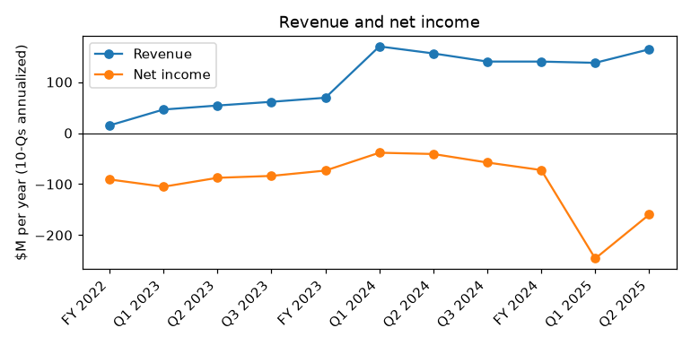
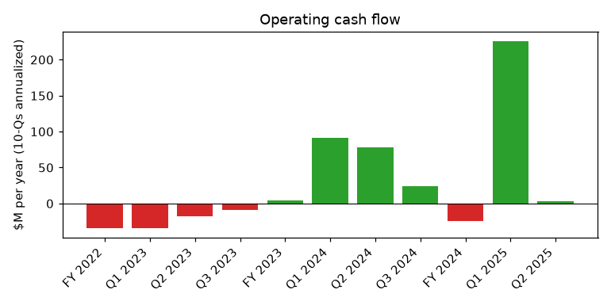
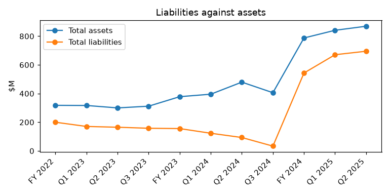

# TERAWULF INC. (CIK 1083301): 10-Q for the period ending 2025-06-30, filed 2025-08-08, model score 0.623

## Answer

The 0.623 score comes mainly from three things: an annualized net loss of $159.6M (-18.4% of assets, 24th peer percentile), liabilities that rose about sevenfold to $695.1M, and a current ratio of 0.66 against a peer median of 1.42. Much of the loss is non-cash stock compensation booked in Q1, and most of the liabilities are unsecured converts due in 2030 plus prepaid rent. The real stress is fast cash spending on the HPC buildout. Cash fell from $218.2M to $90.0M in Q2 alone, so this is a funding-dependence story rather than a near-term default story.

**Verdict:** unclear
**Own risk:** medium, about 3%
**Agree with the model:** partly. The score band (0.5–0.7, historical bankruptcy rate 4%) fits. The leverage input overstates near-term danger, and the model inputs mostly do not show the cash burn.

## The numbers

Income and cash flow are annualized. The year-before figures come from the prior-year column of this filing. There are 125 peers.

| Input | This report ($M) | Year before ($M) | % of assets | Peer pct. | What drives it |
|---|---|---|---|---|---|
| Total assets | 869.4 | 479.6 | 100.0 | 42 | HPC buildout at Lake Mariner |
| Current assets | 99.1 | 111.0 | 11.4 | 10 | Cash of $90.0M; no bitcoin held |
| Current liabilities | 151.3 | 92.4 | 17.4 | 39 | Buildout payables and accruals |
| Total liabilities | 695.1 | 93.3 | 79.9 | 41 | $500M 2030 converts and $90M prepaid rent |
| Revenue | 164.1 | 156.0 | 18.9 | 41 | Roughly flat mining revenue |
| Net income | -159.6 | -41.0 | -18.4 | 24 | $40.0M Q1 stock compensation, depreciation |
| Operating income | -150.4 | -18.2 | -17.3 | 37 | Same drivers; weaker mining margins |
| Operating cash flow | 3.4 | 78.5 | 0.4 | 52 | Propped up by the $90M rent prepayment |

Liabilities/assets is 0.80 (peer median 0.84). The current ratio is 0.66 (peer median 1.42).

## Main reasons

**1. Large net loss, inflated by a one-off charge** (model input)
- The H1 net loss was -$79.8M (Q1 -$61.4M, Q2 -$18.4M). That is -18.4% of assets, in the 24th percentile.
- *Inference:* Q2 alone annualizes to about -$73M.
- "The Company recorded stock-based compensation expense of $1.3 million and $40.0 million during the three and six months ended June 30, 2025" (10-Q, 2025-08-08, Note 15 / Cash Flow Statement)

**2. Weak short-term liquidity** (model input)
- Current assets are in the 10th percentile, and the current ratio is 0.66 against a peer median of 1.42.
- Working capital went from $229.6M at 12/31/24 to $(52.2)M.
- "the Company had cash and cash equivalents of $90.0 million, a working capital balance of $(52.2) million, total stockholders’ equity of $174.3 million and an accumulated deficit of $412.1 million" (10-Q, 2025-08-08, MD&A - Financial Condition)

**3. Short cash runway** (from the filings)
- The H1 net change in cash was $(182.6)M, and H1 capex was $(213.6)M.
- *Inference:* Q2 total burn of about $128.2M leaves about 2 months of cash. On Q2 operating burn alone (about -$54.8M), the runway is about 5 months.
- "increases in purchase of and deposits on plant and equipment of $120.1 million related to the buildout of its facilities at the Lake Mariner Facility" (10-Q, 2025-08-08, MD&A - Liquidity and Capital Resources)

**4. Operating cash flow is positive only because of a one-time prepayment** (model input)
- H1 operating cash flow was $1.7M, in the 52nd percentile. It includes a $90.0M deferred rent increase.
- *Inference:* without the prepayment, H1 operating cash flow was about -$88M.
- "Net cash provided by operating activities 1,677 39,227" (10-Q, 2025-08-08, Condensed Consolidated Statements of Cash Flows)

**5. Leverage jumped, but it is long-dated and cheap** (model input)
- Liabilities/assets is 0.80, in the 41st percentile. The converts' fair value is about $426.6M, roughly 85% of par. H1 cash interest was $7.1M.
- "The 2030 Convertible Notes mature on February 1, 2030" (10-Q, 2025-08-08, Note 10 - Debt)

## Evidence against

- **No near-term debt wall and no secured creditor.** "The notes are senior unsecured obligations of the Company and bear interest at a rate of 2.75% per year payable semiannually in arrears on May 1 and November 1 of each year" (8-K, 2024-10-25, Indenture and the Notes)
- **Equity capacity is available.** In 2024 the company raised $487.1M of converts and $188.7M of equity. "As of June 30, 2025, the remaining capacity of the ATM Program to offer and sell shares of Common Stock is $200.0 million." (10-Q, 2025-08-08, Note 14 - Common Stock)
- **Clean 2024 audit.** The reviewed 2025 passages contain no going-concern language. "our report dated February 28, 2025, expressed an unqualified opinion on the Company's internal control over financial reporting" (10-K, 2025-03-03, Report of Independent Registered Public Accounting Firm)
- **Contracted HPC tenants.** "Subsequent to December 31, 2024, the Company received $90.0 million of Prepaid Rent under its HPC Leases" (10-K, 2025-03-03, MD&A - Financial Condition)
- **Positive equity of $174.3M and no impairments.** "The Company recorded no impairment during the three and six months ended June 30, 2025 and June 30, 2024." (10-Q, 2025-08-08, Note 6 / Note 7)

## How it developed

| Date | Event |
|---|---|
| 2024-10-25 | $500M 2.75% converts due 2030 closed; about $175M used for capped calls and buybacks |
| 2024-12-31 | Cash $274.1M, working capital $229.6M |
| 2025-03-31 | Cash $218.2M after the $90M prepaid rent; $33.3M of buybacks in Q1 |
| 2025-05-27 | Acquisition of CEO-owned Beowulf E&D for about $52.4M, mostly in stock |
| 2025-06-20 | Chief Accounting Officer departure effective |
| 2025-06-30 | Cash $90.0M, working capital $(52.2)M, no bitcoin held |

## Dates to watch

- **2025-11-01:** convert interest payment of about $6.9M.
- **Q3 2025 10-Q (around November 2025):** cash level, ATM usage and new financing.
- **Any 8-K** on HPC financing, new leases or project debt, and Lake Mariner delivery milestones.
- **2030-02-01:** convertible note maturity.

## What would change my mind

- **Higher risk:** a going-concern paragraph, a missed interest payment, failed or very dilutive raises, a lease default or tenant termination, or cash below about $30M with no new funding.
- **Lower risk:** a large ATM draw, project financing, or a new long-term HPC lease with a creditworthy tenant that funds the buildout.

## Charts

## How sure I am

Moderately sure. The debt structure limits near-term default risk. The outcome depends on new funding, which the filings cannot answer.

**Could not check:** management's 12-month funding plan; remaining committed HPC capex; a Q2-only cash flow statement (Q2 figures were derived as H1 minus Q1); financings after June 30; HPC lease termination and delay terms; sensitivity to the bitcoin price.

## Filings used

- 10-Q 2025-08-08
- 10-K 2025-03-03
- 10-Q 2025-05-09
- 8-K 2025-05-30
- 8-K 2025-05-27
- 8-K 2024-11-21
- 8-K 2024-10-25
- 8-K 2024-10-10
- 8-K 2024-10-03
- 8-K 2024-08-21
- 8-K 2024-07-09
- 8-K 2024-05-23