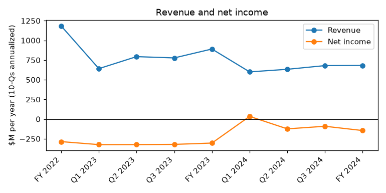
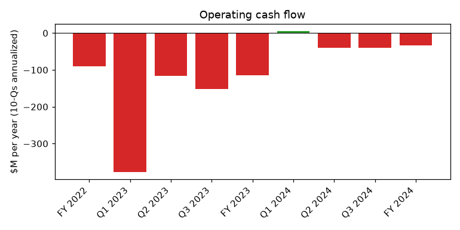
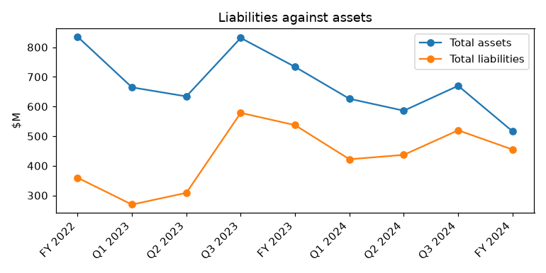

# IROBOT CORP (CIK 1159167): 10-K for the period ending 2024-12-31, filed 2025-03-12, model score 0.648

## Answer
The score comes from a $145.5M net loss (-28.2% of assets), a $103.0M operating loss, liabilities at 88% of assets (peer median 50%) and a current ratio of 1.32 (peer median 2.19). The filing text is worse than these numbers: about $88.7M of one-time gains shrank the 2024 loss, and the auditor's going concern opinion breaches the Carlyle term loan, a breach waived only until May 6, 2025.

**Verdict:** real risk. **Own risk:** high, about 30% (the band's rate is 4%). **Agree with the model:** partly; the risk is higher than its band suggests.

## The numbers
| Input | This report ($M) | Year before ($M) | Share of assets | Peer percentile | What drives it |
|---|---|---|---|---|---|
| Total assets | 516.1 | 733.7 | 100.0% | 53 | Shrunk by losses (inferred) |
| Current assets | 288.5 | 465.5 | 55.9% | 56 | Includes $134.3M cash |
| Current liabilities | 218.2 | 287.1 | 42.3% | 72 | Smaller business (inferred) |
| Total liabilities | 454.9 | 537.2 | 88.1% | 83 | Term loan, about $180M (derived) |
| Revenue | 681.8 | 890.6 | 132.1% | 89 | Down 23.4% |
| Net income | -145.5 | -304.7 | -28.2% | 30 | Helped by one-time gains |
| Operating income | -103.0 | -264.1 | -19.9% | 36 | Workforce and cost cuts |
| Operating cash flow | -33.2 | -114.8 | -6.4% | 37 | Helped by $75.2M Amazon fee |

Peer group: 258 companies.

**Cash:** $134,303,000. At the 2024 burn of $2.77M a month that is 48.5 months; without the Amazon fee, burn is about $9M a month, or about 15 months (derived). Non-cash charges are 32% of the loss; the cash-adjusted loss is -$99.4M.

## Main reasons
1. **The going concern opinion breaches the term loan** (from the filings): "we would be in breach of the Going Concern Covenant and the Agent would be able to exercise all applicable remedies under the Credit Agreement but for Amendment No. 1 described above" (10-K, 2025-03-12, Item 1A. Risk Factors).
2. **The waiver is short and discretionary** (from the filings). It ends May 6, 2025, and the covenant cannot be cured before the next 10-K, about March 2026: "As a result, we are dependent on continued waivers from the Lenders to avoid an event of default related to the Going Concern Covenant, which waivers are in the Lenders' sole discretion." (10-K, 2025-03-12, Item 1A. Risk Factors). The company names bankruptcy as an outcome: "we may be forced to terminate, significantly curtail or cease our operations or to pursue other alternatives, including, but not limited to, commencing a case under the U.S. Bankruptcy Code." (10-K, 2025-03-12, Item 1A. Risk Factors)
3. **Acceleration would cost far more than the cash** (from the filings). The loan matures 2026-07-24: "the applicable minimum guaranteed return ranges between 1.4x and 1.7x of the principal and the consolidated core assets financial covenant is reduced to $200.0 million." (10-Q, 2024-11-06, Note 9, Debt). Inferred: about $250M to $300M owed, against $134.3M cash.
4. **Large losses on shrinking revenue** (model input). Net loss at the 30th peer percentile, operating income 36th, operating cash flow 37th: "Our total revenue for fiscal 2024 was $681.8 million, declining 23.4% from revenue of $890.6 million in fiscal 2023." (10-K, 2025-03-12, Item 1. Business)
5. **High leverage, thin liquidity** (model input). Liabilities/assets 0.88 vs peer median 0.50; current ratio 1.32 vs 2.19. Equity about $61M (derived), down from $196.5M. No quote.
6. **One-time gains hide the real burn** (from the filings): "which excludes the one-time benefits of $75.2 million related to the Parent Termination Fee and $13.5 million related to an intellectual property litigation settlement" (10-K, 2025-03-12, Item 1. Business). The waiver also returned $40.0M to a lender-controlled account and gave lenders 6% penny warrants.

## Evidence against
- Losses are shrinking: net loss halved; Q4 operating cash burn about $2.7M (derived).
- "As of the date of filing of this Annual Report on Form 10-K, we are in compliance with the Minimum Core Assets Covenant." (10-K, 2025-03-12, Item 1. Business)
- Lenders waived rather than accelerated and took warrants (8-K, 2025-03-12). Inferred: they may prefer a sale or refinancing.
- Workforce cut about 40%; opex down $126.4M excluding one-time benefits.
- Q3 2024 operating income $7.3M; gross margin 32.2% vs 25.8% (10-Q, 2024-11-06).
- "The Term Loan matures on July 24, 2026." (10-Q, 2024-11-06, Note 9, Debt), beyond 365 days.
- New robots launched March 11, 2025.
- No missed payment or late filing disclosed.

## How it developed
- 2024-01-28: Amazon merger terminated; founder CEO leaves; 31% job cuts.
- 2024-01-29: $94.0M Amazon fee; $35.0M repays loan, $40.0M restricted.
- 2024-05-06: Gary S. Cohen becomes CEO.
- 2024-09-28: Q3 operating income $7.3M; restricted $40.0M drawn for inventory.
- 2024-11-04: CFO leaves; 105 more jobs cut.
- 2024-12-28: Year end: revenue $681.8M, net loss $145.5M.
- 2025-02-04: Extra 10% China tariff.
- 2025-03-11: Amendment No. 1 waiver; $40.0M returned; warrants.
- 2025-03-12: 10-K with going concern paragraph; strategic review begins.

## Dates to watch
- 2025-05-06: waiver ends; default unless extended.
- Q1 2025 10-Q (around May 2025): underlying burn, covenants, waivers.
- Strategic review: sale, refinancing or restructuring.
- 2025-08-17: Picea manufacturing agreement expires.
- Around March 2026: next 10-K, earliest covenant cure.
- 2026-07-24: loan maturity.

## What would change my mind
- Lower risk: waiver extended or covenant amended; a sale or refinancing that repays the loan; a large equity raise; positive operating cash flow without one-time items.
- Higher risk: no extension, a core assets breach, a missed interest payment, or bankruptcy advisors hired.

## Charts

## How sure I am
Moderate. Could not check: free cash after the $40.0M return; exact loan principal and return multiple; Q4 2024 and Q1 2025 results without one-time items; lenders' intentions; equity value and usable ATM capacity.

## Filings used
10-K 2025-03-12; 10-K 2024-02-27; 10-Q 2024-11-06; 10-Q 2024-08-07; 10-Q 2024-05-08; 8-K 2025-03-12; 8-K 2024-11-06; 8-K/A 2024-08-13; 8-K 2024-08-13; 8-K 2024-08-07; 8-K 2024-06-13; 8-K 2024-06-05; 8-K 2024-05-23; 8-K 2024-05-07; 8-K 2024-03-26; 8-K 2024-01-29