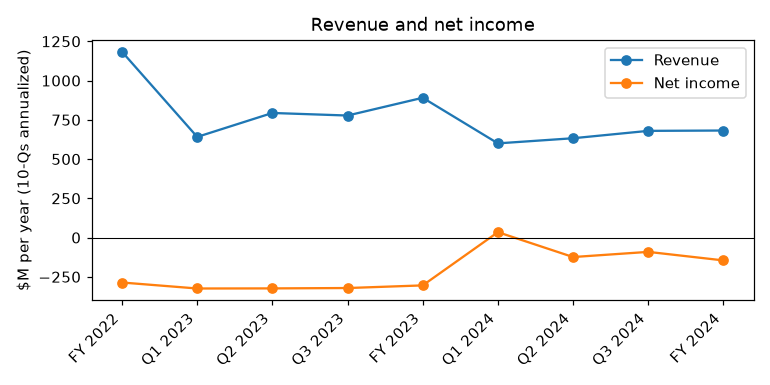
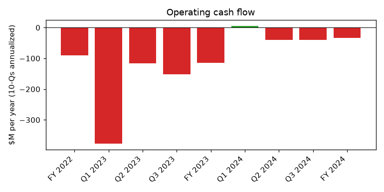
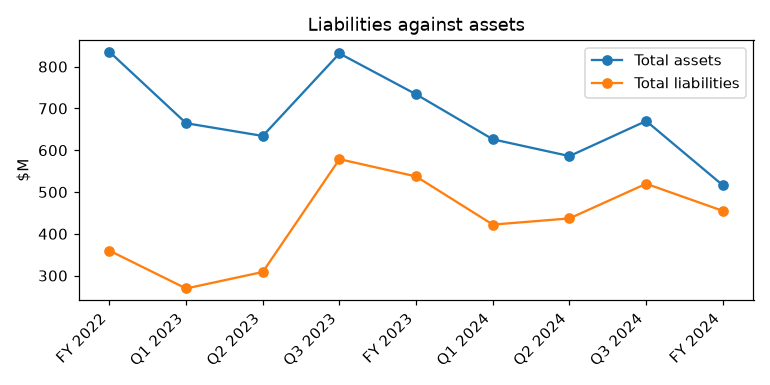

# IROBOT CORP (CIK 1159167): 10-K for the period ending 2024-12-31, filed 2025-03-12, model score 0.648

## Answer
The score reflects three straight years of losses (FY2024 net loss $145.5M, operating loss $103.0M, operating cash flow -$33.2M), liabilities equal to 88% of assets (peer median 50%), a current ratio of 1.32 (peer median 2.19) and revenue down 23.4%. The filings show the distress is real and worse than the numbers suggest: the losses were cushioned by $88.7M of one-time gains, the auditor added a going concern paragraph, and only an 8-week lender waiver (until May 6, 2025) keeps the company out of default.

## Verdict
- **Verdict:** real risk
- **My own risk:** high, roughly 30%
- **Agree with the model:** partly. The filings point to more risk than the numbers alone show.

## The 8 numbers

| Input | This report ($M) | Year before ($M) | Share of assets | Peer percentile (258 peers) | What drives it |
|---|---|---|---|---|---|
| Total assets | 516.1 | 733.7 | 100.0% | 53 | Down $217.6M (derived) |
| Current assets | 288.5 | 465.5 | 55.9% | 56 | Down $177M in a year |
| Current liabilities | 218.2 | 287.1 | 42.3% | 72 | Current ratio 1.32 vs peer median 2.19 |
| Total liabilities | 454.9 | 537.2 | 88.1% | 83 | Equity only about $61.2M (derived) |
| Revenue | 681.8 | 890.6 | 132.1% | 89 | Down 23.4%; gross margin 20.9% |
| Net income | -145.5 | -304.7 | -28.2% | 30 | Third straight loss |
| Operating income | -103.0 | -264.1 | -19.9% | 36 | About -$191.7M without one-time gains (derived) |
| Operating cash flow | -33.2 | -114.8 | -6.4% | 37 | About -$122M without one-time items (derived) |

## Main reasons

1. **Default is avoided only by a short waiver** (from the filings). The waiver runs until May 6, 2025; further waivers until the next 10-K (expected March 2026) are at the lenders' sole discretion. It cost a $3.6M PIK fee, 6% penny warrants and $40.0M returned to lender control.
   - "we would be in breach of the Going Concern Covenant and the Agent would be able to exercise all applicable remedies under the Credit Agreement but for Amendment No. 1 described above" (10-K, 2025-03-12, Item 1A. Risk Factors - time-limited waiver)

2. **Going concern doubt, and the company names bankruptcy** (from the filings).
   - "The report also states that we have a history of operating losses and negative cash flows from operations that raise substantial doubt about our ability to continue as a going concern." (10-K, 2025-03-12, Item 1A. Risk Factors)
   - "we may be forced to terminate, significantly curtail or cease our operations or to pursue other alternatives, including, but not limited to, commencing a case under the U.S. Bankruptcy Code." (10-K, 2025-03-12, Item 1A. Risk Factors)

3. **Large losses, flattered by one-time gains** (model input and from the filings). Net income -$145.5M vs -$304.7M, -28.2% of assets, 30th percentile of peers; net income is the input the model weighs most.
   - "which excludes the one-time benefits of $75.2 million related to the Parent Termination Fee and $13.5 million related to an intellectual property litigation settlement" (10-K, 2025-03-12, Item 1. Business - 2024 Financial Performance)

4. **High leverage, weak liquidity** (model input). Liabilities/assets 0.88 vs peer median 0.50 (83rd percentile). Implied equity fell from $196.5M to about $61.2M (derived). Current ratio 1.32 vs peer median 2.19.

5. **Expensive secured debt due July 24, 2026, and cash does not cover it** (from the filings). About $180M principal (derived) at SOFR + 9.00% and 2.5% PIK. Cash was $99.4M at Sep 28, 2024; after the $40.0M returned, about $59M is usable: roughly 6 months at the underlying burn, or 17 months at the Q3 2024 pace (derived).
   - "the applicable minimum guaranteed return ranges between 1.4x and 1.7x of the principal and the consolidated core assets financial covenant is reduced to $200.0 million." (10-Q, 2024-11-06, Note 9, Debt)

## Evidence against
- Covenant met, no missed interest payment disclosed: "As of the date of filing of this Annual Report on Form 10-K, we are in compliance with the Minimum Core Assets Covenant." (10-K, 2025-03-12, Item 1. Business - Recent Developments)
- Lenders chose to waive rather than enforce.
- The board started a formal strategic review, including a sale or refinancing.
- Cost cuts mostly done: about 440 jobs (40%) and $126.4M of operating expenses.
- Late 2024 improved: Q3 gross margin 32.2%, implied Q4 cash burn about $2.7M (derived).
- New robot line launched; ATM capacity $79.6M at Sep 28, 2024.

## How it developed

| Date | Turning point |
|---|---|
| 2023-07-24 | $200.0M Carlyle term loan, due July 24, 2026 |
| 2024-01-28 | Amazon merger terminated; CEO steps down; about 350 job cuts |
| 2024-11-04 | CFO steps down; 105 more job cuts |
| 2024-12-28 | FY2024 ends: revenue -23.4%, net loss $145.5M |
| 2025-03-11 | Amendment No. 1 waiver until May 6, 2025; new robot line launched |
| 2025-03-12 | 10-K with going concern paragraph; strategic review starts |

## Dates to watch (next 12 months)
- **2025-05-06:** waiver expires and the $4.0M use fee is due; extension or default.
- **Q1 2025 10-Q (around May 2025):** cash, burn and covenant status.
- **2025-08-17:** Picea manufacturing agreement expires unless extended.
- **Strategic review outcome:** sale, refinancing or restructuring.

## What would change my mind
- Lower risk: a waiver through the next 10-K; a signed sale or refinancing of the Carlyle loan; new liquidity covering over a year of burn; 2025 results showing revenue growth and positive operating cash flow.
- Higher risk: no waiver extension by May 6, 2025, a core assets covenant breach, or a missed interest payment.

## Charts

## How sure I am
Moderate. Not checked: year-end cash; exact loan principal; core assets covenant headroom; whether lenders signalled later waivers; Q4 2024 figures directly.

## Filings used
10-K 2025-03-12; 10-K 2024-02-27; 10-Q 2024-11-06; 10-Q 2024-08-07; 10-Q 2024-05-08; 8-K 2025-03-12; 8-K 2024-11-06; 8-K/A 2024-08-13; 8-K 2024-08-13; 8-K 2024-08-07; 8-K 2024-06-13; 8-K 2024-06-05; 8-K 2024-05-23; 8-K 2024-05-07; 8-K 2024-03-26; 8-K 2024-01-29