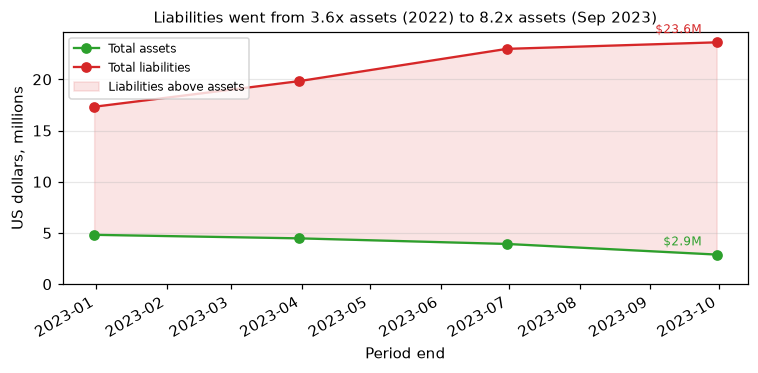

# Creatd, Inc. (CIK 1357671): 10-Q for period ending 2023-09-30, filed 2023-11-15, model score 0.523

## Answer

The score is in the 0.5–0.7 band mainly because the annualized net loss of −$31.0M is about 10x total assets of $2.9M (5th peer percentile), and liabilities are 8.2x assets. Two things likely held it below 0.7: cash burn fell sharply, and the loss is no worse than a year earlier. The filings show distress beyond these 8 numbers: $6,759 of cash, defaults on most notes and the PPP loan, and about $4.75M of debentures due February 28, 2024.

## Verdict

- **Verdict:** real risk.
- **Own risk:** high, roughly 20%.
- **Agree with model:** partly. The filings point to more risk than the band's 4% base rate.

## The 8 model inputs

Income and cash flow are annualized. There are 23 peers.

| Input | This report $M | Year before $M | Peer pct | Driver |
|---|---|---|---|---|
| Total assets | 2.9 | 8.7 | 30 | Shrinking |
| Current assets | 0.4 | 1.7 | 38 | Cash nearly gone |
| Current liabilities | 21.7 | 15.2 | 81 | Defaulted notes, unpaid bills |
| Total liabilities | 23.6 | 17.3 | 82 | Almost all current |
| Revenue | 2.8 | 5.3 | 84 | Roughly halved |
| Net income | −31.0 | −31.8 | 5 | Stock compensation, debt discount accretion |
| Operating income | −24.5 | −28.0 | 19 | Costs far above revenue |
| Operating cash flow | −4.5 | −18.5 | 23 | Lower burn, partly unpaid payables |

Liabilities to assets are 8.16, against a peer median of 0.85. The current ratio is 0.02, against a peer median of 0.35.

**Cash:** $6,759 at 9/30/2023. That covers 0.02 months at the 9-month burn, or 0.1 months at the Q3 burn of $0.06M a month. About 36% of the 9-month loss is non-cash. The cash-adjusted loss is −$14.9M, against a reported −$23.3M.

## Main reasons

1. **The net loss is about 10x total assets** (model input). The annualized loss is −$31.0M against $2.9M of assets, or −1073% of assets. That is the 5th percentile of 23 peers (10-Q, 2023-11-15, financial statements).
2. **The balance sheet is deeply insolvent** (model input). Liabilities are 8.16x assets, against a peer median of 0.85. That puts the company at the 81st–82nd peer percentile. The filing says: "As of September 30, 2023, the Company had a working capital deficit of $21,329,846 as compared to a working capital deficit of $13,728,152 at December 31, 2022" (10-Q, 2023-11-15, MD&A Liquidity).
3. **Cash is effectively zero** (from the filings). The low Q3 burn was flattered by payables and accrued expenses, which rose $5.9M over 9 months. The filing says: "its cash position may not be sufficient to support its daily operations." (10-Q, 2023-11-15, Note 3 Going Concern).
4. **Payment defaults are widespread** (from the filings). $2,265,447 of senior secured note principal is in default at 18% default interest. The PPP loan and many high-cost notes are also in default. The filing says: "As of September 30, 2023, the Loan is in default, and the lender may require immediate payment of all amounts owed under the Loan or file suit and obtain judgment." (10-Q, 2023-11-15, Note 5 Notes Payable).
5. **Maturities fall on one date, and the debt is secured on all assets** (from the filings). About $4.75M ($2,485,000 + $2,267,140) is due February 28, 2024. The filing says: "whereby the Company granted a first priority security interest in all of their respective assets to the Holders" (8-K, 2022-09-19, Item 1.01). My inference is that a missed February payment makes foreclosure or a court process plausible.

## Evidence against

- **Lenders are extending rather than enforcing.** The filing says: "extend the maturity dates for the Debentures, which have a cumulative remaining balance of $2,485,000, to February 28, 2024" (10-Q 2023-11-15 Note 14; 8-K 2023-11-01).
- **Burn fell sharply.** The 9-month burn was $3.4M, against $13.7M a year earlier (10-Q, 2023-11-15, MD&A).
- **Some liabilities are being cut without cash.** Debt is converting to equity, a $2.07M payroll tax liability was eliminated, and a $405k severance claim was settled mostly in shares (8-K, 2023-11-01).
- **Inference:** small OTC companies in this state often dilute, go dark or wind down informally rather than file for bankruptcy.

## How it developed

- **2022-09-02:** The May 2022 notes default, and a Nasdaq panel decides to delist the stock.
- **2022-09-19:** A first-priority lien is granted on all assets.
- **2023-04-19:** The 10-K carries an auditor going concern paragraph.
- **2023-10-16:** The CFO resigns, and the CEO takes over the role.
- **2023-11-01:** The debentures are extended to 2024-02-28, and the conversion price is cut to $0.025.

## Dates to watch

- **2023-11-30 and 2023-12-11:** the first monthly note payments ($45,416.67 and $47,142.85).
- **December 2023:** deferred note payments, the CEO notes and the Second September 2022 Note come due.
- **2024-02-28:** about $4.75M of debentures mature.
- **Around April 2024:** the FY2023 10-K, including the auditor opinion and whether it is filed on time.

**What would change my mind:**

- **Lower risk:** a multi-million-dollar financing, a conversion or long extension of the debentures, or a sale that pays off the secured debt.
- **Higher risk:** lenders enforcing, suing or foreclosing, or a missed February maturity.

## Charts

## How sure I am

My confidence is moderate. The distress is clear, but it is unclear whether it ends in a bankruptcy filing or an informal outcome.

I could not check:

- whether any lender has accelerated or enforced since the filing
- the exact debt due within 12 months
- what the secured holders would do after a default
- how much of the equity line is usable
- how comparable the peers are

## Filings used

10-Q 2023-11-15; 10-K 2023-04-19; 10-Q 2023-08-14; 10-Q 2023-05-18; NT 10-Q 2023-11-15; 8-K 2023-11-01; 8-K 2023-05-22; NT 10-Q 2023-05-15; 8-K 2023-05-03; NT 10-K 2023-03-31; 8-K 2023-02-10 (×3); 8-K 2023-01-20; 8-K 2022-11-18; NT 10-Q 2022-11-14; 8-K 2022-11-07; 8-K 2022-10-25; 8-K 2022-09-26; 8-K 2022-09-19; 8-K 2022-09-09; 8-K 2022-09-06; 8-K 2022-07-29; 8-K 2022-06-07; 8-K 2022-06-03