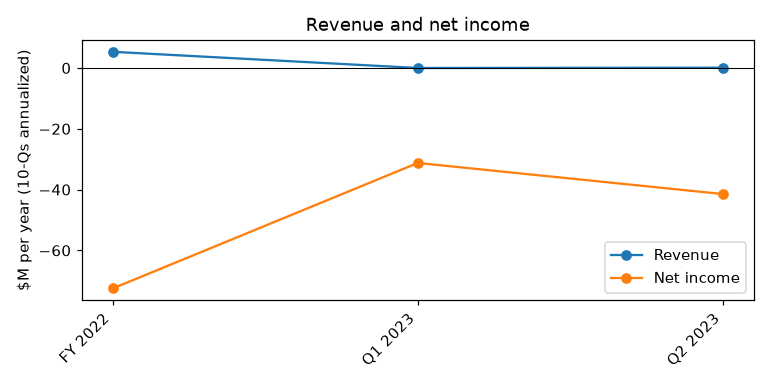
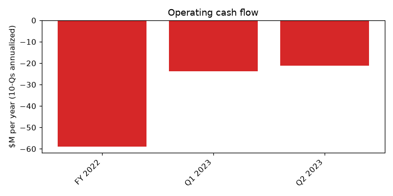
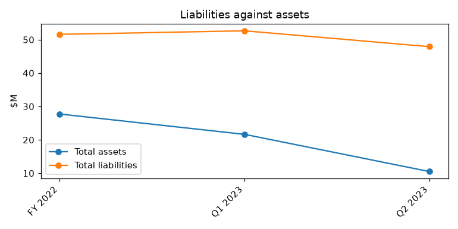

# ATHERSYS, INC / NEW (CIK 1368148): 10-Q for the period ending 2023-06-30, filed 2023-08-16, model score 0.582

## Answer

The score of 0.582 comes from a small balance sheet ($10.5M of assets) carrying $47.9M of liabilities, a current ratio of 0.09, almost no revenue, and an annualized net loss about four times total assets. The filings confirm the distress is real. Cash was $0.8M on August 9, 2023, against $16.5M of accounts payable, and management says it would likely have to file for bankruptcy protection without adequate financing.

**Verdict:** real risk. **Own risk:** very high (about 45%). **Agree with the model:** partly. In the 0.5-0.7 band only 4% went bankrupt; the filings point higher.

## The numbers

| Input | This report ($M) | Year before ($M) | What drives it | Peer percentile |
|---|---|---|---|---|
| Total assets | 10.5 | 35.2 | Cash down to $1.8M; Stow lease right-of-use asset impaired | 17 |
| Current assets | 3.7 | 21.4 | Cash burn with little new financing | 19 |
| Current liabilities | 42.7 | 33.2 | Unpaid suppliers; $16.5M accounts payable on Aug 9 | 95 |
| Total liabilities | 47.9 | 46.9 | Payables plus the new $15.0M convertible note | 95 |
| Revenue | 0.1 | 10.5 | Q2 revenue $48.8 thousand vs $2.3M | 15 |
| Net income | -41.5 | -91.7 | Operating losses plus a $7.5M impairment | 5 |
| Operating income | -40.6 | -93.3 | Trial and running costs with no revenue | 5 |
| Operating cash flow | -21.1 | -73.2 | Burn cut after the 70% workforce reduction | 8 |

958 peers. Year-before values are from this filing's prior-year column; income and cash flow annualized.

## Main reasons

1. **Cash runway of about one month or less** (from the filings). Cash was $1.8M at June 30 and $0.8M on August 9. The Q2 burn was about $4.6M, or about $1.5M a month. Operating cash flow ranks at the 8th peer percentile. "As of August 9, 2023, we had $0.8 million of cash and cash equivalents and accounts payable of $16.5 million, of which $8.7 million is related to deferred accounts payable to supplier." (10-Q, 2023-08-16, MD&A Liquidity and Capital Resources)

2. **Management names bankruptcy as the likely outcome without financing** (from the filings). There is going concern doubt, and the accumulated deficit is $676.6M. "If we are unable to obtain adequate financing, we likely would have to file for protection under the bankruptcy laws to continue to pursue potential transactions and conduct a wind down of our Company." (10-Q, 2023-08-16, Note 2. Going Concern; MD&A Liquidity and Capital Resources)

3. **Liabilities far exceed assets** (model input). Total liabilities are $47.9M against $10.5M of assets (4.57x vs a peer median of 0.45). The stockholders' deficit widened from $(23,851) thousand to $(37,419) thousand. "Balance at June 30, 2023 — — 21,833,847 21 639,173 (676,613) (37,419)" (10-Q, 2023-08-16, Statement of stockholders' equity)

4. **Current liabilities are about 11 times current assets** (model input). Current assets are $3.7M against $42.7M of current liabilities, a current ratio of 0.09 vs a peer median of 3.51. Current liabilities rank at the 95th percentile.

5. **The supplier can accelerate if a payment is late** (from the filings). $11.8M of deferred payables are due at $0.25M a month from October 2023, with almost no cash to pay. "If any cash payment remains unpaid for more than 60 days following the date such cash payment was due, the supplier has the right to declare the entire remaining balance due immediately and payable without further notice." (10-Q, 2023-08-16, Note 11. Forbearance Agreement and Convertible Note)

## Evidence against

- The supplier restructuring pushed most cash payments to October 2023 and later: "The Company recorded a gain on extinguishment of $2.6 million as a result of the restructuring." (10-Q, 2023-08-16, Note 11)
- Burn fell sharply: "Net cash used in operating activities was $10.6 million for the six months ended June 30, 2023 compared to $36.6 million for the six months ended June 30, 2022." (10-Q, 2023-08-16, MD&A Cash Flow Analysis)
- Part of the loss is non-cash: "the Company recorded an impairment charge related to the right-of-use asset of $7.5 million." (10-Q, 2023-08-16, Note 5; MD&A)
- The $15.0M note is PIK and matures in May 2026, so it needs no near-term cash.

## How it developed

- 2022-06-02: restructuring cuts the workforce by up to 70%; President/COO, CSO and CFO depart
- 2022-07-06: Aspire Capital terminates the $100M equity facility
- 2023-04-03: 10-K filed late, with a going concern opinion
- 2023-05-17: supplier forbearance agreement; $15.0M convertible note
- 2023-06-09: landlord sues for breach of lease
- 2023-08-09: cash $0.8M; Healios MOU
- 2023-08-16: 10-Q filed late, with the bankruptcy warning

## Dates to watch and what would change my mind

Dates to watch:
- 2023-09-15: Nasdaq Panel deadline for the $35M market value standard
- October 2023: first $0.25M forbearance payment is due
- Next 1-2 months: any new financing
- Stow lawsuit and Healios dispute (a $3.0M+ judgment is a note default)
- 2024-01-24: deadline to regain the $1.00 bid price

What would change my mind:
- An equity raise or partnering deal funding 6-12 months
- A sale of the company or assets outside court
- Forbearance payments made and the listing kept
- Positive MASTERS-2 data

## Charts

## How sure I am

Confidence: high. The facts above come from the filings. The runway estimates and the 45% risk figure are my own inferences.

Could not check:
- Cash and any financing after August 9, 2023
- The amount the Stow landlord seeks beyond "in excess of $25,000"
- July and August 2023 burn (estimated from Q2 at about $1.5M a month)

## Filings used

10-Q 2023-08-16; 10-K 2023-04-03; 10-Q 2023-05-15; NT 10-Q 2023-08-15; 8-K 2023-08-11; 8-K 2023-07-31; 8-K 2023-05-23; 8-K 2023-04-18; 8-K 2023-04-14; NT 10-K 2023-04-03; 8-K 2023-01-05; 8-K 2022-12-29; 8-K 2022-11-10; 8-K 2022-11-01; 8-K 2022-10-20; 8-K 2022-09-22; 8-K 2022-08-17; 8-K 2022-08-04; 8-K 2022-08-02; 8-K 2022-07-08; 8-K 2022-06-21; 8-K 2022-06-02; 8-K 2022-05-12; 8-K 2022-04-28; 8-K 2022-03-24