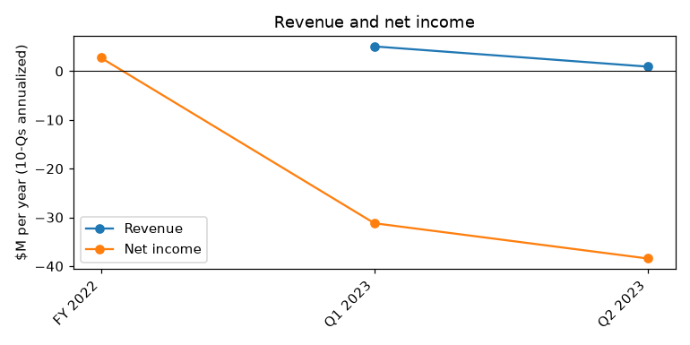
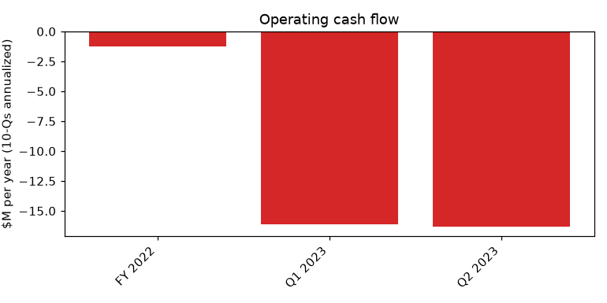
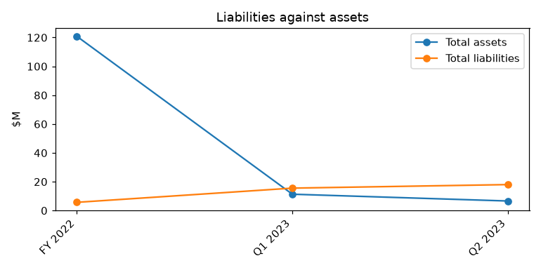

# AERWINS Technologies Inc. (CIK 1855631): 10-Q for period ending 2023-06-30, filed 2023-08-21, model score 0.536

## Answer
The score of 0.536 comes from an annualized net loss of $38.4M against only $6.6M of assets, liabilities of 2.71 times assets and a current ratio of 0.47. The filings show the distress is real and probably worse than the score band suggests: cash was $35,359 against a burn of about $1.36M a month, the company was already in default on notes payable and a related-party loan, and its Japanese bank account was seized on August 10, 2023.

**Verdict:** real risk. **My own risk:** very high, roughly 30% (reports scored 0.5-0.7 went bankrupt 4% of the time). **Agree with the model:** yes.

## The numbers
Income and cash flow annualized; year before from this filing's prior-year column; ranks among 132 peers. Drivers are my reading. Liabilities to assets 2.71 (peer median 0.63); current ratio 0.47 (peer median 1.74).

| Input | This report ($M) | Year before ($M) | Peer percentile | What drives it |
|---|---|---|---|---|
| Total assets | 6.6 | 117.0 | 10 | SPAC trust money did not arrive as assets |
| Current assets | 5.5 | 0.1 | 86 | Mostly not cash |
| Current liabilities | 11.5 | 0.5 | 94 | Defaulted notes, related-party loan, unpaid payables |
| Total liabilities | 18.0 | 4.5 | 95 | Current debts plus the Lind notes due 2025 |
| Revenue | 0.9 | 3.9 | 18 | Small and shrinking business |
| Net income | -38.4 | -14.5 | 5 | Operating loss plus stock compensation and impairment |
| Operating income | -34.2 | -14.8 | 6 | Costs far above revenue |
| Operating cash flow | -16.3 | -18.1 | 3 | Cash spent running the business |

**Cash:** $35,359 on hand; burn about $1.36M a month, so about 0.03 months of cash before any debt due. Non-cash charges (stock compensation $3.7M, impairment $1.6M, depreciation $0.2M) are 28% of the six-month loss of $19.2M, so the cash-adjusted loss is -$13.8M.

## Main reasons
1. **Huge loss against a small asset base** (model input). Net income -$38.4M annualized, -579.6% of assets; operating income -$34.2M; 5th and 6th peer percentile. "Net loss of $19,222,865 for the six months ended June 30, 2023." (10-Q, 2023-08-21, Statement of cash flows; MD&A)
2. **Liabilities far above assets** (model input). Total liabilities $18.0M vs assets $6.6M (2.71x, 95th percentile); current liabilities $11.5M vs current assets $5.5M (94th percentile). No quote available.
3. **Cash nearly gone** (model input). Operating cash flow -$16.3M annualized, 3rd peer percentile; 0.03 months of cash. "the Company’s cash position may not be sufficient to support the Company’s daily operations." (10-Q, 2023-08-21, Note 2 - Going Concern)
4. **Already in payment default** (from the filings). Notes payable of $1,480,000 unpaid at due date, with $29,392 accrued interest; 100,000,000 yen (about $692,185) unpaid on the loan from the former CEO. "the Company is regarded as in default and recognizes interest expenses of $29,392 as accrued expenses." (10-Q, 2023-08-21, Notes to financial statements - notes payable)
5. **Creditors are enforcing** (from the filings). $28,075 seized on August 10, 2023; directors paid company bills personally ($102,000 and $210,424 outstanding). "As of August 10, 2023, the health insurance association seized our bank account in Japan for delinquent health insurance premiums." (10-Q, 2023-08-21, Note 24 - Subsequent Events)
6. **Lind notes and Nasdaq triggers** (from the filings). Lind defaults include cross-default on other debt over $100,000, market cap below $20,000,000 for 10 days, and delisting; Nasdaq sent bid price and MVLS notices. "(r) the Company’s market capitalization is below $20,000,000 for 10 consecutive days" (8-K, 2023-05-30, Item 1.01 (Events of Default))

**Also in the filings:** going concern doubt, accumulated deficit $65,695,768, all Japanese fixed assets impaired, two late 10-Qs, an auditor dismissal and heavy management turnover.

**My inference:** the existing defaults could trip the Lind cross-default, making the notes due early and blocking the third tranche.

## Evidence against
- Non-cash charges are 28% of the loss. "Share-based compensation of $3,658,298." (10-Q, 2023-08-21, Statement of cash flows)
- Lind funded $3,500,000 in April and May 2023 and a third $1,500,000 tranche is expected (10-Q, 2023-08-21, MD&A - Liquidity and Capital Resources).
- A $100 million SEPA with YA, usable only after a registration statement is effective (8-K, 2023-01-23, Item 1.01).
- Lind notes mature in April and May 2025 with no regular interest, so no large maturity in the next year unless a default speeds them up (10-Q, 2023-08-21, convertible notes).
- Half the related-party loan was repaid by May 22, 2023, and the lender is negotiating (10-Q, 2023-08-21, short-term loan from related party).
- No material legal proceedings were reported (10-K, 2023-03-31, Business - Legal Proceedings).
- My inference: the defaults so far are owed to small or related-party creditors.

## How it developed
- 2023-02-03: SPAC merger closed; $5,000,000 PIPE.
- 2023-02-27: A.L.I. borrowed 200,000,000 yen from the CEO.
- 2023-03-20: CEO resigned.
- 2023-04-20 and 2023-06-08: Nasdaq bid price and MVLS notices.
- 2023-06-30: extended loan maturity passes with 100,000,000 yen unpaid.
- 2023-07-18: Funding Committee formed; 2023-07-25 COO resigned.
- 2023-08-10: Japanese bank account seized.
- 2023-08-14: second late 10-Q notice; 2023-08-21 10-Q filed with going concern doubt.

## Next 12 months
- 2023-10-17: Nasdaq $1.00 bid price deadline.
- 2023-12-05: Nasdaq MVLS deadline.
- Mid-November 2023: Q3 10-Q, on time or late.
- Also: third Lind tranche or a Lind default notice; SEPA registration; talks on the defaulted loans; new seizures in Japan; Funding Committee recommendations.

**Would lower my risk:** an equity raise or SEPA draws that repay the defaulted debt, Lind waiving the cross-default and funding the third tranche, or a sale or strategic investor. **Would raise it:** Lind accelerating the notes, more seized accounts, or an insolvency filing by the Japanese subsidiary.

## Charts

## How sure I am
Moderate. Not checked: cash after June 30; Q2 burn alone; whether Lind declared or waived a default; SPAC trust left after redemptions; whether the Outsourcing Inc. investment happened; market cap against the $20,000,000 trigger.

## Filings used
- 10-Q: 2023-08-21, 2023-05-23
- 10-K: 2023-03-31
- NT 10-Q: 2023-08-14, 2023-05-16
- 8-K: 2023-08-07, 2023-07-20, 2023-06-13, 2023-05-30, 2023-05-26, 2023-05-19, 2023-04-27, 2023-04-21, 2023-04-13, 2023-03-30, 2023-03-24, 2023-03-23, 2023-03-02, 2023-02-09, 2023-02-09, 2023-02-03, 2023-01-23, 2023-01-20, 2022-11-10, 2022-09-07, 2022-08-10, 2022-08-10, 2022-03-18