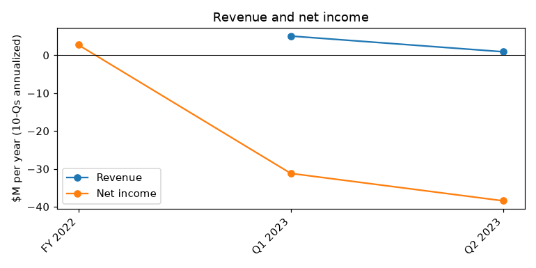
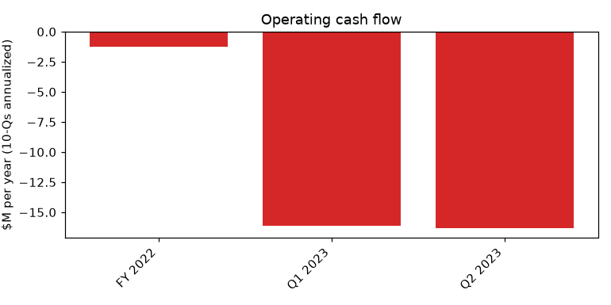
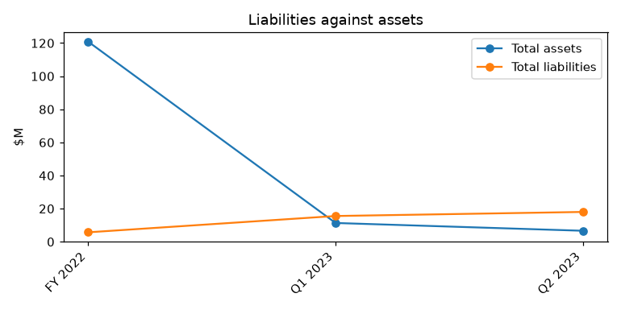

# AERWINS TECHNOLOGIES INC. (CIK 1855631) – 10-Q for the period ending 2023-06-30, filed 2023-08-21 – model score 0.536

## Answer
The score of 0.536 comes from a very weak balance sheet and large losses: liabilities are 2.71 times assets (peer median 0.63), the current ratio is 0.47 (peer median 1.74), and the annualized net loss of $38.4M is almost six times total assets. The filings confirm real distress: the company is already in default on notes and on a related-party loan, and a creditor seized its Japanese bank account.

**Verdict:** real risk. **Own risk:** high, about 25%. **Agree with the model:** yes.

## The numbers

| Input | This report ($M) | Year before ($M) | What drives it | Peer percentile |
|---|---|---|---|---|
| Total assets | 6.6 | 117.0 | Prior year is the pre-merger SPAC trust; Japanese fixed assets written down | 10 |
| Current assets | 5.5 | 0.1 | Post-merger operating business | 86 |
| Current liabilities | 11.5 | 0.5 | Defaulted notes and loan, unpaid payables | 94 |
| Total liabilities | 18.0 | 4.5 | 271% of assets | 95 |
| Revenue | 0.9 | 3.9 | Small and falling | 18 |
| Net income | -38.4 | -14.5 | Operating losses, impairment, stock compensation | 5 |
| Operating income | -34.2 | -14.8 | Costs far above revenue | 6 |
| Operating cash flow | -16.3 | -18.1 | Heavy cash burn | 3 |

Year-before figures come from the prior-year column of this filing; income and cash flow are annualized. Peers: 132.

## Main reasons

1. **Already in default on debt** (from the filings). Notes payable of $1,480,000 were not paid when due, and the remaining 100,000,000 yen (about $692,185) of the related-party loan was unpaid after its maturity was extended to June 30, 2023; the default rate is 14.6%.
   "the Company is regarded as in default and recognizes interest expenses of $29,392 as accrued expenses." (10-Q, 2023-08-21, notes payable)
   "Accordingly, the Company is regarded in default and negotiates the terms with the lender." (10-Q, 2023-08-21, short-term loan from related party)

2. **Liabilities far exceed assets** (model input). Total liabilities $18.0M vs total assets $6.6M (ratio 2.71, peer median 0.63); equity is about -$11.4M. Current ratio 0.47 vs peer median 1.74. No quote available.

3. **Very short cash runway** (model input). Annualized operating cash outflow is $16.3M (about $1.36M a month), 3rd peer percentile. My inference: even all $5.5M of current assets would last only about 4 months, before paying $11.5M of current liabilities.
   "the Company’s cash position may not be sufficient to support the Company’s daily operations." (10-Q, 2023-08-21, Note 2 - Going Concern)

4. **Creditors are acting** (from the filings). A.L.I. Technologies cannot pay some payables on time; $28,075 was seized from its Japanese bank account; directors personally paid $102,000 and $210,424 of company bills.
   "As of August 10, 2023, the health insurance association seized our bank account in Japan for delinquent health insurance premiums." (10-Q, 2023-08-21, Note 24 - Subsequent Events)

5. **Large and growing losses** (model input). Annualized net loss $38.4M vs $14.5M a year before (5th peer percentile); accumulated deficit $65,695,768.
   "Net loss of $19,222,865 for the six months ended June 30, 2023." (10-Q, 2023-08-21, statement of cash flows; MD&A)

6. **Senior secured Lind notes have tight default triggers** (from the filings). They include a cross-default over $100,000, a market-cap floor and delisting, while two Nasdaq deficiency notices are open. The SPA also limits new financing.
   "(r) the Company’s market capitalization is below $20,000,000 for 10 consecutive days" (8-K, 2023-05-30, Item 1.01)

## Evidence against
- Lind convertible notes brought in $3.5M in April and May 2023. They mature in 2025 and carry no regular interest. "a Note with a purchase price of $1,400,000 and a principal amount of $1,680,000, and the issuance to the Investor of 1,568,542 Warrants" (8-K, 2023-05-30, Item 1.01)
- A third Lind tranche of $1.5M is expected, but it has conditions that the existing defaults may block.
- The SEPA could provide up to $100M of equity, but only once a registration statement is effective. "The Company is required to have a Registration Statement declared effective by the SEC before it can raise any funds using the SEPA." (8-K, 2023-01-23, Item 1.01)
- Part of the loss is non-cash. "Share-based compensation of $3,658,298." (10-Q, 2023-08-21, statement of cash flows)
- Half of the related-party loan was repaid in May 2023; the defaulted debts total only about $2.2M.

## How it developed
- 2023-01-23: SEPA with YA II PN for up to $100M announced
- 2023-02-03: Merger of the Pono SPAC with AERWINS closes
- 2023-02-27: A.L.I. borrows 200,000,000 yen from then-CEO Shuhei Komatsu
- 2023-03-20: CEO and Chairman resigns
- 2023-04-12: Lind SPA signed and first note sold ($2.1M)
- 2023-04-20 / 06-08: Nasdaq minimum bid and market value notices
- 2023-04-21: Auditor Marcum LLP dismissed
- 2023-05-16 / 08-14: NT 10-Qs for Q1 and Q2
- 2023-05-23: Second Lind note ($1.4M); Q1 10-Q with going concern doubt
- 2023-06-30: Related-party loan unpaid at extended maturity; in default
- 2023-07-18 / 07-25: Funding Committee formed; COO resigns
- 2023-08-10: Japanese bank account seized
- 2023-08-21: Q2 10-Q discloses the defaults

## Dates to watch
- 2023-10-17: Nasdaq $1.00 minimum bid deadline (a further 180 days may be possible)
- 2023-12-05: Nasdaq $50M market value deadline
- Effectiveness of the resale registration statement, needed for the third Lind tranche and for SEPA draws
- Any Lind Event of Default notice or acceleration
- Talks with the former CEO on the defaulted loan; any further seizures in Japan
- Q3 2023 10-Q: whether it is filed on time, and how much cash is left
- Lind note maturities: April 12 and May 23, 2025

**What would change my mind:** a raise of more than about $15M that cures the defaults; SEPA draws; settlements with the lender and noteholders; a Lind waiver and the third tranche closing; a big cut in cash burn. On the other side, Lind accelerating its notes, more seizures, or delisting would raise the risk.

## Charts

## How sure I am
Moderate. I could not check: the exact cash balance at June 30, 2023 (the runway uses current assets as an upper bound); the Q2 cash burn alone; whether Lind declared or waived a default; whether the registration statement is effective and the third tranche closed; trust money left after redemptions; funding from the Outsourcing Inc. MOU or the Vault JV; the breakdown of current assets and liabilities; market capitalization against the $20M trigger.

## Filings used
10-Q 2023-08-21; 10-K 2023-03-31; 10-Q 2023-05-23; NT 10-Q 2023-08-14; 8-K 2023-08-07; 8-K 2023-07-20; 8-K 2023-06-13; 8-K 2023-05-30; 8-K 2023-05-26; 8-K 2023-05-19; NT 10-Q 2023-05-16; 8-K 2023-04-27; 8-K 2023-04-21; 8-K 2023-04-13; 8-K 2023-03-30; 8-K 2023-03-24; 8-K 2023-03-23; 8-K 2023-03-02; 8-K 2023-02-09; 8-K 2023-02-09; 8-K 2023-02-03; 8-K 2023-01-23; 8-K 2023-01-20; 8-K 2022-11-10; 8-K 2022-09-07; 8-K 2022-08-10; 8-K 2022-08-10; 8-K 2022-03-18