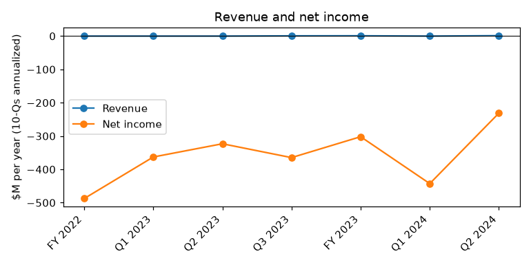
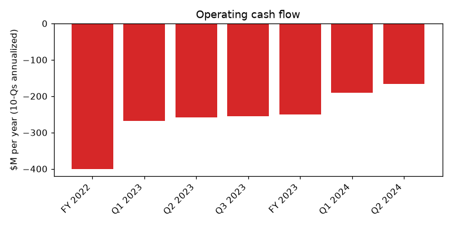
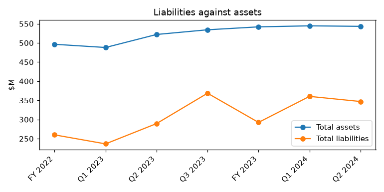

# CANOO INC. (CIK 1750153): 10-Q for the period ending 2024-06-30, filed 2024-08-14, model score 0.606

## Answer
The score reflects a balance sheet with almost no liquid assets and large losses. Current assets are 6.1% of total assets (2nd peer percentile). The current ratio is 0.17, against a peer median of 1.86. The annualized loss is about 42.6% of assets on revenue of $1.2M. In my view the model probably understates the distress, because cash covers about a third of a month of burn.

**Verdict:** real risk. **My own risk:** high, roughly 30%. **Agree with the model:** partly. A score of 0.606 falls in a band where 4% of reports went bankrupt. I would place this report nearer the >0.7 band.

## The numbers

| Input | This report ($M) | Year before ($M) | % of assets | Peer pct. | What drives it |
|---|---|---|---|---|---|
| Total assets | 543.3 | 522.1 | 100.0 | 43 | Mostly PP&E ($380.1M) and a $50.2M deferred warrant asset |
| Current assets | 33.4 | 25.5 | 6.1 | 2 | Little cash ($4.5M unrestricted) |
| Current liabilities | 195.0 | 202.4 | 35.9 | 68 | $58.4M unpaid capex and Yorkville advances |
| Total liabilities | 347.0 | 289.4 | 63.9 | 60 | Prepaid advances and convertible debt |
| Revenue | 1.2 | 0.0 | 0.2 | 6 | First vehicle deliveries |
| Net income | -231.3 | -323.2 | -42.6 | 21 | Operating losses plus fair-value swings |
| Operating income | -211.7 | -310.2 | -39.0 | 24 | Pre-revenue cost base |
| Operating cash flow | -166.8 | -259.1 | -30.7 | 19 | Cash burn, falling year over year |

Liabilities/assets is 0.64, against a peer median of 0.59 (120 peers). Income and cash flow are annualized. The year-before column comes from the prior-year column of this filing.

**Cash:**
- Unrestricted cash is $4,513,000, or **0.32 months** of cash at the six-month burn of $13.9M a month.
- Only 16% of the six-month loss is non-cash: stock compensation $12.1M and D&A $6.8M.
- The **cash-adjusted loss is $96.7M**, against a reported $115.6M.

## Main reasons

1. **Extreme illiquidity** (model input)
   - Current assets are $33.4M against current liabilities of $195.0M.
   - Current assets/assets is at the 2nd percentile. The current ratio is 0.17, against a peer median of 1.86.
   - Source: 10-Q, 2024-08-14, balance sheet.

2. **Cash covers a third of a month of burn** (from the filings)
   - Six-month operating cash flow was -$83.4M. Implied Q2 burn was about $35.9M, or about $12M a month.
   - "Cash and cash equivalents $ 4,513 $ 6,394" (10-Q, 2024-08-14, Condensed Consolidated Balance Sheet).

3. **Going-concern doubt persists** (from the filings)
   - Substantial doubt appears in seven prior 10-Qs and two 10-Ks.
   - "management cannot conclude as of the date of this filing that its plans are probable of being successfully implemented." (10-Q, 2024-08-14, Note 2 - Liquidity and Capital Resources).

4. **Liquidity rests on one Yorkville facility** (from the filings)
   - The July 2024 PPA's initial advance netted about $14.1M, roughly one month of burn.
   - The facility has a $100M limit, a $1.00 floor and a 19.99% exchange cap.
   - "The Company’s principal sources of liquidity are its unrestricted cash balance and the Company's principal access to capital is under the July 2024 PPA" (10-Q, 2024-08-14, Note 2 - Liquidity and Capital Resources).

5. **Advances can become cash claims** (from the filings)
   - $31.0M is outstanding on the Tenth PPA and $15.0M on the June PPA, which matures around 2024-12-13.
   - "the full amount outstanding under the Pre-Paid Advances plus the Redemption Premium, together with interest and other amounts owed in respect thereof, will become, at Yorkville’s election, immediately due and payable in cash." (10-Q, 2024-08-14, Note 9 - Yorkville PPAs).
   - Separately, $58.4M of unpaid PP&E purchases sits in current liabilities, more than all current assets.

6. **Fair-value swings distort the loss** (from the filings)
   - The Q2 net loss was $4.96M, against $110.7M in Q1.
   - "Loss on fair value change in convertible debt and other 67,116" (10-Q, 2024-08-14, Condensed Consolidated Statement of Cash Flows).
   - Inference: the low Q2 loss likely flatters the model's annualized net income.

## Evidence against

- **New money after quarter end.** "net proceeds of the Initial July Prepaid Advance to the Company were approximately $14.1 million." (10-Q, 2024-08-14, Note 18 - Subsequent Events).
- **Headroom under the July PPA.** "with an aggregate limitation on the Prepaid Advances of $100,000,000 over the course of 24 months from the Effective Date" (8-K, 2024-07-22, Item 1.01).
- **Insider support.** "for a total aggregate purchase price of $10,000,000" (8-K, 2024-04-11, Item 1.01).
- **First deliveries.** "We have commercialized our first production vehicles and are delivering them to customers." (10-Q, 2024-08-14, MD&A Overview).

## How it developed

| Date | Turning point |
|---|---|
| 2023-03-31 | Nasdaq minimum bid price notice |
| 2023-04-10 | CEO-affiliated factory sale-leaseback |
| 2024-03-14 | $62.0M Tenth Pre-Paid Advance, netting $15.0M |
| 2024-04-01 | 10-K: substantial doubt |
| 2024-05-15 | Q1 10-Q: cash $3.7M, burn $47.5M |
| 2024-07-19 | July 2024 PPA, up to $100M |
| 2024-08-14 | Q2 10-Q: cash $4.5M; Torrance reorganization and WARN notices |

## Dates to watch

- **2024-08-30:** maturity of the $26.6M debenture (balance unknown)
- **2024-10-02:** maturity of the $27.9M debenture (balance unknown)
- **Mid-November 2024:** Q3 10-Q, covering cash and going-concern language
- **2024-11-26:** maturity of the $15M debenture
- **About 2024-12-13:** maturity of the June advance
- **Ongoing:** the share price against the $1.00 floor

## What would change my mind

**Lower risk:**
- A non-Yorkville financing covering at least six months of burn
- A large order with cash deposits

**Higher risk:**
- A default or missed payment
- A delisting notice
- The share price falling below the $1.00 floor

## Charts

## How sure I am

**Confidence:** moderate. The illiquidity is clear, but the timing depends on Yorkville's continued support.

**Could not check:**
- Remaining principal on the 2023 debentures
- The share price at the filing date
- The actual cash on 2024-08-14
- Whether capex vendors are pressing for payment
- How much each input contributed to the score

## Filings used

10-Q 2024-08-14; 10-K 2024-04-01; 10-Q 2024-05-15; 8-K 2024-07-22; 8-K 2024-06-13; 8-K 2024-04-11; 8-K 2024-03-14; 8-K 2024-02-07; 8-K 2024-01-31; 8-K 2024-01-12; 8-K 2024-01-05; 8-K 2023-12-20; 8-K 2023-11-22; 8-K 2023-10-02; 8-K 2023-09-26; 8-K 2023-09-15; 8-K 2023-09-13; 8-K 2023-08-31; 8-K 2023-08-04; 8-K 2023-07-07; 8-K 2023-06-28; 8-K 2023-04-25; 8-K 2023-04-10; 8-K 2023-03-31