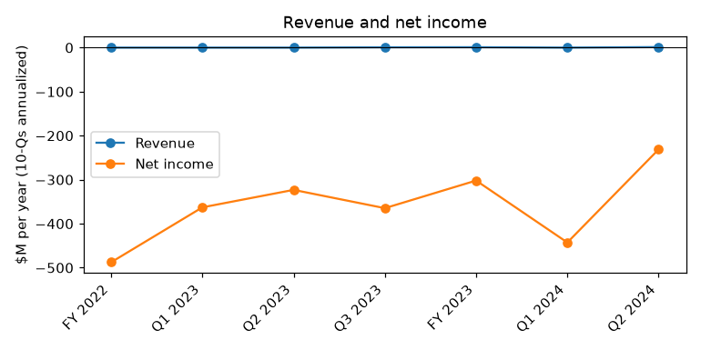
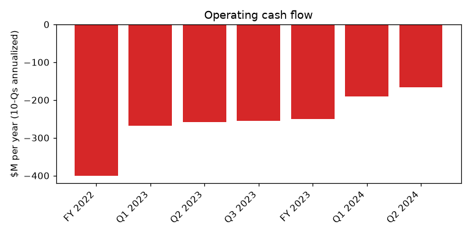
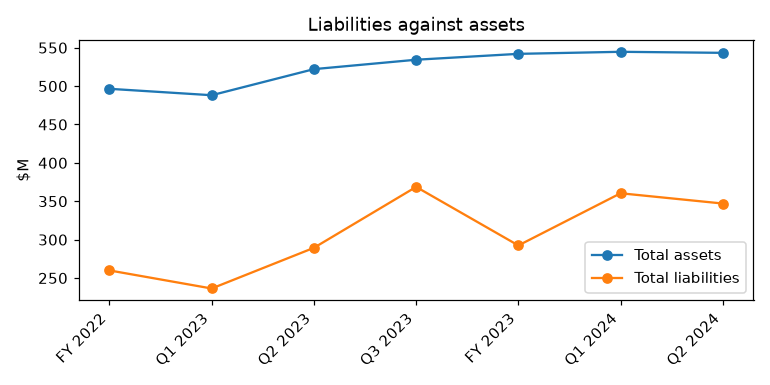

# CANOO INC. (CIK 1750153): 10-Q for the period ending 2024-06-30, filed 2024-08-14, model score 0.606

## Answer

The score falls in the 0.5–0.7 band, where 4% of reports went bankrupt. Two inputs drive it: a deep annualized loss of $231.3M (42.6% of assets) and very small current assets (6.1% of assets, 2nd percentile of peers). It is not higher partly because the loss looks better than last year's $323.2M. That improvement comes largely from non-cash fair value gains, so the numbers likely understate the distress.

## Verdict

- **Verdict:** real risk
- **Own risk:** high, roughly 25%
- **Agree with the model:** partly. The ranking is right, but the score likely understates the risk.

## The numbers

Income and cash flow are annualized. The "year before" figures come from the prior-year column of this filing. Peer percentiles are among 120 peers.

| Input | This report ($M) | Year before ($M) | % of assets | Peer pct. | What drives it |
|---|---|---|---|---|---|
| Total assets | 543.3 | 522.1 | 100.0 | 43 | Mostly long-lived plant |
| Current assets | 33.4 | 25.5 | 6.1 | 2 | Only $4.5M unrestricted cash |
| Current liabilities | 195.0 | 202.4 | 35.9 | 68 | $58.4M unpaid equipment purchases |
| Total liabilities | 347.0 | 289.4 | 63.9 | 60 | Includes Yorkville advances |
| Revenue | 1.2 | 0.0 | 0.2 | 6 | Minimal |
| Net income | -231.3 | -323.2 | -42.6 | 21 | Q2 loss small due to fair value gains |
| Operating income | -211.7 | -310.2 | -39.0 | 24 | Lower after 2023 cost cuts |
| Operating cash flow | -166.8 | -259.1 | -30.7 | 19 | Still about $12M a month |

- **Liabilities to assets:** 0.64, against a peer median of 0.59.
- **Current ratio:** 0.17, against a peer median of 1.86.

## Main reasons

**1. The cash runway is almost nil (from the filings).**
- Q2 operating burn was $35.9M ($83.4M for six months minus $47.5M in Q1), about $12.0M a month.
- Unrestricted cash of $4.5M lasts about 11 days.
- Adding restricted current cash ($4.0M) and the July advance (about $14.1M net) gives about 1.5 months.
- Quote: "Cash and cash equivalents $ 4,513 $ 6,394" (10-Q, 2024-08-14, Condensed Consolidated Balance Sheets).

**2. Short-term liquidity is far below peers (model input).**
- The current ratio is 0.17, against a peer median of 1.86. Current assets are at the 2nd percentile of peers.
- Unpaid capital-spending payables of $58.4M alone exceed total current assets of $33.4M (from the filings).
- Quote: "The Company has incurred losses and negative cash flows from operating activities since inception and has a working capital deficit." (10-Q, 2024-08-14, Note 2).

**3. Losses are severe, and the improvement is partly an accounting artefact (model input and from the filings).**
- The annualized net loss is 42.6% of assets (21st percentile).
- Q2's $5.0M loss, against $110.7M in Q1, reflects gains of $22.0M on warrants, $16.8M on derivatives and $24.5M on debt extinguishment. A $67.1M fair value loss on convertible debt partly offset these gains.
- My inference is that the loss input flatters the company.
- Quote: "Loss on fair value change in convertible debt and other 67,116 —" (10-Q, 2024-08-14, Statement of Cash Flows).

**4. Management's going concern conclusion is unusually stark (from the filings).**
- This is the eighth straight 10-Q with substantial doubt.
- Quote: "management cannot conclude as of the date of this filing that its plans are probable of being successfully implemented." (10-Q, 2024-08-14, Note 2 - Liquidity and Capital Resources).

**5. The Yorkville debt is short-dated, costly and can be called in cash (from the filings).**
- $31.0M remains on the Tenth advance. The $15.0M June advance matures around 2024-12-13.
- The Tenth advance raised $62.0M gross but only $15.0M net after repayments and charges.
- Monthly cash payments start if the share price stays below the $2.30 floor. My inference is that the new PPA's $1.00 floor suggests the $2.30 floor is under pressure.
- Quote: "If any Pre-Paid Advances are outstanding and any event of default has occurred, the full amount outstanding under the Pre-Paid Advances plus the Redemption Premium, together with interest and other amounts owed in respect thereof, will become, at Yorkville’s election, immediately due and payable in cash." (10-Q, 2024-08-14, Note 9 - Yorkville PPAs).

## Evidence against

- **Yorkville keeps funding the company.** The July 2024 PPA adds a $15.0M advance (about $14.1M net). Quote: "with an aggregate limitation on the Prepaid Advances of $100,000,000 over the course of 24 months from the Effective Date." (8-K, 2024-07-22, Item 1.01).
- **Insiders are putting in money.** The CEO's entities bought $16.5M of Series C preferred in 2024.
- **Burn is falling.** Operating outflow was $83.4M in the first six months of 2024, against $129.5M a year earlier.
- **The company has a record of surviving.** It has filed ten consecutive reports with going concern doubt, and such doubt is common in this score band.
- **There are one-off cash sources.** Employee retention credits were sold for $9.0M. A Section 16(b) claim of about $61.1M against DDG is pending, with an uncertain outcome.

## How it developed

| Date | Turning point |
|---|---|
| 2023-04-10 | Oklahoma City plant assigned to a CEO-affiliated entity and leased back |
| 2024-03-08 | 1-for-23 reverse split |
| 2024-03-14 | $62.0M Tenth advance, $15.0M net |
| 2024-04-01 | 10-K: going concern doubt; $251.1M burn in 2023 |
| 2024-06-13 | $15.0M June advance, 6-month maturity |
| 2024-07-19 | New PPA: up to $100M, $1.00 floor |
| 2024-08-14 | Q2 10-Q; Torrance reorganization and WARN notices to 194 staff |

## Dates to watch

- **2024-08-30, 2024-10-02 and 2024-11-26:** maturities of the 2023 debentures. They can be extended, and the amounts are not stated.
- **About 2024-11-14:** the Q3 10-Q, showing cash, burn and any further PPA draws.
- **About 2024-12-13:** the $15.0M June advance matures.
- **Any time:** a VWAP below $2.30 for 5 of 7 days, a vote on the 19.99% exchange cap, or Nasdaq listing notices.

## What would change my mind

- **Lower:** an investment above $100M that extends the runway past 12 months, or firm vehicle deliveries generating meaningful revenue.
- **Higher:** a Yorkville default notice, a missed cash payment or a refusal to fund; vendor action over the $58.4M of payables; or delisting.

## Charts

## How sure I am

Moderate. The filings state the cash, debt terms and going concern language. The runway figures, the "accounting artefact" reading and the order of drivers are my inferences.

**Could not check:**
- The current share price against the $2.30 and $1.00 floors.
- How much of the $100M PPA can be drawn under the exchange cap.
- The balances on the 2023 debentures.
- The terms and aging of the capital-spending payables.
- The exact Q2 monthly burn. I assumed Q2 equals six-month burn minus Q1.
- How much each input moved the score.

## Filings used

- 10-Q: 2024-08-14, 2024-05-15
- 10-K: 2024-04-01
- 8-K: 2024-07-22, 2024-06-13, 2024-04-11, 2024-03-14, 2024-02-07, 2024-01-31, 2024-01-12, 2024-01-05, 2023-12-20, 2023-11-22, 2023-10-02, 2023-09-26, 2023-09-15, 2023-09-13, 2023-08-31, 2023-08-04, 2023-07-07, 2023-06-28, 2023-04-25, 2023-04-10, 2023-03-31