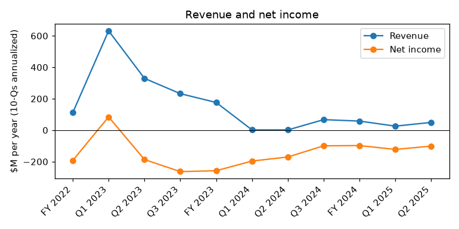
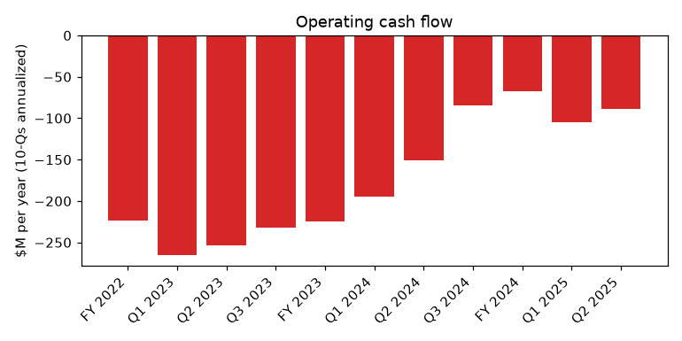
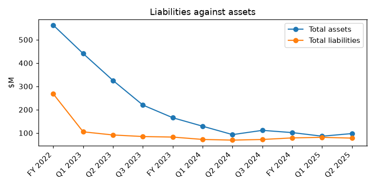

# Sangamo Therapeutics, Inc (CIK 1001233): 10-Q for the period ending 2025-06-30, filed 2025-08-07, model score 0.688

## Answer

The score comes mainly from a large annualized net loss ($101.2M, about 104% of assets) and operating cash burn of $88.6M, set against only $97.6M of assets. Liabilities are 80% of assets (peer median 46%), and the current ratio is 1.05 (peer median 3.26). The filing text is worse than the numbers: it shows going concern doubt, cash that lasts only into Q4 2025, and management exploring a bankruptcy filing.

## Verdict

- **Verdict:** real risk
- **Own risk:** high, about 30%
- **Agree with the model:** partly. The ranking is right, but the 0.5-0.7 band's 4% base rate likely understates the risk.

## The numbers

"Year before" is the prior-year column of this filing. Income and cash flow are annualized. There are 844 peers.

| Input | This report ($M) | Year before ($M) | % of assets | Peer pct. | Driver |
|---|---|---|---|---|---|
| Total assets | 97.6 | 93.0 | 100.0 | 45 | Cash $38.3M, plus new equity |
| Current assets | 49.9 | 40.1 | 51.1 | 28 | Mostly cash |
| Current liabilities | 47.7 | 39.0 | 48.9 | 81 | Almost equal to current assets |
| Total liabilities | 78.0 | 69.3 | 79.9 | 75 | No borrowings |
| Revenue | 49.5 | 1.7 | 50.7 | 62 | One-time: $18.0M Lilly upfront, final $5.0M from Pfizer |
| Net income | -101.2 | -170.4 | -103.7 | 22 | R&D; smaller loss than last year |
| Operating income | -95.0 | -177.2 | -97.3 | 25 | Mostly cash costs |
| Operating cash flow | -88.6 | -151.1 | -90.8 | 22 | Six-month burn $44.3M |

## Main reasons

1. **Bankruptcy being explored** (from the filings). This is repeated from the 10-K and the Q1 10-Q. "We have explored, and will continue to explore, whether filing for bankruptcy protection is in the best interest of our Company and our stakeholders." (10-Q, 2025-08-07, MD&A - Financial Position - Going Concern)

2. **Going concern doubt and a short runway** (from the filings). The company has about $47.2M: $38.3M of cash plus $8.9M of ATM sales since quarter end. "management believes that substantial doubt exists about the Company’s ability to continue as a going concern for a period of twelve months from the date these Condensed Consolidated Financial Statements are issued." (10-Q, 2025-08-07, Note 1 - Liquidity, Going Concern, and Capital Resources). Management says cash "will be sufficient to meet our liquidity requirements only into the fourth quarter of 2025" (10-Q, 2025-08-07, MD&A - Financial Position - Going Concern).
   *Inference:* without the one-time Lilly upfront, burn is about $12M a month. That leaves about 4 months.

3. **Large losses against a small asset base** (model input, and the model's most important one). The net loss is 103.7% of assets, at the 22nd peer percentile. "Net loss $ (19,986) $ (36,128) $ (50,583) $ (85,217)" (10-Q, 2025-08-07, Condensed Consolidated Statements of Operations)

4. **Heavy cash burn** (model input). The burn is 90.8% of assets, at the 22nd peer percentile. It is mostly real cash: stock-based compensation is only $4.8M and there is no impairment. "Net cash used in operating activities (44,307) (75,547)" (10-Q, 2025-08-07, Condensed Consolidated Statements of Cash Flows)

5. **Leveraged, illiquid balance sheet** (model input). The ratios are 0.80 for liabilities to assets and 1.05 for the current ratio, against peer medians of 0.46 and 3.26. Equity is $19.6M against a $1,554.9M accumulated deficit. "Balances at June 30, 2025 272,803,887 $ 2,728 $ 1,573,233 $ (1,554,900) $ (1,459) $ 19,602" (10-Q, 2025-08-07, Statements of Stockholders' Equity)

6. **No Fabry partner** (from the filings). Management says its ability to raise capital depends on such a deal. Pfizer, Biogen, Novartis and Kite have all left, and R&D is expected to rise. "we are engaged in business development discussions with potential counterparties concerning a commercialization agreement for our Fabry disease program, but have been unsuccessful in consummating any such transaction to date." (10-Q, 2025-08-07, MD&A - Financial Position - Going Concern)

## Evidence against

- **No debt**, so no lender can force a filing (10-Q, 2025-08-07, Note 1).
- **ATM capacity remains:** "Approximately $168.8 million remained available under the sales agreement as of June 30, 2025." (10-Q, 2025-08-07, Note 9 - At-the-Market Offering Program)
- **New money was raised:** $21.1M net from the May offering, the $18.0M Lilly upfront (up to $1.4B in milestones), and $8.9M of ATM sales after quarter end.
- **Losses narrowed** from last year, and equity rose from $4.9M to $19.6M during the quarter.
- **The runway has been extended before.** In March the company said "we expect to meet our liquidity requirements only into the middle of the second quarter of 2025." (10-K, 2025-03-17, Item 1A Risk Factors)
- **No defaults** were reported: no missed payments, forbearance, restructuring advisors or late filings.

## How it developed

- **2024-04-24:** first Nasdaq bid price deficiency
- **2024-12-30:** Pfizer ends the hemophilia A collaboration
- **2025-03-17:** 10-K shows going concern doubt, a runway into mid-Q2 2025, and bankruptcy being explored
- **2025-04-30:** second Nasdaq deficiency, with a deadline of 2025-10-27
- **2025-05-12:** Q1 10-Q shows the Lilly license, equity of $4.9M, and a runway early into Q3 2025
- **2025-06-30:** cash $38.3M and equity $19.6M after the May offering
- **2025-08-07:** Q2 10-Q shows a runway into Q4 2025, with bankruptcy still being explored

## Dates to watch and what would change my mind

- **2025-10-27:** Nasdaq compliance deadline. The filing warns "our common stock may be delisted" (see the quote below).
- **Q4 2025:** management's date for cash running out
- **Q3 2025 10-Q (around November 2025):** new runway and going concern wording
- **Any time:** a Fabry partner, new financing, or restructuring advisors being named

Nasdaq quote: "We currently do not meet, and may not regain compliance with, the listing standards of the Nasdaq Capital Market, and as a result our common stock may be delisted." (10-Q, 2025-08-07, Special Note Regarding Forward-Looking Statements)

These would lower my estimate:
- a Fabry deal with real upfront cash
- financing that lasts well into 2026
- new capsid deals or Lilly milestones
- regaining Nasdaq compliance

These would raise it:
- restructuring advisors
- no new money before Q4 2025
- delisting

## Charts

## How sure I am

Moderately sure. I could not check:
- the exact Q2 burn without the Lilly upfront (my figure is derived)
- the share price, or how much more ATM selling the market can absorb
- the remaining value of the Astellas and Genentech deals
- lease and off-balance-sheet obligations
- the status of Fabry talks and the BLA timeline

## Filings used

- 10-Q 2025-08-07
- 10-K 2025-03-17
- 10-Q 2025-05-12
- 8-K 2025-06-16
- 8-K 2025-05-06
- 8-K 2024-12-30
- 8-K 2024-06-05
- 8-K 2024-04-30