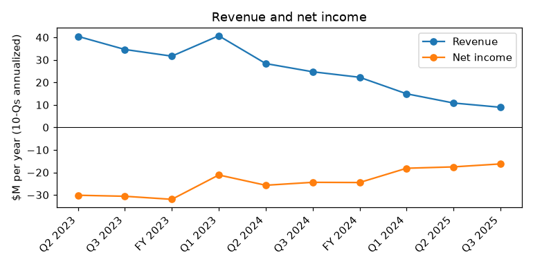
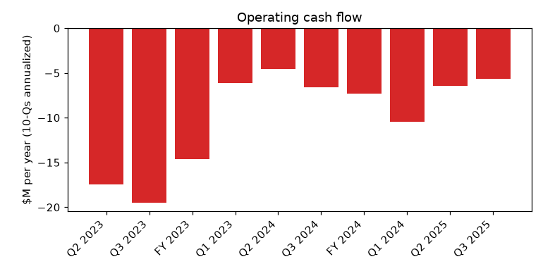
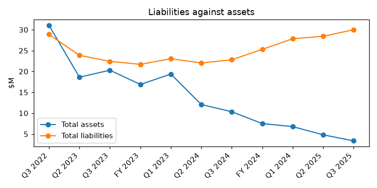

# LOOP MEDIA, INC. (CIK 1643988): 10-Q for the period ending 2025-06-30, filed 2025-08-14, model score 0.718

## Answer

The score is high because the company is small, shrinking and deeply insolvent: $30.0M of liabilities against $3.4M of assets (8.9x, peer median 0.59x), a current ratio of 0.07, and an annualized net loss of $16.2M (bottom 4% of peers). The filings confirm the distress is real: cash was $109,692, and since quarter end several lenders and creditors have declared defaults and accelerated debts this cash cannot cover.

**Verdict:** real risk. **Own risk:** very high (about 50%). **Agree with the model:** yes.

## The numbers

| Input | This report ($M) | Year before ($M) | Share of assets | Peer percentile | What drives it |
|---|---|---|---|---|---|
| Total assets | 3.4 | 10.3 | 100% | 14 | Shrinking asset base |
| Current assets | 1.8 | 6.5 | 54.8% | 58 | Little cash left |
| Current liabilities | 25.2 | 20.6 | 750% | 94 | Defaulted debt, unpaid suppliers |
| Total liabilities | 30.0 | 22.8 | 891.6% | 94 | Loans, insider notes, payables |
| Revenue (annualized) | 8.9 | 24.7 | 265.4% | 95 | Revenue collapsed |
| Net income (annualized) | -16.2 | -24.4 | -482.6% | 4 | Continuing losses |
| Operating income (annualized) | -11.9 | -21.2 | -354.2% | 5 | Costs above revenue |
| Operating cash flow (annualized) | -5.6 | -7.1 | -167.6% | 6 | Cash burn, eased by unpaid suppliers |

598 peers. Liabilities-to-assets 8.92 (peer median 0.59); current ratio 0.07 (peer median 1.42).

**Cash:** $109,692 at June 30, 2025; at $0.47M monthly burn that is 0.23 months (about one week). Non-cash charges are only 11% of the 9-month loss: net loss -$12.2M, cash-adjusted -$10.8M.

## Main reasons

1. **Liabilities far exceed assets; short-term debts cannot be met** (model input). Liabilities $30.0M vs assets $3.4M (8.92x); current liabilities $25.2M vs current assets $1.8M. Higher than 94% of peers. "These factors raise substantial doubt about our ability to continue as a going concern." (10-Q, 2025-08-14, Note 1 - Going concern)

2. **Cash is almost gone** (from the filings). $109,692, about one week of burn, against roughly $4M of accelerated non-insider claims. "approximately $0 and $490,195, respectively, of cash exceeded the FDIC insurance limits." (10-Q, 2025-08-14, Note 2 - Cash)

3. **Secured lenders are in default and accelerating** (from the filings). Agile accelerated $1,000,476 on July 21, 2025, with rights to its collateral: "the aggregate amount of one million four hundred seventy six dollars ($1,000,476), due and payable within seven days of the July 21 Notice." (8-K, 2025-07-25, Item 2.04). The all-asset May 2023 line matured unpaid ($889,000 owed); the default is uncured.

4. **Defaults are spreading** (from the filings). Bellino Trust declared default on its $2.0M, 30% note; ASCAP accelerated $1,175,000, Cara $361,800, AFG $268,035, Balboa $82,427; most equipment financings were out of covenant compliance. "We have received notices of default and acceleration letters from certain lenders related to outstanding debt obligations." (10-Q, 2025-08-14, Note 1 and Note 8)

5. **Equity funding is effectively closed** (from the filings). 1800 Diagonal demanded $286,326 at 150%: "1800 Diagonal converted $9,490 of the principal amount due into 7,014,043 shares of our common stock at a conversion price of $0.001353." (10-Q, 2025-08-14, Note 13 - Subsequent Events). The stock trades on OTC Pink.

6. **Losses are large and mostly cash** (model input). Annualized net loss -$16.2M (4th percentile); revenue $8.9M vs $24.7M; operating cash flow 6th percentile. Accounts payable rose $4,137,485 in nine months. No quote available.

## Evidence against

- The Executive Chairman took over the Bellino note: "In a private transaction on July 15, 2025, the Bellino Trust $2.0M Convertible Note was assigned to Mr. Cassidy with no changes to the terms." (10-Q, 2025-08-14, Note 13 - Subsequent Events)
- Insider entity Excel keeps funding and swapping debt for equity: "As a result, our obligations under the Excel $1.0M Note were extinguished." (10-Q, 2025-08-14, Note 8 - Excel $1.0M Line of Credit)
- It escaped a GemCap foreclosure: "all amounts, including principal and accrued interest, owing to GemCap were paid off and all of our obligations to GemCap have been extinguished" (10-Q, 2025-08-14, Note 8 - GemCap)
- Costs were cut: "operating expenses for the three months ended March 31, 2025, were $3,424,224, a decrease of $3,836,804, or 53%, from $7,261,028" (10-Q, 2025-05-15, MD&A)
- Inference: many claims are small, so a modest insider injection could cure some; small creditors may prefer workouts or repossession over a court filing.

## How it developed

- 2024-08-08: delisted from NYSE American; moves to OTC Pink.
- 2024-11-05: GemCap accelerates; settled 2024-11-27.
- 2024-12-30: auditor Marcum (going concern paragraph) dismissed.
- 2025-05-10: May 2023 secured line matures unpaid.
- 2025-06-01 to 06-20: Bellino and 1800 Diagonal defaults.
- 2025-07-08 to 08-06: ASCAP, Balboa, Cara, Agile and AFG accelerate.
- 2025-08-14: 10-Q filed with going concern doubt and uncured defaults.

## Dates to watch

- 2025-08-21: end of AFG's 15-day window on $268,035.
- Any Agile enforcement against collateral.
- 2025-09-30: fiscal year end; then the 10-K audit opinion.
- 2025-10-18: Bellino $2.0M note maturity (held by Mr. Cassidy).
- 2025-11-27: Excel $3.0M line maturity unless extended.
- Any 8-K Item 2.04, Item 1.03 bankruptcy or receivership, or secured-party sale notice.

**Would change my mind:** an insider or equity injection curing the Agile, May 2023, ASCAP and AFG defaults; written forbearance from secured lenders; insider debt converted to equity; or an out-of-court sale paying creditors. A foreclosure or involuntary petition would raise the risk.

## Charts

## Confidence

Moderate. Could not check: payments or settlements after the creditor demands; remaining Excel capacity and Mr. Cassidy's willingness to keep funding; total debt due in 12 months; cash after June 30, 2025; whether secured creditors would choose a UCC sale or repossession over a court filing.

## Filings used

10-Q 2025-08-14; 10-K 2024-12-12; 10-Q 2025-05-15; 10-Q 2025-02-04; 8-K 2025-08-12; 8-K 2025-07-25; 8-K 2025-07-21; 8-K 2025-07-14; 8-K 2025-07-01; 8-K 2025-03-31; 8-K 2025-02-26; 8-K 2025-01-03; 8-K 2024-12-30; 8-K 2024-12-23; 8-K 2024-12-10; 8-K 2024-12-04; 8-K 2024-11-27; 8-K 2024-11-12; 8-K 2024-11-04; 8-K 2024-10-24; 8-K 2024-10-18; 8-K 2024-10-04; 8-K 2024-09-05; 8-K 2024-08-30; 8-K 2024-08-21; 8-K 2024-08-09; 8-K 2024-08-01; 8-K 2024-07-18; 8-K 2024-06-03; 8-K 2024-04-24; 8-K 2024-04-03; 8-K 2024-03-19