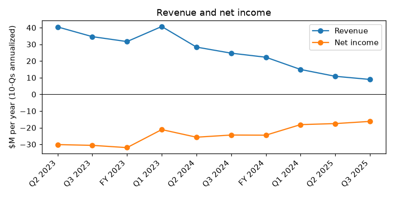
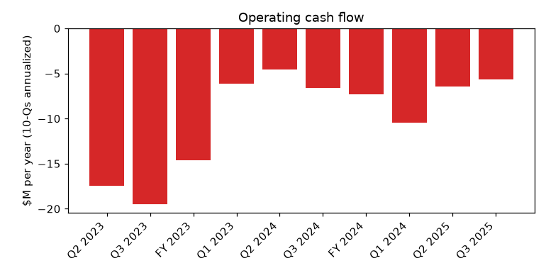
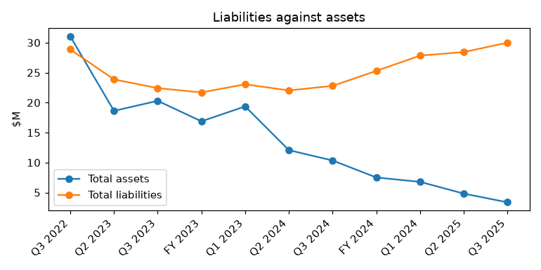

# Loop Media, Inc. (CIK 1643988): 10-Q for the period ending 2025-06-30, filed 2025-08-14, model score 0.718

## Answer
The score is high because Loop Media's liabilities are about 8.9 times its assets ($30.0M vs $3.4M), its current ratio is 0.07, and its annualized net loss of $16.2M equals about 483% of assets, all at the bad extreme of its 598 peers. The filings show real distress: between June and August 2025 at least seven creditors declared defaults or accelerated debt, and cash was likely under $250,000 against a quarterly burn of about $1M.

## Verdict
- Verdict: **real risk**
- Own risk: **very high, about 55%**
- Agree with the model: **yes**
- Reports scored above 0.7 went bankrupt 18% of the time.

## The numbers

|Input|This report ($M)|Year before ($M)|What drives it|Peer percentile|
|---|---|---|---|---|
|Total assets|3.4|10.3|Asset base shrank by two-thirds|14|
|Current assets|1.8|6.5|Cash nearly gone|58|
|Current liabilities|25.2|20.6|Debt coming due, unpaid suppliers|94|
|Total liabilities|30.0|22.8|8.92x assets (peer median 0.59)|94|
|Revenue|8.9|24.7|Revenue collapsed; high rank only because assets are tiny|95|
|Net income|-16.2|-24.4|Smaller loss, still -483% of assets|4|
|Operating income|-11.9|-21.2|Costs cut, still a deep loss|5|
|Operating cash flow|-5.6|-7.1|Burn eased partly by not paying suppliers|6|

Peers: 598. Current ratio 0.07 vs peer median 1.42. Year-before figures come from the prior-year column of this filing; income and cash flow are annualized.

## Main reasons
1. **Liabilities about nine times assets** (model input). Total liabilities $30.0M vs total assets $3.4M; liabilities/assets 8.92 vs peer median 0.59; total liabilities at the 94th percentile. No quote available. Source: 10-Q, 2025-08-14, balance sheet.
2. **Cannot meet short-term obligations** (model input). Current liabilities $25.2M vs current assets $1.8M; current ratio 0.07 vs peer median 1.42. No quote available. Source: 10-Q, 2025-08-14, balance sheet.
3. **Cash nearly gone** (model input). Annualized operating cash flow -$5.6M (6th percentile); six-month burn $3,233,491; cash was $425,646 at March 31, 2025. "approximately $0 and $490,195, respectively, of cash exceeded the FDIC insurance limits." (10-Q, 2025-08-14, Note 2 - Cash). Inference: cash under $250,000 against about $1.0M burned per quarter, so under one month of cash.
4. **Defaults and accelerations across many creditors** (from the filings). May 2023 secured line, $889,000 unpaid at May 10, 2025 maturity; Bellino Trust $2M note, June 1 payment missed; 1800 Diagonal, $286,326 demanded; Agile, $1,000,476 due within seven days; ASCAP $1,175,000; Cara Communications $361,800; Balboa $82,427; AFG $268,035. Covenants breached on several equipment financings. "We have received notices of default and acceleration letters from certain lenders related to outstanding debt obligations." (10-Q, 2025-08-14, Note 1; Note 8 - Debt)
5. **Going concern doubt** (from the filings). "These factors raise substantial doubt about our ability to continue as a going concern." (10-Q, 2025-08-14, Note 1 - Going concern)
6. **Debt due soon, no committed financing** (from the filings). Current convertible debt $2,152,668 plus related party $3,000,000; line-of-credit maturities $2,941,485 in 2025 and $6,318,046 in 2026. 1800 Diagonal converts at prices that fell from $0.01302 to $0.001353, so equity raises are effectively shut. "We have no agreements, commitments, or understandings to secure additional financing at this time" (10-K, 2024-12-12, Item 1A)

## Evidence against
- The Executive Chairman took over the defaulted Bellino note: "In a private transaction on July 15, 2025, the Bellino Trust $2.0M Convertible Note was assigned to Mr. Cassidy with no changes to the terms." (10-Q, 2025-08-14, Note 13 - Subsequent Events)
- Insider entity Excel keeps funding and converting debt to equity, and its $2.5M revolver is perpetual: "As a result, our obligations under the Excel $1.0M Note were extinguished." (10-Q, 2025-08-14, Note 8 - Excel $1.0M Line of Credit)
- New $2.0M Capital Foundry facility after surviving GemCap's 2024 foreclosure attempt: "The loan matures on February 2, 2028" (10-Q, 2025-08-14, Note 8 - Capital Foundry Revolving Line of Credit)
- Some creditors have not acted yet: "this default has not yet been cured; however, no further action has been taken against the Company with respect to the May 2023 Secured Note." (10-Q, 2025-08-14, Note 8)
- Costs were cut; about $4.0M of the nine-month loss is non-cash (10-Q, 2025-08-14, cash flows).
- Inference: many accelerated debts are small; a micro-cap may wind down or be sold outside court instead of filing.

## How it developed
- 2024-08-08: Delisted from NYSE American; OTC Pink from August 9.
- 2024-11-05: GemCap accelerates the senior loan and moves to auction company property.
- 2024-11-27: GemCap paid off ($1,644,613.41); Excel provides a $3.0M convertible line.
- 2024-12-12: 10-K: $24.5M net loss, going concern doubt.
- 2025-05-10: May 2023 secured line matures unpaid.
- 2025-06-16 to 06-20: Bellino Trust and 1800 Diagonal declare defaults.
- 2025-07-08 to 08-06: ASCAP, Balboa, Cara Communications, Agile and AFG accelerate; Bellino note assigned to Mr. Cassidy (July 15).
- 2025-08-14: This 10-Q, with going concern doubt.

## Dates to watch
- 2025-08-21: AFG 15-day deadline on $268,035.
- Late July 2025 onward: any Agile collateral enforcement.
- Any creditor lawsuit or judgment.
- 2025-09-30: deferred board cash compensation due; fiscal year end.
- 2025-10-23: Agile $800,000 loan matures.
- Around 2025-10-18: Bellino $2M note maturity (now held by Mr. Cassidy).
- Around 2025-11-27: Excel $3.0M line maturity.
- Around December 2025: FY2025 10-K, any NT 10-K or 8-K Item 1.03.

## What would change my mind
- Lower risk: insiders buying out or restructuring the Agile, May 2023 and ASCAP debts; forbearance deals; a sale or merger that pays creditors; a sizeable outside raise.
- Higher risk: a secured lender seizing collateral, a judgment lien or an 8-K Item 1.03.
- An out-of-court wind-down would mean no formal bankruptcy despite the distress.

## Charts

## How sure I am
Moderate. I could not check:
- the exact June 30, 2025 cash balance or June-quarter burn;
- whether Agile seized collateral or any creditor sued;
- how much of the Excel $3.0M line is undrawn, and whether Mr. Cassidy keeps funding;
- total past-due payables and royalties;
- whether the Capital Foundry revolver is cross-defaulted.

## Filings used
10-Q 2025-08-14; 10-K 2024-12-12; 10-Q 2025-05-15; 10-Q 2025-02-04; 8-K 2025-08-12; 8-K 2025-07-25; 8-K 2025-07-21; 8-K 2025-07-14; 8-K 2025-07-01; 8-K 2025-03-31; 8-K 2025-02-26; 8-K 2025-01-03; 8-K 2024-12-30; 8-K 2024-12-23; 8-K 2024-12-10; 8-K 2024-12-04; 8-K 2024-11-27; 8-K 2024-11-12; 8-K 2024-11-04; 8-K 2024-10-24; 8-K 2024-10-18; 8-K 2024-10-04; 8-K 2024-09-05; 8-K 2024-08-30; 8-K 2024-08-21; 8-K 2024-08-09; 8-K 2024-08-01; 8-K 2024-07-18; 8-K 2024-06-03; 8-K 2024-04-24; 8-K 2024-04-03; 8-K 2024-03-19