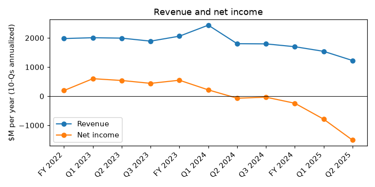
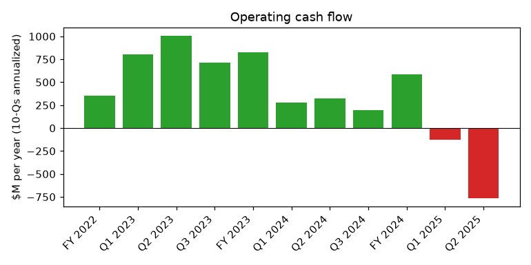
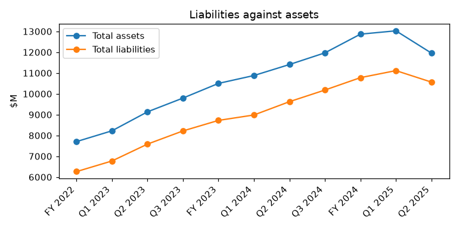

# NEW FORTRESS ENERGY INC. (CIK 1749723) – 10-Q for period ending 2025-06-30, filed 2025-09-05, model score 0.636

## Answer

The score of 0.636 comes from a large annualized net loss (-$1,508M, -12.6% of assets), negative operating income and cash flow, falling revenue and liabilities at 88% of assets, all near the worst of 147 peers. The filings show distress worse than the 0.5-0.7 band suggests: going concern doubt, a missed guarantee deadline, an expected covenant breach, a fully drawn revolver and a strategic alternatives process.

## Verdict

- **Verdict:** real risk
- **Own risk:** very high, about 45%
- **Agree with the model:** partly; if anything the score understates the risk.

## The 8 numbers

Year before: prior-year column of this filing; income and cash flow annualized.

| Input | This report ($M) | Year before ($M) | What drives it | Peer percentile (of 147) |
|---|---|---|---|---|
| Total assets | 11,957.3 | 11,408.4 | Little changed | 55 |
| Current assets | 1,482.5 | 1,124.3 | Includes $551.1M unrestricted cash | 72 |
| Current liabilities | 2,201.3 | 1,564.8 | Rising; most debt still long-term | 86 |
| Total liabilities | 10,564.0 | 9,623.3 | About $9.4B debt principal | 92 |
| Revenue | 1,224.2 | 1,801.5 | Jamaica sale, end of Puerto Rico power project | 9 |
| Net income | -1,508.4 | -60.4 | $699M Q2 impairments, $473M Jamaica gain, doubled interest | 12 |
| Operating income | -811.6 | 457.7 | Q2 segment margin $25.0M vs $158.4M | 11 |
| Operating cash flow | -768.3 | 325.9 | Q2 burn about $352.5M | 9 |

Liabilities/assets 0.88 (peer median 0.67); current ratio 0.67 (peer median 0.86).

## Main reasons

1. **Going concern doubt** (from the filings), reversing the 10-K. "management has concluded that, the Company’s current liquidity and forecasted cash flows from operations are not probable to be sufficient to support, in full, its obligations as they become due" (10-Q, 2025-09-05, Note 2. Basis of presentation)

2. **Missed PortoCem guarantee** (from the filings). The $79.1M guarantee was due August 17, 2025; cross-acceleration could make substantially all debt (about $9.4B principal vs $551M cash) payable. "this guarantee was not provided by the deadline, and as a result, a majority of debenture holders have the right to call for a meeting of holders and declare an event of early maturity." (10-Q, 2025-09-05, Note 2 / Debt note - PortoCem Debentures)

3. **Expected covenant breach** (from the filings) for the quarter ending September 30, 2025, after a Q2 covenant holiday. "the Company does not expect to be in compliance with the consolidated first lien ratio or the fixed charge coverage ratio included within the Revolving Facility, Letter of Credit Facility and Term Loan A Credit Agreement" (10-Q, 2025-09-05, Note 2 / Debt note)

4. **No committed liquidity left** (from the filings). TLA commitments are zero. "including the outstanding letters of credit, the Company has fully utilized the borrowing capacity of $729,933 as of June 30, 2025." (10-Q, 2025-09-05, Debt note - Revolving Facility). *Inference:* at the Q2 burn rate, unrestricted cash lasts about 4.7 months.

5. **Losses and cash burn** (model input). Operating income -$811.6M vs +$457.7M; operating cash flow -$768.3M vs +$325.9M; 11th and 9th percentile. "In the first and second quarters of 2025, the Company recognized operating losses and negative operating cash flows, and this decline in earnings accelerated in the second quarter of 2025." (10-Q, 2025-09-05, Note 2. Basis of presentation)

6. **Restructuring signals** (from the filings). Debt fair value $5,785M vs $9,088M at year-end 2024. "The Company has also initiated a process to evaluate strategic alternatives and has retained a financial advisor to assist in this evaluation." (10-Q, 2025-09-05, Note 2 / MD&A Liquidity). *Inference:* a common step before court-supervised restructuring.

## Evidence against

- Much of the Q2 loss is non-cash impairment, though the goodwill impairment reflects a higher company risk premium (10-Q, 2025-09-05, MD&A).
- Jamaica sale closed for $1.055B: "the Company received net proceeds of approximately $678,480, with an additional $98,635 of proceeds held in escrow." (10-Q, 2025-09-05, Note 4. Dispositions)
- Lenders keep granting waivers, extensions and new money. *Inference:* creditors prefer an out-of-court workout.
- Possible cash outside the forecast: Puerto Rico claims, escrow, and "realization of up to $110.0 million in proceeds from the modification of Genera’s Operation and Maintenance Agreement" (10-Q, 2025-09-05, MD&A Liquidity and Capital Resources)
- No acceleration declared at filing; PortoCem downgrade trigger suspended through August 30, 2026.
- About $387.25M equity raised in October 2024 (8-K, 2024-10-02).

## How it developed

- **2024-09-30:** only about $80M of cash and liquidity estimated.
- **2024-11-27:** refinancing into 12.000% New 2029 Notes with springing maturity.
- **2025-03-10:** 10-K; going concern doubt judged alleviated.
- **2025-05-14:** Jamaica sale closed.
- **2025-05-15:** GMLP preferred dividend not paid.
- **2025-06-30:** late Q1 10-Q with going concern doubt.
- **2025-08-17:** $79.1M PortoCem guarantee missed.
- **2025-09-05:** Q2 10-Q: expected Q3 breach, financial advisor hired.

## Dates to watch

- 2025-09-12: PREPA gas supply agreement expiry
- 2025-09-30: covenant test expected to fail
- Any PortoCem holder meeting declaring early maturity
- 2025-11-14: LC facility maturity
- 2026-02-16: Nasdaq compliance deadline
- About 2026-07-01: springing maturity on $2.73B New 2029 Notes, Revolver and Term Loans if 2026 Notes remain

## What would change my mind

- Lower risk: waivers and covenant resets; a refinancing retiring the 2026 Notes; large inflows from Puerto Rico claims, Genera or asset sales; a long-term PREPA deal.
- Higher risk: an early maturity or acceleration declaration, a missed coupon, or a restructuring support agreement.

## Charts

## How sure I am

Moderate. Could not check: whether PortoCem holders declared early maturity; bank waiver talks; exact Q2 standalone cash flows; usable restricted cash; interest payment dates; each input's contribution to the score.

## Filings used

10-Q 2025-09-05; 10-K 2025-03-10; 10-Q 2025-06-30; 8-K 2025-08-22; 8-K 2025-08-14; NT 10-Q 2025-08-12; 8-K 2025-05-27; 8-K 2025-05-21; NT 10-Q 2025-05-13; 8-K 2025-05-12; 8-K 2025-03-27; 8-K 2025-03-07; NT 10-K 2025-03-04; 8-K 2025-02-06; 8-K 2025-01-03; 8-K 2024-12-11; 8-K 2024-11-27; 8-K 2024-11-15; 8-K 2024-11-07; 8-K 2024-10-24; 8-K 2024-10-02; 8-K 2024-10-01; 8-K 2024-09-30; 8-K 2024-09-06; 8-K 2024-07-25; 8-K 2024-03-25; 8-K 2024-03-08